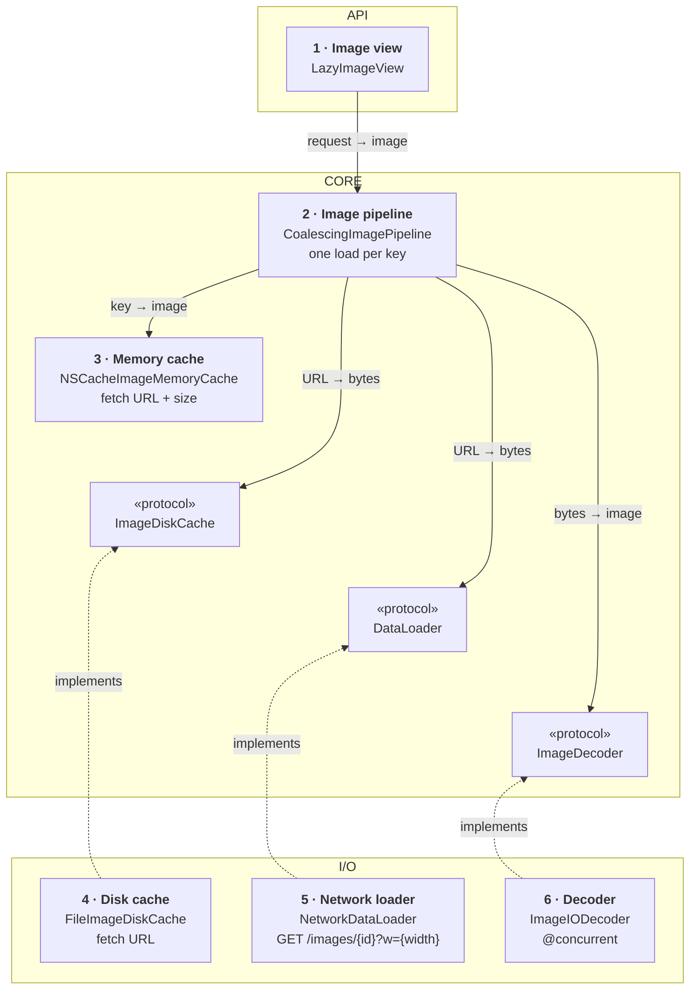
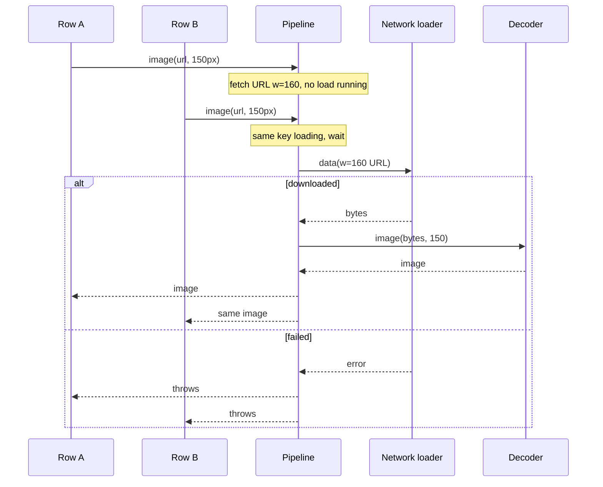
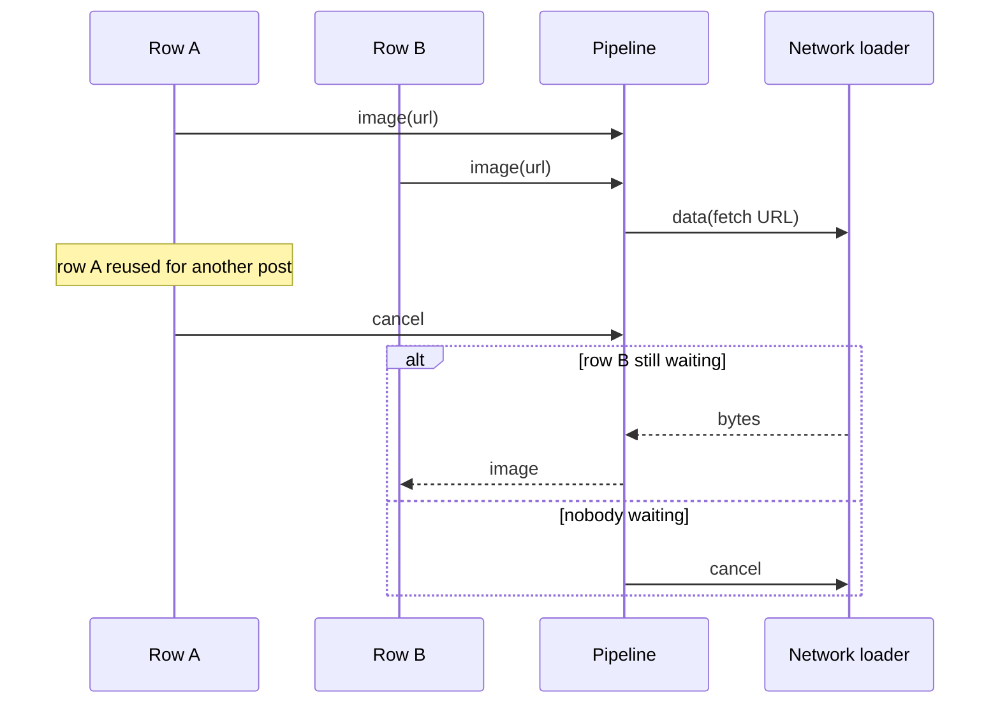

*A recurring senior mobile prompt. The answer stays small: six cards, two keys said the same way everywhere, one download per picture, decoding off the main thread.*

> **Interviewer:** "We show a lot of images — feeds, avatars, a photo grid. Design the image loading library we'd build for that. Something like Kingfisher or Nuke."

## Run it as a round, not as reading

Set a timer. Sketch. Talk the whole time. Open a section only when its slot is over.

| Clock | Phase | What you do |
|---|---|---|
| 0:00–0:02 | The prompt | Repeat it back in one sentence |
| 0:02–0:07 | Clarify | Ask yours, then read section 1 |
| 0:07–0:12 | Scope | Out of scope first, then required, then later |
| 0:12–0:24 | High level | The idea · the parts · the sketch · one line each · two flows |
| 0:24–0:40 | Deep dives | The interviewer picks one of sections 9–11 |
| 0:40–0:45 | Recap | Follow-ups, then the 60-second summary |

## What this question is really testing

- **The cost of a decoded image:** width × height × 4 bytes, whatever the file size.
- **Cache keys that are true.** The CDN sends different bytes per width, so the key names the width.
- **One download for two rows** that want the same picture, and cancelling without killing a download another row still needs.
- **Decoding off the main thread**, at the size shown, so scrolling never waits.
- **Knowing when to stop.** `AsyncImage`, `URLCache` and `NSCache` are fine for a small app. Say when.

**Traps:** designing the CDN; a cache with no byte limit; "bytes are the same at every size" when the CDN resizes; decoding on the main thread or inside the pipeline actor; calling prefetching a guarantee; "the app's memory stays flat".

::: Words used in this chapter
- **Repository** — the one owner of one kind of data. It turns the server's format into the app's model.
- **Composite** — a repository that only reads: it asks two repositories and combines their answers into one model.
- **Store** — in-memory state that several screens show at once. Here, the memory cache.
- **Use case** — one user intent with a product rule, like "only the latest tap counts".
- **View model** — the screen's brain. It owns the screen's state and hands the screen one view state.
- **Decode, downsample** — decoding unpacks a JPEG into pixels; downsampling decodes straight to a smaller size, so the big version never exists.
- **Width bucket** — one of a few widths the CDN serves (160, 320, 640, 1280), so nearby sizes share one file.
- **Fetch URL** — the picture's URL plus its bucket. The disk cache and downloads use it as their key.
- **Image key** — the fetch URL plus the pixel size it was decoded at. The memory cache uses it.
- **Actor** — a Swift object that runs one piece of its code at a time.
- **Coalesce** — when two callers want the same thing, do the work once and give both the result.
:::

::: 1 · The interviewer answers your clarifying questions
**"One app, or an SDK other teams adopt?"** → *One app, shaped so it could become a package.*

**"Where do images come from?"** → *The network. Skip bundled assets.*

**"Who calls it?"** → *SwiftUI views, some UIKit image views, and sometimes code that wants an image to share.*

**"Heaviest screen?"** → *A thumbnail grid you can fling through, and a full-screen view when you tap one.*

**"Can the server resize?"** → *Yes. The CDN takes `?w=` and sends `ETag` and `Cache-Control`.*

**"Offline?"** → *Pictures the user has seen should still show.*

**"Public or private images?"** → *Public for now. Profile photos may go private later.*

**"How big?"** → *Ten million users a day, about 200 pictures each. A grid shows about 30 at once.*

**"Minimum OS?"** → *iOS 17, SwiftUI, Swift 6.*

**"What hurts today?"** → *Stutter on older phones, and the app gets killed for using too much memory.*
:::

::: 2 · Requirements and scope — what you should have said
**Out of scope, said first:** GIFs and video, filters and editing, placeholder animations (the caller owns those), bundled and file sources, and the server beyond "a CDN with a width parameter".

**Required for the prompt**

1. Load a picture by URL, at the size it will be shown, into a view or back to a caller.
2. Cache in memory, and on disk so seen pictures show offline.
3. One download per picture and width, even when two rows ask.
4. Cancel when no row needs the picture any more.

**What must feel good:** smooth (no decoding or disk work on the main thread) · bounded *cache* memory · no repeat download · no wrong picture in a reused row.

**Production considerations** (say, don't draw): prefetching, visible-first priority, freshness from the CDN's headers, metrics, private URLs. See sections 10–12.

**Optional follow-ups** (add only when asked):

```text
No offline need                → URLCache instead of our disk cache
Private images                 → auth in the loader, a protected folder
Another source (files, Photos) → a new data loader
GIFs, filters                  → a decoder per format, a processing step
Other teams adopt it           → a Swift package with a small public API
```

*"I'll start simple and add each of these when the requirement appears."*
:::

::: 3 · The idea, in 30 seconds — before you draw anything
> *"A view asks for a picture by URL and by its size in pixels. One pipeline turns that into a fetch URL, the picture plus the smallest CDN width bucket that covers it, `GET /images/{id}?w={width}`. It checks a memory cache keyed by fetch URL plus pixel size, then a disk cache keyed by the fetch URL, then downloads. If another row is already loading the same thing, it joins that load. A decoder shrinks the bytes to the pixel size off every actor, and the result goes into memory. It's a library, so three frames: the API callers touch, the core that coordinates, and the I/O that does the work."*
:::

::: 4 · What we need — the components, before the sketch
| # | Part | Type | Layer | Its one job |
|---|---|---|---|---|
| 1 | **Image view** | `LazyImageView` | API | Shows one picture in one view; cancels on reuse. |
| 2 | **Image pipeline** | `CoalescingImagePipeline` | Core | Memory → disk → network → decode, one load per key. |
| 3 | **Memory cache** | `NSCacheImageMemoryCache` | Core | Decoded pictures by image key, within a byte budget. |
| 4 | **Disk cache** | `FileImageDiskCache` | I/O | Compressed bytes by fetch URL, with a size cap. |
| 5 | **Network loader** | `NetworkDataLoader` | I/O | `GET /images/{id}?w={width}` → bytes. |
| 6 | **Decoder** | `ImageIODecoder` | I/O | Bytes → a picture at the pixel size. |
| chip | **Disk cache** | `ImageDiskCache` | Core | The promise card 4 keeps. |
| chip | **Data loader** | `DataLoader` | Core | The promise card 5 keeps. |
| chip | **Decoder** | `ImageDecoder` | Core | The promise card 6 keeps. |

Six cards, three chips.

**A library's roles**, with their app twins: the **pipeline** coordinates, the **memory cache** is a store of pixels, the **disk cache** a database of bytes, the **loader** a client, the **decoder** a platform adapter. No repository, composite or use case: no app model, no product intent.

**Not drawn:** `ImageURLBuilder`, a pure helper with its own protocol that the pipeline is given (it changes with the CDN, not with the pipeline's rules). **Not on the list yet:** a file loader, a disk index in SQLite, auth headers, processing, metrics.
:::

::: 5 · The sketch


**How to read it.** A solid arrow points from the asker to the answerer: *request → reply*. Dashed arrows mean *implements*. On a miss the pipeline asks memory, then disk, then the network, then the decoder.

**Dependency inversion, in one line.** The core writes the three promises (the chips); I/O keeps them, so every dashed arrow points **up** and the core never imports networking, the file system or ImageIO.

**One owner per source.** Memory, disk and network each have one card. The pipeline only decides the order to ask.

**No separate store:** the memory cache already is the one place every screen's pictures live.

**On Miro:** three frames (blue, purple, green), six cards, three chips, five solid arrows. Point at card 2: *"this is where two rows share one download."*
:::

::: 6 · Each component: its job, its interface, the choice inside it
**The values everyone passes.** Two keys, said the same way everywhere.

```swift
struct PixelSize: Hashable, Sendable { let width, height: Int }

/// What a caller asks for. Equality is URL + size only.
struct ImageRequest: Hashable, Sendable {
    /// The picture, without a width. The pipeline adds the bucket.
    let url: URL
    /// Points × screen scale, worked out by the view
    let pixelSize: PixelSize
}

/// Not part of the request, so a prefetch and a visible row match
enum ImagePriority: Sendable { case visible, prefetch }

/// The memory cache's key, and the decode's
struct ImageKey: Hashable, Sendable {
    /// url + "?w=" bucket: the disk cache's and the download's key
    let fetchURL: URL
    let pixelSize: PixelSize
}
```

### 1 · Image view (`LazyImageView`)

**Job:** the one line a screen writes to show a picture. It turns points into pixels and drops results for an old request.

**Interface:**

```swift
struct LazyImageView: View {
    /// Reads the pipeline and displayScale from the environment
    init(url: URL, size: CGSize)
}

extension UIImageView {
    /// nil cancels and clears
    @MainActor func setImage(url: URL?, pipeline: ImagePipeline)
}
```

**Choices:**

- **It asks the memory cache synchronously first**, so a cached picture shows in the same frame, with no flicker.
- **It keeps its current request as a token** and sets a result only if it still matches. Cancellation is cooperative, so a late result for the old row can still arrive; this check is the stale-result guard.
- **SwiftUI:** `.task(id: request)` starts the load on appear and cancels it on disappear or a new request.

### 2 · Image pipeline (`CoalescingImagePipeline`)

**Job:** every request goes through it. It picks the fetch URL, checks memory, joins a load already running, or runs one: disk, then network, then decode.

```swift
protocol ImagePipeline: Sendable {
    /// Memory only. Synchronous, safe on the main thread.
    func cachedImage(for request: ImageRequest) -> UIImage?
    /// Throws the load's error, or CancellationError when this
    /// caller's task is cancelled. Others waiting keep the load.
    func image(for request: ImageRequest,
               priority: ImagePriority) async throws -> UIImage
    /// Best effort. Correctness never depends on it.
    func prefetch(_ requests: [ImageRequest])
    func cancelPrefetch(_ requests: [ImageRequest])
}

actor CoalescingImagePipeline: ImagePipeline {
    init(memory: ImageMemoryCache, disk: ImageDiskCache,
         loader: DataLoader, decoder: ImageDecoder,
         urls: ImageURLBuilder)
}

/// Not drawn. Pure: the smallest bucket ≥ the pixel width.
protocol ImageURLBuilder: Sendable {
    func fetchURL(for request: ImageRequest) -> URL
}
```

**Choices:**

- **The actor keeps only the in-flight tables:** downloads by fetch URL, decodes by image key, each with a count of who waits. `cachedImage`, `prefetch` and `cancelPrefetch` are `nonisolated`; the first reads the memory cache, which is thread-safe on its own.
- **The bucket has one owner:** the pipeline asks its URL builder, first, before any cache. The view knows pixels, the loader knows URLs, and nobody else picks a width.
- **It never decodes itself.** The decoder runs off the actor, at most one decode per CPU core, so a fling doesn't start sixty.

### 3 · Memory cache (`NSCacheImageMemoryCache`)

**Job:** keeps decoded pictures ready to draw, by image key, within a byte budget.

```swift
protocol ImageMemoryCache: Sendable {
    /// Synchronous and thread-safe. nil = not in memory.
    func image(for key: ImageKey) -> UIImage?
    /// Cost = bytes per row × pixel height
    func store(_ image: UIImage, for key: ImageKey)
    func removeAll()
}

final class NSCacheImageMemoryCache: ImageMemoryCache {
    init(byteLimit: Int)
}
```

**Choices:**

- **A byte budget, not an item count.** One full-screen picture costs as much as a hundred thumbnails. `NSCache` with `totalCostLimit`, each picture's bytes as the cost in `setObject(_:forKey:cost:)`.
- **Emptied on `didReceiveMemoryWarningNotification`.** This bounds the *cache*; the app's total memory still moves with everything else.
- *Switch to* a small LRU for a predictable eviction order.

### 4 · Disk cache (`FileImageDiskCache`)

**Job:** keeps downloaded files, still compressed, by fetch URL, so seen pictures show offline.

```swift
struct CachedData: Sendable {
    let data: Data
    let etag: String?
    /// From Cache-Control max-age
    let freshUntil: Date
}

protocol ImageDiskCache: Sendable {
    /// nil = a miss. A corrupt file is deleted and reads as a miss.
    func data(for fetchURL: URL) async -> CachedData?
    /// Atomic: a temporary file, then a rename. Never throws.
    func store(_ entry: CachedData, for fetchURL: URL) async
    /// Oldest first, off the launch path
    func trim(toBytes limit: Int) async
}

actor FileImageDiskCache: ImageDiskCache {
    init(directory: URL, files: FileManager)
}
```

**Choices:**

- **Keyed by the fetch URL, bucket included.** The CDN sends different bytes for `w=160` and `w=640`, so they are two files. Nearby display sizes share a bucket, so they share a file.
- **In `Library/Caches`, with a size cap.** The system may clear it; that's fine for a cache.
- **The headers decide freshness, we decide retention** (deep dive 11).

### 5 · Network loader (`NetworkDataLoader`)

**Job:** downloads a fetch URL from the CDN. It knows nothing about sizes or caches.

```swift
enum LoadedData: Sendable {
    case new(CachedData)
    /// 304: the copy on disk is still right, fresh until this date
    case notModified(freshUntil: Date)
}

protocol DataLoader: Sendable {
    /// Throws on a bad status, a short body or cancel.
    /// Cancelling the caller cancels the download.
    func data(for fetchURL: URL, ifNoneMatch etag: String?,
              priority: ImagePriority) async throws -> LoadedData
}

final class NetworkDataLoader: DataLoader {
    init(visible: URLSession, prefetch: URLSession)
}
```

**Choices:**

- **Visible first.** It sets `URLSessionTask.priority` high for visible rows and low for prefetches. Priority is a hint; the real lever is cancelling prefetches the user flung past.
- **Prefetches use their own session** with `allowsConstrainedNetworkAccess = false`, so they don't run in Low Data Mode.
- **The protocol earns a fake** that holds its reply (to test sharing and cancelling) and new sources as new conformances.

### 6 · Decoder (`ImageIODecoder`)

**Job:** turns compressed bytes into a picture at the pixel size, off every actor.

```swift
protocol ImageDecoder: Sendable {
    /// Throws if the bytes aren't an image. Checks cancellation first.
    func image(from data: Data, maxPixelSize: Int) async throws -> UIImage
}

struct ImageIODecoder: ImageDecoder {
    /// Runs on the global pool, not the pipeline actor
    @concurrent func image(from data: Data,
                           maxPixelSize: Int) async throws -> UIImage
}
```

**Choices:**

- **`@concurrent`, because of Swift 6.2.** Under SE-0461 a plain `nonisolated async` function runs on its caller's actor, so a decode would block the pipeline.
- **Downsample while decoding:** `CGImageSourceCreateThumbnailAtIndex` with `kCGImageSourceThumbnailMaxPixelSize`, so the full bitmap never exists, and `kCGImageSourceShouldCacheImmediately`, so the first draw doesn't decode on the main thread.

**Why these parts, and no more.** Each card changes for one reason:

| Card | Changes when |
|---|---|
| 1 · Image view | a platform API (SwiftUI, UIKit) |
| 2 · Image pipeline | a product rule (order, sharing, cancelling) |
| 3 · Memory cache | what several screens share (the pixel budget) |
| 4 · Disk cache | a storage schema (files, retention) |
| 5 · Network loader | an endpoint or payload (the CDN's HTTP) |
| 6 · Decoder | a platform API (ImageIO) |
| not drawn · URL builder | an endpoint or payload (the `?w=` buckets) |

Each protocol earns a fake or a new conformance. Not added: a use case or repository (no app rules, no app model), a processor chain, a generic cache, a DI container. Constructor injection is enough.
:::

::: 7 · Key flows through the sketch
**Flow 1 — two rows want the same avatar.** Memory and disk both miss.



One download and one decode serve both rows. Bytes go to disk under the fetch URL, the picture to memory under the image key.

**Flow 2 — a row is reused before its picture arrives.**



Cancelling takes the row off the waiting list. The download stops only when the last caller leaves. A late result for row A is dropped by its view's token check.
:::

::: 8 · The server contract
```
GET  /v1/images/{id}?w={160|320|640|1280}
     → 200  image/jpeg
            Cache-Control: max-age=86400
            ETag: "a1b2"

GET  /v1/images/{id}?w=640   If-None-Match: "a1b2"
     → 304  (no body: keep the copy on disk)
```

- **Width buckets**, so the phone downloads 640 pixels, not a 4000-pixel original, and nearby sizes share one CDN copy and one disk file.
- **`Cache-Control` says how long a copy is fresh; `ETag` checks a stale one cheaply.** A 304 sends no bytes.
- **Pictures are shared, so the CDN caches them hard.** Private ones would need signed URLs (section 12).
:::

::: 9 · Deep dive — "Two cells show the same avatar. Walk me through it."
**Decision:** the pipeline actor keeps two in-flight tables. Downloads are keyed by fetch URL, decodes by image key. Each entry holds the running task and how many callers wait on it.

1. **Check memory.** A hit returns at once.
2. **If a decode for this image key is running, join it.** Add one to its count and await the same task.
3. **Otherwise, put a new entry in the table straight away**, before any `await`. Its task reads disk, joins or starts the download for the fetch URL, then decodes.
4. **When a caller cancels, take one off the count.** That caller gets `CancellationError`. Cancel the task only at zero. Remove the entry when it finishes, success or failure.

**Why "straight away".** An actor lets other callers in at every `await`, so two callers could both find nothing and both download.

**Why two tables.** A 150-pixel and a 160-pixel request share the `w=160` bucket but decode to two sizes. Keying downloads by fetch URL gives them one download and two decodes.

*Rejected:* cancel the shared load when any caller cancels. Row A scrolls away and kills the download row B still needs.
:::

::: 10 · Deep dive — "This grid gets the app killed on an older iPhone. Why?"
**The fact:** a decoded picture costs width × height × 4 bytes. A 4032 × 3024 photo is a 2 MB JPEG but about 49 MB decoded. Twenty of those is the kill.

**Decision:** download a bucket near the display size, and decode straight to the display size, off the main thread.

1. The view works out the size in **pixels**: points × screen scale.
2. The pipeline's URL builder picks the smallest bucket that covers that width.
3. The decoder makes a thumbnail at the pixel size from the compressed bytes. The full-size bitmap never exists.
4. The memory cache counts each picture's bytes against its budget. A memory warning empties it; visible rows ask again.

*Rejected:* decode full size, then redraw smaller. Peak memory is still the full picture.

**Prefetching is an optimization, not correctness.** UIKit's `UICollectionViewDataSourcePrefetching` calls `prefetch` and `cancelPrefetch`, but its callbacks aren't guaranteed, so each row still loads its own picture. SwiftUI has none: start on appear, cancel on disappear.
:::

::: 11 · Deep dive — "Why not just use URLCache?"
**Decision:** own a disk cache of compressed bytes, keyed by fetch URL, with a size cap.

1. **Compressed, not decoded.** Bytes are 10–50 times smaller, and decoding is cheap next to downloading.
2. **Safe writes.** A temporary file, then a rename, so a crash can't leave a half-written file under the real name.
3. **Oldest out first**, from a small index of size and last use, trimmed off the launch path.
4. **Freshness from the headers.** Within `max-age`, use the copy. Past it, show the copy at once and revalidate in the background with `If-None-Match`. Offline, keep showing it.

*Rejected:* `URLCache` alone. With the default policy a copy past `max-age` needs the network to revalidate, and you don't choose what it evicts. *Switch to it* if offline doesn't matter: it's free and already honours the headers.
:::

::: 12 · Failure modes, production and scale
**Failures**

| Failure | Client behaviour |
|---|---|
| Offline | Disk hits show, even if stale; misses fail fast to a placeholder |
| Download fails | One retry for timeouts and 5xx, none for 4xx; remember a 404 briefly |
| 429 from the CDN | Honour `Retry-After`; drop prefetches first |
| Corrupt file | Delete it, download once more, then placeholder |
| Memory warning | Empty the memory cache; visible rows ask again |
| Late result into a reused row | Dropped by the request token |
| Signed URL expired | Ask the app for a fresh URL, retry once |
| Killed mid-write | The temporary file is never renamed; the old copy stays |

**Production notes** (short, not on the board)

- **Networking:** a timeout per request; safe retries with backoff; cancel what no row needs.
- **Metrics:** memory and disk hit rate, load time, decode time, memory warnings, failures by status. No URLs in logs if images are private.
- **Security:** HTTPS only. Private images: see the bank.

**Scale, back of the envelope**, with the interviewer's numbers:

```text
pictures on screen × pixels each × 4 bytes   = memory for one screen
users a day × pictures each × bytes each     = CDN bandwidth
```

30 thumbnails × 400 × 400 × 4 bytes is about 19 MB a screen, so a budget of a few screens is 50–100 MB. The same 30 at 12 megapixels would be 1.5 GB. 10M × 200 × 40 KB is about 80 TB a day: buckets and hit rate move the cost, not the client architecture.

**Grow only when asked**

```text
One screen, few pictures  → AsyncImage, or URLCache + NSCache
A fling grid              → this pipeline: coalesce, cancel, downsample
Offline past max-age      → our own disk cache
Bigger disk cache         → its index in SQLite
Private images            → auth in the loader, a protected folder
Another source            → a new DataLoader conformance
```
:::

::: 13 · Question bank — everything they can push on
Answer out loud first, then open.

### Scope and architecture

<details>
<summary>"Walk me through the layers."</summary>

API: the view helpers. Core: the pipeline, the memory cache and the three promises. I/O: disk cache, network loader, decoder.
</details>

<details>
<summary>"Where's the use case? The repository?"</summary>

There are none. A library has no user intent with a product rule and no app model; its roles are pipeline, cache, loader and decoder.
</details>

<details>
<summary>"Show me dependency inversion."</summary>

The core writes `ImageDiskCache`, `DataLoader` and `ImageDecoder`; I/O implements them. The arrows point up, so the core imports no networking, files or ImageIO.
</details>

<details>
<summary>"Where does mapping happen?"</summary>

A request becomes a fetch URL in the URL builder; bytes become a picture only in the decoder. Caches and loader never convert anything.
</details>

<details>
<summary>"Where does shared state come from? A composite, a store?"</summary>

Neither. The memory cache is the one shared place for pictures, and the pipeline's tables are its own bookkeeping.
</details>

<details>
<summary>"Why six parts and not one ImageManager?"</summary>

Each changes for one reason: the view with UIKit or SwiftUI, the pipeline with its rules, the caches with retention, the loader with HTTP, the decoder with ImageIO.
</details>

<details>
<summary>"When is AsyncImage enough?"</summary>

One screen, few pictures, no offline need. It has no memory cache we control and no downsampling.
</details>

### Caching and keys

<details>
<summary>"What's the disk cache key?"</summary>

The fetch URL, bucket included. The CDN sends different bytes for each width, so each width is its own file.
</details>

<details>
<summary>"And the memory key?"</summary>

The fetch URL plus the pixel size, because a picture decoded for 150 pixels isn't the one for 160.
</details>

<details>
<summary>"Who picks the width bucket?"</summary>

The pipeline, through its URL builder, before any cache lookup. The view only knows pixels, the loader only knows URLs.
</details>

<details>
<summary>"Why not store decoded pictures on disk?"</summary>

They're 10–50 times bigger, and decoding is cheap next to the disk space.
</details>

<details>
<summary>"Does the app's memory stay flat while scrolling?"</summary>

No. The image cache is bounded and empties on a memory warning, so image memory doesn't grow with scroll depth. Total app memory still moves.
</details>

<details>
<summary>Follow-up chain: "Revalidation."</summary>

1. *"The picture on the server changed."* → The disk copy has an `ETag`.
2. *"When do you check?"* → Past `max-age`, in the background.
3. *"What does the user see meanwhile?"* → The old copy, at once.
4. *"And if it's unchanged?"* → A 304 with no body; mark the copy fresh.
</details>

### Concurrency and cancellation

<details>
<summary>"Why is the pipeline an actor?"</summary>

Its in-flight tables are changed by many callers. The actor makes sure one changes them at a time.
</details>

<details>
<summary>"Then how is cachedImage synchronous?"</summary>

It's `nonisolated` and reads the memory cache, which is thread-safe on its own. The actor guards only the in-flight tables.
</details>

<details>
<summary>"An async function runs off the main thread, right?"</summary>

Not always. Under SE-0461 a plain `nonisolated async` function runs on its caller's actor, so the decoder is marked `@concurrent`.
</details>

<details>
<summary>"A fling starts sixty decodes. Fine?"</summary>

No. The pipeline lets one decode per CPU core run, and cancelled rows leave the queue before they decode.
</details>

<details>
<summary>"A prefetch is running and the row becomes visible."</summary>

Priority isn't part of the request, so the visible row joins the same load. Swift raises the awaited task's priority.
</details>

<details>
<summary>Follow-up chain: "The wrong picture flashes."</summary>

1. *"A reused row shows the old picture for a moment."* → The old result arrived after cancel.
2. *"Why, if you cancelled?"* → Cancellation only sets a flag; work stops at its next check.
3. *"Fix?"* → The view keeps a request token and sets a result only if it matches.
4. *"Why not cancel harder?"* → A result can already be on its way. The token is the stale-result guard.
</details>

### Performance and network

<details>
<summary>"How much memory does a picture take?"</summary>

Width × height × 4 bytes, decoded. A 12-megapixel photo is about 49 MB.
</details>

<details>
<summary>"It stutters. Where do you start?"</summary>

Instruments first. Usual causes: decoding on the main thread, at full size, or at first draw.
</details>

<details>
<summary>"How does prefetch work?"</summary>

UIKit's prefetch callback calls `prefetch` at low priority and its cancel callback cancels. The callbacks aren't guaranteed, so each row still loads its own picture.
</details>

<details>
<summary>"Visible rows and prefetches compete. Who wins?"</summary>

Visible rows, by task priority. Priority is only a hint, so cancelling prefetches the user flung past matters more.
</details>

### Testing and change

<details>
<summary>"How do you test coalescing and cancelling?"</summary>

A fake loader that holds its reply. Ask twice: one call. Cancel one caller: not cancelled. Cancel both: cancelled.
</details>

<details>
<summary>"Some images are private now."</summary>

Signed URLs or an auth header in the loader, over HTTPS. Key on image ID + bucket, not the signature, in a protected folder cleared on sign-out.
</details>

<details>
<summary>"What changes at 10×?"</summary>

Mostly the CDN. On the client: smaller thumbnail buckets, backing off on 429s, a disk index in SQLite.
</details>

<details>
<summary>Follow-up chain: "A second screen."</summary>

1. *"Tap a thumbnail to open it full screen."* → A new request: same URL, bigger pixel size, so a bigger bucket.
2. *"Does it download again?"* → Yes, the `w=1280` file is different bytes. The `w=320` file stays for the grid.
3. *"Show something at once?"* → The full-screen view shows the grid's cached thumbnail, then swaps in the sharp one.
4. *"Avoid the second download?"* → Fetch the original once and downsample both from it, at a bandwidth cost on every thumbnail.
</details>
:::

::: 14 · Scorecard — mark yourself, 0 / 1 / 2
| | Did you… | 0–2 |
|---|---|---|
| 1 | Talk the whole time, and listen when interrupted | |
| 2 | Clarify before designing | |
| 3 | Give a rejected alternative for each choice | |
| 4 | Say out of scope first; separate required from later | |
| 5 | Say the idea, list the parts, then sketch | |
| 6 | Keep the sketch to nine type cards | |
| 7 | Name the endpoint, width buckets, `max-age` and `ETag` | |
| 8 | Give the decoded cost: width × height × 4 | |
| 9 | Key disk by fetch URL, memory by fetch URL + size | |
| 10 | Give the bucket one owner: the pipeline | |
| 11 | Coalesce loads; cancel only when the last caller leaves | |
| 12 | Decode to display size, `@concurrent`, off the actor | |
| 13 | Call prefetching an optimization; visible rows first | |
| 14 | Land the recap inside 60 seconds | |

14+ is a pass.<!--private--> Anything scored 0 goes in the progress log and comes back as a recall prompt.<!--/private--><!--public--> A zero names the thing to read about next.<!--/public-->
:::

::: 15 · The 60-second recap
A view asks for a picture by URL and pixel size. The pipeline turns that into a fetch URL with the smallest CDN width bucket that covers it, and that one choice sets both keys: disk by fetch URL, memory by fetch URL plus size. On a miss it reads disk or downloads, and two rows asking for the same thing share one load, which stops only when the last caller leaves. A `@concurrent` decoder downsamples to the display size off every actor, because a decoded picture costs width × height × 4 bytes. The memory cache has a byte budget, the disk cache keeps compressed files the headers mark stale but never delete, and the view's token drops late results. The core depends only on protocols, so a new source or a fake plugs in unchanged.
:::
