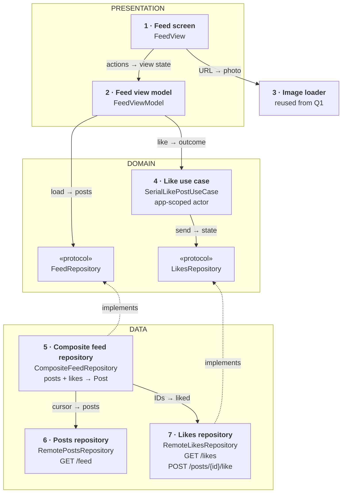
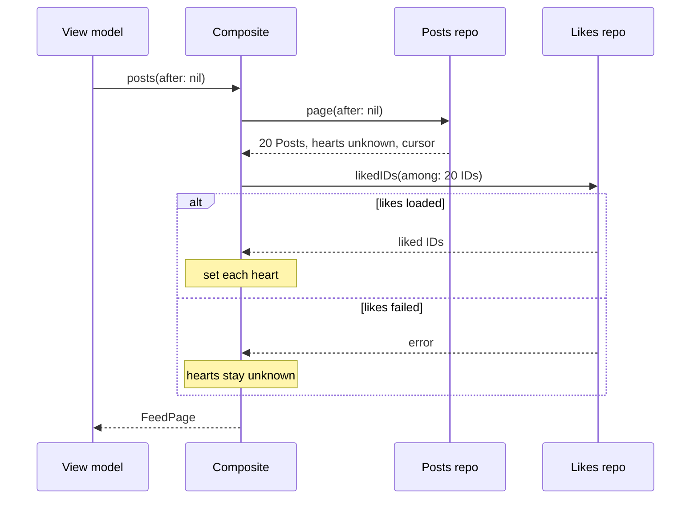
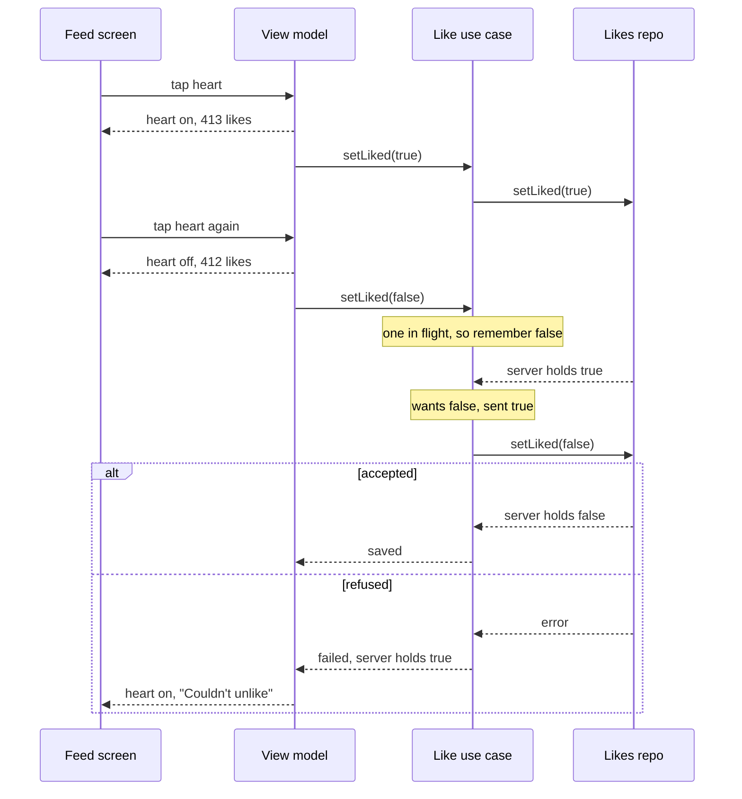

*One of the most common senior mobile prompts. The answer stays small: three endpoints, one repository per source, a read-only composite, and a like that stays correct however fast the user taps.*

> **Interviewer:** "We have a feed of photos, like a social app's home feed. It scrolls forever. Design the client for me."

## Run it as a round, not as reading

Set a timer. Sketch. Talk the whole time. Open a section only when its slot is over.

| Clock | Phase | What you do |
|---|---|---|
| 0:00–0:02 | The prompt | Repeat it back in one sentence |
| 0:02–0:07 | Clarify | Ask yours, then read section 1 |
| 0:07–0:12 | Scope | Out of scope first, then required, then later |
| 0:12–0:24 | High level | The idea · the parts · the sketch · one line each · two flows |
| 0:24–0:40 | Deep dives | The interviewer picks one of sections 9–11 |
| 0:40–0:45 | Recap | Follow-ups, then the 60-second summary |

## What this question is really testing

- **Cursor pagination**, and knowing the server, not the cursor, owns the ordering.
- **Rows that know their height before the photo arrives**, so nothing jumps.
- **"Load more" that fires once**, and old pages that can't land after a refresh.
- **A like that feels instant and stays correct** when the user taps three times fast.
- **Knowing what not to build.** Ranking is the server's job. The photos come from question 1's image loader.

**Traps:** page numbers instead of a cursor; "a cursor guarantees no duplicates"; caching the personal feed on a CDN; "cancel the old request, last tap wins"; showing "not liked" when the likes call failed.

::: Words used in this chapter
- **Repository** — the one owner of one kind of data. It turns the server's format into the app's model.
- **Composite** — a repository that only reads: it asks two repositories and combines their answers into one model.
- **Store** — in-memory state that several screens show at once. Not needed here yet.
- **Use case** — one user intent with a product rule, like "only the latest tap counts".
- **View model** — the screen's brain. It owns the screen's state and hands the screen one view state.
- **Page, cursor** — about 20 posts at a time; the cursor is a bookmark only the server can read.
- **DTO, mapping** — a DTO is the server's format. Mapping turns it into the app's model.
- **Protocol** — a promise of what a part can do, without saying how. A fake keeps the same promise in tests.
- **Optimistic update** — show the result of a tap at once, and correct it if the server refuses.
- **Idempotent** — sending the same request twice has the same effect as once.
- **CDN** — servers near the user that keep copies of shared files, like photos.
:::

::: 1 · The interviewer answers your clarifying questions
**"What's in a post?"** → *One photo, an author, a caption, a like count. Skip video and carousels.*

**"Who orders the feed?"** → *The server ranks it, per user. Your feed is personal, even though each post in it is shared. Show pages in the order you get them.*

**"How do I know which posts I liked?"** → *Today, a separate likes endpoint. A post doesn't say whether you liked it.*

**"Offline?"** → *Nice to have. An error with a retry button is fine for now.*

**"New posts live?"** → *No. Pull to refresh is enough.*

**"Other screens showing the same posts?"** → *Not now. Just the feed.*

**"How many users?"** → *Say ten million a day. Don't design the backend.*

**"Minimum OS, UIKit or SwiftUI?"** → *iOS 17, SwiftUI, Swift 6. Tell me if you'd use UIKit for the list.*

**"What hurts today?"** → *Stutter on older phones, and the list jumping when photos load.*
:::

::: 2 · Requirements and scope — what you should have said
**Out of scope, said first:** ranking, posting, comments, stories, video, ads, search. The image loader is reused from question 1.

**Required for the prompt**

1. Show the feed and load more as the user scrolls.
2. Pull to refresh.
3. Like and unlike, instantly, and correctly under fast taps.

**What must feel good:** smooth on an old phone · rows never jump · bounded image memory · no duplicate posts, no wrong hearts.

**Production considerations** (say, don't draw): token refresh, retries, timeouts, metrics. See section 12.

**Optional follow-ups** (add only when asked):

```text
A second screen shows the same posts → a shared post store
Offline reading                       → a saved copy of the last pages
Offline likes                         → a small persistent queue of likes
New posts while reading               → a "new posts" pill
Live updates                          → push, or a socket — only if required
```

*"I'll start simple and add each of these when the requirement appears."*
:::

::: 3 · The idea, in 30 seconds — before you draw anything
> *"The server gives me pages of my feed with an opaque cursor, in the order to show them. A posts repository calls `GET /feed`, a likes repository calls `GET /likes` and `POST /posts/{id}/like`, and each maps its own data. A read-only composite combines posts and liked IDs into one `Post`. The view model loads pages, guards against double loads and stale pages, and gives the screen one view state. Liking is a use case with a rule: the heart changes at once, and one request at a time per post sends the latest state the user wants."*
:::

::: 4 · What we need — the components, before the sketch
| # | Part | Type | Layer | Its one job |
|---|---|---|---|---|
| 1 | **Feed screen** | `FeedView` | Presentation | Draws the view state, forwards actions. |
| 2 | **Feed view model** | `FeedViewModel` | Presentation | Rows, paging and hearts → one view state. |
| 3 | **Image loader** | reused from Q1 | Reused | Delivers each photo. |
| 4 | **Like use case** | `SerialLikePostUseCase` | Domain | One like per post in flight, latest wins. |
| 5 | **Composite feed repository** | `CompositeFeedRepository` | Data | Posts + liked IDs → `Post`. |
| 6 | **Posts repository** | `RemotePostsRepository` | Data | `GET /feed` → posts and a cursor. |
| 7 | **Likes repository** | `RemoteLikesRepository` | Data | `GET /likes` and `POST /posts/{id}/like`. |
| chip | **Feed repository** | `FeedRepository` | Domain | The promise card 5 keeps. |
| chip | **Likes repository** | `LikesRepository` | Domain | The write promise card 7 keeps. |

Seven cards, two chips. `Post` isn't a card; it's written on the composite's.

**Not drawn:** the `HTTPClient` that cards 6 and 7 share (draw it as card 8, orange, if they ask where auth lives). **Not on the list yet:** everything under "optional follow-ups".
:::

::: 5 · The sketch


**How to read it.** A solid arrow points from the asker to the answerer: *request → reply*. Dashed arrows mean *implements*; the grey card is reused from question 1.

**Dependency inversion, in one line.** The domain writes the two promises (the chips); the data layer keeps them (cards 5 and 7), so both dashed arrows point **up** and the view model and use case never see networking.

**One class, two promises.** Card 5 reaches card 7 through a narrow read promise, `LikedPostsSource`, which isn't drawn. The use case sees only the write promise.

**No shared store on this sketch:** one screen shows the posts. A second screen would add one.

**On Miro:** three frames (blue, purple, green), seven cards, two chips, seven solid arrows. Point at card 5: *"two sources, one model. If the feed carried `isLiked`, this card would go away."*
:::

::: 6 · Each component: its job, its interface, the choice inside it
**The model everyone shares.** The screen never sees a DTO.

```swift
struct Post: Identifiable, Hashable, Sendable {
    let id: PostID
    let author: Author
    let caption: String
    /// URL, width, height
    let image: ImageRef
    var likeCount: Int
    /// liked, notLiked, or unknown (the likes call failed)
    var like: LikeState
}

struct FeedPage: Sendable {
    let posts: [Post]
    /// nil = the end
    let next: Cursor?
}
```

The photo's **size** is in the model; its pixels live in the image loader's bounded cache.

### 1 · Feed screen (`FeedView`)

**Job:** draws the view state and reports taps, rows appearing and refresh. It decides nothing.

**Interface:** reads `viewModel.viewState`; calls `onAppear()`, `rowAppeared(_:)`, `refresh()`, `toggleLike(_:)`.

**Choice:** SwiftUI `List` first: it reuses its rows (it's backed by a collection view). A `LazyVStack` builds rows lazily but doesn't recycle them. *Switch to* a wrapped `UICollectionView` only for prefetch callbacks or hitches measured on the oldest phone.

### 2 · Feed view model (`FeedViewModel`)

**Job:** keeps the rows, the paging session and fresh hearts, as one view state.

**Interface:**

```swift
struct FeedViewState: Equatable {
    let rows: [PostRow]
    /// loading, loaded, failed(message): the first page
    let initialLoad: LoadState
    /// idle, loading, failed(message), end: the pages after it
    let pagination: PaginationState
}

struct PostRow: Equatable, Identifiable {
    let id: PostID
    let author: String
    let caption: String
    let imageURL: URL
    /// width ÷ height, so the row has its size before the photo
    let aspectRatio: Double
    /// already formatted, e.g. "412 likes"
    let likes: String
    /// filled, empty, or dimmed while unknown
    let heart: HeartState
}

@MainActor @Observable
final class FeedViewModel {
    init(feed: FeedRepository, likePost: LikePostUseCase)

    var viewState: FeedViewState { get }

    func onAppear() async
    /// Loads the next page when this row is 5 from the end
    func rowAppeared(_ id: PostID) async
    func refresh() async
    func toggleLike(_ id: PostID) async
}
```

**Choices:**

- **One view state, two small load states.** A feed can have rows *and* be loading more, or rows *and* a failed next page; one status enum can't say both.
- **The heart overlay lives here**, because only this screen shows it: per post, the wanted heart and the heart before the taps, laid over every page until the use case reports. The *sending* rule lives in the use case.
- **Main actor**, so "check, then mark loading" needs no lock.

### 3 · Image loader (reused from question 1)

**Job:** gives each row its photo at the size the row shows.

**Interface:** the row asks with the photo's URL and its display size, and cancels when the row goes away.

**Choice:** reused, not redesigned: memory and disk cache, one download per URL, cancellation, downsizing off the main thread.

### 4 · Like use case (`SerialLikePostUseCase`)

**Job:** sends likes, one request per post at a time, always the latest wanted state.

```swift
enum LikeOutcome: Equatable, Sendable {
    /// The server holds what the user wants
    case saved
    /// A newer tap on this post took over and will report instead
    case superseded
    /// The latest state was refused. nil = no reply said what
    /// the server holds; the screen restores its pre-tap heart.
    case failed(serverState: Bool?)
}

protocol LikePostUseCase: Sendable {
    /// Never throws. Not cancelled by the caller's task: the like
    /// still lands, the caller only stops waiting.
    func setLiked(_ liked: Bool, post: PostID) async -> LikeOutcome
}

actor SerialLikePostUseCase: LikePostUseCase {
    init(likes: LikesRepository)
}
```

**Choices:**

- **The rule a product manager would state:** "only the latest tap counts, and the heart never lies". That's why it's a use case and loading isn't.
- **App-scoped, one instance, an `actor`.** Its per-post table only works if every caller shares it: a feed pushed again mid-like would otherwise bring a second table and send in parallel.
- **It sends the final state** ("liked: true"), never "toggle", one request at a time per post (section 11).
- **It runs each send in its own task**, so a screen closing mid-like doesn't cancel the write.

### 5 · Composite feed repository (`CompositeFeedRepository`)

**Job:** combines a page of posts with which of them are liked. It owns no source and never writes.

```swift
protocol FeedRepository: Sendable {
    /// Posts in display order with hearts filled in, or .unknown
    /// if likes failed. Throws only if posts failed.
    /// Cancelling the caller cancels both requests.
    func posts(after cursor: Cursor?) async throws -> FeedPage
}

final class CompositeFeedRepository: FeedRepository {
    init(posts: PostsRepository, likedPosts: LikedPostsSource)
}
```

**How it combines:**

1. Ask the posts repository for a page: `Post`s with every heart `unknown`, plus the cursor.
2. Ask which of those IDs are liked.
3. Set each heart to `liked` or `notLiked`, or leave the page `unknown` if step 2 failed.

**Choices:**

- **One source failing never hides the feed**, and it combines app models only; each repository maps its own DTOs.
- **The trade-off, said out loud:** two sources keep ownership clean, but two requests add latency. In production I'd ask the backend for `isLiked` on each feed item; then this card and the likes read go away, and nothing above the domain changes.

### 6 · Posts repository (`RemotePostsRepository`)

**Job:** fetches `GET /feed` and maps each `PostDTO` to a `Post` with its heart `unknown`.

```swift
protocol PostsRepository: Sendable {
    /// Throws on failure. Cancelling the caller cancels the request.
    func page(after cursor: Cursor?) async throws -> FeedPage
}
```

**Choices:**

- **It passes the cursor back untouched**, and maps here, so DTOs never leave this card.
- **Decoding is off the caller's actor.** Under Swift 6.2 a plain `nonisolated async` function runs on its caller's actor, so the HTTP client marks decoding `@concurrent`.

### 7 · Likes repository (`RemoteLikesRepository`)

**Job:** reads which posts are liked with `GET /likes`, and saves one with `POST /posts/{id}/like`. Two callers, so two small promises.

```swift
/// Domain: the like use case's promise
protocol LikesRepository: Sendable {
    /// Saves the final state and returns what the server holds.
    /// Throws if refused or unreachable. Cancelling the caller
    /// cancels the request; the use case runs it in its own task.
    func setLiked(_ liked: Bool, post: PostID) async throws -> Bool
}

/// Data-internal: the composite's promise
protocol LikedPostsSource: Sendable {
    /// Throws on failure; the caller turns that into unknown, never "none".
    func likedIDs(among posts: [PostID]) async throws -> Set<PostID>
}

final class RemoteLikesRepository: LikesRepository, LikedPostsSource {
    init(http: HTTPClient)
}
```

**Choice:** one class, two promises (interface segregation). The use case can't read likes, the composite can't write them, and each fake needs one method. Rules live in the use case, so this stays a thin adapter.

**Why these parts, and no more.** Each card changes for one reason:

| Card | Changes when |
|---|---|
| 1 · Feed screen | the screen's design |
| 2 · Feed view model | the screen's behaviour |
| 4 · Like use case | a product rule (how likes are sent) |
| 5 · Composite | how two sources combine |
| 6 · Posts repository | an endpoint or payload (`/feed`) |
| 7 · Likes repository | an endpoint or payload (`/likes`, `/like`) |

Each protocol earns a fake or a smaller promise. Not added: a use case for loading (a pass-through), a protocol for the view model, a shared store, a DI container. Constructor injection is enough.
:::

::: 7 · Key flows through the sketch
**Flow 1 — opening the feed.** Loading more is the same, with the cursor.



**Flow 2 — like, then unlike, while the first request is still out.**



The first `setLiked(true)` returns `superseded`; only the latest tap can change the heart back.
:::

::: 8 · The server contract
```
GET  /v1/feed?cursor={opaque}&limit=20
     → { "items": [ { "id", "author", "caption",
                      "image": { "url", "width", "height" },
                      "likeCount" } ],
         "nextCursor": "…" }            // null at the end

GET  /v1/likes?postIds=p1,p2,…
     → { "liked": ["p1", "p7"] }

POST /v1/posts/{id}/like   { "liked": true }
     → 200 { "liked": true, "likeCount": 413 }
```

- **An opaque cursor, owned by the server.** It avoids the shifting page numbers suffer only if the server keeps a stable order for the session, so the client still skips IDs it already shows.
- **Width and height in the post**, so rows are sized before the photo loads.
- **The like carries the final state, and the reply carries the server's truth.** The feed is personal, never on a shared CDN; photos are shared and cached hard.
:::

::: 9 · Deep dive — "The user flings to the bottom, then pulls to refresh."
**Trigger:** ask for the next page about one screen before the end. On iOS 17, the row five from the end calls `rowAppeared` from its `.onAppear`. On iOS 18, `onScrollTargetVisibilityChange` reports visible rows directly.

**Guard — load once, not five times:**

1. If a page is loading, or there are no more pages, return.
2. Otherwise mark `pagination = .loading` **at once**, before any `await`.
3. Await the page, then append it, skipping IDs already shown (a duplicate ID breaks a list's identity).
4. Failure → `pagination = .failed`; the rows stay, and a retry row appears.

On the main actor step 2 needs no lock: the first call wins.

**Refresh starts a new session:**

1. Bump a `generation` counter and cancel the old page task.
2. Load the first page with no cursor.
3. Replace the rows and the cursor, and reset `pagination`.
4. Any page that arrives tagged with an old generation is dropped.

*Why both cancel and a counter:* cancellation in Swift is cooperative. A reply that's already back can still try to append. The generation is the stale-result guard; cancel only saves bandwidth.

**Scroll position:** refresh happens at the top, so replacing is fine. Never replace rows under someone reading lower down.
:::

::: 10 · Deep dive — "It stutters on an older iPhone, and the list jumps. Why?"
Measure first (Instruments: Hangs, Animation Hitches). The usual causes:

1. **Full-size photos decoded on the main thread.** The image loader downsizes them off the main thread, to the row's pixel size.
2. **Rows measured after the photo arrives.** That's the jump. Size from the model: `height = width ÷ aspectRatio`.
3. **Rebuilding a whole row for one like.** Change only the heart. In UIKit, `reconfigureItems` updates a cell in place.
4. **Formatting in the row.** Format once, in the view state.

**From the image loader:** one download per URL, cancel when a row scrolls away, and a check that the arriving photo still belongs to the row. Ask the CDN for the display width.

**Prefetching is an optimization, not correctness.** In UIKit, `UICollectionViewDataSourcePrefetching` starts photos early and cancels them, but its callbacks aren't guaranteed, so a row still loads its own photo. SwiftUI has no prefetch callback: start on appear, cancel on disappear.

**Memory:** decoded photos are what's big. The image cache has a cost limit and empties on a memory warning, so image memory doesn't grow with scroll depth.
:::

::: 11 · Deep dive — "The user taps like three times, fast. Then the likes call fails."
**Three quick taps** (like, unlike, like). The use case keeps, per post, the state the user wants now:

1. Remember the wanted state.
2. If a request for this post is in flight, stop. The earlier call becomes `superseded`.
3. Otherwise send the wanted state.
4. When it finishes, if the wanted state differs from what was just sent, send again. Otherwise report `saved`, or `failed` with the server's last known state if refused, and forget the post.

Like, unlike, like while the first is out: one request, and the third tap gets `saved`.

**Why not "cancel the old one, last tap wins"?** Cancelling a task doesn't recall a request the server already got, and two in flight can land in either order, so the server could end on "unliked" under a filled heart.

**Safe rollback.** Only the latest call can return `failed`, so an old failure never undoes a newer tap. The heart goes to `serverState`, not "the opposite"; with no reply (a timeout), to the heart before the taps, until a refresh corrects it.

**A refresh during a like.** The view model lays its unsettled hearts over the refreshed page, so a refresh can't flip a heart mid-change.

**The likes read fails.** Rows show a dimmed, disabled heart (`unknown`) until the next page or refresh. *Rejected:* empty hearts. They'd be false, and the user would like a post twice.

**A second screen shows the same post** (a profile grid). Then posts and the heart overlay move into one shared `@MainActor` post store both view models read; the use case writes outcomes to it and keeps the rule.
:::

::: 12 · Failure modes, production and scale
**Failures**

| Failure | Client behaviour |
|---|---|
| First page fails | Full-screen error with retry |
| Later page fails | Keep the rows, show a retry row |
| Photo fails | Placeholder; retry on tap or when the row reappears |
| Likes unavailable | Known hearts stay; unknown ones dimmed, never "not liked" |
| Like refused | Heart goes to the server's state, short message |
| Cursor expired | Start a new session from the first page |
| Token expired | The HTTP client refreshes it and retries once |
| Offline | Error with retry (cached pages come later, if asked) |

**Production notes** (short, not on the board)

- **Networking:** a timeout per request; retry only what's safe (timeouts, 5xx, with backoff); honour `Retry-After` on 429; cancel reads for screens that are gone, never the like.
- **Caching:** photos in memory and on disk, with the CDN's cache headers deciding freshness.
- **Metrics:** first-page time, page failure rate, image cache hit rate, decode time, scroll hitches, like failure rate.

**Scale, back of the envelope**, with the interviewer's numbers:

```text
daily users × sessions a day × pages a session × posts a page = feed items read
photos shown × average photo size                            = CDN bandwidth
```

10M × 5 × 3 × 20 is three billion items a day. Page size, photo size and cache hit rate move the cost, not the client architecture.

**Grow only when asked**

```text
One screen                → the heart overlay in the view model
A second screen           → a shared post store holds posts and the overlay
Offline reading           → persist the last pages, show them first
Offline likes             → a persistent queue (now you own sync and conflicts)
Live updates              → push or a socket, only if the product needs it
```
:::

::: 13 · Question bank — everything they can push on
Answer out loud first, then open.

### Scope and architecture

<details>
<summary>"Walk me through the layers."</summary>

Presentation: screen and view model. Domain: `Post`, the two protocols, the like use case. Data: posts and likes repositories, and a read-only composite.
</details>

<details>
<summary>"Why does liking get a use case and loading doesn't?"</summary>

Liking has a product rule: only the latest tap counts, one request per post at a time. Loading a page is one call with no rule; a use case would only pass it through.
</details>

<details>
<summary>"Why two repositories and a composite, not one?"</summary>

Different endpoints, different reasons to change; the composite is where they meet. If the feed returned `isLiked`, I'd drop it.
</details>

<details>
<summary>"Show me dependency inversion."</summary>

The feed and likes protocols live in the domain; the composite and the likes repository implement them. Both arrows point up, so the view model and use case never import networking.
</details>

<details>
<summary>"Where does mapping happen?"</summary>

In each repository: the posts repository maps `PostDTO` to `Post`, the likes repository turns the reply into a set of IDs. The composite only combines app models.
</details>

<details>
<summary>"Where does the combined state come from?"</summary>

The composite, for each page. There's no store, because only one screen shows the posts; a second screen would add one.
</details>

<details>
<summary>"Why does the likes repository have two protocols?"</summary>

Two callers need different halves: the composite reads, the use case writes. One class, two small promises.
</details>

### Pagination

<details>
<summary>"Why a cursor and not page numbers?"</summary>

New posts shift page numbers, so you see repeats. A cursor says "continue from here", and the server decides what that means.
</details>

<details>
<summary>"What guarantees you get no duplicates?"</summary>

The server's stable order for the session. The client still skips IDs it already shows, because that guarantee lives on another machine.
</details>

<details>
<summary>"How does SwiftUI tell you to load more?"</summary>

The row five from the end calls the view model from `.onAppear`; on iOS 18, `onScrollTargetVisibilityChange` can do it. The view model decides.
</details>

<details>
<summary>"What happens if two load-more triggers fire?"</summary>

The first marks pagination loading before any await, on the main actor. The second sees it and returns.
</details>

<details>
<summary>Follow-up chain: "Refresh during a page load."</summary>

1. *"User refreshes while page 4 loads."* → The refresh bumps the generation and cancels page 4.
2. *"Page 4 still arrives."* → It carries the old generation, so it's dropped.
3. *"Why isn't cancel enough?"* → Cancellation is cooperative; a reply already back can still try to land.
</details>

### Likes

<details>
<summary>"What if the user taps like three times quickly?"</summary>

The heart follows each tap. One request per post at a time; when it finishes, the latest state goes only if it differs.
</details>

<details>
<summary>"What if request 1 finishes after request 2?"</summary>

It can't: there's only one request per post in flight. That's the reason to serialize instead of cancelling.
</details>

<details>
<summary>"An old request fails after a newer tap. Do you roll back?"</summary>

No. Older calls are superseded; only the latest gets an outcome. The heart is corrected only when the latest state is refused, and then to the server's state.
</details>

<details>
<summary>"The user leaves the screen mid-like. Is the like cancelled?"</summary>

No. The protocol promises the write lands; the use case runs it in its own task, and the closing screen only stops waiting.
</details>

<details>
<summary>"Why is the use case an actor, and why only one?"</summary>

Its per-post table is shared state, so it needs isolation. One app-wide instance, because a second one would have its own table and send in parallel.
</details>

<details>
<summary>"What happens if the likes read fails?"</summary>

Hearts become unknown: dimmed and disabled until the next page or refresh. Showing "not liked" would be false.
</details>

<details>
<summary>Follow-up chain: "A second screen."</summary>

1. *"A profile grid shows the same post. User likes it in the feed."* → With separate copies, the grid is wrong.
2. *"Fix it."* → One shared observable post store; both screens read it, and the heart overlay moves there.
3. *"Where does the rule go?"* → It stays in the use case, which now writes outcomes to the store.
4. *"When wouldn't you do this?"* → With only one screen.
</details>

### Images and performance

<details>
<summary>"How do you stop a reused row showing the wrong image?"</summary>

Cancel the old request on reuse, and check the arriving photo still matches the row's current URL before showing it.
</details>

<details>
<summary>"How do you stop the list jumping?"</summary>

Size each row from the width and height in the post, before the photo arrives. Never insert above what the user is reading.
</details>

<details>
<summary>"UICollectionView or SwiftUI List?"</summary>

`List` first: it reuses rows. A wrapped collection view only if I need prefetch callbacks or the oldest phone hitches.
</details>

### Production and change

<details>
<summary>"What would you add for offline support?"</summary>

Persist the last pages and show them first. Offline likes need a persistent queue, which means owning sync and conflicts, so only if required.
</details>

<details>
<summary>"How do you test liking?"</summary>

The use case with a fake likes repository that holds its reply: like, unlike, like, one request sent. The view model with a fake use case returning failed: the heart goes to the server state.
</details>

<details>
<summary>Follow-up chain: "Two weeks instead of six."</summary>

1. *"What do you cut?"* → Offline and anything for a second screen.
2. *"What can't you cut?"* → Cursor pages, the load guard, rows sized from the post, serialized likes.
3. *"Risk?"* → No content offline. Fixable next release.
</details>
:::

::: 14 · Scorecard — mark yourself, 0 / 1 / 2
| | Did you… | 0–2 |
|---|---|---|
| 1 | Talk the whole time, and listen when interrupted | |
| 2 | Clarify before designing | |
| 3 | Give a trade-off for each choice | |
| 4 | Say out of scope first; separate required from later | |
| 5 | Say the idea, list the parts, then sketch | |
| 6 | Keep the sketch to nine type cards, one line each | |
| 7 | Explain the cursor as opaque and server-owned | |
| 8 | Name the three endpoints, and the two-request trade-off | |
| 9 | Map in each repository; keep the composite read-only | |
| 10 | Make the like optimistic and serialized per post | |
| 11 | Roll back only the latest tap, to the server's state | |
| 12 | Say the use case is one app-wide actor, and a like isn't cancelled | |
| 13 | Guard load-more, and drop stale pages after refresh | |
| 14 | Land the recap inside 60 seconds | |

14+ is a pass.<!--private--> Anything scored 0 goes in the progress log and comes back as a recall prompt.<!--/private--><!--public--> A zero names the thing to read about next.<!--/public-->
:::

::: 15 · The 60-second recap
The server gives me my personal feed in pages, with an opaque cursor it owns; I send it back untouched and still skip IDs I already show. A main-actor view model loads the next page five rows before the end, marks it loading before any await so it fires once, and drops stale pages after a refresh with a generation counter. A posts repository and a likes repository each map their own data, and a read-only composite combines them into one `Post`; in production I'd ask for `isLiked` in the feed and drop the second call. Liking flips the heart at once, and one app-wide use case sends one request per post at a time, always the latest state, so only the latest tap can be corrected.
:::
