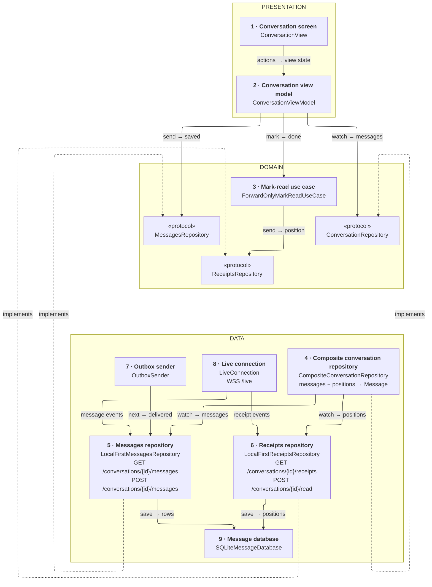
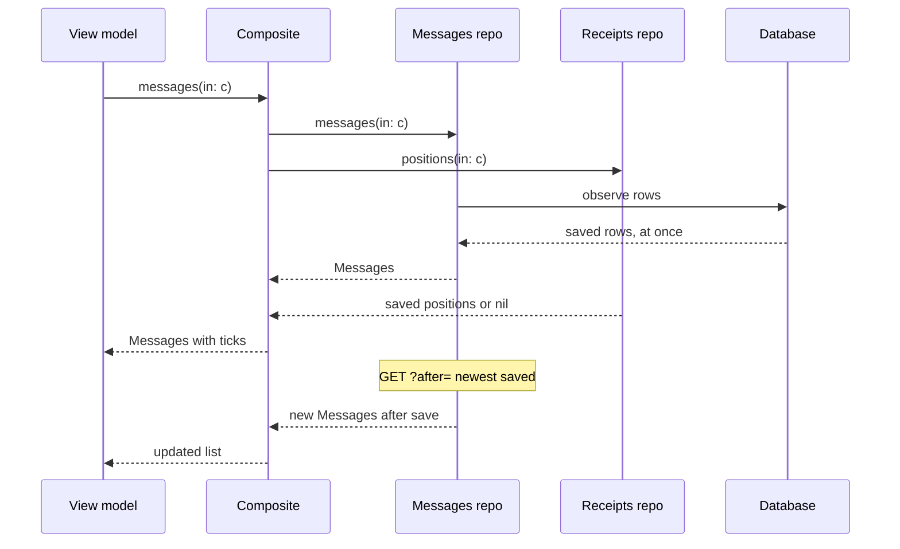
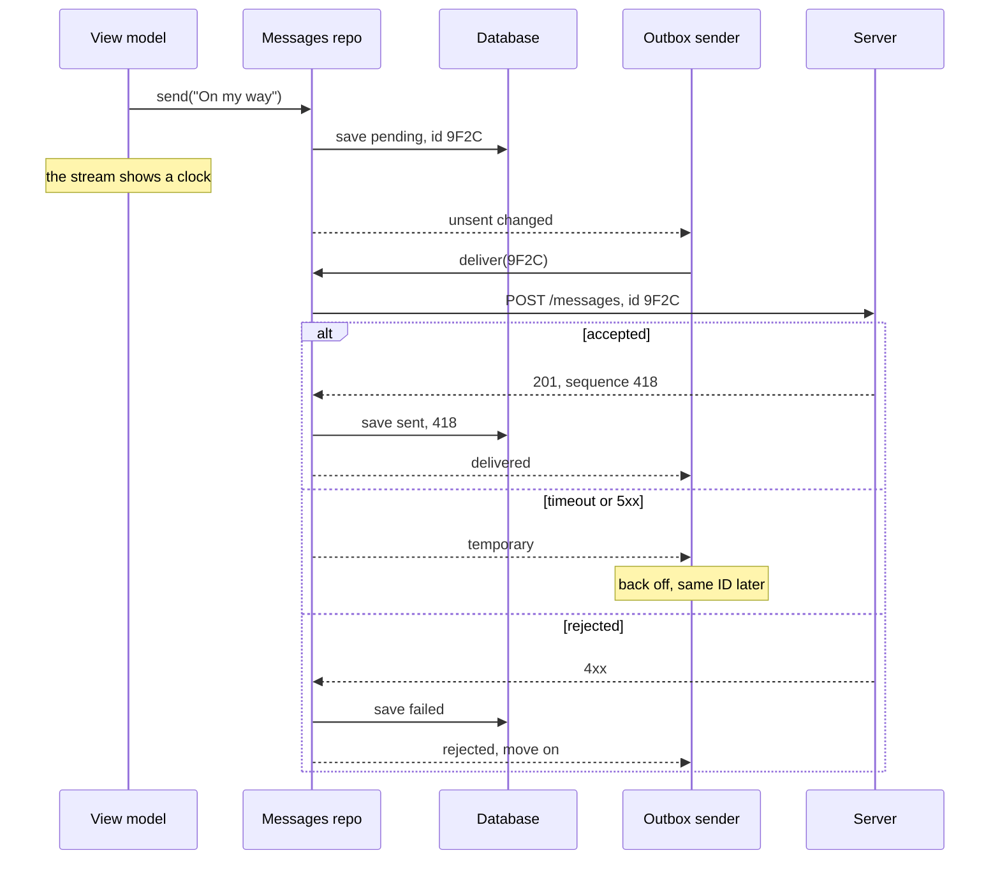
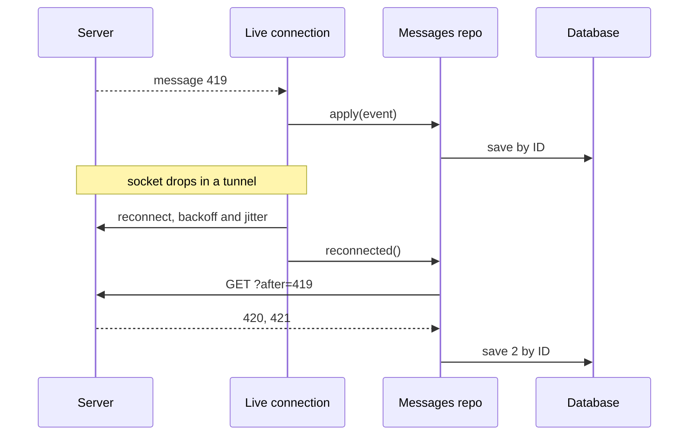
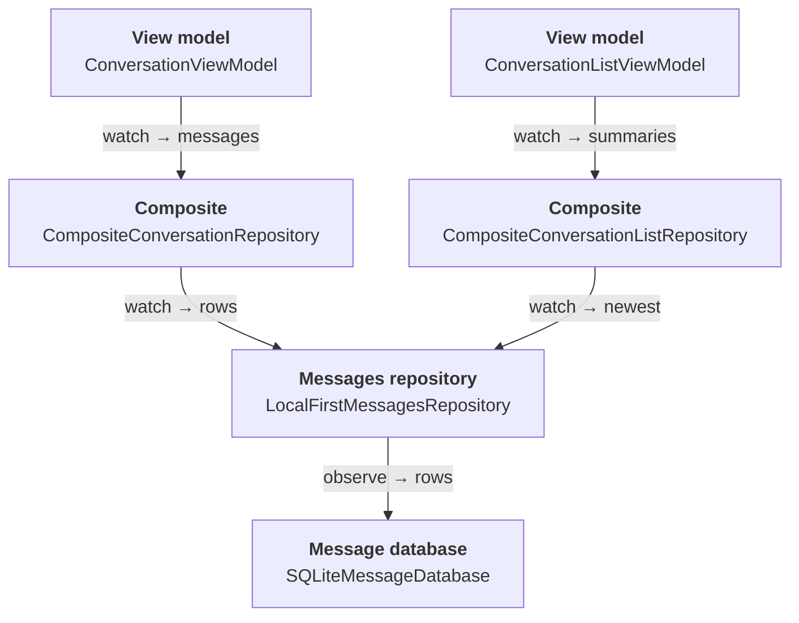

*A recurring senior mobile prompt. The answer stays small: a database the screen observes, one repository per source, a read-only composite, one socket and a background sender.*

> **Interviewer:** "Let's design the client side of a chat app. One-to-one and small group conversations. Where would you start?"

## Run it as a round, not as reading

Set a timer. Sketch. Talk the whole time. Open a section only when its slot is over.

| Clock | Phase | What you do |
|---|---|---|
| 0:00–0:02 | The prompt | Repeat it back in one sentence |
| 0:02–0:07 | Clarify | Ask yours, then read section 1 |
| 0:07–0:12 | Scope | Out of scope first, then required, then later |
| 0:12–0:24 | High level | The idea · the parts · the sketch · one line each · two flows |
| 0:24–0:40 | Deep dives | The interviewer picks one of sections 9–11 |
| 0:40–0:45 | Recap | Follow-ups, then the 60-second summary |

## What this question is really testing

- **Who decides the order?** The server's sequence number, not the phone's clock.
- **A send that doesn't wait**, and a retry the server recognises: a client message ID.
- **The screen observes a database on the phone.** The network only writes into it.
- **Catching up after a gap**, because a socket can miss things.
- **Honest splits:** the socket, the sending loop and each source are separate parts.

**Traps:** ordering by the phone's clock; a send that waits for the server; a retry with a new ID; one "read up to" for a group of 50; trusting push; "not read" when receipts failed.

::: Words used in this chapter
- **Repository** — the one owner of one kind of data. It turns the server's format into the app's model.
- **Composite** — a repository that only reads: it asks two repositories and combines their answers into one model.
- **Store** — in-memory state that several screens show at once. Not needed here yet.
- **Use case** — one user intent with a product rule, like "a read marker only moves forward".
- **View model** — the screen's brain. It owns the screen's state and hands the screen one view state.
- **WebSocket** — a line kept open, so the server can say "new message" at once.
- **Sequence number** — the server's counter per conversation: 417, 418, 419. It is the order.
- **Client message ID** — an ID the sender's device gives a message. Sent twice, the server keeps one.
- **Outbox** — messages saved on the phone that the server hasn't accepted yet.
- **Read position** — how far one member has read: "read up to 417". A group has one per member.
:::

::: 1 · The interviewer answers your clarifying questions
**"One-to-one only, or groups?"** → *Both. Groups up to about 50 people.*

**"What's in a message?"** → *Text only.*

**"Offline?"** → *Yes. Read with no signal; write a message that goes out later.*

**"Several devices?"** → *A phone and an iPad. Both show the same order.*

**"What does a sent message show?"** → *Sending, sent, delivered, read. Failed, with a retry.*

**"Who has read what?"** → *A receipts endpoint, one read position per member.*

**"Which screens?"** → *The conversation screen. The conversation list comes later.*

**"How many users?"** → *20 million a day, 30 messages each. Don't design the backend.*

**"Minimum OS?"** → *iOS 17, SwiftUI, Swift 6.*
:::

::: 2 · Requirements and scope — what you should have said
**Out of scope, said first:** the server, attachments, typing, calls, editing, search, encryption, sign-in, the conversation list.

**Required for the prompt**

1. Open a conversation instantly, even offline.
2. Send online or offline: it shows at once, is kept once, and shows its status.
3. Receive new messages live, and catch up on anything missed.
4. Scroll back through older messages.

**What must feel good:** no lost or doubled messages · the same order on every device · never waiting on the network · ticks that never lie.

**Production considerations** (say, don't draw): token refresh, timeouts, safe retries, metrics. See section 12.

**Optional follow-ups** (add only when asked):

```text
The conversation list      → a second reader of the same database
Typing indicators          → socket events, kept in memory
New messages while closed  → push to nudge, catch-up to deliver
"Read by 12 of 49"         → fetched when the user asks
Sending after hours closed → a background refresh
```

*"I'll start simple and add each of these when the requirement appears."*
:::

::: 3 · The idea, in 30 seconds — before you draw anything
> *"The screen observes a database on the phone, so it opens instantly and works offline. A messages repository owns messages: `GET /conversations/{id}/messages` for history and catch-up, `POST /conversations/{id}/messages` to deliver. A receipts repository owns read positions: `GET /conversations/{id}/receipts` and `POST /conversations/{id}/read`. One live connection holds `WSS /live` while the app is open and hands each event to its owner. Sending saves first, with an ID the phone chose; an outbox sender delivers unsent rows oldest first, with the same ID on retry. A read-only composite combines messages and positions into one `Message` with its ticks, and marking read is a use case, because the read marker only moves forward."*
:::

::: 4 · What we need — the components, before the sketch
| # | Part | Type | Layer | Its one job |
|---|---|---|---|---|
| 1 | **Conversation screen** | `ConversationView` | Presentation | Draws the view state, forwards actions. |
| 2 | **Conversation view model** | `ConversationViewModel` | Presentation | Messages and history → one view state. |
| 3 | **Mark-read use case** | `ForwardOnlyMarkReadUseCase` | Domain | The read marker only moves forward. |
| 4 | **Composite conversation repository** | `CompositeConversationRepository` | Data | Messages + read positions → `Message`. |
| 5 | **Messages repository** | `LocalFirstMessagesRepository` | Data | Owns messages. |
| 6 | **Receipts repository** | `LocalFirstReceiptsRepository` | Data | Owns read positions. |
| 7 | **Outbox sender** | `OutboxSender` | Data | Delivers unsent rows, oldest first. |
| 8 | **Live connection** | `LiveConnection` | Data | One socket while open; routes events. |
| 9 | **Message database** | `SQLiteMessageDatabase` | Data | Rows on disk, observed. |
| chip | **Conversation repository** | `ConversationRepository` | Domain | The read promise card 4 keeps. |
| chip | **Messages repository** | `MessagesRepository` | Domain | The send promise card 5 keeps. |
| chip | **Receipts repository** | `ReceiptsRepository` | Domain | The mark-read promise card 6 keeps. |

Nine cards, three chips. `Message` is written on the composite's card.

**No use case for sending or loading:** same-ID retries and oldest-first draining are delivery mechanics, and loading has no rule.

**Not drawn:** `APIClient` (HTTP, auth) for cards 5 and 6, `WebSocketClient` over `URLSessionWebSocketTask` for card 8, and `NetworkMonitor` (protocol `NetworkStatus`) over `NWPathMonitor` for card 7. **Not on the list yet:** everything under "optional follow-ups".
:::

::: 5 · The sketch


**How to read it.** Solid arrows: *request → reply*, asker to answerer. Dashed: *implements*. Orange is the network connection.

**Dependency inversion, in one line.** The domain writes the three promises (the chips); cards 4, 5 and 6 keep them, so the dashed arrows point **up** and the view model never sees a socket, a database or HTTP.

**One owner per source.** Messages reach the database only through card 5, positions only through card 6. The socket and the sending loop have their own lifecycles, so they are cards 7 and 8.

**No shared store on this sketch:** one screen shows the conversation. When the list arrives, the database is what both screens observe.

**On Miro:** three frames, nine cards, three chips. Point at card 9: *"the screen reads only this; the network only writes."*
:::

::: 6 · Each component: its job, its interface, the choice inside it
**The model everyone shares.** The screen never sees a DTO or a row.

```swift
struct Message: Identifiable, Hashable, Sendable {
    /// the client message ID, chosen by the sender's device
    let id: MessageID
    let senderID: UserID
    let text: String
    let sentAt: Date
    /// the server's order, nil until accepted
    let sequence: Int?
    /// pending, sent, failed: my message reaching the server
    var send: SendState
    /// unknown, sent, delivered, read: how far the others got
    var receipt: ReceiptState
}
```

The ID comes from the sender's device, so a bubble keeps its identity from "sending" to "read".

### 1 · Conversation screen (`ConversationView`)

**Job:** draws the view state and reports actions and scrolling. It decides nothing.

**Interface:** reads `viewModel.viewState`; calls `start()` from `.task`, `send(_:)`, `retry(_:)`, `topReached()`, `newestVisible(_:)`.

**Choice:** a `ScrollView` with a `LazyVStack`, `defaultScrollAnchor(.bottom)` to open at the newest message, and `scrollPosition(id:)` so prepending history keeps the reader on the same bubble. *Switch to* a wrapped `UICollectionView` if it stutters: a lazy stack doesn't reuse rows.

### 2 · Conversation view model (`ConversationViewModel`)

**Job:** observes one conversation and turns it, plus history paging, into one view state.

**Interface:**

```swift
struct ConversationViewState: Equatable {
    let title: String
    let rows: [MessageRow]
    /// idle, loading, failed(message), beginning
    let history: HistoryState
}

struct MessageRow: Equatable, Identifiable {
    let id: MessageID
    let text: String
    let isMine: Bool
    /// already formatted, e.g. "14:02"
    let time: String
    /// clock, retry, one tick, two, read, dimmed. nil if not mine
    let ticks: Ticks?
}

@MainActor @Observable
final class ConversationViewModel {
    init(conversation: ConversationID,
         reader: ConversationRepository,
         messages: MessagesRepository,
         markRead: MarkReadUseCase)

    var viewState: ConversationViewState { get }

    /// Runs until the view's task is cancelled
    func start() async
    func send(_ text: String) async
    func retry(_ id: MessageID) async
    func topReached() async
    func newestVisible(_ id: MessageID)
}
```

**Choices:**

- **No optimistic overlay.** A pending message is a real saved row, so its bubble comes from the database. Nothing to roll back; a rejection turns only that bubble red.
- **History is this screen's state**, guarded so a second `topReached()` returns while one load is out.

### 3 · Mark-read use case (`ForwardOnlyMarkReadUseCase`)

**Job:** moves my read marker forward, one request per conversation at a time, always the highest position seen.

```swift
protocol MarkReadUseCase: Sendable {
    /// Never throws. Ignores positions at or below the highest
    /// wanted. Not cancelled by the caller's task.
    func markRead(upTo sequence: Int, in conversation: ConversationID) async
}

actor ForwardOnlyMarkReadUseCase: MarkReadUseCase {
    init(receipts: ReceiptsRepository)
}
```

**Choices:**

- **The rule a product manager would state:** "the read marker never moves back". That's why it's a use case and sending isn't.
- **One app-wide `actor`**, so every caller shares its "highest wanted" per conversation.
- **Serialized, latest wins.** While a request is out, newer positions only raise the wanted number; when it returns, send again if higher. A failure waits for the next call, which covers it.

### 4 · Composite conversation repository (`CompositeConversationRepository`)

**Job:** combines messages with members' read positions into `Message`s with ticks. It owns no source and never writes.

```swift
protocol ConversationRepository: Sendable {
    /// Replays the current value, one stream per caller, ends
    /// when the caller's task is cancelled. Never fails: ticks
    /// stay .unknown until positions load once.
    func messages(in conversation: ConversationID) -> AsyncStream<[Message]>
}

final class CompositeConversationRepository: ConversationRepository {
    init(messages: MessageStream, positions: ReadPositionStream)
}
```

**How it combines,** each time either stream emits:

1. Take the latest messages and the latest positions.
2. No positions yet → ticks stay `unknown`.
3. For each of my sent messages, look at the **other** members: all read past it → `read`; all delivered → `delivered`; else `sent`.
4. Sort by sequence; pending ones last, oldest first.

**Choices:**

- **The trade-off, said out loud:** receipts cost a second request on open. In production I'd ask for positions in the catch-up reply; nothing above the domain changes.

### 5 · Messages repository (`LocalFirstMessagesRepository`)

**Job:** the one owner of messages: saves pending ones, fetches history and catch-up, delivers on request, applies socket events.

```swift
/// Domain: the view model's promise
protocol MessagesRepository: Sendable {
    /// Saves a pending row with a new client ID
    func send(_ text: String, in conversation: ConversationID) async throws
    /// Failed → pending again, same ID, back of the queue
    func retry(_ id: MessageID) async throws
    /// GET ?before=, false at the beginning. Cancellable.
    func loadOlder(in conversation: ConversationID) async throws -> Bool
}

/// Data-internal: the composite's. Opening it catches up.
protocol MessageStream: Sendable {
    func messages(in conversation: ConversationID) -> AsyncStream<[Message]>
}

/// Data-internal: the outbox sender's
protocol PendingMessages: Sendable {
    func unsentChanged() -> AsyncStream<Void>
    func oldestUnsent() async throws -> MessageID?
    /// POST and save. Throws .temporary or .rejected (row failed)
    func deliver(_ id: MessageID) async throws(DeliveryError)
}

/// Data-internal: the live connection's
protocol MessageEventSink: Sendable {
    func apply(_ event: MessageEventDTO) async
    /// Catches up every conversation being observed
    func reconnected() async
}

final class LocalFirstMessagesRepository: MessagesRepository,
    MessageStream, PendingMessages, MessageEventSink {
    init(api: APIClient, database: MessageDatabase)
}
```

**Choices:**

- **One class, four small promises** (interface segregation): each caller sees only its part, and each fake needs a method or two.
- **Saved by client ID, and a row only moves forward** (pending → sent, never back). That is the stale-result guard, carried by the ID and the sequence: a late catch-up can't undo a newer event.
- **It runs no loop.** Cards 7 and 8 call it.

### 6 · Receipts repository (`LocalFirstReceiptsRepository`)

**Job:** the one owner of read positions: fetches them, posts mine, applies socket receipt events.

```swift
/// Domain: the use case's promise
protocol ReceiptsRepository: Sendable {
    /// Returns the server's position. Throws if refused or
    /// unreachable. Cancelling the caller cancels it.
    func markRead(upTo sequence: Int, in conversation: ConversationID) async throws -> Int
}

/// Data-internal: the composite's. nil until one fetch works.
protocol ReadPositionStream: Sendable {
    func positions(in conversation: ConversationID) -> AsyncStream<ReadPositions?>
}

/// Data-internal: the live connection's
protocol ReceiptEventSink: Sendable {
    func apply(_ event: ReceiptEventDTO) async
    func reconnected() async
}

final class LocalFirstReceiptsRepository: ReceiptsRepository,
    ReadPositionStream, ReceiptEventSink {
    init(api: APIClient, database: MessageDatabase)
}
```

**Choice:** a position is saved as the **higher** of old and new, so a late event can't move a tick back.

### 7 · Outbox sender (`OutboxSender`)

**Job:** delivers unsent messages, oldest first, one at a time.

```swift
actor OutboxSender {
    init(pending: PendingMessages, network: NetworkStatus)
    /// Called once at launch
    func start()
    func stop()
}
```

**Choices:**

- **Triggers:** launch, the network coming back, a new unsent row.
- **One at a time.** In parallel, the server could accept them in any order.
- **Temporary error → back off; rejected → move on.** It owns no endpoint: card 5 delivers.

### 8 · Live connection (`LiveConnection`)

**Job:** holds one WebSocket while in the foreground and hands each event to its owner.

```swift
actor LiveConnection {
    init(socket: WebSocketClient,
         messages: MessageEventSink,
         receipts: ReceiptEventSink)
    /// The app root calls these from scenePhase
    func start()
    func stop()
}
```

**Choices:**

- **Foreground only.** A closed app gets push; the catch-up delivers.
- **A dead socket can look open.** `sendPing` every 30 seconds finds out; then reconnect with backoff and jitter, and call `reconnected()` on both sinks.
- **Auth:** a short-lived token at connect; an expired one is refreshed, then it reconnects.

### 9 · Message database (`SQLiteMessageDatabase`)

**Job:** keeps rows and positions on disk, and re-sends a query's result after every write.

```swift
protocol MessageDatabase: Sendable {
    /// Re-sent after each committed write
    func messageRows(in conversation: ConversationID) -> AsyncStream<[MessageRecord]>
    func positionRows(in conversation: ConversationID) -> AsyncStream<[PositionRecord]>
    /// Insert or update by client ID, in one transaction
    func save(_ rows: [MessageRecord]) async throws
    func save(_ positions: [PositionRecord]) async throws
}
```

**Choices:**

- **SQLite with GRDB's `ValueObservation`**, which re-runs a query after each committed write. On Core Data, `NSFetchedResultsController` does the same.
- **Rejected on iOS 17: SwiftData behind a view model.** `@Query` observes only inside a view, and `fetchHistory` is iOS 18.
- **Records only.** File protection on, deleted at sign-out.

**Why these parts, and no more.** Each card changes for one reason:

| Card | Changes when |
|---|---|
| 1 · Conversation screen | the screen's design |
| 2 · Conversation view model | the screen's behaviour |
| 3 · Mark-read use case | a product rule (how the marker moves) |
| 4 · Composite | how two sources combine |
| 5 · Messages repository | an endpoint or payload (`/messages`) |
| 6 · Receipts repository | an endpoint or payload (`/receipts`, `/read`) |
| 7 · Outbox sender | a background job's lifecycle (triggers, backoff) |
| 8 · Live connection | a connection's lifecycle |
| 9 · Message database | a storage schema |

Each protocol earns a fake or a smaller promise. Not added: a sending or loading use case, a view model protocol, a shared store, a DI container.
:::

::: 7 · Key flows through the sketch
**Flow 1 — opening a conversation.**



**Flow 2 — sending in a tunnel.**



**Flow 3 — receiving live, then catching up.**


:::

::: 8 · The server contract
```
GET  /v1/conversations/{id}/messages?before={sequence}&limit=50
GET  /v1/conversations/{id}/messages?after={sequence}&limit=50
     → { "items": [ { "clientMessageId", "senderId", "text",
                      "sequence", "sentAt" } ],
         "hasMore": true }

POST /v1/conversations/{id}/messages
     { "clientMessageId": "9F2C…", "text": "On my way" }
     → 201 { "clientMessageId", "sequence": 418, "sentAt" }
       (same clientMessageId again → 200, the same message)

GET  /v1/conversations/{id}/receipts
     → { "members": [ { "userId", "deliveredUpTo": 418,
                        "readUpTo": 417 } ] }

POST /v1/conversations/{id}/read   { "upToSequence": 419 }
     → 200 { "readUpTo": 419 }       // never lower than before

WSS  /v1/live                       // token at connect
     ← { "type": "message", "message": { … } }
     ← { "type": "receipt", "conversationId", "userId",
         "deliveredUpTo", "readUpTo" }
```

- **Sequence numbers per conversation**, promised in order with no holes, so a jump shows a gap.
- **`clientMessageId` makes sending idempotent**, if the server remembers IDs longer than the client retries.
- **Positions per member**, because a group's "read" must say *whose*. A second request on open; the `?after=` reply could carry them.
:::

::: 9 · Deep dive — "Messages arrive out of order, twice, or not at all."
**Decision:** the sequence is the order, the client ID removes duplicates, a catch-up fills gaps.

1. **Save by client ID.** A message from the socket and again from the catch-up shows once. So does my own message from the iPad: it arrives with the iPad's client ID.
2. **Sort by sequence.** A late message lands in the right place.
3. **Spot a gap.** 418 then 421 → `GET ?after=418`, relying on the no-holes promise.
4. **Catch up after every reconnect**, from the newest saved sequence. A socket doesn't promise delivery across a drop.

**The pending bubble that moves.** A pending message sits at the bottom. Accepted, it takes its sequence, usually the newest, so it stays put. If another message got in first, it moves above mine once, animated: the order every device shows.

*Rejected:* ordering by the sender's clock. Clocks drift, so two devices would disagree.
:::

::: 10 · Deep dive — "I send a message in a tunnel, then close the app."
**Decision:** save first, show at once, deliver later with the same ID.

1. **Save** the row as *pending*. The database stream puts it on screen at once.
2. **The outbox sender wakes** on the new row, the network coming back, or the next launch, and delivers oldest first, one at a time.
3. **Temporary error** (timeout, 5xx, 429 with `Retry-After`) → still *pending*, back off. **Rejected** (4xx) → only that message *fails*; the queue moves on.
4. **Every retry posts the same `clientMessageId`.** If only the reply was lost, the server answers "already have it".

`beginBackgroundTask` asks for a little time after closing; the system can end it early, and the rest goes at next launch.

*Rejected:* disabling send offline. Safe, but it feels broken.
:::

::: 11 · Deep dive — "Read receipts in a group of 50, and a second screen."
**Marking read.**

1. The newest message is on screen, app active: the view model calls `markRead(upTo: 419)`.
2. The use case drops anything not above the highest wanted; one request per conversation at a time.
3. The server keeps the higher number and sends the others a receipt event.
4. Their receipts repositories save the higher position; the composite recomputes ticks.

**Group ticks.** "Read" means every other member's `readUpTo` is at or past the message: the lowest of 49 numbers. One shared number can't say whose.

**Receipts fail to load.** Keep saved positions; with none, ticks are `unknown`, dimmed. *Rejected:* "not delivered", maybe false.

**The conversation list** is a second composite over the same repositories. One save updates both screens, because both observe the database. No shared store, no change bus.


:::

::: 12 · Failure modes, production and scale
**Failures**

| Failure | Client behaviour |
|---|---|
| Offline | Open from the database; sends wait |
| Send times out or 5xx | Still *pending*; back off, same ID |
| Send rejected (4xx) | Only that message turns *failed*, tap to retry |
| Socket drops or goes silent | Ping finds it; reconnect with jitter, catch up |
| Receipts call fails | Keep saved ticks; none saved → dimmed, never "not delivered" |
| App killed mid-send | Next launch delivers it, same ID |
| Token expired | Refresh, retry once; socket reconnects |
| Signed out | Socket closed, database deleted |

**Production notes** (short, not on the board)

- **Networking:** a timeout per request; retry only what's safe (timeouts, 5xx, and sends, thanks to the ID); honour `Retry-After` on 429; cancel history reads for a closed screen, never a delivery.
- **Background:** push nudges a closed app, and a `UNNotificationServiceExtension` can adjust its text; delivery is still the catch-up on open.
- **Metrics:** send-to-sent time, outbox size, reconnects, time to open. Never message text.

**Scale, back of the envelope**, with the interviewer's numbers:

```text
daily users × messages each  = messages a day
messages a day ÷ 86,400 s    = sends per second (average)
```

20M × 30 is 600 million a day, about 7,000 a second. That's the server's cost, not the client's shape.

**Grow only when asked**

```text
The conversation list      → a second composite, same database
New messages while closed  → push to nudge, catch-up to deliver
"Read by 12 of 49"         → the same positions, shown on request
Sending after hours closed → a background refresh step
```
:::

::: 13 · Question bank — everything they can push on
Answer out loud first, then open.

### Scope and architecture

<details>
<summary>"Walk me through the layers."</summary>

Presentation: screen, view model. Domain: `Message`, three protocols, the mark-read use case. Data: two repositories, a read-only composite, the sender, the connection, the database.
</details>

<details>
<summary>"Why does marking read get a use case and sending doesn't?"</summary>

"The marker never moves back" is a product rule. Same-ID retries and oldest-first draining are delivery mechanics, so they live with the data they deliver.
</details>

<details>
<summary>"Why is the socket its own part?"</summary>

Its lifecycle (foreground, ping, reconnect, token) changes for other reasons than any endpoint. Inside a repository it would be a second job.
</details>

<details>
<summary>"Show me dependency inversion."</summary>

The domain owns the three protocols; the data cards implement them, so the view model never imports networking or SQLite.
</details>

<details>
<summary>"Where does mapping happen?"</summary>

Each repository maps its DTOs to records on save, and records to app models on read. The composite only combines app models.
</details>

<details>
<summary>"Where does the combined state come from?"</summary>

The composite, each time messages or positions change. No store: one screen, and a second would observe the same database.
</details>

<details>
<summary>"Why does the messages repository have four protocols?"</summary>

Four callers need different parts: send, read, deliver, apply events. One class, four small promises.
</details>

### Ordering and the API

<details>
<summary>"Why not order by timestamp?"</summary>

Phone clocks drift and can be changed. The server's sequence is the same on every device.
</details>

<details>
<summary>"What guarantees order and no holes?"</summary>

The server's promise. The client still saves by ID and catches up after gaps.
</details>

<details>
<summary>"How does the UI find out the database changed?"</summary>

The database re-runs the query after each write and emits rows; the view model iterates the stream from the view's `.task`.
</details>

<details>
<summary>"Why not SwiftData?"</summary>

On iOS 17 it observes only through `@Query` in a view; history is iOS 18. Behind a view model I need a stream.
</details>

<details>
<summary>Follow-up chain: "The reply is lost."</summary>

1. *"You post and it times out."* → The row stays *pending*.
2. *"Did the server get it?"* → You can't know. Retry with the same ID.
3. *"It had."* → It returns the stored message. One message, not two.
4. *"Retry with a new ID?"* → Your friend gets it twice.
</details>

### Sending

<details>
<summary>"What happens when I tap send?"</summary>

A pending row is saved, so the bubble appears at once. The sender sees it and delivers.
</details>

<details>
<summary>"Three messages queued offline. In what order do they go?"</summary>

One at a time, oldest first. In parallel the server could accept them in any order.
</details>

<details>
<summary>"The second of three is rejected."</summary>

Only it turns failed; the third still goes. A tapped retry keeps its ID and gets a later sequence.
</details>

<details>
<summary>"Is the 'sending' bubble optimistic UI state?"</summary>

No, it's a real saved row: the outbox. Nothing to roll back, so neither the view model nor a repository holds an overlay.
</details>

### Receiving and receipts

<details>
<summary>"The socket was down for five minutes."</summary>

On reconnect, `GET ?after=` the newest saved sequence, saved by ID.
</details>

<details>
<summary>"I send from my iPad. What does my phone show?"</summary>

It arrives by socket with the iPad's client ID, saved as mine. A catch-up lands on the same row.
</details>

<details>
<summary>"What does 'read' mean in a group of 50?"</summary>

Every other member has read past it: the lowest of their positions. "Read by 12" comes from the same numbers.
</details>

<details>
<summary>"The receipts call fails. Show 'not read'?"</summary>

No. Keep saved ticks; with none, they're unknown and dimmed.
</details>

<details>
<summary>Follow-up chain: "A second screen."</summary>

1. *"Add the conversation list. A message arrives."* → The repository saves it.
2. *"How does the list update?"* → Its composite observes the same repositories.
3. *"No shared store?"* → The database is what both screens observe.
4. *"When would you add a store?"* → For in-memory state both show, like a typing indicator.
</details>

### Testing and change

<details>
<summary>"How do you test sending?"</summary>

The sender with a fake `PendingMessages` that fails once, then succeeds: two deliveries, same ID.
</details>

<details>
<summary>"How do you test group ticks?"</summary>

The composite with two fake streams: three messages, positions for three members. Check the lowest position decides "read".
</details>

<details>
<summary>"What changes at 10×?"</summary>

Mostly the server. On the client: positions in the catch-up reply, less history kept, backing off on 429.
</details>

<details>
<summary>Follow-up chain: "Two weeks instead of six."</summary>

1. *"What do you cut?"* → Older-history paging and group detail.
2. *"What can't you cut?"* → The database as the screen's source, client IDs, catch-up after reconnect.
3. *"Risk?"* → Long conversations start shorter. Fixable next release.
</details>
:::

::: 14 · Scorecard — mark yourself, 0 / 1 / 2
| | Did you… | 0–2 |
|---|---|---|
| 1 | Talk the whole time, and listen when interrupted | |
| 2 | Clarify before designing | |
| 3 | Give a trade-off for each choice | |
| 4 | Say out of scope first, including the server | |
| 5 | Say the idea, list the parts, then sketch | |
| 6 | Keep the sketch to nine type cards, one line each | |
| 7 | Name the five endpoints and the socket | |
| 8 | Order by the server's sequence, not the clock | |
| 9 | Reuse the client ID on retry; fail only that message | |
| 10 | Make the screen observe the database, and say how | |
| 11 | Split the socket and the sender from the repositories | |
| 12 | Keep the composite read-only; map in each repository | |
| 13 | Group "read" per member; failed receipts unknown | |
| 14 | Land the recap inside 60 seconds | |

14+ is a pass.<!--private--> Anything scored 0 goes in the progress log and comes back as a recall prompt.<!--/private--><!--public--> A zero names the thing to read about next.<!--/public-->
:::

::: 15 · The 60-second recap
The screen observes a SQLite database on the phone, so it opens instantly and works offline; the network only writes into it. A messages repository and a receipts repository each own one source, and a read-only composite combines messages and per-member read positions into one `Message` with ticks. Sending saves a pending row with an ID the phone chose; an app-scoped outbox sender delivers unsent rows oldest first and retries with the same ID, so the server keeps each message once. One live connection holds the socket while open, routes events, and triggers a catch-up after every reconnect. The sequence is the order everywhere. Marking read is the one use case: the marker only moves forward.
:::
