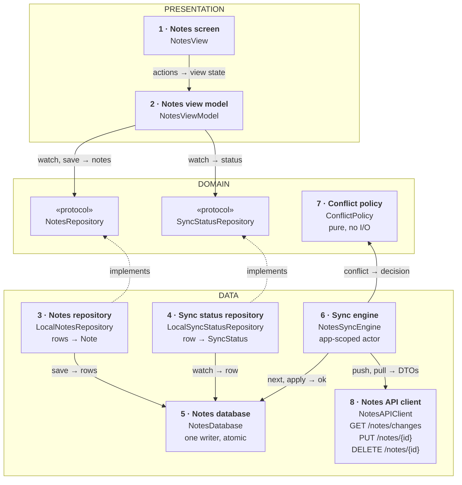
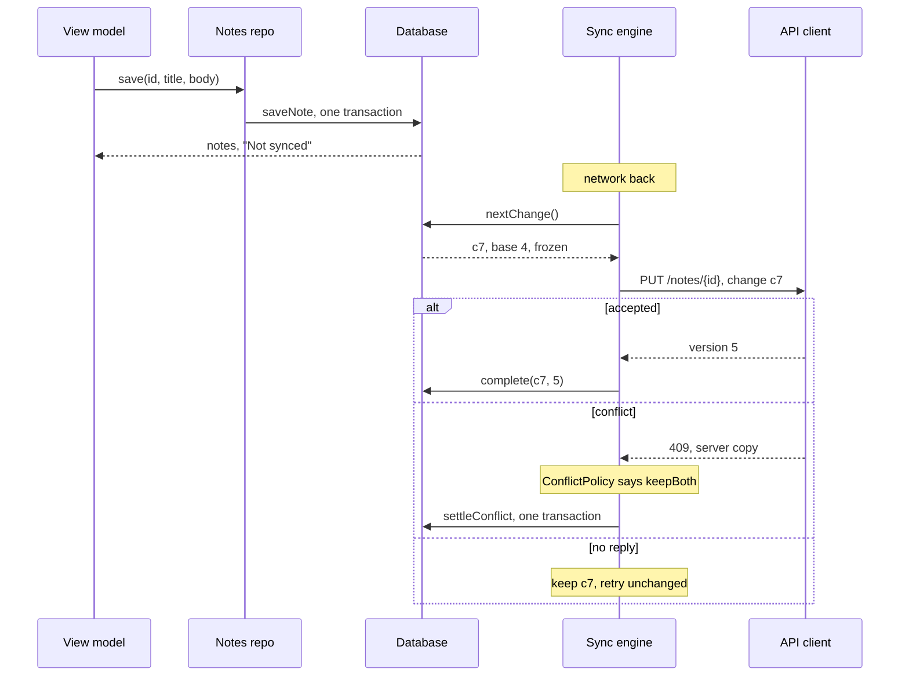
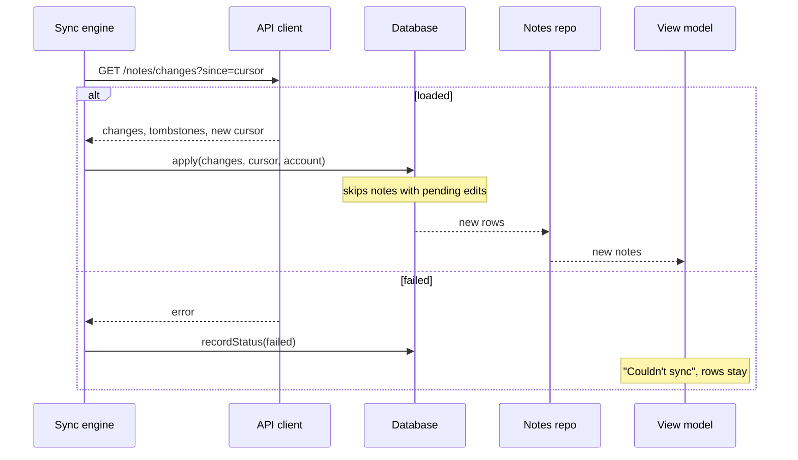

*A recurring senior mobile prompt. The answer stays small: the phone's database is the truth and owns every write that must land together, one background job syncs, and a pure policy decides conflicts.*

> **Interviewer:** "Design a notes app that works fully offline and syncs."

## Run it as a round, not as reading

Set a timer. Sketch. Talk the whole time. Open a section only when its slot is over.

| Clock | Phase | What you do |
|---|---|---|
| 0:00–0:02 | The prompt | Repeat it back in one sentence |
| 0:02–0:07 | Clarify | Ask yours, then read section 1 |
| 0:07–0:12 | Scope | Out of scope first, then required, then later |
| 0:12–0:24 | High level | The idea · the parts · the sketch · one line each · two flows |
| 0:24–0:40 | Deep dives | The interviewer picks one of sections 9–11 |
| 0:40–0:45 | Recap | Follow-ups, then the 60-second summary |

## What this question is really testing

- **Where the truth lives.** The phone's database, not the server. The screen never waits for the network.
- **A queue of unsent changes** saved with the note in one transaction, sent in order per note, safe to retry.
- **Conflicts as a product rule:** the same note edited on two devices offline. Never lose text.
- **Deletes that travel:** a note deleted offline must disappear everywhere.
- **Keeping it small.** Sync is one background job, not something the screen does.

**Traps:** saving to the server first; "one transaction" across two databases; "last write wins"; retries without an ID; deleting rows instead of tombstones; "No notes" when the first sync failed; background sync at a set time.

::: Words used in this chapter
- **Repository** — the one owner of one kind of data. It turns the server's format into the app's model. Here, the database's.
- **Composite** — a repository that only reads: it asks two repositories and combines their answers into one model. Not used here.
- **Store** — in-memory state that several screens show at once. Not needed here yet.
- **Use case** — one user intent with a product rule, like "only the latest tap counts". Not needed here.
- **View model** — the screen's brain. It owns the screen's state and hands the screen one view state.
- **Policy** — a product rule as a pure function: no disk, no network, no state.
- **Source of truth** — the one place whose answer is right: the phone's database.
- **Pending change** — an edit the server hasn't got. Its **change ID** makes a resend harmless (idempotent).
- **Transaction** — several writes saved together, all or none.
- **Version, conflict** — the server bumps a note's version on each change; a conflict is an edit of an old version.
- **Tombstone, cursor** — a tombstone marks a deleted note. The cursor is the server's bookmark in its changes feed.
:::

::: 1 · The interviewer answers your clarifying questions
**"What's in a note?"** → *A title and plain text. No attachments for now.*

**"One device or several?"** → *Phone, iPad and the web, same account.*

**"Shared notes?"** → *No. One owner per note.*

**"Two devices edit the same note offline?"** → *Never lose what someone typed. How you show it is up to you.*

**"An edit on one device, a delete on another?"** → *Your call. Say what you'd pick.*

**"How fresh must other devices be?"** → *Seconds when online is nice. Minutes is fine.*

**"How many notes?"** → *Hundreds, a few KB each. Some users have ten thousand.*

**"How many users?"** → *Five million, a few dozen saves a day each. Don't design the backend.*

**"Minimum OS?"** → *iOS 17, SwiftUI, Swift 6.*
:::

::: 2 · Requirements and scope — what you should have said
**Out of scope, said first:** attachments, sharing, rich text, server search, the web client, how the server stores notes.

**Required for the prompt**

1. Create, edit and delete notes with no network.
2. Changes reach the user's other devices when online.
3. A conflict never loses text.
4. Show which notes haven't synced, and whether the last sync failed.

**What must feel good:** instant · durable, even if killed · each change lands once, in order · only changes are sent.

**Production considerations** (say, don't draw): token refresh, safe retries, data protection, metrics. Section 12.

**Optional follow-ups** (add only when asked):

```text
Seconds-fresh on other devices → a silent push that starts a pull
Long notes, attachments        → diffs, separate uploads
Fewer conflict copies          → merge edits to different lines
Real-time collaboration        → a different design (CRDT or OT)
```

*"I'll start simple and add each of these when the requirement appears."*
:::

::: 3 · The idea, in 30 seconds — before you draw anything
> *"The phone's database is the truth, so the screen reads and writes only there. One database owns the notes and the pending changes, so a save writes both in one transaction. A sync engine sends pending changes with `PUT /notes/{id}` and `DELETE /notes/{id}`, one at a time per note, each with a change ID, then pulls other devices' changes with `GET /notes/changes?since={cursor}`. When the server says 'conflict', a pure conflict policy decides: keep both copies, and an edit beats a delete. Sync status is its own stream, so a failed sync reads 'not up to date', never 'no notes'."*
:::

::: 4 · What we need — the components, before the sketch
| # | Part | Type | Layer | Its one job |
|---|---|---|---|---|
| 1 | **Notes screen** | `NotesView` | Presentation | Draws the view state, forwards actions. |
| 2 | **Notes view model** | `NotesViewModel` | Presentation | Notes + sync status → one view state; owns the draft. |
| 3 | **Notes repository** | `LocalNotesRepository` | Data | Note rows → `Note`; save and delete. |
| 4 | **Sync status repository** | `LocalSyncStatusRepository` | Data | The status row → `SyncStatus`. |
| 5 | **Notes database** | `NotesDatabase` | Data | Notes, tombstones, pending changes, status; atomic writes. |
| 6 | **Sync engine** | `NotesSyncEngine` | Data | Triggers; push one change at a time, then pull. |
| 7 | **Conflict policy** | `ConflictPolicy` | Domain | Decides a 409: keep both, edit beats delete. |
| 8 | **Notes API client** | `NotesAPIClient` | Data | The three endpoints → DTOs. |
| chip | **Notes repository** | `NotesRepository` | Domain | The promise card 3 keeps. |
| chip | **Sync status repository** | `SyncStatusRepository` | Domain | The promise card 4 keeps. |

Eight cards, two chips. `Note` and `SyncStatus` are written on cards 3 and 4.

**No use case:** watch, save and delete have no rule. The one rule, conflicts, is a pure policy: no user taps "resolve".

**Not drawn:** the `HTTPClient` inside card 8, and a network monitor wrapping `NWPathMonitor` behind a `NetworkPath` protocol (card 6's trigger). **Not on the list yet:** the optional follow-ups, a search index.
:::

::: 5 · The sketch


**How to read it.** A solid arrow points from the asker to the answerer: *request → reply*. Dashed arrows mean *implements*. Only the orange card touches the network.

**Dependency inversion, in one line.** The domain writes the two promises (the chips); cards 3 and 4 keep them, so both dashed arrows point **up**.

**One class, three promises.** Card 5 keeps a narrow protocol per caller: `NoteRecords` (card 3), `SyncStatusRecords` (card 4), `SyncRecords` (card 6). That makes "one transaction" honest: note and pending change live in one database.

**No shared store:** list and editor are one screen; a second screen would watch the same database.

**On Miro:** three frames, eight cards, two chips. Point at card 6: *"the screen never waits for this."*
:::

::: 6 · Each component: its job, its interface, the choice inside it
**The models everyone shares.** The screen never sees a record or a DTO.

```swift
struct Note: Identifiable, Hashable, Sendable {
    /// Made on the phone, so it exists offline
    let id: NoteID
    let title: String
    let body: String
    let updatedAt: Date
    /// synced, pending, or refused (the server won't take it)
    let sync: NoteSyncState
}

struct SyncStatus: Equatable, Sendable {
    /// nil = this device has never finished a sync
    let lastSyncedAt: Date?
    let isSyncing: Bool
    let lastRunFailed: Bool
}
```

### 1 · Notes screen (`NotesView`)

**Job:** shows the list and the editor, and reports what the user does. It decides nothing.

**Interface:** reads `viewModel.viewState`; calls `onAppear()`, `select(_:)`, `create()`, `edit(title:body:)`, `delete(_:)`.

**Choice:** `NavigationSplitView`: side by side on iPad, pushed on iPhone, one screen.

### 2 · Notes view model (`NotesViewModel`)

**Job:** combines the notes and status streams into one view state, and owns the draft.

```swift
struct NotesViewState: Equatable {
    /// title, preview, formatted date, badge ("Not synced")
    let rows: [NoteRow]
    /// noNotes, firstSyncRunning, firstSyncFailed; nil when there are rows
    let empty: EmptyState?
    let isSyncing: Bool
    /// e.g. "Couldn't sync · last synced 10:42"; the rows stay
    let syncProblem: String?
    let editor: EditorState?
}

@MainActor @Observable
final class NotesViewModel {
    init(notes: NotesRepository, status: SyncStatusRepository)

    var viewState: NotesViewState { get }

    func onAppear() async
    func select(_ id: NoteID)
    func create()
    func edit(title: String, body: String)
    func delete(_ id: NoteID)
}
```

**Choices:**

- **It watches, it doesn't fetch.** Each stream replays its value, then every change, from this screen or from sync.
- **Small states that coexist:** rows, syncing and "last sync failed" at once, without a dozen enum cases.
- **A failed sync is "unknown", not "empty".** "No notes yet" appears only after a sync succeeded; before that, "Loading your notes…" or "Couldn't load them yet".
- **The draft is the view model's until saved,** debounced (half a second after typing stops, and on leaving). An incoming list never overwrites it.

### 3 · Notes repository (`LocalNotesRepository`)

**Job:** reads rows as `Note`s; turns a save or delete into one atomic database call.

```swift
protocol NotesRepository: Sendable {
    /// Replays the current notes, then each change. One stream per
    /// caller; it finishes when the caller's task is cancelled.
    func notes() -> AsyncStream<[Note]>
    /// Saves the note and its pending change, all or none. Throws
    /// only if the disk write fails. Not cancelled by the caller.
    func save(id: NoteID, title: String, body: String) async throws
    /// Marks a tombstone and queues the delete, all or none.
    func delete(_ id: NoteID) async throws
}

final class LocalNotesRepository: NotesRepository {
    init(records: NoteRecords)
}
```

**Choices:**

- **`save(id:title:body:)`, not `save(_ note: Note)`,** so a caller can't set `sync` or a version. Only the database decides those.
- **One source, so no composite.** The pending flag is a join inside one database. No "sync now": the engine notices saves.

### 4 · Sync status repository (`LocalSyncStatusRepository`)

**Job:** reads the status row the engine writes, as `SyncStatus`.

```swift
protocol SyncStatusRepository: Sendable {
    /// Replays the current status, then each change. One stream per
    /// caller; finishes when the caller's task is cancelled.
    func status() -> AsyncStream<SyncStatus>
}

final class LocalSyncStatusRepository: SyncStatusRepository {
    init(records: SyncStatusRecords)
}
```

**Choice:** its own protocol, so the notes stream carries notes only, not the engine's state.

### 5 · Notes database (`NotesDatabase`)

**Job:** keeps notes, tombstones, versions, pending changes, the cursor and the status row, and runs each write that must land together as one transaction.

```swift
/// Card 3's half
protocol NoteRecords: Sendable {
    func noteRows() -> AsyncStream<[NoteRecord]>
    /// Note row + its waiting change, one transaction
    func saveNote(id: NoteID, title: String, body: String) async throws
    func deleteNote(id: NoteID) async throws
}

/// Card 4's half
protocol SyncStatusRecords: Sendable {
    func statusRow() -> AsyncStream<SyncStatusRecord>
}

/// Card 6's half
protocol SyncRecords: Sendable {
    /// The "after each save" trigger
    func pendingCount() -> AsyncStream<Int>
    /// Oldest change whose note has nothing in flight, frozen
    /// with its text and base version. nil = nothing to send.
    func nextChange() async throws -> SentChange?
    func complete(_ change: ChangeID, version: Int) async throws
    func markRefused(_ change: ChangeID) async throws
    /// One transaction: server copy in, optional new note queued,
    /// the stale change dropped
    func settleConflict(_ change: ChangeID, serverCopy: NoteRecord?,
                        newNote: NoteRecord?) async throws
    /// Changes + cursor, one transaction. Skips notes with a pending
    /// change; refuses a run for another account.
    func apply(_ changes: [NoteRecord], cursor: Cursor,
               account: AccountID) async throws
    func cursor() async throws -> Cursor?
    func recordStatus(_ status: SyncStatusRecord) async throws
}

actor NotesDatabase: NoteRecords, SyncStatusRecords, SyncRecords {
    init(fileURL: URL)
}
```

**Choices:**

- **One owner of the tables that change together.** "Note + change" and "changes + cursor" are one transaction each only because one database runs both.
- **SQLite behind one actor on iOS 17.** The only writer, so it publishes after each commit. *Rejected:* SwiftData behind a `@ModelActor` has no change history on iOS 17; `HistoryDescriptor` is iOS 18. *Switch* at an iOS 18 minimum.
- **Records only;** cards 3, 4 and 6 map.

### 6 · Sync engine (`NotesSyncEngine`)

**Job:** the one background job: wake on a trigger, push pending changes one at a time, then pull.

```swift
protocol SyncEngine: Sendable {
    /// Starts the triggers: launch, network back, foreground, a newly
    /// queued change. Calling it twice changes nothing.
    func start() async
    /// Sign-out. A reply still in flight is refused by apply's
    /// account check.
    func stop() async
}

actor NotesSyncEngine: SyncEngine {
    init(records: SyncRecords, api: NotesAPI,
         policy: ConflictPolicy, network: NetworkPath)
}
```

**Choices:**

- **One loop, one change at a time,** oldest first: no two syncs race, and each note's changes arrive in order. Push first, then pull.
- **It asks the policy, it doesn't own the rule.** On a 409 it calls `ConflictPolicy`, then `settleConflict`. The DTO → record mapper is a pure helper inside it.

### 7 · Conflict policy (`ConflictPolicy`)

**Job:** decides what a conflict becomes. Pure: no disk, no network, no state.

```swift
enum Side: Equatable, Sendable {
    case edited(title: String, body: String)
    case deleted
}

enum ConflictResolution: Equatable, Sendable {
    /// Server copy stays the note; local text becomes a new note
    case keepBoth(copyTitle: String)
    /// The server deleted it; local text comes back as a new note
    case recreate
    /// Our delete lost to a newer edit; the note comes back
    case keepServer
}

struct ConflictPolicy: Sendable {
    /// Same input, same answer. Never throws.
    func resolve(local: Side, server: Side) -> ConflictResolution
}
```

**Choices:**

- **Domain, because a PM states it** without naming HTTP: "never lose text, and an edit beats a delete".
- **A policy, not a use case:** no user intent starts it, and it does no I/O. Tested with plain inputs.

### 8 · Notes API client (`NotesAPIClient`)

**Job:** calls the three endpoints and decodes the replies into DTOs.

```swift
protocol NotesAPI: Sendable {
    /// Throws on failure. Cancelling the caller cancels the request.
    func changes(since cursor: Cursor?) async throws -> ChangesPageDTO
    /// Throws .conflict(NoteDTO) on 409; the DTO says deleted: true
    /// for a tombstone. A repeated change ID gets the first answer.
    func put(_ id: NoteID, _ note: NoteBodyDTO, baseVersion: Int?,
             change: ChangeID) async throws -> Int
    func delete(_ id: NoteID, baseVersion: Int,
                change: ChangeID) async throws
}
```

**Choices:**

- **A client, not a repository:** it returns DTOs. A fake that answers 409 or times out tests the engine.
- **Auth in its HTTP client:** on a 401, refresh once and retry. Decoding is `@concurrent` under Swift 6.2, off the engine's actor.

**Why these parts, and no more.** Each card changes for one reason:

| Card | Changes when |
|---|---|
| 1 · Notes screen | the screen's design |
| 2 · Notes view model | the screen's behaviour |
| 3 · Notes repository | a storage schema (how note rows read as `Note`) |
| 4 · Sync status repository | a storage schema (the status row) |
| 5 · Notes database | a storage schema (tables, transactions) |
| 6 · Sync engine | a connection's lifecycle (when and in what order sync runs) |
| 7 · Conflict policy | a product rule (what a conflict becomes) |
| 8 · Notes API client | an endpoint or payload |

Each protocol earns a fake or a smaller promise. Not added: a use case for saving (a pass-through), a composite (one source), a shared store (the database is shared), a DI container, a CRDT library.
:::

::: 7 · Key flows through the sketch
**Flow 1 — edit offline, then the network comes back.**



A timeout doesn't say whether the server saved it, so the retry is identical; the server answers a repeat with its first answer.

**Flow 2 — another device changed a note.**



A failed pull applies nothing and keeps the cursor.
:::

::: 8 · The server contract
```
GET    /v1/notes/changes?since={cursor}&limit=200
       → { "changes": [ { "id", "title", "body", "version",
                          "updatedAt", "deleted": false } ],
           "nextCursor": "…", "hasMore": false }

PUT    /v1/notes/{id}   Idempotency-Key: {changeId}
       { "title", "body", "baseVersion": 4 }   // null for a new note
       → 200 { "version": 5 }
       → 409 { "note": { …server copy…, "deleted": false } }

DELETE /v1/notes/{id}?baseVersion=5   Idempotency-Key: {changeId}
       → 204, or 409 with the newer copy
```

- **The phone makes the note ID and the change ID.** `PUT` creates or updates; a repeated change ID gets the first answer.
- **`baseVersion` says "I edited version 4".** If the server is past it, or holds a tombstone, it answers 409.
- **The cursor is opaque and the server's.** Order is its promise; the client returns it untouched and ignores a change no newer than its copy. Expired: `410 Gone`, full resync. Personal data, never on a shared cache.
:::

::: 9 · Deep dive — "The same note is edited on the phone and the laptop, both offline."
**Decision: keep both copies. The rule lives in `ConflictPolicy`.**

1. The phone syncs first: `PUT` with base 4 is accepted; the note is version 5.
2. The laptop's `PUT` with base 4 gets **409** and the server's version 5.
3. The policy sees two edits: `keepBoth`. In one transaction the server's copy becomes the note, and the laptop's **latest** text becomes a new note, "Groceries (conflict copy)", with its own pending change.
4. The user merges by hand, if they care.

*Rejected:* last write wins, which silently throws away one device's typing. *Later:* merge edits to different lines. *Out of this design:* CRDTs, which solve real-time collaboration.
:::

::: 10 · Deep dive — "The user deletes a note offline. How do the other devices find out?"
**Decision: a tombstone, not a removed row.**

1. The phone marks the note deleted, hides it, and queues a delete, in one transaction.
2. The engine sends `DELETE` with the base version.
3. The server keeps a tombstone and returns it in everyone's changes feed.
4. Other devices apply it: mark deleted, hide.

**Why not remove the row?** A pull couldn't tell "deleted here" from "never had it", and the note would return.

**Edit here, delete there.** The policy says an edit beats a delete:

- *The delete landed first.* Our `PUT` gets 409 with `deleted: true`. `recreate`: our text returns as a new note, new ID.
- *The edit landed first.* Our `DELETE` gets 409 with the newer copy. `keepServer`: the note reappears.
- *Both deleted.* No conflict; the server answers 204.

**Cleaning up:** tombstones are purged after, say, 30 days. A device offline longer gets `410` and resyncs, keeping pending changes.
:::

::: 11 · Deep dive — "The app is killed in the middle of syncing."
**Nothing is lost, and nothing is applied twice.**

- **After saving, before sending.** Note and change were one transaction; next launch sends it.
- **After the server accepted, before `complete`.** The frozen change goes again, same change ID; the server returns its first answer. No 409, no duplicate.
- **Mid-pull.** Changes and cursor are one transaction, so the pull repeats.

**Concurrency:** database and engine are each one app-scoped actor; the view model is on the main actor.

**The stale-result guard, carried by the account ID.** Cancellation is cooperative, so a reply can land after sign-out; `apply` refuses another account's results. Inside the same transaction it also skips notes edited while the pull was out.

**Sign-out with pending changes:** warn ("3 notes haven't synced and will be lost"), then stop the engine, delete the database.

**Background.** `beginBackgroundTask(withName:expirationHandler:)` gives a push a little time as the user leaves. A `BGAppRefreshTask` from `BGTaskScheduler` may pull, but the system decides if and when. A bonus.
:::

::: 12 · Failure modes, production and scale
**Failures**

| Failure | Client behaviour |
|---|---|
| No network | Everything works; rows say "Not synced" |
| Push times out | Keep the change, retry it unchanged with backoff |
| Pull fails | Apply nothing, keep the cursor; "Couldn't sync", rows stay |
| First sync fails on a new device | "Couldn't load your notes yet", never "No notes" |
| 409 conflict | The policy decides; no text is lost |
| Refused for good (other 4xx) | Stop retrying; "Couldn't sync" on that note only |
| 401 | Refresh once and retry; else sign in again, keep pending |
| 429 | Wait for `Retry-After` |
| Cursor expired (410) | Full resync, keeping pending changes |

**Production notes** (short, not on the board)

- **Networking:** timeouts; retry timeouts and 5xx with backoff, safe because every write has a change ID. `NWPathMonitor` is a hint to try now, not a promise.
- **Caching:** the database *is* the cache.
- **Metrics:** save-to-ack latency, oldest pending age, sync failures, conflict rate, full resyncs. No note text in logs.
- **Security:** tokens in the Keychain; the database file uses `completeUntilFirstUserAuthentication`, because `complete` locks it while the phone is locked and background sync fails.

**Scale, back of the envelope**, with the interviewer's numbers:

```text
notes per user × average note size        = local storage
users × saves synced a day × payload size = sync traffic
```

10,000 notes × 2 KB is 20 MB: fine on the phone, too much to download each launch, hence the changes feed. Five million × 30 × 2 KB is about 300 GB a day; debouncing keeps it down.

**Grow only when asked**

```text
A second screen or a widget  → watches the same database, no store
Seconds-fresh across devices → a silent push that starts a pull
Ten thousand notes           → paged pulls, a lazy list
Long notes                   → send diffs, not whole bodies
Attachments                  → separate uploads, referenced from the note
Collaboration                → a different design (CRDT or OT)
```
:::

::: 13 · Question bank — everything they can push on
Answer out loud first, then open.

### Scope and architecture

<details>
<summary>"Walk me through the layers."</summary>

Presentation: screen and view model. Domain: the models, two repository protocols, the conflict policy. Data: two local repositories, the database, the engine, the API client.
</details>

<details>
<summary>"Why no use case?"</summary>

Watch, save and delete have no product rule; a use case would only pass them through. Conflicts have no user intent and no I/O, so they're a pure policy.
</details>

<details>
<summary>"Why is the conflict rule in the domain and not in the sync engine?"</summary>

A PM states it without naming HTTP. In the engine it would hide in a loop and change whenever the sync order does.
</details>

<details>
<summary>"Show me dependency inversion."</summary>

The two repository protocols live in the domain; cards 3 and 4 implement them. Both arrows point up, so the view model never imports SQLite or networking.
</details>

<details>
<summary>"Where does mapping happen?"</summary>

Rows → models in cards 3 and 4, DTO → record in a pure mapper inside the engine. The client returns DTOs; the database knows records only.
</details>

<details>
<summary>"Where does the combined state come from? Is there a composite?"</summary>

No composite: one source, and the pending flag is a join inside it. The view model combines notes and sync status, since only it needs both.
</details>

<details>
<summary>"Why isn't sync status part of the notes stream?"</summary>

It's the engine's state, not a note's. Its own protocol keeps each promise, and each fake, small.
</details>

### Saving and the queue

<details>
<summary>"Why does one database own both the notes and the queue?"</summary>

So a save is one transaction. Two databases can't commit together; a crash between them leaves an edit that never syncs.
</details>

<details>
<summary>"The user edits a note ten times offline."</summary>

One waiting change per note: "upload the latest". Ten edits, one request.
</details>

<details>
<summary>"The user keeps typing while a change is in flight."</summary>

It becomes the waiting change, sent next with the version the first one got back.
</details>

<details>
<summary>"A PUT times out. Did the server save it?"</summary>

We can't know. We resend the frozen change, same ID; the server returns its first answer.
</details>

<details>
<summary>Follow-up chain: "The app is killed."</summary>

1. *"Right after saving."* → The change was saved with the note; it goes at next launch.
2. *"After the server accepted."* → Same change ID again; the server returns its first answer.
3. *"Mid-pull."* → Changes and cursor are one transaction, so the pull repeats.
</details>

### Sync and the API

<details>
<summary>"What's in the cursor, and what if it expires?"</summary>

Opaque, maybe a position in the server's log. Too old gets 410: full resync, keeping pending changes.
</details>

<details>
<summary>"Can the feed send a change twice, or out of order?"</summary>

Order is the server's promise. The client applies a change only if its version is newer, so a repeat is harmless.
</details>

<details>
<summary>"A pulled change arrives for a note with unsent edits."</summary>

`apply` skips it inside its transaction. Our push goes, and the server's answer, accept or 409, settles it.
</details>

<details>
<summary>"When does sync run? Every 15 minutes in the background?"</summary>

At launch, on foreground, when the network returns, and when a change is queued. Background refresh runs when `BGTaskScheduler` chooses, or not at all.
</details>

<details>
<summary>"How does the engine know there's a new save?"</summary>

It watches the database's pending count; the repository never calls it.
</details>

<details>
<summary>"The sync fails. What does the screen show?"</summary>

Its notes, "Couldn't sync" and the last-synced time. On a new device, "Couldn't load your notes yet", never "No notes".
</details>

<details>
<summary>Follow-up chain: "Sign-out."</summary>

1. *"Sign-out mid-sync."* → Stop the engine; a reply can still arrive.
2. *"It arrives."* → It carries the old account, and `apply` refuses it. That's the stale-result guard.
3. *"There are unsent changes."* → Warn that they'll be lost, then delete the database.
</details>

### Conflicts and deletes

<details>
<summary>"Two devices edit the same note offline."</summary>

The second `PUT` gets 409. The policy says keep both: the server's copy as the note, our latest text as a conflict copy.
</details>

<details>
<summary>"Edit on one device, delete on another."</summary>

An edit beats a delete. A `PUT` on a tombstone comes back as a new note; a `DELETE` against a newer edit loses, and the note reappears.
</details>

<details>
<summary>"How do you test conflicts?"</summary>

The policy with plain inputs. The engine with a fake API answering 409 and an in-memory database: both notes exist.
</details>

### Change and scale

<details>
<summary>"Why not SwiftData?"</summary>

On iOS 17 a `@ModelActor` gives no change history; SwiftData history is iOS 18. Then I'd reconsider.
</details>

<details>
<summary>"What changes at 10x?"</summary>

Mostly the server. Client: paged pulls, diffs, honouring 429s.
</details>

<details>
<summary>Follow-up chain: "A second screen."</summary>

1. *"Add a widget with the latest notes."* → It reads the same database, moved into an App Group container.
2. *"Does it see an edit at once?"* → The app does, by watching; the widget after `WidgetCenter` reloads its timeline.
3. *"Do you need a shared store now?"* → No. The database is the shared state; a store would only duplicate it.
</details>
:::

::: 14 · Scorecard — mark yourself, 0 / 1 / 2
| | Did you… | 0–2 |
|---|---|---|
| 1 | Talk the whole time, and listen when interrupted | |
| 2 | Clarify before designing | |
| 3 | Give a trade-off for each choice | |
| 4 | Say out of scope first; separate required from later | |
| 5 | Say the idea, list the parts, then sketch | |
| 6 | Keep the sketch to nine type cards, one line each | |
| 7 | Make the phone's database the truth, one owner for note + change | |
| 8 | Name the three endpoints; call the cursor opaque and server-owned | |
| 9 | Send each note's changes in order, one in flight, with a change ID | |
| 10 | Put the conflict rule in a pure policy; never lose text | |
| 11 | Sync deletes with tombstones; say what beats what | |
| 12 | Keep sync status off the notes stream; failed is unknown, not empty | |
| 13 | Survive being killed; call background sync opportunistic | |
| 14 | Land the recap inside 60 seconds | |

14+ is a pass.<!--private--> Anything scored 0 goes in the progress log and comes back as a recall prompt.<!--/private--><!--public--> A zero names the thing to read about next.<!--/public-->
:::

::: 15 · The 60-second recap
The phone's database is the truth, so the app never waits for the network. One database actor owns notes, tombstones and pending changes, so a save writes note and change in one transaction. Notes and sync status are separate streams the view model combines, so a failed sync reads "not up to date", never "no notes". One background engine pushes with `PUT` and `DELETE`, one change at a time, each with its base version and a change ID so retries are harmless, then pulls `GET /notes/changes?since=` and applies changes and cursor together. On a 409, a pure conflict policy decides: keep both copies, and an edit beats a delete. Being killed at any step is safe, and background refresh is a bonus.
:::
