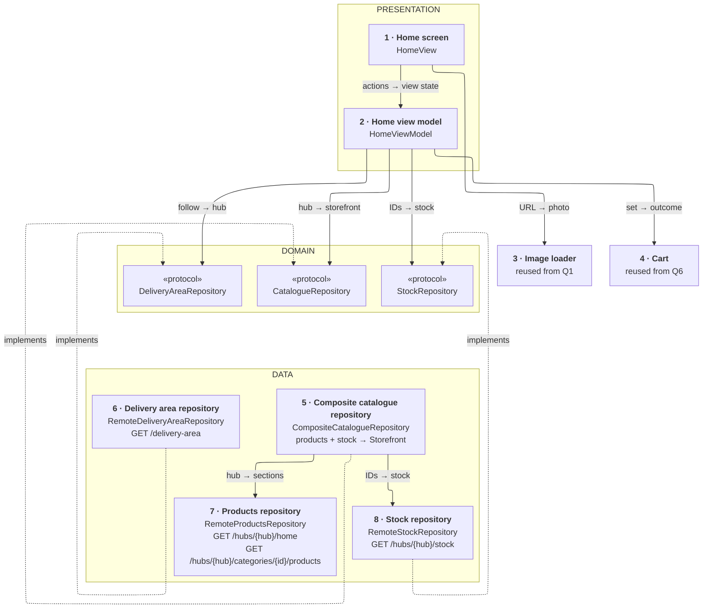
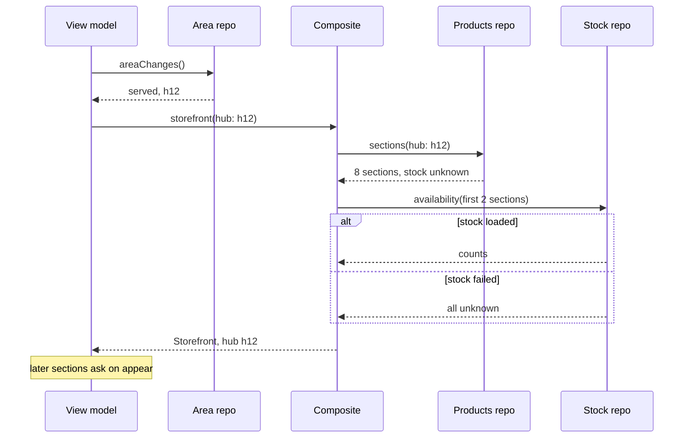
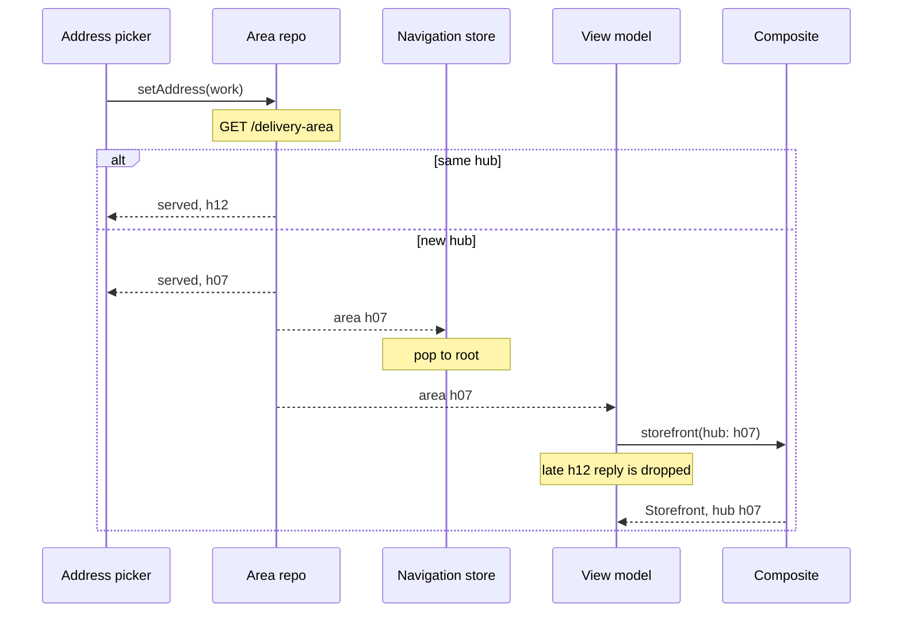

*A catalogue looks like a list question. The twist is that the list belongs to a place: each address maps to one small warehouse with its own products and stock. The answer stays small: one source says which hub, the hub goes into every request path, and stock is asked for only what's on screen.*

> **Interviewer:** "We deliver groceries in about ten minutes from small local warehouses. Design the home and catalogue screens. What's in stock depends on the customer's address."

## Run it as a round, not as reading

Set a timer. Sketch. Talk the whole time. Open a section only when its slot is over.

| Clock | Phase | What you do |
|---|---|---|
| 0:00–0:02 | The prompt | Repeat it back in one sentence |
| 0:02–0:07 | Clarify | Ask yours, then read section 1 |
| 0:07–0:12 | Scope | Out of scope first, then required, then later |
| 0:12–0:24 | High level | The idea · the parts · the sketch · one line each · two flows |
| 0:24–0:40 | Deep dives | The interviewer picks one of sections 9–11 |
| 0:40–0:45 | Recap | Follow-ups, then the 60-second summary |

## What this question is really testing

- **The address decides everything.** Address → hub → catalogue, and the hub is in every cache key.
- **A home screen the server arranges,** with block types the app may not know yet.
- **Two kinds of freshness.** Names and prices change daily; stock changes by the minute.
- **Honest tiles.** Price, deposit and "out of stock", with failed stock shown as unknown.
- **One owner for the hub,** which every screen and the cart follow.

**Traps:** the hub in a header instead of the path; trusting cached stock at checkout; prices in `Double`; crashing on an unknown block type; "out of stock" when the stock call failed; stock for every product on the home.

::: Words used in this chapter
- **Repository** — the one owner of one kind of data. It turns the server's format into the app's model.
- **Composite** — a repository that only reads: it asks two repositories and combines their answers into one model.
- **Store** — in-memory state that several screens show at once. Here: question 6's cart.
- **Use case** — one user intent with a product rule, like "only the latest tap counts".
- **View model** — the screen's brain. It owns the screen's state and hands the screen one view state.
- **Hub (dark store)** — a small warehouse that only serves deliveries. Each address has one.
- **Stock** — how many of a product the hub has right now.
- **Server-driven section** — a block of the home the server chooses and orders.
- **Cache key** — the label a saved response is filed under. A new key means a new copy.
- **Deposit (Pfand)** — a refundable charge on bottles and cans, shown beside the price.
- **Minor units** — money as a whole number of cents: 1,99 € is 199.
:::

::: 1 · The interviewer answers your clarifying questions
**"How does an address become a hub?"** → *The server decides. Send a location; it answers with a hub or "we don't deliver there".*

**"No address yet?"** → *Let them look around a default hub. Ordering needs an address.*

**"How many products per hub?"** → *About 3,000. Similar across hubs, not the same.*

**"Same price everywhere?"** → *Per hub, yes; never per user. Discounts come from the server.*

**"Who decides the home screen?"** → *The server: banners, categories, "buy again", product rows. Marketing adds new kinds of blocks.*

**"How fast does stock change?"** → *Popular items sell out in minutes. Checkout always re-checks. Hubs close at night.*

**"Offline?"** → *Show what you have. Nobody orders offline.*

**"Cart?"** → *Question 6. Tiles have its stepper.*

**"Minimum OS?"** → *iOS 17, SwiftUI, Swift 6.*
:::

::: 2 · Requirements and scope — what you should have said
**Out of scope, said first:** search, the cart and checkout (question 6), the address picker, the courier map, recommendations. Photos come from question 1's image loader.

**Required for the prompt**

1. Resolve the address to a hub; handle no address, out of area and closed.
2. Show the home the server arranges, skipping block types the app doesn't know.
3. Open a category and scroll its products.
4. Tiles with price, discount, deposit and stock, fresh enough to trust while browsing.

**What must feel good:** a fast home from cache · stock never shown as known when it isn't · two hubs never mixed · exact prices.

**Production considerations** (say, don't draw): HTTP caching, retries, timeouts, metrics per hub (section 12).

**Optional follow-ups** (add only when asked): search, live stock, the whole catalogue offline, a product detail screen. The ladder is in section 12.
:::

::: 3 · The idea, in 30 seconds — before you draw anything
> *"A delivery-area repository is the one owner of the hub: it calls `GET /delivery-area` and streams area changes to whoever follows them. Every catalogue request carries the hub in its path: `GET /hubs/{hub}/home` for the server's sections, `GET /hubs/{hub}/categories/{id}/products` for a category, and `GET /hubs/{hub}/stock` on its own, because stock goes stale in seconds. A products repository maps the first two; a stock repository caches counts for 30 seconds. A read-only composite fills in stock for the first screenful. The view model follows the hub, asks for stock as sections appear, and drops any reply for an old hub. Steppers are question 6's cart."*
:::

::: 4 · What we need — the components, before the sketch
| # | Part | Type | Layer | Its one job |
|---|---|---|---|---|
| 1 | **Home screen** | `HomeView` | Presentation | Draws the view state. |
| 2 | **Home view model** | `HomeViewModel` | Presentation | Hub, storefront, stock, cart → one view state. |
| 3 | **Image loader** | reused from Q1 | Reused | Delivers product photos. |
| 4 | **Cart** | reused from Q6 | Reused | Quantities and the stepper's write. |
| 5 | **Composite catalogue repository** | `CompositeCatalogueRepository` | Data | Products + stock → `Storefront`. |
| 6 | **Delivery area repository** | `RemoteDeliveryAreaRepository` | Data | Address → hub, and hub changes. |
| 7 | **Products repository** | `RemoteProductsRepository` | Data | Sections and category pages per hub. |
| 8 | **Stock repository** | `RemoteStockRepository` | Data | Counts per hub, cached 30 seconds. |
| chip | **Catalogue repository** | `CatalogueRepository` | Domain | The promise card 5 keeps. |
| chip | **Delivery area repository** | `DeliveryAreaRepository` | Domain | The promise card 6 keeps. |
| chip | **Stock repository** | `StockRepository` | Domain | The promise card 8 keeps. |

Eight cards, three chips. `Storefront` and `Product` aren't cards: the composite returns them. The category screen has the same shape, so it isn't drawn twice.

**Not drawn:** `NavigationStore`, the app's path holder, which follows `areaChanges()` and pops to the root on a new hub; `MoneyFormatter`, a pure helper; the shared `HTTPClient`. **Not on the list yet:** a use case. Loading has no product rule, and the one write with a rule, the quantity, is question 6's.
:::

::: 5 · The sketch


**How to read it.** A solid arrow points from the asker to the answerer: *request → reply*. Dashed arrows mean *implements*; the grey cards are reused from questions 1 and 6.

**Dependency inversion, in one line.** The domain writes the three promises (the chips); cards 5, 6 and 8 keep them, so the arrows point **up** and the view model never sees an endpoint.

**Shared state on this sketch:** the hub is on every screen, so its one owner, card 6, is drawn. The cart store is shared too, and it's question 6's.

**On Miro:** three frames, eight cards, three chips. Point at card 6: *"one owner of the hub; everything that depends on it follows its stream."*
:::

::: 6 · Each component: its job, its interface, the choice inside it
**The models everyone shares.** `Money` is question 6's, unchanged. The screen never sees a DTO.

```swift
struct Money: Hashable, Sendable {
    /// 1,29 € is 129. The server sends minor units.
    let minorUnits: Int
    /// ISO 4217, e.g. "EUR"
    let currency: String
}

/// served(HubID), outOfArea, or browsing(defaultHub: HubID)
enum DeliveryArea: Equatable, Sendable { … }

struct Storefront: Equatable, Sendable {
    /// The hub it was built for: the stale-result guard checks it
    let hub: HubID
    /// open, or closed(opensAt:)
    let hours: HubHours
    /// The server's order, unknown types already removed
    let sections: [HomeSection]
}

/// banners · categories · products(title:) · buyAgain, each with an id
enum HomeSection: Equatable, Sendable, Identifiable { … }

struct Product: Equatable, Sendable, Identifiable {
    /// The same SKU question 6's cart uses
    let id: SKU
    let name: String
    /// URL, width, height
    let image: ImageRef
    let price: Money
    let originalPrice: Money?
    /// Shown beside the price, never added in
    let deposit: Money?
    /// Required by German price rules: per kg or litre
    let unitPrice: UnitPrice?
    /// inStock(count), outOfStock, or unknown (not asked yet, or failed)
    var availability: Availability
}
```

### 1 · Home screen (`HomeView`)

**Job:** draws the address header, a closed or offline notice, and the sections. It decides nothing.

**Interface:** reads `viewModel.viewState`; reports appear, foreground, pull to refresh, a section appearing, and stepper taps. Category taps are `NavigationLink(value:)`, handled by `navigationDestination(for:destination:)`.

**Choices:**

- **A `LazyVStack` of sections,** product rows as horizontal lazy stacks, tiles sized before photos arrive.
- **`.refreshable`** for pull to refresh; `scenePhase` tells the view model the app came back.
- **The `NavigationStack` path lives in `NavigationStore`,** not here and not in the view model, because the category screen needs the same reset.

### 2 · Home view model (`HomeViewModel`)

**Job:** follows the hub, loads its storefront, asks for stock as sections appear, and builds one view state.

```swift
struct HomeViewState: Equatable {
    /// "Torstraße 1" or "Add your address"
    let addressTitle: String
    /// closed "Opens at 07:00", offline "May be out of date", or nil
    let notice: Notice?
    /// loading, sections([SectionRow]), outOfArea(message), failed(message)
    let content: ContentState
    /// false when closed, offline, browsing or out of area
    let canOrder: Bool
}

struct ProductTile: Equatable, Identifiable {
    let id: SKU
    let name: String
    let imageURL: URL
    /// All formatted: "2,49 €", struck "2,99 €", "+ 0,25 € Pfand", "9,96 €/kg"
    let price: String
    let originalPrice: String?
    let deposit: String?
    let unitPrice: String?
    /// none, low("Only 2 left"), or out
    let stockBadge: StockBadge
    /// From the cart store. nil while the cart loads.
    let quantity: Int?
    let canAdd: Bool
}

@MainActor @Observable
final class HomeViewModel {
    init(area: DeliveryAreaRepository, catalogue: CatalogueRepository,
         stock: StockRepository, cart: CartStore,
         updateQuantity: UpdateQuantityUseCase, formatter: MoneyFormatter)
    var viewState: HomeViewState { get }
    func onAppear() async
    func refresh() async
    func onForeground() async
    func sectionAppeared(_ id: SectionID) async
    func setQuantity(_ quantity: Int, for sku: SKU) async
}
```

**Choices:**

- **The stale-result guard is the hub.** Every request names it, every reply carries it, and a reply whose hub isn't the current one is dropped. Cancelling the old load only saves bandwidth.
- **It doesn't decide when stock is stale.** It reports moments (a section appearing, foreground); the stock repository's 30-second cache decides whether to call.
- **Small separate states, not one enum.** A closed or offline hub still has sections.

### 3 · Image loader (reused from question 1)

**Job:** gives each tile its photo at the tile's size. **Interface:** URL plus display size, cancelled when the tile goes. **Choice:** photo URLs carry no hub, so they stay cached across a hub switch.

### 4 · Cart (reused from question 6)

**Job:** the stepper's quantity and its write.

**Interface:** the tile reads `CartStore.quantity(of:)` and `canEdit`, and calls `UpdateQuantityUseCase.setQuantity(_:for:)`, both keyed by the same `SKU`. That's all this chapter needs.

**Choice:** reused. Question 6's store also follows `areaChanges()`, so the badge and tiles switch hub together.

### 5 · Composite catalogue repository (`CompositeCatalogueRepository`)

**Job:** combines a hub's products with their stock for the first screenful. It owns no source and never writes.

```swift
protocol CatalogueRepository: Sendable {
    /// Sections for this hub, with stock for the first two sections.
    /// Other products stay .unknown. Throws only if sections failed.
    /// Cancelling the caller cancels both requests.
    func storefront(hub: HubID) async throws -> Storefront
    /// One page of 20, with its stock. Same failure rules.
    func products(hub: HubID, category: CategoryID,
                  after cursor: Cursor?) async throws -> ProductPage
}

final class CompositeCatalogueRepository: CatalogueRepository {
    init(products: ProductsRepository, stock: StockRepository)
}
```

**How it combines:**

1. Ask the products repository for the hub's sections: `Product`s with stock `unknown`.
2. Ask the stock repository for the products in the first two sections (a screenful).
3. Set those products' `availability`; if step 2 failed, leave them `unknown`.

**Choices:**

- **Stock failing never hides the catalogue,** and it only combines app models.
- **The trade-off, said out loud:** two requests add latency. They're separate because they go stale at different speeds. If the first load is too slow, I'd ask the server for a stock snapshot inside the home reply.

### 6 · Delivery area repository (`RemoteDeliveryAreaRepository`)

**Job:** the one owner of the hub. It resolves an address with `GET /delivery-area` and tells every follower when the hub changes.

```swift
protocol DeliveryAreaRepository: Sendable {
    /// Throws if unreachable.
    func area() async throws -> DeliveryArea
    /// Replays the current area, then emits only when the hub changes.
    /// One stream per caller. Finishes when the caller's task is cancelled.
    func areaChanges() -> AsyncStream<DeliveryArea>
    /// Called by the address picker. Throws if unreachable: the old area stays.
    func setAddress(_ address: Address) async throws -> DeliveryArea
}
```

**Choices:**

- **An actor, app-scoped.** The home, the category screen, `NavigationStore` and question 6's cart store all follow the same stream.
- **A new address in the same hub emits nothing,** so no cache or cart is touched. It keeps the last address and area in a small file, so launch starts from the last hub.

### 7 · Products repository (`RemoteProductsRepository`)

**Job:** fetches `GET /hubs/{hub}/home` and `GET /hubs/{hub}/categories/{id}/products`, and maps them.

```swift
/// Data-internal: the composite's promise
protocol ProductsRepository: Sendable {
    /// Unknown section types dropped and counted. Throws on failure.
    func sections(hub: HubID) async throws -> [HomeSection]
    func page(hub: HubID, category: CategoryID, after cursor: Cursor?) async throws -> ProductPage
}
```

**Choices:**

- **The hub is in the URL path,** so it's in every cache key for free: `URLCache`, the CDN, memory. A header would hide it from the key.
- **Offline, it asks with `.returnCacheDataDontLoad`** and marks the result stale.

### 8 · Stock repository (`RemoteStockRepository`)

**Job:** fetches counts from `GET /hubs/{hub}/stock?ids=` and keeps them for 30 seconds.

```swift
protocol StockRepository: Sendable {
    /// Cached counts younger than 30 s, the rest fetched in one request.
    /// Never throws: a failed fetch returns .unknown, never .outOfStock.
    func availability(of skus: [SKU], at hub: HubID) async -> [SKU: Availability]
}
```

**Choice:** a memory cache keyed by hub and SKU, an actor. Never on disk: old stock is worse than none.

**Why these parts, and no more.** Each card changes for one reason:

| Card | Changes when |
|---|---|
| 1 · Home screen | the screen's design |
| 2 · Home view model | the screen's behaviour |
| 3 · Image loader | (question 1) |
| 4 · Cart | (question 6) |
| 5 · Composite | how two sources combine |
| 6 · Delivery area repository | an endpoint or payload (`/delivery-area`) |
| 7 · Products repository | an endpoint or payload (home, categories) |
| 8 · Stock repository | an endpoint or payload (`/stock`) |

Each protocol earns a fake. Not added: a use case for loading (no rule), a catalogue database, a product store, a DI container. Constructor injection is enough.
:::

::: 7 · Key flows through the sketch
**Flow 1 — opening the home screen.** A category page is the same, with a cursor.



**Flow 2 — the user changes address while a load is still running.**



Question 6's cart store follows the same stream and loads the h07 cart.
:::

::: 8 · The server contract
```
GET  /v1/delivery-area?lat=52.529&lng=13.401
     → { "status": "served", "hub": "h12" }   or { "status": "outOfArea" }

GET  /v1/hubs/{hub}/home?sections=banners,categories,products,buyAgain
     → { "hours": { "isOpen": true, "opensAt": null },
         "sections": [ { "id": "s1", "type": "products", "title": "Fresh fruit",
           "items": [ { "sku": "p1", "name": "Bananas", "image": { … },
             "price": { "minorUnits": 199, "currency": "EUR" },
             "originalPrice": null, "deposit": null,
             "unitPrice": { "minorUnits": 199, "per": "kg" } } ] } ] }

GET  /v1/hubs/{hub}/categories/{id}/products?cursor={opaque}&limit=20
     → { "items": [ product ], "nextCursor": "…" }   // null at the end

GET  /v1/hubs/{hub}/stock?ids=p1,p2,…
     → { "asOf": "2026-10-20T10:42:05Z", "stock": { "p1": 12, "p2": 0 } }
```

The cart's endpoints are question 6's.

- **The hub is in the path,** so it's in every cache key. Category pages are the same for everyone at a hub, so a CDN can keep them for minutes. The home is personal ("buy again"), never shared.
- **Money is minor units plus a currency,** as in question 6. The client never does arithmetic on prices.
- **The client says which section types it can draw.** The server leaves out the rest; the client still skips anything unknown.
:::

::: 9 · Deep dive — "Marketing wants a new kind of home block next week, without a release."
**Decision:** the server arranges the home from a fixed set of typed sections. The app draws each type it knows and skips the rest.

1. **Decode by type.** Each section has a `type` and an `id`; the mapper decodes the known ones into `HomeSection` cases.
2. **Unknown types are skipped, not fatal,** and counted, so a mistake shows on a dashboard.
3. **The client declares what it can draw** (`?sections=…`). The server leaves out the rest, or sends an older equivalent.
4. **A new type is additive:** one decode case and one view case, both checked by the compiler.

**Say it honestly:** new content and order need no release. New layouts do, unless built from existing types. A registry (type → decoder and view) is the next step only if blocks ship weekly.

**Rejected:** a generic layout language. It's a second UI framework to maintain and keep accessible.
:::

::: 10 · Deep dive — "The user changes address in the middle of a session."
**Decision:** one owner of the hub, and the hub in every request. A new hub just asks for different keys; nothing must be cleared to be correct.

1. **The delivery area repository resolves the new address.** Same hub: nothing emits. New hub: `areaChanges()` emits.
2. **Every follower reacts on its own:** `NavigationStore` pops to the root, the view model shows "loading" and asks for `storefront(hub: h07)`, the cart store loads the h07 cart.
3. **A late h12 reply is dropped** by the stale-result guard: its hub isn't the current one. Cancelling is cooperative, so a reply can still land.
4. **Stock is keyed by hub too,** so h12 counts are never shown at h07.

**Clearing memory** only saves space. The disk cache keeps the old hub for a fast switch back.

**No address:** browse the default hub, prices shown, stock hidden, the stepper asks for an address. **Out of area:** a message and "Change address", no catalogue.

**Rejected:** the hub in a header the API client adds. Two hubs then share one URL, and a cache can serve one hub's stock to another.
:::

::: 11 · Deep dive — "The tile says in stock. The hub sold the last one a minute ago."
**Decision:** stock is a hint for browsing, never a promise. Asked for only what's on screen, kept 30 seconds, and checkout has the final word.

1. **Only what's on screen.** The composite fills the first two sections. Each later section asks when it appears, about 10 SKUs.
2. **Natural moments, not a timer:** appear, foreground (`scenePhase` becomes active), pull to refresh. The repository answers from cache if it's younger than 30 seconds.
3. **Three tile states:** in stock ("Only 2 left" when low), "Out of stock" with the stepper hidden, or no badge when unknown. Unknown is never drawn as out.
4. **Checkout validates.** The server checks real stock, and question 6 shows what changed.

**Offline:** the last catalogue, "May be out of date", no stock badges, `canOrder` false.

**Rejected:** polling every few seconds, or a socket per user. Battery and server load for browsing that only needs to be roughly right. Switch if the product shows live counts on purpose.
:::

::: 12 · Failure modes, production and scale
**Failures**

| Failure | Client behaviour |
|---|---|
| Address can't be resolved | Keep the old hub, "Couldn't check this address", retry |
| Hub closed | Catalogue shown, "Opens at 07:00", ordering off |
| Home fails, cache exists | Cached home, marked stale |
| Home fails, no cache | Full-screen error with retry |
| Stock fails | Products shown, stock unknown, never "out" |
| Unknown section type | Skipped, counted |
| Offline | Last catalogue, stale, no badges, can't order |

**Production notes** (short, not on the board)

- **Networking:** a timeout per request; retry reads with backoff; honour `Retry-After` on 429; cancel loads for screens that are gone.
- **Caching:** the server's `Cache-Control` decides: minutes for categories, seconds for stock. A larger `URLCache` disk keeps the last home per hub.
- **Metrics:** time to first home, cache hits, skipped sections by type, stock failures, and "out of stock at checkout" per hub, which says whether 30 seconds is fresh enough.
- **Privacy:** the location goes only to `/delivery-area`; after that the hub ID is enough.

**Scale, back of the envelope:** 3,000 products × about 500 bytes is 1.5 MB a hub, so a daily full download is a real option later. Stock costs more: 100,000 users × 5 foregrounds × 20 SKUs is 10 million lookups a day, which is why only what's on screen is asked.

**Grow only when asked**

```text
Search                      → a search endpoint per hub
Product detail screen       → reads the same catalogue and cart
Whole catalogue offline     → a daily download per hub, in a database
Live stock                  → shorter cache, then push, only if needed
Stock shown on two screens  → a shared stock store
```
:::

::: 13 · Question bank — everything they can push on
Answer out loud first, then open.

### Scope and architecture

<details>
<summary>"Walk me through the layers."</summary>

Presentation: the home screen and its view model. Domain: the models and three protocols. Data: delivery area, products and stock repositories, and a read-only composite.
</details>

<details>
<summary>"Why no use case here?"</summary>

Loading has no product rule; a use case would only pass it through. The one write with a rule, the quantity, is question 6's use case.
</details>

<details>
<summary>"Show me dependency inversion."</summary>

The three protocols live in the domain; the data cards implement them. The view model never sees an endpoint, and tests use fakes.
</details>

<details>
<summary>"Where does mapping happen?"</summary>

In each repository: the products repository maps sections and drops unknown types, the stock repository maps counts. The composite only combines app models.
</details>

<details>
<summary>"Where does the combined state come from?"</summary>

The composite, for the first screenful. Later stock comes straight from the stock repository; the shared state, the hub and the cart, comes from their own owners.
</details>

<details>
<summary>"Why isn't the hub change on the catalogue protocol?"</summary>

It's another source's event. The delivery area repository owns it; the catalogue only answers for the hub it's given.
</details>

### Address and hub

<details>
<summary>"What do you show with no address?"</summary>

A default hub to browse, prices shown, stock hidden, and "Add your address to order" on the stepper.
</details>

<details>
<summary>"The hub is closed. What changes?"</summary>

The catalogue still shows, with "Opens at 07:00" from the home reply, and ordering is off.
</details>

<details>
<summary>"Who resets the navigation when the hub changes?"</summary>

`NavigationStore`, which follows the same stream. The view model doesn't own another screen's navigation.
</details>

<details>
<summary>Follow-up chain: "Switching address."</summary>

1. *"User moves from home to work."* → New hub, so `areaChanges()` emits.
2. *"Who reacts?"* → The view model, the navigation store and the cart store, each on its own.
3. *"What do you clear?"* → Nothing for correctness: the hub is in every key.
4. *"An old reply arrives."* → Its hub isn't current, so the stale-result guard drops it.
</details>

### Server-driven home

<details>
<summary>"What if the server sends a section type you don't know?"</summary>

The mapper skips it and counts it. The rest of the home still shows.
</details>

<details>
<summary>"How does the server know what an old app can draw?"</summary>

The app sends the types it supports. The server leaves out or replaces the rest.
</details>

<details>
<summary>"Why not a generic server-defined layout?"</summary>

It's a second UI framework to build and keep accessible. Typed sections cover what marketing changes: content and order.
</details>

### Stock and money

<details>
<summary>"Why is stock a separate endpoint?"</summary>

Stock goes stale in seconds, the catalogue in minutes. One reply would force the shorter lifetime on both.
</details>

<details>
<summary>"Do you fetch stock for every product on the home?"</summary>

No: the first two sections, then each section as it appears. A home has dozens of products, and most are never seen.
</details>

<details>
<summary>"Who decides stock is stale?"</summary>

The stock repository's 30-second cache. The view model only reports moments: appear, foreground, refresh.
</details>

<details>
<summary>"The stock call failed. What does the tile show?"</summary>

No badge, and the stepper still works. Unknown is not out of stock; checkout checks.
</details>

<details>
<summary>"Why not Double for prices?"</summary>

Doubles can't hold most cents exactly. The server sends minor units, an integer, and nothing is computed on the phone.
</details>

<details>
<summary>"How do you format the price?"</summary>

A pure `MoneyFormatter` divides minor units by the currency's exponent and uses `Decimal.FormatStyle.Currency` with the phone's locale.
</details>

<details>
<summary>"What do you do with the deposit?"</summary>

Show it beside the price ("+ 0,25 € Pfand"), never added in. The unit price is shown too; German price rules require it.
</details>

### Production and change

<details>
<summary>"Can a CDN cache these responses?"</summary>

Category pages, yes: the same for everyone at a hub. The home and the cart, no: they're personal.
</details>

<details>
<summary>"What happens offline?"</summary>

The last catalogue, marked stale, no stock badges, ordering off.
</details>

<details>
<summary>"How do you test this?"</summary>

The composite with fakes: failed stock gives unknown. The view model with a fake area stream: a new hub drops a late reply.
</details>

<details>
<summary>"What changes at 10x users?"</summary>

Stock lookups grow fastest. Keep asking only for what's on screen, and back off on 429s.
</details>

<details>
<summary>Follow-up chain: "A second screen."</summary>

1. *"A product detail screen."* → It reads the same catalogue and stock protocols, by SKU.
2. *"The user adds two there and goes back."* → The quantity is in question 6's cart store, so the tile matches.
3. *"Stock refreshed on detail. The tile is older."* → Fine for browsing. A shared stock store fixes it if it matters.
4. *"When wouldn't you add it?"* → While one screen shows stock at a time.
</details>
:::

::: 14 · Scorecard — mark yourself, 0 / 1 / 2
| | Did you… | 0–2 |
|---|---|---|
| 1 | Talk the whole time, and listen when interrupted | |
| 2 | Clarify before designing | |
| 3 | Give a trade-off for each choice | |
| 4 | Say out of scope first; separate required from later | |
| 5 | Say the idea, list the parts, then sketch | |
| 6 | Keep the sketch to nine type cards, one line each | |
| 7 | Name the four endpoints | |
| 8 | Put the hub in every request path | |
| 9 | Give the hub one owner that everything follows | |
| 10 | Handle no address, out of area and closed | |
| 11 | Skip unknown section types, and declare the known ones | |
| 12 | Ask stock only for what's on screen; failed is unknown | |
| 13 | Use minor units and the server's currency | |
| 14 | Land the recap inside 60 seconds | |

14+ is a pass.<!--private--> Anything scored 0 goes in the progress log and comes back as a recall prompt.<!--/private--><!--public--> A zero names the thing to read about next.<!--/public-->
:::

::: 15 · The 60-second recap
A delivery-area repository is the one owner of the hub: it resolves the address and streams hub changes to the view model, the navigation store and question 6's cart. The hub is in every request path, so it's in every cache key, and a reply for an old hub is dropped. The home is typed sections the server arranges; the app says which it draws and skips the rest. Stock has its own endpoint because it goes stale in seconds: asked for only what's on screen, cached 30 seconds, unknown when it fails, and checked again at checkout. A read-only composite fills stock for the first screenful. Prices are minor units in the server's currency, deposit beside them. Photos come from question 1, steppers from question 6.
:::
