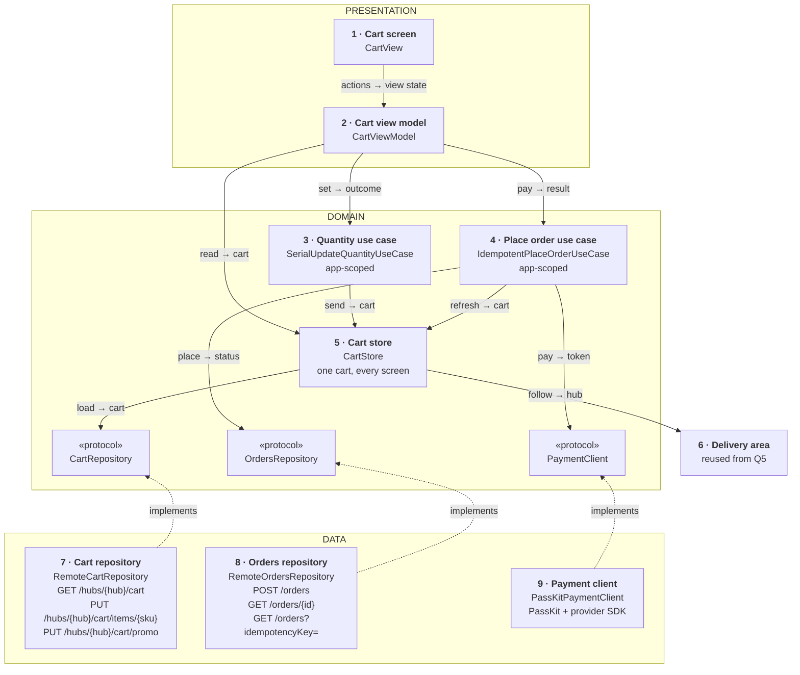
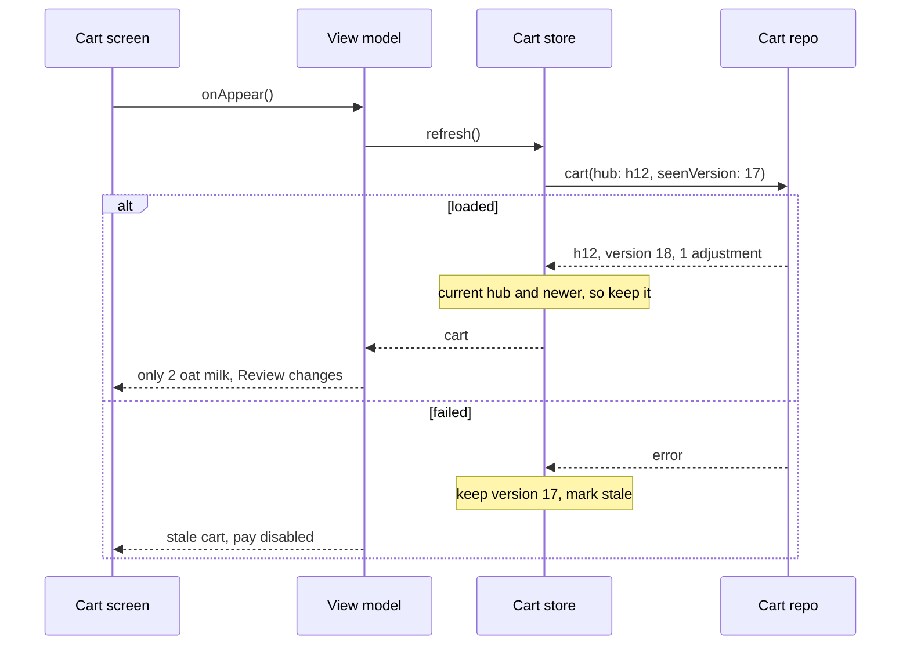
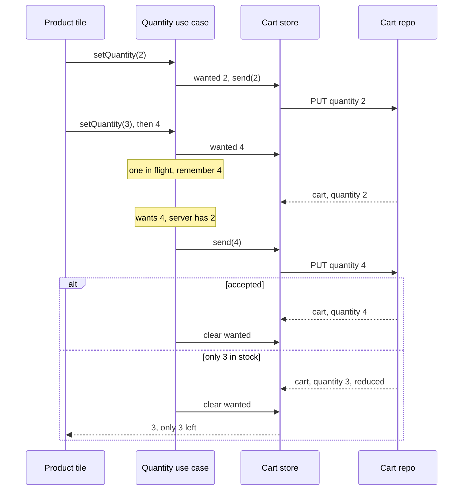
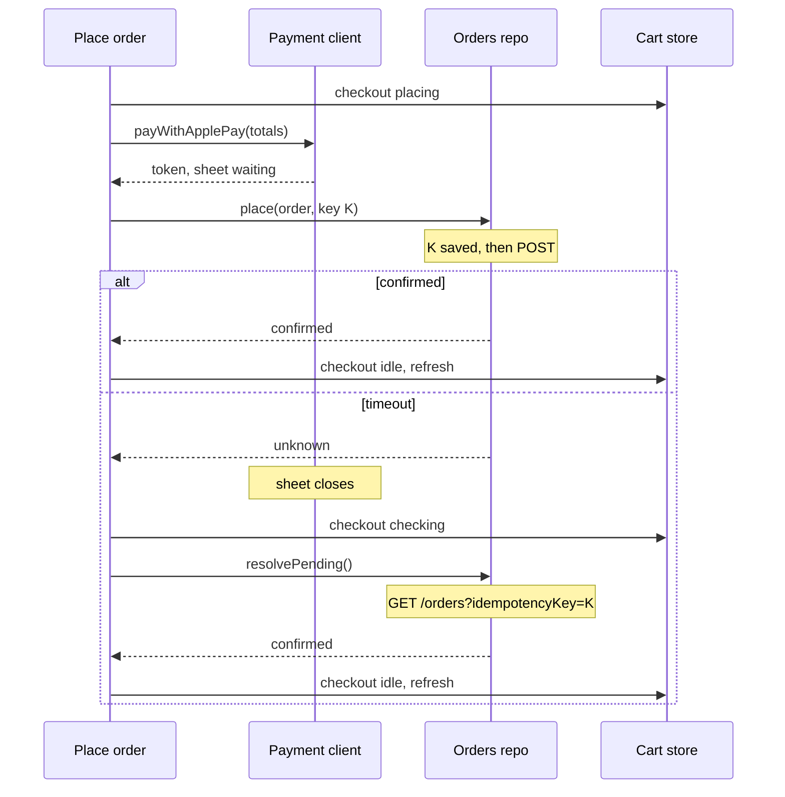

*A common senior prompt for commerce apps. The answer stays small: the server owns every price, one shared store keeps every screen in step, and an order is placed once with a key the phone keeps until it knows the result.*

> **Interviewer:** "Design the cart and checkout for our grocery delivery app. Stock and prices can change while the customer is shopping, and we must never charge twice."

## Run it as a round, not as reading

Set a timer. Sketch. Talk the whole time. Open a section only when its slot is over.

| Clock | Phase | What you do |
|---|---|---|
| 0:00–0:02 | The prompt | Repeat it back in one sentence |
| 0:02–0:07 | Clarify | Ask yours, then read section 1 |
| 0:07–0:12 | Scope | Out of scope first, then required, then later |
| 0:12–0:24 | High level | The idea · the parts · the sketch · one line each · three flows |
| 0:24–0:40 | Deep dives | The interviewer picks one of sections 9–11 |
| 0:40–0:45 | Recap | Follow-ups, then the 60-second summary |

## What this question is really testing

- **Who owns the money.** The server prices everything; the phone shows it.
- **Steppers that feel instant** and end on the right number after fast taps.
- **One cart on every screen,** following the address.
- **Changes shown, never hidden.** Out of stock or a new price is seen before paying.
- **Exactly one order,** even after a timeout or relaunch.

**Traps:** adding up prices on the phone; sending "+1"; "cancel the old request, last tap wins"; silently changing the total; "payment failed" after a timeout; a new key for a retry.

::: Words used in this chapter
- **Repository** — the one owner of one kind of data. It turns the server's format into the app's model.
- **Composite** — a repository that only reads: it asks two repositories and combines their answers into one model. Not needed here.
- **Store** — in-memory state that several screens show at once. Here: the cart.
- **Use case** — one user intent with a product rule, like "only the latest tap counts".
- **View model** — the screen's brain. It owns the screen's state and hands the screen one view state.
- **Hub** — the small local warehouse serving an address, with its own stock and cart.
- **Adjustment** — a change the server made to a line on its own: out of stock, fewer left, a new price.
- **Deposit (Pfand)** — a refundable charge on bottles and cans, added per item.
- **Idempotency key** — a random ID on a request, so the server can tell a retry from a new one.
- **3-D Secure** — the bank's extra check for card payments, often in its own app.
:::

::: 1 · The interviewer answers your clarifying questions
**"Where does the cart live?"** → *On the server, one per user per hub. It follows the user to their iPad.*

**"Who computes prices, deposit and fees?"** → *The server, always, with the minimum order and small-basket fee. The app never computes a total.*

**"Is stock reserved when I add something?"** → *No, only at order time. It can run out while you shop.*

**"What payment methods?"** → *Apple Pay, and cards with 3-D Secure through our payment provider's SDK. One promo code per order.*

**"Where is the cart shown?"** → *A total bar on every catalogue screen, a stepper on every tile, and the cart screen.*

**"And if the address changes?"** → *Question 5's delivery area says which hub serves it. A new hub means a different cart.*

**"Offline?"** → *Not required. Show the last cart, marked offline.*

**"Minimum OS?"** → *iOS 17, SwiftUI, Swift 6.*

**"What hurts today?"** → *Steppers that jump back, and double charges after timeouts.*
:::

::: 2 · Requirements and scope — what you should have said
**Out of scope, said first:** browsing, choosing the address (question 5), order tracking, substitutions, refunds, saved cards.

**Required for the prompt**

1. Change quantities from any screen, instantly and correctly.
2. Show the server's totals: deposit, delivery fee, minimum order, small-basket fee, promo.
3. Show every stock or price change before the user pays.
4. Place the order exactly once, with Apple Pay or a card with 3-D Secure.

**What must feel good:** steppers never lag · one cart everywhere · only the server's totals · never charged twice.

**Production considerations** (say, don't draw): timeouts, safe retries, metrics, payment security (section 12).

**Optional follow-ups** (add only when asked): offline reading, live stock, stock reservations, more payment methods. The ladder is in section 12.
:::

::: 3 · The idea, in 30 seconds — before you draw anything
> *"The cart lives on the server per hub. Every reply is the whole cart: prices, fees, adjustments, a version. A cart repository calls `GET /hubs/{hub}/cart`, `PUT /hubs/{hub}/cart/items/{sku}` and `PUT /hubs/{hub}/cart/promo`. One shared cart store feeds every screen, and follows question 5's delivery area to a new hub. A quantity use case sends final quantities, one request per product at a time. A place-order use case shows changes first, pays through a payment client, and orders with one key per attempt. An orders repository calls `POST /orders`, `GET /orders/{id}` and `GET /orders?idempotencyKey=`, keeping the key on disk until it knows the outcome."*
:::

::: 4 · What we need — the components, before the sketch
| # | Part | Type | Layer | Its one job |
|---|---|---|---|---|
| 1 | **Cart screen** | `CartView` | Presentation | Draws the view state. |
| 2 | **Cart view model** | `CartViewModel` | Presentation | Cart and checkout → one view state. |
| 3 | **Quantity use case** | `SerialUpdateQuantityUseCase` | Domain | One request per product in flight, latest wins. |
| 4 | **Place order use case** | `IdempotentPlaceOrderUseCase` | Domain | Review, pay, order once per attempt. |
| 5 | **Cart store** | `CartStore` | Domain | The one cart every screen shows. |
| 6 | **Delivery area** | reused from Q5 | Reused | Says which hub serves the address. |
| 7 | **Cart repository** | `RemoteCartRepository` | Data | The three cart endpoints. |
| 8 | **Orders repository** | `RemoteOrdersRepository` | Data | The three order endpoints, the pending key. |
| 9 | **Payment client** | `PassKitPaymentClient` | Data | The Apple Pay sheet and the bank's check. |
| chip | **Cart repository** | `CartRepository` | Domain | The promise card 7 keeps. |
| chip | **Orders repository** | `OrdersRepository` | Domain | The promise card 8 keeps. |
| chip | **Payment client** | `PaymentClient` | Domain | The promise card 9 keeps. |

Nine cards, three chips. `Cart` isn't a card: the store holds it. The catalogue's tiles read card 5 and call card 3, like card 2.

**Not drawn:** the shared `HTTPClient`, and `MoneyFormatter`, a pure helper. **Not on the list yet:** the optional follow-ups.
:::

::: 5 · The sketch


**How to read it.** A solid arrow points from the asker to the answerer: *request → reply*. Dashed arrows mean *implements*; the grey card is reused from question 5.

**Dependency inversion, in one line.** The domain writes the three promises (the chips); cards 7–9 keep them, so the arrows point **up** and no use case imports PassKit.

**The shared store is on this sketch** because the prompt puts the cart on several screens.

**On Miro:** three frames, nine cards, three chips. Point at card 5: *"every cart reply lands here, and every screen reads it."*
:::

::: 6 · Each component: its job, its interface, the choice inside it
**The models everyone shares.** Question 5 uses the same `Money`. The screen never sees a DTO.

```swift
struct Money: Hashable, Sendable {
    /// 1,29 € is 129. The server sends minor units.
    let minorUnits: Int
    /// ISO 4217, e.g. "EUR"
    let currency: String
}

struct Cart: Equatable, Sendable {
    let hub: HubID
    /// Bumped by the server on every change
    let version: Int
    let lines: [CartLine]
    /// outOfStock, reduced, priceChanged, promoRemoved
    let adjustments: [Adjustment]
    /// subtotal, deposit, fees, discount, total
    let totals: CartTotals
    /// belowMinimum(missing:), hubClosed, or nil
    let blocker: CheckoutBlocker?
}
```

### 1 · Cart screen (`CartView`)

**Job:** draws lines, changes, totals and the pay button. It decides nothing.

**Interface:** reads `viewModel.viewState`, calls its actions. **Choice:** a SwiftUI `List`.

### 2 · Cart view model (`CartViewModel`)

**Job:** turns the shared cart and its checkout phase into one view state.

```swift
struct CartViewState: Equatable {
    let lines: [CartLineRow]
    let changes: [ChangeRow]
    /// Formatted, dimmed while a quantity saves
    let totals: TotalsBlock
    /// pay(label), reviewChanges, blocked, updating, placing, checking
    let checkout: CheckoutButton
    let canEdit: Bool
}

@MainActor @Observable
final class CartViewModel {
    init(store: CartStore, updateQuantity: UpdateQuantityUseCase,
         placeOrder: PlaceOrderUseCase, formatter: MoneyFormatter)
    var viewState: CartViewState { get }
    func onAppear() async
    func setQuantity(_ quantity: Int, for sku: SKU) async
    func acknowledgeChanges()
    func applyPromo(_ code: String) async
    func pay(with method: PaymentMethod) async
}
```

**Choice:** nothing is computed here. Totals come from the server; `MoneyFormatter`, a pure helper, divides minor units by the currency's exponent (2 for EUR) and formats with `Decimal.FormatStyle.Currency`.

### 3 · Quantity use case (`SerialUpdateQuantityUseCase`)

**Job:** sends the latest wanted quantity, one request at a time per product.

```swift
/// saved · superseded (a newer tap reports) · locked (an order is placing)
/// · failed(serverQuantity: Int?), nil when no reply said
enum QuantityOutcome: Equatable, Sendable { … }

@MainActor
protocol UpdateQuantityUseCase {
    /// Never throws. Not cancelled by the caller's task:
    /// the write lands, the caller only stops waiting.
    func setQuantity(_ quantity: Int, for sku: SKU) async -> QuantityOutcome
}

@MainActor
final class SerialUpdateQuantityUseCase: UpdateQuantityUseCase {
    init(store: CartStore)
}
```

**Choice:** the rule a product manager would state is "the cart ends on my last tap". App-scoped and on the main actor: every tile shares its per-product table, and it writes the main-actor store.

### 4 · Place order use case (`IdempotentPlaceOrderUseCase`)

**Job:** shows changes first, then pays and orders once per attempt.

```swift
/// confirmed(OrderID) · reviewChanges · blocked · declined(message:)
/// · checking (no answer yet) · cancelled (sheet closed)
enum CheckoutResult: Equatable, Sendable { … }

@MainActor
protocol PlaceOrderUseCase {
    /// Never throws. Once payment starts, not cancelled by the caller's task.
    func placeOrder(with method: PaymentMethod) async -> CheckoutResult
    /// At launch and on foreground: settles an attempt left from before
    func resumePendingAttempt() async
}

@MainActor
final class IdempotentPlaceOrderUseCase: PlaceOrderUseCase {
    init(store: CartStore, orders: OrdersRepository, payment: PaymentClient)
}
```

**The rule, in steps:**

1. Not idle → return. Else set `placing` before any `await`; steppers lock everywhere.
2. Refresh. Unseen adjustments → `reviewChanges`; a blocker → `blocked`.
3. Make one key for this attempt, pay, and place the order with that key.
4. Confirmed or declined unlocks the cart. No answer sets `checking`.

**Choice:** the rule is "never charge twice". Saving the key, retrying and looking it up are delivery, so they live in the orders repository.

### 5 · Cart store (`CartStore`)

**Job:** holds the current hub's cart, wanted quantities and the checkout phase, for every screen.

```swift
@MainActor @Observable
final class CartStore {
    init(cart: CartRepository, area: DeliveryAreaRepository)
    /// loading, loaded(Cart), or unavailable(last: Cart?)
    private(set) var server: CartState
    /// Quantities the server hasn't confirmed yet
    private(set) var wanted: [SKU: Int]
    /// idle, placing, or checking
    private(set) var checkout: CheckoutPhase
    /// Wanted, else the server's. nil while unknown.
    func quantity(of sku: SKU) -> Int?
    /// true only when loaded and idle
    var canEdit: Bool { get }
    /// Follows areaChanges() for the app's lifetime
    func start()
    func refresh() async throws -> Cart
    /// Rule-free writes, passed through
    func send(_ quantity: Int, for sku: SKU) async throws -> Cart
    func setPromo(_ code: String?) async throws
    // plus setWanted, setCheckout, markSeen
}
```

**Choices:**

- **App-scoped, so it owns the hub change:** a new hub empties `wanted` and loads that hub's cart, for every screen at once.
- **The stale-result guard is hub plus version.** A reply is kept only for the current hub and a newer version.
- **No rule, no protocol.** Rules live in cards 3 and 4; tests use the real store with a fake repository.

### 6 · Delivery area (reused from question 5)

**Job:** says which hub serves the address. **Interface:** the store uses `areaChanges() -> AsyncStream<DeliveryArea>` from question 5's `DeliveryAreaRepository`: it replays the current area, then emits on a hub change. **Choice:** reused; the cart follows the hub.

### 7 · Cart repository (`RemoteCartRepository`)

**Job:** calls the three cart endpoints and maps `CartDTO` to `Cart`.

```swift
protocol CartRepository: Sendable {
    /// Changes listed since seenVersion. Throws if unreachable.
    /// Cancelling the caller cancels the read.
    func cart(hub: HubID, seenVersion: Int?) async throws -> Cart
    /// Throws if refused. Run in its own task by the use case.
    func setQuantity(_ quantity: Int, for sku: SKU, hub: HubID) async throws -> Cart
    func setPromo(_ code: String?, hub: HubID) async throws -> Cart
}
```

**Choice:** every reply is the whole cart: one shape to map, fresh prices. One caller (the store), one protocol.

### 8 · Orders repository (`RemoteOrdersRepository`)

**Job:** places orders with an `Idempotency-Key`, looks them up, and keeps the key of an unsettled attempt.

```swift
protocol OrdersRepository: Sendable {
    /// Saves the key to disk, then POST /orders. Never throws:
    /// no reply → .unknown, key kept. Not cancelled by the caller.
    func place(_ request: OrderRequest, key: IdempotencyKey) async -> OrderStatus
    /// After 3-D Secure: asks GET /orders/{id} until final, else .unknown
    func finalStatus(of id: OrderID) async -> OrderStatus
    /// nil: nothing pending. Else looks the key up with backoff,
    /// resending with it if the server never got it.
    func resolvePending() async -> OrderStatus?
}
```

**Choices:**

- **The saved key is bookkeeping about its own requests,** so it lives here: a small file, deleted on a definite answer.
- **A 409 maps to `.cartChanged(Cart)`,** an answer, not an error.

### 9 · Payment client (`PassKitPaymentClient`)

**Job:** shows the Apple Pay sheet or the bank's 3-D Secure check.

```swift
@MainActor
protocol PaymentClient {
    /// Shows the sheet. While it waits, calls `charge` with the token
    /// and closes on its answer. nil: the user closed the sheet.
    func payWithApplePay(_ totals: CartTotals,
                         charge: @Sendable (PaymentToken) async -> OrderStatus) async -> OrderStatus?
    /// Returns when the user finishes or leaves: not proof of payment
    func completeBankCheck(_ action: PaymentAction) async
}
```

**Choices:**

- **`PKPaymentAuthorizationController` presents without a view,** so this lives in data. Its summary items get `NSDecimalNumber(mantissa:exponent:isNegative:)` from minor units, exponent −2: nothing is rounded.
- **A new payment method is a new conformance,** not an `if`.

**Why these parts, and no more.** Each card changes for one reason:

| Card | Changes when |
|---|---|
| 1 · Cart screen | the screen's design |
| 2 · Cart view model | the screen's behaviour |
| 3 · Quantity use case | a product rule (how quantities are sent) |
| 4 · Place order use case | a product rule (never charge twice) |
| 5 · Cart store | what several screens share |
| 6 · Delivery area | (question 5) |
| 7 · Cart repository | an endpoint or payload (the cart) |
| 8 · Orders repository | an endpoint or payload (orders and their keys) |
| 9 · Payment client | a platform API (PassKit, the provider SDK) |

Each protocol earns a fake. Not added: a composite (nothing combines two sources), a use case for loading or the order lookup, a DI container.
:::

::: 7 · Key flows through the sketch
**Flow 1 — opening the cart.** A new hub does the same, from `loading`.



**Flow 2 — three fast taps on "+" (1 → 4).**



The earlier calls return `superseded`.

**Flow 3 — paying with Apple Pay, and the reply never arrives.**


:::

::: 8 · The server contract
```
GET  /v1/hubs/{hub}/cart?seenVersion=17
     → { "hub": "h12", "version": 18,
         "lines": [ { "sku", "name", "quantity",
                      "unitPrice": { "minorUnits": 129, "currency": "EUR" },
                      "deposit":   { "minorUnits": 25,  "currency": "EUR" } } ],
         "adjustments": [ { "sku", "kind": "reduced", "to": 2 } ],
         "totals": { "subtotal", "deposit", "fees", "total" },
         "blocker": null }

PUT  /v1/hubs/{hub}/cart/items/{sku}   { "quantity": 3 }     → the whole cart
PUT  /v1/hubs/{hub}/cart/promo         { "code": "SPRING" }  → the whole cart

POST /v1/orders   Idempotency-Key: 7f3c…
     { "hub": "h12", "cartVersion": 18,
       "payment": { "method": "applePay", "token": "…" } }
     → 201 confirmed · 202 needsAction (3-D Secure) · 402 declined
     → 409 cartChanged, with the new cart

GET  /v1/orders/{id}                 → { "orderId", "status" }
GET  /v1/orders?idempotencyKey=7f3c… → { "orderId", "status" }  or 404
```

- **Every cart reply is the whole cart,** priced by the server, tagged with hub and version.
- **A quantity `PUT` is safe to repeat by nature; an order `POST` only because of the key.** A repeat gets the first result.
- **The order names the cart version the user saw,** so a changed cart gets 409, not a different charge. The cart is personal, never on a shared CDN.
:::

::: 9 · Deep dive — "The user taps plus five times on the oat milk tile. Then taps Pay."
**The decision:** the store shows the wanted quantity at once, and the use case keeps **one request per product** in flight, always the latest.

1. Each tap sets `wanted[sku]` before any `await`. Tile, badge and cart all show it.
2. If a request for this product is in flight, stop. The earlier call becomes `superseded`.
3. Otherwise send the wanted value through the store.
4. When the reply lands, the store applies it. If wanted still differs, send again. If not, clear `wanted` and report `saved`.

Five fast taps usually make two requests.

**Rollback, only for the latest, to the server's number:** the tile shows it with "Couldn't update". A clamp ("only 3 left") isn't a failure, just a reply of 3.

**Taps during checkout.** Pay sets `placing` first: steppers disable, and a tap already on its way returns `locked`. A quantity still saving shows "Updating…" and Pay waits. Otherwise the `PUT` would bump the version and fail the order with a 409.

**Unknown is not zero.** Steppers wait for the cart, so a guessed 0 never overwrites the iPad's 2.

**Rejected: debounce alone.** Two sends can still overlap and land out of order.
:::

::: 10 · Deep dive — "The hub runs out of eggs and bananas go up. Then the user moves."
**The decision:** the server reports every change it made on its own as a line **adjustment**, and the user sees it before paying.

1. Any cart reply can carry adjustments.
2. At checkout the use case refreshes first. Any adjustment returns `reviewChanges` before the sheet opens.
3. As the last guard, `POST /orders` carries `cartVersion`. A change in the last seconds gets 409, and no charge.

**The screen shows** a row per affected line ("Bananas: now 1,49 €, was 1,29 €"), the new total, and "Review changes" until the user taps OK. Then "Pay 23,40 €". A `belowMinimum` blocker shows "Add 3,10 € more"; the phone never knows thresholds.

**A new hub.** The store follows `areaChanges()`: it empties `wanted`, shows `loading` and loads the new hub's cart. An old-hub reply fails the hub check. Carrying items over is the server's call; moved items arrive as adjustments.

**Rejected: update the total silently.** Simpler, but the user agrees to a price they never saw.
:::

::: 11 · Deep dive — "The order request times out. The user force-quits and reopens the app."
**The decision:** one idempotency key **per checkout attempt**, saved before the request leaves. An unknown outcome is answered by **asking about that key**: never a new order, never "failed".

1. On Pay, the use case makes key K. The orders repository saves it, then sends `POST /orders` with K.
2. No reply: `place` returns `unknown`, the phase becomes `checking`, and `resolvePending()` asks `GET /orders?idempotencyKey=K` with backoff.
3. Found: show its status. Not found: the server never got it, so resend with the same K.
4. A definite answer deletes the saved key. Only a new attempt gets a new one.

**After a relaunch,** `resumePendingAttempt()` runs first and the store starts in `checking`.

**Apple Pay.** The order is placed inside `paymentAuthorizationController(_:didAuthorizePayment:handler:)` while the sheet waits. Its `PKPaymentAuthorizationResult` has no "unknown", so `place` makes one bounded request; on a timeout the sheet closes and the cart says "Checking your order…".

**Card with 3-D Secure.** `POST /orders` answers `needsAction` and the payment client shows the bank's check. Its "done" isn't proof: `finalStatus(of:)` asks the server.

**Rejected: just disable the button.** It stops double taps, not retries or relaunches.
:::

::: 12 · Failure modes, production and scale
**Failures**

| Failure | Client behaviour |
|---|---|
| Cart load fails | Last cart marked stale; steppers and pay disabled |
| Latest quantity fails | Server's quantity, "Couldn't update" |
| Cart changed at checkout | Show the adjustments, ask again |
| Order times out | "Checking your order…", look up the key |
| App killed mid-checkout | Resolve the saved key before offering checkout |
| 3-D Secure abandoned | Ask the order's status; the server decides expiry |
| Payment declined | Message, unlock; next attempt, new key |
| Hub changes | New hub's cart from loading; old replies dropped |

**Production notes** (short, not on the board)

- **Networking:** a timeout per request; retry `PUT`s freely, `POST /orders` only with its key; honour `Retry-After` on 429. Cancel reads, never writes.
- **Caching:** the cart is personal, never HTTP-cached.
- **Metrics:** tap-to-confirmed time, rollbacks, adjustments per checkout, unknown outcomes. **Security:** card details go only to the provider SDK.

**Scale, back of the envelope:** orders a day × taps per order, fewer after serializing. 200,000 × 30 is 6 million taps a day; small cart replies matter more than the client architecture.

**Grow only when asked**

```text
Cart on every screen       → one shared store (here already: the prompt asks)
Read the cart offline      → persist the last cart, read-only
Live stock while browsing  → push or a socket per hub
Hold stock while paying    → a server reservation with a countdown
More payment methods       → one more payment client conformance
```
:::

::: 13 · Question bank — everything they can push on
Answer out loud first, then open.

### Scope and architecture

<details>
<summary>"Walk me through the layers."</summary>

Presentation: screen and view model. Domain: `Cart`, the store, two use cases, three protocols. Data: two repositories and the payment client.
</details>

<details>
<summary>"Why does changing a quantity get a use case, but loading the cart doesn't?"</summary>

A quantity has a rule: the cart ends on the last tap. Loading is one call; a use case would only pass it through.
</details>

<details>
<summary>"Why isn't looking up an unknown order its own use case?"</summary>

Looking a key up with backoff is delivery, owned by the orders repository. The rule is place-order's.
</details>

<details>
<summary>"Show me dependency inversion."</summary>

The three protocols live in the domain and the data cards implement them; the use cases never import PassKit.
</details>

<details>
<summary>"Where does mapping happen?"</summary>

In each repository: DTOs become `Cart` and `OrderStatus`. The payment token is opaque and never mapped.
</details>

<details>
<summary>"Where does the combined state come from? Is there a composite?"</summary>

No composite: nothing combines two sources. Server cart plus wanted quantities is the store's `quantity(of:)`.
</details>

<details>
<summary>Follow-up chain: "A second screen."</summary>

1. *"The product page gets a stepper."* → Same store, same use case.
2. *"Why not let each screen fetch its own?"* → Copies drift: badge 3, tile 2.
3. *"And the iPad?"* → The cart is on the server, so it loads there.
4. *"When wouldn't you have a store?"* → With the cart on one screen only.
</details>

### Quantities

<details>
<summary>"Why send the quantity instead of plus one?"</summary>

A final state is safe to retry. A "+1" retried after a timeout adds two.
</details>

<details>
<summary>"Why not cancel the old request when a new tap comes?"</summary>

It doesn't recall a request the server got, and two in flight can land in either order.
</details>

<details>
<summary>"An old request fails after a newer tap. Do you roll back?"</summary>

No. Only the latest call gets an outcome, and it rolls back to the server's quantity, not "one less".
</details>

<details>
<summary>"Two products' replies land out of order."</summary>

Each is a whole cart with a version; the store keeps the newer.
</details>

<details>
<summary>"The user taps a stepper while the order is placing."</summary>

Steppers are disabled from the moment Pay is tapped; the use case returns `locked`.
</details>

<details>
<summary>Follow-up chain: "The user changes address."</summary>

1. *"New address, new hub."* → The store follows the delivery area and loads the new hub's cart.
2. *"Who owns that?"* → The app-scoped store. Every screen holds the same instance.
3. *"An old-hub request is in flight."* → Its reply names the old hub, so the stale-result guard drops it.
</details>

### Money and changes

<details>
<summary>"Why not compute the total on the phone?"</summary>

Deposit, fees and promos are server rules; two copies will disagree.
</details>

<details>
<summary>"How do you store money?"</summary>

`Money(minorUnits:currency:)`. Formatting divides by the currency's exponent; Apple Pay gets an `NSDecimalNumber` from the same integer.
</details>

<details>
<summary>"How does the server know what the user has seen?"</summary>

Reads send `seenVersion` and the order sends `cartVersion`. The server refuses an order for an old version.
</details>

### Placing the order

<details>
<summary>"What exactly makes it 'exactly once'?"</summary>

The server returns the key's first result to any repeat, and the phone keeps the key on disk until it knows the outcome.
</details>

<details>
<summary>"When do you make a new key?"</summary>

After a definite result, or when the cart or method changes. Never for a retry.
</details>

<details>
<summary>"It timed out. Why not show 'payment failed'?"</summary>

It may have worked, and "failed" invites a second order.
</details>

<details>
<summary>"The user leaves the cart screen mid-order. Is it cancelled?"</summary>

No. The use case is app-scoped and its writes aren't cancelled by the caller; the screen only stops waiting.
</details>

<details>
<summary>Follow-up chain: "Double tap on Pay."</summary>

1. *"Two taps on Pay."* → The first sets `placing` before any await; the second returns.
2. *"Two devices pay at once."* → Different keys; the version check lets one win.
3. *"Why isn't a disabled button enough?"* → Retries, relaunches and second devices.
</details>

### Production and change

<details>
<summary>"How do you test the quantity rule?"</summary>

A fake repository that holds its reply. Tap 2, 3, 4, release: two requests, 2 then 4.
</details>

<details>
<summary>"What works offline?"</summary>

The last cart, read-only, marked stale. No changes, no checkout.
</details>

<details>
<summary>"What changes at 10x?"</summary>

Mostly the server. On the client: fewer requests per tap, backing off on 429s.
</details>

<details>
<summary>Follow-up chain: "Two weeks instead of six."</summary>

1. *"What do you cut?"* → Promo codes and card payments; keep Apple Pay.
2. *"What can't you cut?"* → Server totals, adjustments before paying, serialized quantities, the saved key.
</details>
:::

::: 14 · Scorecard — mark yourself, 0 / 1 / 2
| | Did you… | 0–2 |
|---|---|---|
| 1 | Talk the whole time, and listen when interrupted | |
| 2 | Clarify before designing | |
| 3 | Give a trade-off for each choice | |
| 4 | Say out of scope first; separate required from later | |
| 5 | Say the idea, list the parts, then sketch | |
| 6 | Keep the sketch to nine type cards, one line each | |
| 7 | Name the six endpoints | |
| 8 | Keep every price on the server, in minor units | |
| 9 | Justify the shared store; say it follows the hub | |
| 10 | Send final quantities, one per product, locked while paying | |
| 11 | Roll back only the latest tap, to the server's number | |
| 12 | Show adjustments before paying, with a version check | |
| 13 | One key per attempt, saved; look it up on unknown | |
| 14 | Land the recap inside 60 seconds | |

14+ is a pass.<!--private--> Anything scored 0 goes in the progress log and comes back as a recall prompt.<!--/private--><!--public--> A zero names the thing to read about next.<!--/public-->
:::

::: 15 · The 60-second recap
The cart lives on the server per hub; every reply is the whole cart, in minor units, with a version. One app-scoped store holds it for every screen, with wanted quantities on top, and follows the delivery area to a new hub. A quantity use case sends final quantities, one request per product, and only the latest can roll back. Changes come back as adjustments the user sees before paying, and the order carries the cart version as a last guard. Pay freezes the steppers, pays through a payment client, and places the order with one key per attempt. The orders repository saves that key first, so a timeout or relaunch asks about it instead of ordering again.
:::
