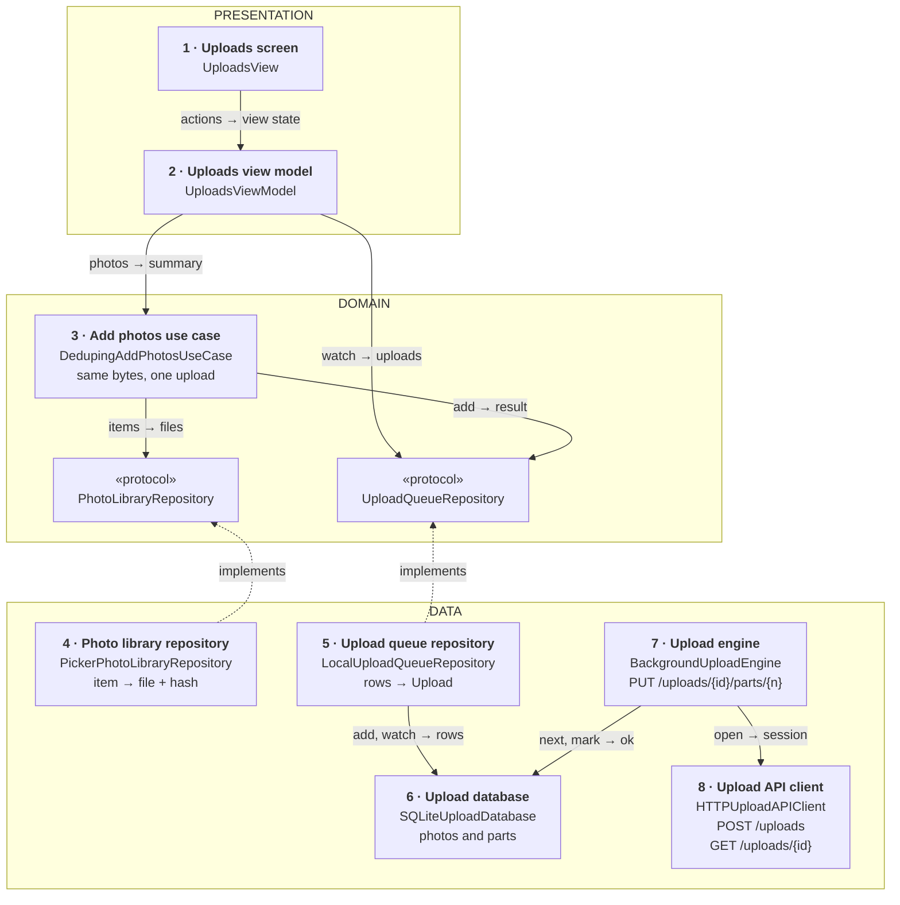
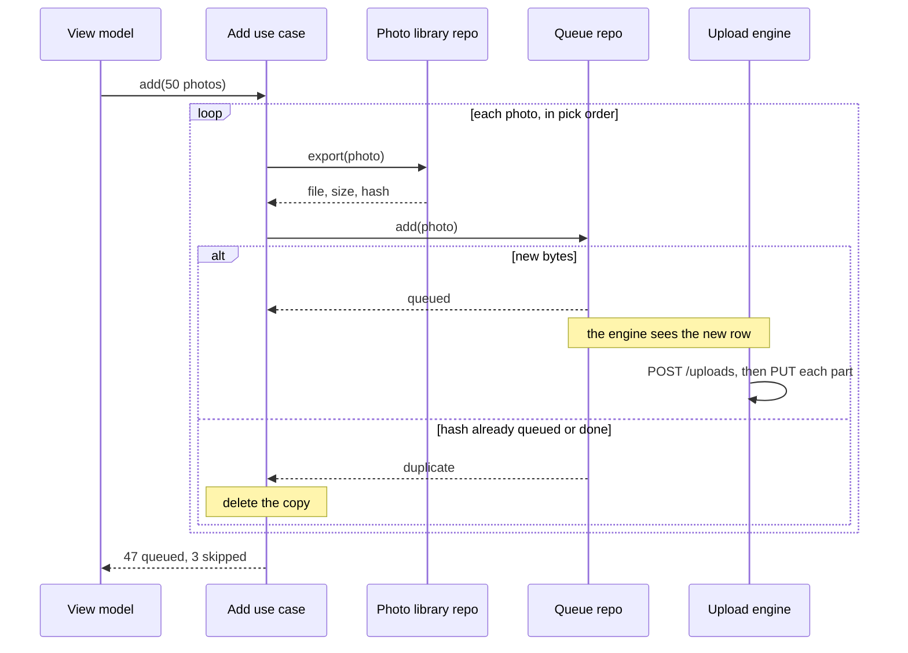
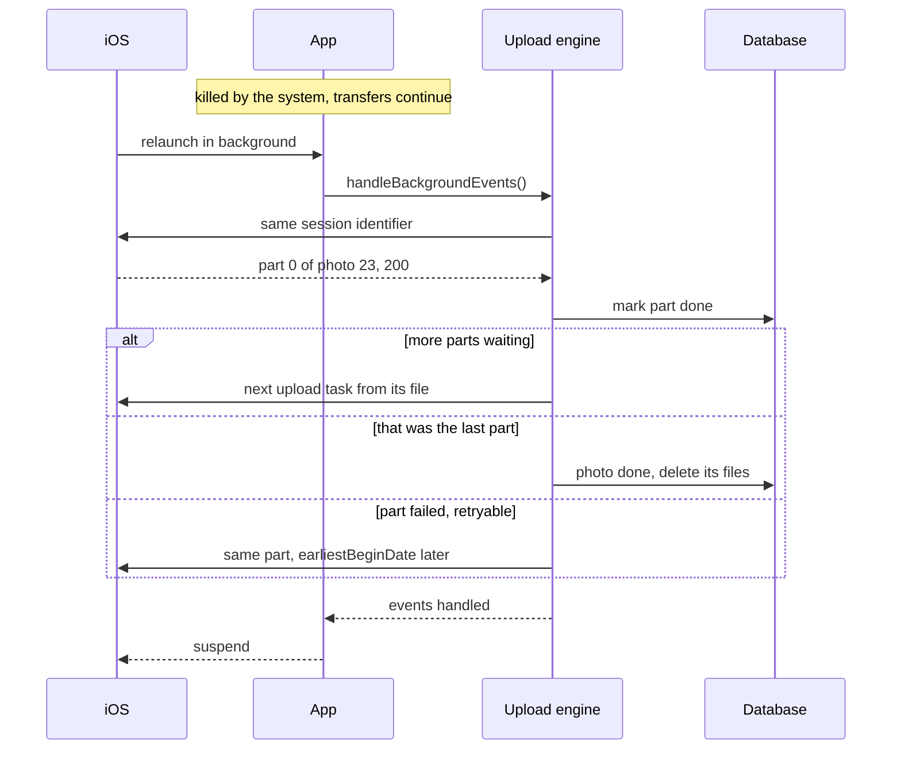

*A recurring senior mobile prompt. The answer stays small: copy each photo to a file, queue it in a database, and let a background session upload it in parts, so nothing is lost when the app is closed, killed or offline.*

> **Interviewer:** "The user opens the picker, chooses 50 photos and taps Upload. Design that, on the client."

## Run it as a round, not as reading

Set a timer. Sketch. Talk the whole time. Open a section only when its slot is over.

| Clock | Phase | What you do |
|---|---|---|
| 0:00–0:02 | The prompt | Repeat it back in one sentence |
| 0:02–0:07 | Clarify | Ask yours, then read section 1 |
| 0:07–0:12 | Scope | Out of scope first, then required, then later |
| 0:12–0:24 | High level | The idea · the parts · the sketch · one line each · two flows |
| 0:24–0:40 | Deep dives | The interviewer picks one of sections 9–11 |
| 0:40–0:45 | Recap | Follow-ups, then the 60-second summary |

## What this question is really testing

- **Uploads that outlive the app**: a background session, files, and the relaunch.
- **A queue on disk**, so the phone knows what's left after a crash or a force quit.
- **Parts and resume**, so a dropped connection costs one part, not the whole photo.
- **The same photo never uploaded twice**, decided by its bytes, not its name.
- **Memory and disk**: fifty photos are never all in memory at once.

**Traps:** a foreground session with "a bit of background time"; uploading `Data` in a background session; "uploads survive a force quit"; deduping by file name; progress by photo count.

::: Words used in this chapter
- **Repository** — the one owner of one kind of data. It turns the server's format into the app's model.
- **Composite** — a repository that only reads: it asks two repositories and combines their answers into one model. Not used here.
- **Store** — in-memory state that several screens show at once. Not needed here yet.
- **Use case** — one user intent with a product rule, like "the same photo is uploaded once".
- **View model** — the screen's brain. It owns the screen's state and hands the screen one view state.
- **Background session** — a `URLSession` whose transfers the system runs for you, even while your app is suspended or killed.
- **Relaunch** — the system starts your app in the background to tell it that transfers finished.
- **Upload session** — the server's record of one photo being uploaded, with an ID and the parts it has so far.
- **Part** — one slice of a photo's file, sent as its own request. Most photos are a single part.
- **Content hash** — a fingerprint of the bytes (SHA-256). Same bytes, same hash.
- **Backoff** — waiting longer after each failure before trying again.
:::

::: 1 · The interviewer answers your clarifying questions
**"Where do the photos come from?"** → *The system photo picker, up to 50 at a time. We don't ask for library access.*

**"How big?"** → *Most are 2–6 MB. Panoramas and RAW files can reach 100 MB. No video for now.*

**"Must it keep going if the user leaves?"** → *Yes. Even if the system kills the app.*

**"Original bytes, or converted?"** → *Original. The server makes the other sizes.*

**"Cellular?"** → *Wi-Fi by default. Settings already has a "Use cellular" switch. Respect Low Data Mode.*

**"What does the server support?"** → *It's ours. Tell me what upload protocol you need.*

**"Duplicates?"** → *Never store the same photo twice for one user.*

**"Which screens show uploads?"** → *Only the upload screen.*

**"How many?"** → *A million people upload a day, about 30 photos each.*

**"Minimum OS?"** → *iOS 17, SwiftUI, Swift 6.*
:::

::: 2 · Requirements and scope — what you should have said
**Out of scope, said first:** video, editing, albums and sharing, the gallery, the server's storage and resizing, uploading the whole library automatically.

**Required for the prompt**

1. Pick up to 50 photos and queue them all at once.
2. Upload them reliably: in the background, after the app is killed, after the network drops.
3. Show progress per photo and overall, with cancel and retry.
4. Never upload the same photo twice.

**What must feel good:** the picker closes at once · honest progress · no photo silently lost · bounded memory.

**Production considerations** (say, don't draw): token expiry during long waits, disk space, metrics. See section 12.

**Optional follow-ups** (add only when asked):

```text
A progress bar on other screens  → a shared upload store
Back up the whole library        → full library access and a sync engine
Video                            → longer parts, transcoding choices
Built-in resume (iOS 17)         → no part files
```

*"I'll start simple and add each of these when the requirement appears."*
:::

::: 3 · The idea, in 30 seconds — before you draw anything
> *"A use case exports each picked photo to a file, fingerprints it with SHA-256, and adds it to a queue in a database, skipping bytes already uploaded or queued. An engine owns one background `URLSession`. It calls `POST /uploads` to open a server upload session, then sends each part with `PUT /uploads/{id}/parts/{n}` as an upload task from a file, so the system keeps going while we're suspended or killed. After a force quit or an expired part it asks `GET /uploads/{id}` what the server has. The view model watches the queue and shows bytes sent per photo and overall."*
:::

::: 4 · What we need — the components, before the sketch
| # | Part | Type | Layer | Its one job |
|---|---|---|---|---|
| 1 | **Uploads screen** | `UploadsView` | Presentation | The picker button, rows, overall bar. |
| 2 | **Uploads view model** | `UploadsViewModel` | Presentation | Queue → rows and overall progress. |
| 3 | **Add photos use case** | `DedupingAddPhotosUseCase` | Domain | Export, fingerprint, queue, skip duplicates. |
| 4 | **Photo library repository** | `PickerPhotoLibraryRepository` | Data | Picked item → a file, its size and hash. |
| 5 | **Upload queue repository** | `LocalUploadQueueRepository` | Data | Rows → `Upload`, add, cancel, retry. |
| 6 | **Upload database** | `SQLiteUploadDatabase` | Data | One row per photo and per part. |
| 7 | **Upload engine** | `BackgroundUploadEngine` | Data | The background session and its parts. |
| 8 | **Upload API client** | `HTTPUploadAPIClient` | Data | `POST /uploads`, `GET /uploads/{id}`. |
| chip | **Photo library** | `PhotoLibraryRepository` | Domain | The promise card 4 keeps. |
| chip | **Upload queue** | `UploadQueueRepository` | Domain | The promise card 5 keeps. |

Eight cards, two chips. `Upload` isn't a card; it's written on card 5.

**Not drawn:** `ContentHasher` (pure, streams a file through SHA-256, given to card 4) and `UploadRetryPolicy` (pure: attempt and error → delay or give up, given to card 7). Each has its own protocol, because each changes for its own reason. **Not on the list yet:** everything under "optional follow-ups".
:::

::: 5 · The sketch


**How to read it.** A solid arrow points from the asker to the answerer: *request → reply*. Dashed arrows mean *implements*.

**Dependency inversion, in one line.** The domain writes the two promises (the chips); cards 4 and 5 keep them, so both dashed arrows point **up** and the use case never sees PhotosUI, SQLite or HTTP.

**One database, two promises.** Card 6 keeps `UploadRecords` for card 5 and `UploadWorkRecords` for card 7. The engine writes progress into it; the repository watches it. Nobody calls the engine: the app starts it at launch and hands it the system's background events.

**No shared store on this sketch:** only the upload screen shows progress.

**On Miro:** three frames (blue, purple, green), eight cards, two chips, eight solid arrows. Point at card 7: *"this is the part that keeps going when we're killed."*
:::

::: 6 · Each component: its job, its interface, the choice inside it
**The model everyone shares.**

```swift
struct Upload: Identifiable, Equatable, Sendable {
    let id: UploadID
    let fileName: String
    let byteCount: Int64
    /// Confirmed parts plus the part in flight
    var bytesSent: Int64
    /// queued, uploading, waiting(reason), done(photoID),
    /// failed(message), cancelled
    var state: UploadState
}

/// queued, alreadyQueued, alreadyUploaded
enum AddResult: Equatable, Sendable { … }
```

`waiting` carries its reason (Wi-Fi, Low Data Mode, offline, retrying).

### 1 · Uploads screen (`UploadsView`)

**Job:** the picker button, a row and bar per photo, an overall bar.

**Interface:** reads `viewModel.viewState`; calls `onAppear()`, `picked(_:)`, `cancel(_:)`, `retry(_:)`.

**Choice:** `PhotosPicker` with `maxSelectionCount: 50` and `preferredItemEncoding: .current`, so HEIC stays HEIC. It needs no library permission.

### 2 · Uploads view model (`UploadsViewModel`)

**Job:** turns the queue into rows and an overall line, and passes picks to the use case.

```swift
struct UploadsViewState: Equatable {
    let rows: [UploadRow]
    /// "23 of 50 · 61%", nil when the queue is empty
    let overall: OverallProgress?
    /// "3 already uploaded, skipped", shown once
    let notice: String?
}

@MainActor @Observable
final class UploadsViewModel {
    init(addPhotos: AddPhotosUseCase, queue: UploadQueueRepository)

    var viewState: UploadsViewState { get }

    func onAppear() async
    func picked(_ items: [PickedPhoto]) async
    func cancel(_ id: UploadID) async
    func retry(_ id: UploadID) async
}
```

**Choices:**

- **Overall progress is by bytes:** total sent ÷ total size. Counting photos sits at "49 of 50" while the 100 MB panorama is still going.
- **Cancel and retry go straight to the queue repository.** No rule, so no use case.

### 3 · Add photos use case (`DedupingAddPhotosUseCase`)

**Job:** for each picked photo, in pick order: export it, fingerprint it, and queue it unless those bytes were already uploaded or queued.

```swift
struct AddSummary: Equatable, Sendable {
    let queued, alreadyUploaded, alreadyQueued, unavailable: Int
}

protocol AddPhotosUseCase: Sendable {
    /// Never throws: a photo that can't be exported counts as
    /// unavailable. Cancelling the caller stops exporting the
    /// rest; photos already queued stay queued.
    func add(_ items: [PickedPhoto]) async -> AddSummary
}

struct DedupingAddPhotosUseCase: AddPhotosUseCase {
    init(library: PhotoLibraryRepository, queue: UploadQueueRepository)
}
```

**Choices:**

- **The rule a product manager would state:** "the same photo is never uploaded twice, and the user hears how many were skipped". That's why adding gets a use case and cancel doesn't.
- **One photo at a time**, so one copy is written and hashed at once. Uploads start while the rest export.
- **A plain struct, no state.** The check is atomic in the database (a unique index on the hash), so two quick picks can't both queue the same bytes.

### 4 · Photo library repository (`PickerPhotoLibraryRepository`)

**Job:** turns one picked item into a file in our container, with its size and content hash.

```swift
/// Wraps the picker's item. Only this card opens it.
struct PickedPhoto: Sendable { let item: PhotosPickerItem }

struct LocalPhoto: Sendable {
    let fileURL: URL
    let fileName: String
    let byteCount: Int64
    /// SHA-256 of the file, hex
    let contentHash: String
}

protocol PhotoLibraryRepository: Sendable {
    /// Throws if the photo is gone or iCloud can't deliver it.
    /// Cancelling the caller cancels the export and deletes
    /// the partial file.
    func export(_ photo: PickedPhoto) async throws -> LocalPhoto
}

actor PickerPhotoLibraryRepository: PhotoLibraryRepository {
    init(directory: URL, files: FileManager, hasher: ContentHasher)
}
```

**Choices:**

- **A file, never `Data`.** `loadTransferable(type:)` with a `FileRepresentation` hands us a temporary file; we move it into our folder before the closure returns. A 100 MB RAW never enters memory.
- **Hashing streams the file:** 1 MB reads with `FileHandle` into `SHA256`.
- **Application Support with `isExcludedFromBackup`**, not `tmp` or `Caches`, which the system may clear while a photo waits. Check `volumeAvailableCapacityForImportantUsage` first.

### 5 · Upload queue repository (`LocalUploadQueueRepository`)

**Job:** the one owner of the queue as the app sees it. It maps rows to `Upload`.

```swift
protocol UploadQueueRepository: Sendable {
    /// Atomic on the content hash. Throws only if the database
    /// can't write.
    func add(_ photo: LocalPhoto) async throws -> AddResult
    /// Replays the current queue on subscribe, then each change.
    /// One stream per caller. Finishes when the caller's task
    /// is cancelled.
    func uploads() -> AsyncStream<[Upload]>
    /// Marks it cancelled; the engine stops its tasks
    func cancel(_ id: UploadID) async throws
    /// Back to queued, attempts reset
    func retry(_ id: UploadID) async throws
}

actor LocalUploadQueueRepository: UploadQueueRepository {
    init(database: UploadRecords)
}
```

**Choices:**

- **It doesn't upload.** It writes intent ("cancelled", "queued") into the database; the engine acts on it.
- **Done photos stay as hash rows** (the file is deleted), so "already uploaded" works offline.

### 6 · Upload database (`SQLiteUploadDatabase`)

**Job:** one row per photo (hash, file, state, upload ID) and per part (index, state, attempts). It publishes changes.

```swift
/// Data-internal: card 7's promise
protocol UploadWorkRecords: Sendable {
    /// Parts to start, oldest photo first, within the limit
    func nextParts(limit: Int) async throws -> [PartRecord]
    func markPart(_ part: PartID, _ state: PartState) async throws
    /// At most a few writes a second per task
    func recordBytes(_ sent: Int64, for part: PartID) async throws
}

actor SQLiteUploadDatabase: UploadRecords, UploadWorkRecords {
    init(fileURL: URL)
}
```

**Choices:**

- **SQLite (or SwiftData)**, for the unique hash index and one transaction for "last part done, photo done".
- **Progress lives here, throttled.** `didSendBodyData` fires many times a second; we write at most twice a second per task.

### 7 · Upload engine (`BackgroundUploadEngine`)

**Job:** owns the background session: reconnects at launch, opens server sessions, starts part tasks, handles results and relaunches.

```swift
protocol UploadEngine: Sendable {
    /// Recreates the session with the same identifier, matches
    /// live tasks to the database, then watches for work.
    /// Idempotent. Called at launch.
    func start() async
    /// From .backgroundTask(.urlSession). Returns when the
    /// system's events are handled, so the app can suspend.
    func handleBackgroundEvents() async
}

actor BackgroundUploadEngine: UploadEngine {
    init(sessionID: String, records: UploadWorkRecords,
         api: UploadAPIClient, retry: UploadRetryPolicy,
         settings: UploadSettings)
}
```

**Choices:**

- **`URLSessionConfiguration.background(withIdentifier:)` and `uploadTask(with:fromFile:)`.** A background session uploads only from a file, which the system reads after we're gone. Results come to the delegate.
- **Each task carries its part ID in `taskDescription`**, so after a relaunch a finished task maps back to its row.
- **Network rules per request:** `allowsExpensiveNetworkAccess` follows the cellular switch, `allowsConstrainedNetworkAccess` is false. The session's `isDiscretionary` is false: the user is waiting.
- **Retry by scheduling, not sleeping.** A failed part is a new task with `earliestBeginDate` from the retry policy, so the system holds the wait.
- *Rejected:* a default session plus extra background time: seconds, not 250 MB.

### 8 · Upload API client (`HTTPUploadAPIClient`)

**Job:** the two small JSON calls, `POST /uploads` and `GET /uploads/{id}`, and the request for each part.

```swift
enum OpenReply: Sendable {
    case opened(UploadSessionDTO)  // id, part size, expiry
    case alreadyStored(photoID: String)
}

protocol UploadAPIClient: Sendable {
    /// Throws on failure. Cancelling the caller cancels it.
    func open(hash: String, byteCount: Int64,
              fileName: String) async throws -> OpenReply
    /// Which parts the server has. Throws .expired on 404.
    func status(of upload: String) async throws -> UploadStatusDTO
    /// Pure: the PUT for one part, headers included
    func partRequest(upload: String, part: Int) -> URLRequest
}

final class HTTPUploadAPIClient: UploadAPIClient {
    init(session: URLSession, baseURL: URL)
}
```

**Choice:** the engine sends the PUTs; the client only builds them, so the payload has one owner. DTOs stop at the engine, which writes rows.

**Why these parts, and no more.** Each card changes for one reason:

| Card | Changes when |
|---|---|
| 1 · Uploads screen | the screen's design |
| 2 · Uploads view model | the screen's behaviour |
| 3 · Add photos use case | a product rule (one upload per photo) |
| 4 · Photo library repository | a platform API (PhotosUI, Transferable) |
| 5 · Upload queue repository | a storage schema (how rows read as `Upload`) |
| 6 · Upload database | a storage schema (tables, transactions) |
| 7 · Upload engine | a connection's lifecycle (the background session) |
| 8 · Upload API client | an endpoint or payload |
| not drawn · Content hasher | the server's dedupe contract (the hash) |
| not drawn · Retry policy | a product rule (how long to keep trying) |

Not added: a use case for cancel or retry (pass-throughs), a store (one screen), a composite (one source), a protocol for the view model, a DI container.
:::

::: 7 · Key flows through the sketch
**Flow 1 — the user picks 50.**



**Flow 2 — the app was killed, and a part finishes.**



After a **force quit** there is no relaunch; the next `start()` reconciles (section 9).
:::

::: 8 · The server contract
```
POST /v1/uploads   { "sha256": "9f2c…", "byteCount": 4718592,
                     "fileName": "IMG_0412.HEIC" }
     → 201 { "uploadId": "u_81", "partSize": 8388608,
             "partCount": 1, "expiresAt": "…" }
     → 200 { "photoId": "p_7" }     // these bytes are already stored

PUT  /v1/uploads/{id}/parts/{n}     body: the part's bytes
     → 200 { "received": 0 }
     → 201 { "photoId": "p_9" }     // that completed the set

GET  /v1/uploads/{id}
     → 200 { "received": [0, 1], "photoId": null, "expiresAt": "…" }
     → 404                          // expired: start again
```

- **The hash goes first**, so the server can say "already stored" across devices, and check what it assembles.
- **Parts are independent and idempotent.** Resending one is harmless; any order works. The server completes the photo when it has every part.
- **The server picks the part size**, so it changes without an app release.
:::

::: 9 · Deep dive — "The user swipes the app away at photo 23."
**Decision:** the queue is the truth, the background session does the transfers, and launch reconciles the two.

Three different "goes away":

1. **Backgrounded, then suspended.** The system keeps the transfers going. Nothing to do.
2. **Killed by the system.** Transfers continue, and the system relaunches the app in the background when tasks finish. SwiftUI's `.backgroundTask(.urlSession(id))` (or `application(_:handleEventsForBackgroundURLSession:completionHandler:)`) calls `handleBackgroundEvents()`. The engine recreates the session with the same identifier, handles each result, starts the next parts, and returns at `urlSessionDidFinishEvents(forBackgroundURLSession:)`.
3. **Force-quit by the user.** The system cancels the session's tasks and won't relaunch the app. On next launch `start()` compares `getAllTasks(completionHandler:)` with rows marked "uploading", asks the server what it has, and queues the rest.

**Why the queue is on disk:** in case 3 only our database knows photo 24 was waiting.

**One catch.** Tasks created in the background start at the system's discretion, so the engine starts work while the user is in the app.

*Rejected:* re-exporting from the picker on relaunch. Our copy is the only reliable source.
:::

::: 10 · Deep dive — "A 100 MB panorama, on a train."
**Decision:** split into 8 MB parts, each its own upload task from its own file, so a drop costs one part.

1. **Open** with `POST /uploads`: an upload ID and the part size. 100 MB is 13 parts; a 5 MB photo is one.
2. **Write part files a few at a time**, about 32 MB ahead, and delete each once confirmed. A one-part photo uploads from its export file.
3. **A dropped part fails** and is retried alone, after a backoff, with `earliestBeginDate`.
4. **After a force quit or a long wait**, `GET /uploads/{id}` says which parts the server holds; send only the rest. A 404 means the session expired: open a new one.

**Why 8 MB.** Smaller parts waste less on a drop but cost more requests, and each finished background task can mean a relaunch.

**At most four tasks in flight**, across all photos. More only splits the same bandwidth.

**The built-in alternative.** Since iOS 17, `URLSession` speaks the IETF resumable upload draft: one task per file, resumed from the server's offset, with `cancel(byProducingResumeData:)` and `uploadTask(withResumeData:)`. *Switch to it* if our server speaks it: no part files. Parts work with any server.
:::

::: 11 · Deep dive — "They pick the same 50 photos again tomorrow."
**Decision:** dedupe by content hash, twice: on the phone, then on the server.

1. **Hash while exporting**, streaming, one buffer of memory.
2. **On the phone:** a unique index on the hash. Done photos keep their hash row, so the answer is `alreadyUploaded`, even offline.
3. **On the server:** `POST /uploads` carries the hash. If the account has those bytes, from any device, it returns the photo ID and nothing is sent.
4. **Tell the user:** "3 already uploaded, skipped", once.

**Why not an ID or the file name?** Without library access there's no stable ID, IDs differ across phones, and `IMG_0001` repeats.

**Two edge cases.** An edited photo has new bytes, so it's a new upload: say that's the product answer. HEIC once and JPEG once hash differently, one more reason for `.current`.

*Rejected:* a perceptual hash. It can merge two different photos.
:::

::: 12 · Failure modes, production and scale
**Failures**

| Failure | Client behaviour |
|---|---|
| Export fails (deleted, iCloud) | Count it unavailable, say so |
| Disk nearly full | Stop adding, say why; queued ones continue |
| Network drops | Parts retry with backoff; "Waiting for network" |
| Cellular, switch off, or Low Data Mode | The row says why it waits |
| Part rejected (4xx) | "Failed", with Retry |
| 401 after a long wait | Refresh the token, recreate the waiting tasks |
| Upload session expired (404) | Open a new one, restart that photo |
| Force quit | Next launch reconciles and continues |

**Production notes** (short, not on the board)

- **Networking:** retry timeouts, 5xx and dropped connections with backoff and jitter; honour `Retry-After` on 429. A token in a waiting task's headers can expire before the system runs it.
- **Storage:** a launch sweep deletes copies with no row.
- **Metrics:** time to all done, part retry rate, relaunches, photos lost after a force quit (should be zero), bytes saved by dedupe.

**Scale, back of the envelope**, with the interviewer's numbers:

```text
uploaders a day × photos each × average size = upload traffic
photos picked × average size                 = peak local copies
```

1M × 30 × 4 MB is about 120 TB a day. On one phone, 50 × 4 MB is 200 MB of copies, shrinking as photos finish.

**Grow only when asked**

```text
A bar on other screens       → a shared upload store
Whole-library backup         → library access, change tracking, a sync engine
Server speaks resumable HTTP → URLSession's built-in resume, no part files
Video                        → bigger parts, maybe transcode first
```
:::

::: 13 · Question bank — everything they can push on
Answer out loud first, then open.

### Scope and architecture

<details>
<summary>"Walk me through the layers."</summary>

Presentation: screen and view model. Domain: `Upload`, two repository protocols, the add-photos use case. Data: two repositories, the database, the engine, the client.
</details>

<details>
<summary>"Why does adding get a use case and cancel doesn't?"</summary>

Adding has a product rule: the same bytes upload once, and the user hears what was skipped. Cancel only writes a state.
</details>

<details>
<summary>"Show me dependency inversion."</summary>

The protocols live in the domain; cards 4 and 5 implement them, so both arrows point up.
</details>

<details>
<summary>"Where does mapping happen?"</summary>

The queue repository maps rows to `Upload`; the engine turns DTOs into rows. The domain sees neither.
</details>

<details>
<summary>"Where does the combined state come from?"</summary>

The database: the engine writes progress there, and the queue repository streams it. One source, so no composite; one screen, so no store.
</details>

<details>
<summary>"Why does nobody call the engine?"</summary>

It's a long-lived job with its own triggers: launch, relaunch, new rows. It works with no screen open.
</details>

### Background sessions

<details>
<summary>"Why not upload `Data` from memory?"</summary>

A background session uploads only from files, which the system reads after your process is gone.
</details>

<details>
<summary>"What happens when the system relaunches you?"</summary>

`.backgroundTask(.urlSession)` runs. The engine recreates the session with the same identifier, handles each result, starts the next parts, and returns when events are delivered.
</details>

<details>
<summary>"Do uploads survive a force quit?"</summary>

No. The system cancels them. The database still knows what's left, so the next launch continues.
</details>

<details>
<summary>"How do you back off in the background?"</summary>

A new task with `earliestBeginDate`. The system holds the wait.
</details>

<details>
<summary>Follow-up chain: "Cellular."</summary>

1. *"User is on cellular, switch off."* → Tasks have `allowsExpensiveNetworkAccess = false`; rows say "Waiting for Wi-Fi".
2. *"They turn it on."* → The engine recreates the waiting tasks; sent parts stay sent.
3. *"Low Data Mode?"* → `allowsConstrainedNetworkAccess = false`, and the row says why it waits.
</details>

### Parts and resume

<details>
<summary>"Why parts at all, if most photos are 5 MB?"</summary>

For the big ones: a drop costs one 8 MB part. A 5 MB photo is one part anyway.
</details>

<details>
<summary>"How do you resume after a force quit?"</summary>

`GET /uploads/{id}` lists the parts the server has; send the rest. A 404 means open a new session.
</details>

<details>
<summary>"Isn't resending a part dangerous?"</summary>

No. Parts are addressed by index, so resending one stores the same bytes again.
</details>

<details>
<summary>"Does iOS have resumable uploads built in?"</summary>

Since iOS 17, for servers speaking the IETF resumable upload draft. Parts work with any server.
</details>

<details>
<summary>Follow-up chain: "Parallelism."</summary>

1. *"Why not 50 at once?"* → They share one link, so each finishes later.
2. *"How many, then?"* → About four tasks across all photos.
3. *"Fair to small photos?"* → Oldest first, so a big one doesn't block the queue for long.
</details>

### Dedupe, memory and disk

<details>
<summary>"How do you detect a duplicate?"</summary>

SHA-256 of the bytes, against a unique index, then again by the server.
</details>

<details>
<summary>"Why not the photo's identifier?"</summary>

Without library access there's no stable one, and IDs differ across phones.
</details>

<details>
<summary>"Why not keep the copies in tmp?"</summary>

The system may clear it while a photo waits. Application Support, excluded from backup.
</details>

<details>
<summary>"The user picks 50 RAW files. Memory?"</summary>

Nothing is held whole: files, 1 MB hash reads, sent from disk. One export at a time.
</details>

### Progress, failure and change

<details>
<summary>"How do you compute overall progress?"</summary>

Bytes sent over total bytes. Counting photos misleads when one is 100 MB.
</details>

<details>
<summary>"Progress after a relaunch?"</summary>

Byte callbacks only arrive while we run; after a relaunch, confirmed parts give the bytes.
</details>

<details>
<summary>"How do you test this?"</summary>

Use case with fakes: same hash twice, one queued. Engine with fakes: a failed part gets a later begin date. The real session on a device.
</details>

<details>
<summary>Follow-up chain: "A second screen."</summary>

1. *"A tab badge shows uploads too."* → A shared `@MainActor` upload store watches the queue once.
2. *"Who reads it?"* → Both view models.
3. *"Before that?"* → No store: one screen.
</details>

<details>
<summary>Follow-up chain: "Two weeks instead of six."</summary>

1. *"What do you cut?"* → Parts: one upload task per photo, restart on failure.
2. *"What can't you cut?"* → The background session, files not data, the queue on disk, dedupe by hash.
3. *"Risk?"* → Big files restart on a drop. Fixable next release.
</details>
:::

::: 14 · Scorecard — mark yourself, 0 / 1 / 2
| | Did you… | 0–2 |
|---|---|---|
| 1 | Talk the whole time, and listen when interrupted | |
| 2 | Clarify before designing | |
| 3 | Give a trade-off for each choice | |
| 4 | Say out of scope first; separate required from later | |
| 5 | Say the idea, list the parts, then sketch | |
| 6 | Keep the sketch to nine type cards, one line each | |
| 7 | Name the three endpoints | |
| 8 | Use a background session and upload from files | |
| 9 | Explain relaunch, and that a force quit cancels transfers | |
| 10 | Keep the queue on disk and reconcile at launch | |
| 11 | Split big files into idempotent parts, and resume from the server's list | |
| 12 | Dedupe by content hash, on the phone and on the server | |
| 13 | Keep photos out of memory; progress by bytes | |
| 14 | Land the recap inside 60 seconds | |

14+ is a pass.<!--private--> Anything scored 0 goes in the progress log and comes back as a recall prompt.<!--/private--><!--public--> A zero names the thing to read about next.<!--/public-->
:::

::: 15 · The 60-second recap
The picker hands me 50 items; a use case exports each to a file in Application Support, hashes it as it streams, and queues it in SQLite unless those bytes are already queued or uploaded. An engine owns one background `URLSession`: it opens a server upload session with `POST /uploads`, which can also say "already stored", and sends each 8 MB part with `PUT /uploads/{id}/parts/{n}` as an upload task from a file, so the system keeps going while we're suspended or killed and relaunches us when parts finish. Retries are new tasks with a later begin date. A force quit cancels everything, so launch compares the database with live tasks and `GET /uploads/{id}`. The view model watches the queue and shows bytes, per photo and overall.
:::
