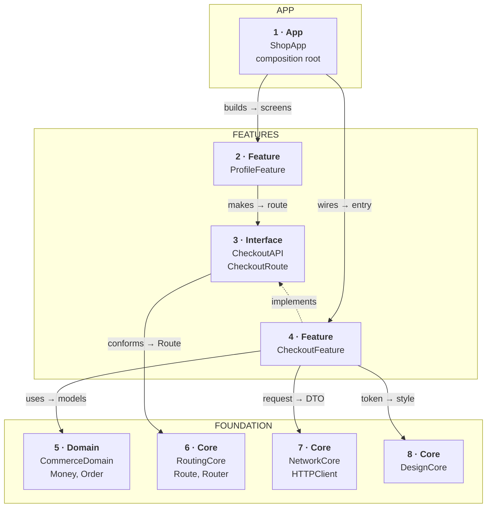
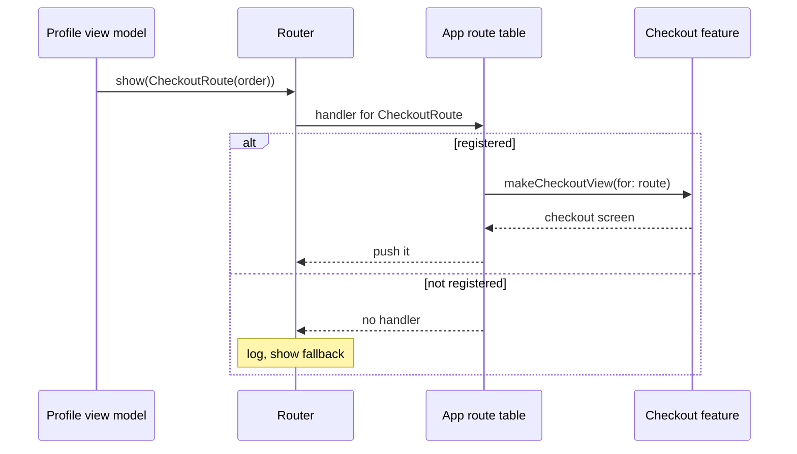
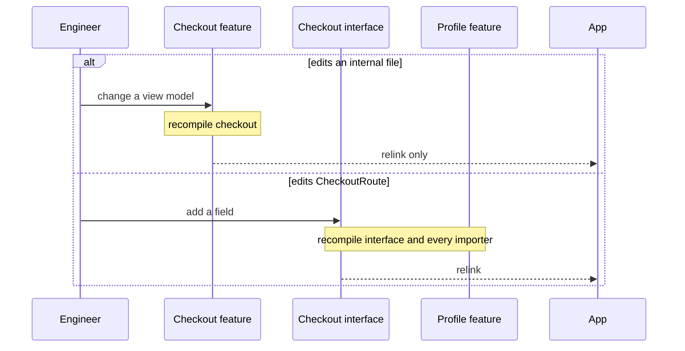

*A recurring senior prompt in first-hand reports. The answer is not "a module per screen". It is a small graph with one direction, interface modules so features never import each other, and one place that wires it all.*

> **Interviewer:** "We're 40 engineers working in one app target. Builds are slow and everyone steps on everyone. Design the module structure."

## Run it as a round, not as reading

Set a timer. Sketch. Talk the whole time. Open a section only when its slot is over.

| Clock | Phase | What you do |
|---|---|---|
| 0:00–0:02 | The prompt | Repeat it back in one sentence |
| 0:02–0:07 | Clarify | Ask yours, then read section 1 |
| 0:07–0:12 | Scope | Out of scope first, then required, then later |
| 0:12–0:24 | High level | The idea · the parts · the sketch · one line each · two flows |
| 0:24–0:40 | Deep dives | The interviewer picks one of sections 9–11 |
| 0:40–0:45 | Recap | Follow-ups, then the 60-second summary |

## What this question is really testing

- **One dependency direction**: app → features → foundation, and never back up.
- **No feature imports another feature.** They meet through small interface modules.
- **One composition root** that wires everything, with plain constructor injection.
- **Knowing what modules buy**: fewer rebuilds, per-team tests and previews, clear owners.
- **Knowing what not to split yet**, and how to migrate without freezing 40 people.

**Traps:** a module per screen; feature A importing feature B "just for one type"; a `Common` module everything depends on; a DI container framework as the first move; a big-bang rewrite; "dynamic frameworks are faster to build, so ship them".

::: Words used in this chapter
- **Repository** — the one owner of one kind of data. It turns the server's format into the app's model.
- **Composite** — a repository that only reads: it asks two repositories and combines their answers into one model.
- **Store** — in-memory state that several screens show at once.
- **Use case** — one user intent with a product rule, like "never charge twice".
- **View model** — the screen's brain. It owns the screen's state and hands the screen one view state.
- **Module** — a unit the compiler builds on its own. Here, a target in a local Swift package.
- **Interface module** — a tiny module holding only a feature's promises: its route and protocols.
- **Composition root** — the one place that creates every real part and passes them in.
- **Route** — a value that says "show this screen with these inputs", without naming the screen's type.
- **Static and dynamic linking** — copied into the app binary at build time, or loaded at launch.
- **Code owners** — a file mapping folders to the team that must review changes there.
:::

::: 1 · The interviewer answers your clarifying questions
**"How are the 40 people organised?"** → *Six product teams: browse, product page, cart and checkout, account, orders, growth. Plus a small platform team.*

**"What hurts most?"** → *A clean build takes 12 minutes. A one-line change rebuilds far too much. Every test runs on every pull request. Project-file merge conflicts weekly.*

**"How is code shared today?"** → *Everything is in one target. Screens reach a global service locator for networking.*

**"Stack?"** → *iOS 17, Swift 6, mostly SwiftUI, a little Objective-C in payments.*

**"One app, or several apps sharing code?"** → *One app today. An App Clip is on the roadmap.*

**"Can we stop features for a migration?"** → *No. We ship weekly.*

**"Launch time and binary size?"** → *Both are watched. Don't make either worse.*

**"Project generator or plain Xcode?"** → *Plain Xcode with Swift packages. Tell me if you'd change that.*
:::

::: 2 · Requirements and scope — what you should have said
**Out of scope, said first:** the architecture inside each feature (it stays view, view model, repository), the backend, CI hardware, a project generator, a DI container framework.

**Required for the prompt**

1. A module graph with rules a team can follow without asking.
2. Features open each other's screens without importing each other.
3. A change rebuilds and retests only what depends on it. Each feature previews on its own.
4. A migration path that never freezes shipping.

**What must feel good:** incremental builds in seconds · one obvious owner per folder · launch time and size no worse · each module testable alone.

**Production considerations** (say, don't draw): linking, binary size, a CI rule that rejects bad imports, code owners. See section 12.

**Optional follow-ups** (add only when asked):

```text
An App Clip reuses checkout  → the App Clip is a second composition root
Two features need one data   → a shared data module under the domain
Builds still slow at 60 devs → more interface modules, a build cache
Deep links from outside      → the app turns URLs into routes
A test-support module        → one …Testing module of fakes per interface
```

*"I'll start with the smallest graph that removes the pain, and split further only when a measurement says so."*
:::

::: 3 · The idea, in 30 seconds — before you draw anything
> *"The app target becomes a thin shell: the composition root. Each team's feature is a module in a local Swift package, and next to it sits a tiny interface module with its route and its promise to others. Features may import any interface, the shared domain and the core modules, but never another feature. The app is the only module that sees every feature: it builds the real parts, passes them in through initialisers, and maps each route to its screen. So editing a feature's insides rebuilds that feature and relinks the app, and nothing else."*
:::

::: 4 · What we need — the components, before the sketch
**Adapted for an architecture prompt:** the cards are modules, the one-blank test reads "this module changes when ___", and section 8 holds the module contracts instead of a server contract.

| # | Part | Module | Role | Its one job |
|---|---|---|---|---|
| 1 | **App** | `ShopApp` | App | The composition root: wires every module. |
| 2 | **Profile feature** | `ProfileFeature` | Feature | One team's screens. Here, the caller. |
| 3 | **Checkout interface** | `CheckoutAPI` | Interface | Checkout's route and promise, nothing else. |
| 4 | **Checkout feature** | `CheckoutFeature` | Feature | One team's screens. Keeps checkout's promise. |
| 5 | **Commerce domain** | `CommerceDomain` | Domain | Shared business models and repository protocols. |
| 6 | **Routing core** | `RoutingCore` | Core | The `Route` and `Router` promises. |
| 7 | **Network core** | `NetworkCore` | Core | One HTTP client: auth, timeouts, decoding. |
| 8 | **Design core** | `DesignCore` | Core | Colours, type, components. |

Eight cards, no chips: the interface module *is* the abstraction here.

**The roles.** *App* sees everything and holds no product code. *Feature* holds screens, view models and its own repositories. *Interface* holds only routes, protocols and the few models they mention. *Domain* holds business models and protocols, no UI, no I/O. *Core* is product-agnostic plumbing.

**Not drawn:** the other four features and their interface modules (same shape as cards 2 to 4), a `PersistenceCore`, an `AnalyticsCore`. **Not on the list yet:** everything under "optional follow-ups".
:::

::: 5 · The sketch


**How to read it.** A solid arrow is an `import`: the asker depends on the answerer. Dashed means *implements*: checkout keeps the promise its interface module writes. Arrows only point down or up to an abstraction, never sideways between features. Not drawn, to keep the board clean: profile imports the same foundation modules as checkout, and `CheckoutAPI` imports `CommerceDomain` for `OrderID`.

**Dependency inversion, in one line.** Profile depends on `CheckoutAPI`, a promise, and `CheckoutFeature` implements it, so the dashed arrow points **up** and profile never compiles against checkout's insides.

**No shared store on this sketch:** no state is shown by two features yet. When the cart badge appears on every tab, the cart store moves behind `CartAPI` (section 13).

**On Miro:** three frames, eight cards, seven solid arrows, one dashed, the four foundation modules on one row. Point at card 3: *"this is the only thing profile ever sees of checkout. Change checkout's insides, and profile doesn't rebuild."*
:::

::: 6 · Each component: its job, its interface, the choice inside it
**The graph, as rules.** These four lines are what you hand the 40 people.

```text
App        → may import everything
Feature    → may import Interface, Domain, Core. Never another Feature
Interface  → may import Domain and RoutingCore only
Domain     → may import nothing of ours. Core → never imports Domain or above
```

### 1 · App (`ShopApp`)

**Job:** the composition root. It creates the real HTTP client, repositories and features, passes them in through initialisers, and registers each route with its screen.

**Interface:**

```swift
@main
struct ShopApp: App {
    /// Builds every module once, at launch.
    /// The only place that names concrete types
    /// like URLSessionHTTPClient or CheckoutFeature.
    init()
    var body: some Scene { get }
}
```

**Choices:**

- **Plain constructor injection, no container framework.** With six features the wiring is a page of code, checked by the compiler. A container trades compile errors for launch-time crashes.
- **No product code here.** If a screen lives in the app target, every change to it relinks everything and nobody owns it.

### 2 · Profile feature (`ProfileFeature`)

**Job:** the account team's screens. In this sketch it is the *caller*: its "Buy again" button opens checkout.

**Interface:**

```swift
public struct ProfileFeature {
    public init(http: HTTPClient, router: Router)
    /// The tab's root screen.
    @MainActor public func makeRootView() -> some View
}
```

**Choices:**

- **It never imports `CheckoutFeature`.** It makes a `CheckoutRoute` and asks the router to show it.
- **Inside, the usual three layers.** View, view model, its own repositories. A module boundary is not a reason to change how a screen is built.

### 3 · Checkout interface (`CheckoutAPI`)

**Job:** everything other features may know about checkout: how to ask for it, and the one model that request carries.

**Interface:** in section 8.

**Choices:**

- **Tiny and slow-changing on purpose.** Every module that imports it rebuilds when it changes, so it holds routes and protocols, never view models or views.
- **Its own module, not a folder inside checkout.** A folder would make importers depend on checkout's whole module, and its rebuilds.

### 4 · Checkout feature (`CheckoutFeature`)

**Job:** the cart and checkout team's screens, view models, repositories and use cases (the "never charge twice" rule lives here).

**Interface:**

```swift
public struct CheckoutFeature: CheckoutEntry {
    public init(http: HTTPClient, orders: OrderRepository)
    @MainActor public func makeCheckoutView(for route: CheckoutRoute) -> AnyView
}
```

**Choices:**

- **Only its entry point is `public`.** Everything else is internal. Helpers shared with its own test target or demo app use `package` access, which is visible inside the package and invisible to the app.
- **Its own test target and demo app.** `CheckoutFeatureTests` builds checkout and its foundation, not the other five features.

### 5 · Commerce domain (`CommerceDomain`)

**Job:** business models more than one feature uses (`Money`, `Order`, `ProductID`) and the repository protocols for them.

**Interface:**

```swift
public struct Money: Hashable, Sendable {
    public let minorUnits: Int
    public let currency: String
}

public protocol OrderRepository: Sendable {
    /// Throws on failure. Cancelling the caller cancels the request.
    func recentOrders() async throws -> [Order]
}
```

**Choices:**

- **Models, protocols, pure rules. No UI, no networking.** That keeps it the slowest-changing module in the app.
- **Not a `Common` module.** Only types two features genuinely share. A type one feature uses stays in that feature.

### 6 · Routing core (`RoutingCore`)

**Job:** the promises navigation is built on: a `Route` marker and a `Router` that shows one.

**Interface:** in section 8.

**Choice:** **routes are typed values, not URL strings.** A typo becomes a compile error. URLs appear only at the edge, where the app turns a deep link into a route.

### 7 · Network core (`NetworkCore`)

**Job:** one HTTP client for the whole app: base URL, auth refresh, timeouts, decoding.

**Interface:** in section 8.

**Choices:**

- **It returns DTOs, never app models.** Each feature's repository maps them, so the core knows no feature.
- **It replaces the global service locator.** The app makes one client and passes it in.

### 8 · Design core (`DesignCore`)

**Job:** colours, type, spacing and shared components, so every team builds from the same parts.

**Interface:** `DSColor`, `DSFont`, `PrimaryButton`, and the rest of the design system.

**Choice:** **its own module, because almost everything imports it.** Keep it stable. A change here rebuilds every feature, so batch changes.

**Why these parts, and no more.** Each module changes for one reason:

| Module | Changes when |
|---|---|
| 1 · App | the app's wiring (which features ship, how they connect) |
| 2 · Profile feature | one team's screens |
| 3 · Checkout interface | what checkout promises other features |
| 4 · Checkout feature | one team's screens |
| 5 · Commerce domain | a shared business concept |
| 6 · Routing core | how screens are presented |
| 7 · Network core | how the app talks to the server |
| 8 · Design core | the brand's look |

Not added: a module per screen, a module per layer inside a feature, a `Common` module, a container framework, generic base classes. Each would add rebuild edges or ceremony without removing a pain the interviewer named.
:::

::: 7 · Key flows through the sketch
**Flow 1 — profile opens checkout, without importing it.**



The route is a value from `CheckoutAPI`. Only the app knows which module answers it.

**Flow 2 — an engineer edits checkout. What rebuilds?**



That is the whole build argument: insides change daily, interfaces rarely.
:::

::: 8 · The module contracts
The public interfaces between modules. These are what code review guards.

```swift
// RoutingCore
public protocol Route: Hashable, Sendable {}

@MainActor
public protocol Router: AnyObject {
    /// Shows the screen registered for this route's type.
    /// Never throws: an unknown route is logged and ignored.
    func show(_ route: any Route)
}

// CheckoutAPI (imports CommerceDomain, RoutingCore)
public struct CheckoutRoute: Route {
    public let orderID: OrderID
    public init(orderID: OrderID)
}

public protocol CheckoutEntry {
    @MainActor func makeCheckoutView(for route: CheckoutRoute) -> AnyView
}

// NetworkCore
public protocol HTTPClient: Sendable {
    /// Returns the decoded DTO. Throws on transport, status or decoding.
    /// Cancelling the caller cancels the request.
    func send<Response: Decodable & Sendable>(
        _ request: HTTPRequest
    ) async throws -> Response
}
```

The graph lives in the package manifest, so the compiler enforces it:

```swift
// Packages/Checkout/Package.swift (abridged)
products: [
    .library(name: "CheckoutAPI", targets: ["CheckoutAPI"]),
    .library(name: "CheckoutFeature", targets: ["CheckoutFeature"]),
],
targets: [
    .target(name: "CheckoutAPI",
            dependencies: ["CommerceDomain", "RoutingCore"]),
    .target(name: "CheckoutFeature",
            dependencies: ["CheckoutAPI", "NetworkCore", "DesignCore"]),
    .testTarget(name: "CheckoutFeatureTests",
                dependencies: ["CheckoutFeature"]),
]
```

- **The manifest is the rule.** A feature can only `import` what its target lists, so "no feature imports a feature" is a line a CI script can check in the manifests.
- **Interfaces mention domain types, never feature types.** `CheckoutRoute` carries an `OrderID`, not a checkout view model.
- **No library `type:`.** Leaving it out lets the package manager pick static or dynamic linking, which Apple recommends (section 12).
:::

::: 9 · Deep dive — "Profile needs to open checkout. How, without importing it?"
**Decision:** typed routes declared in interface modules, resolved by one router the app configures.

1. `CheckoutAPI` declares `CheckoutRoute`, a plain value.
2. Profile's view model is handed a `Router` and calls `router.show(CheckoutRoute(orderID:))`.
3. At launch the app registers, per route type, a closure that asks `CheckoutFeature` for the screen.
4. The router pushes it on the current tab's stack, or presents it, as the route asks.

**Deep links reuse it.** The app parses `shop://checkout/123` into a `CheckoutRoute` and calls the same `show`. Features never parse URLs.

**Feature flags reuse it too.** If checkout v2 is on, the app registers the v2 handler. No caller changes.

**Rejected: profile imports checkout "just for the screen".** One edge becomes ten, then a cycle (checkout's receipt links back to profile), and the build can no longer run them in parallel. **Also rejected:** string URLs as the internal API. A renamed parameter fails at run time, in production.
:::

::: 10 · Deep dive — "Builds take 12 minutes. What does this actually buy?"
**Measure first.** Xcode's build timeline shows which targets wait on which. One giant target compiles serially at the end of every chain.

**What modules change:**

1. **Fewer files recompile.** Editing a feature's internal file recompiles that module. Its importers only see its public interface, which didn't change.
2. **More runs in parallel.** Five features that don't depend on each other build side by side. A deep chain (A needs B needs C) can't.
3. **Explicitly built modules.** Xcode schedules each module's compilation as its own build task, so the work is shared and visible. Xcode 16 does this by default for C and Objective-C and lets Swift opt in; check your Xcode version's notes.
4. **Smaller test and preview builds.** `CheckoutFeatureTests` builds checkout and its foundation. A `#Preview` inside checkout, run from a small demo app, never compiles the other features.

**What it doesn't buy:** a faster clean build, by itself. Clean builds improve only as much as the graph gets wider and shallower.

**Keep the gains:** interface modules stay tiny, `DesignCore` changes in batches, and `public` stays rare, since every public change ripples.

**Rejected: a module per screen.** Two hundred modules add scheduling and linking overhead, slow package resolution, and spread one team's change across many manifests. Split by **team and product area**, then measure.
:::

::: 11 · Deep dive — "How do you migrate without stopping 40 people?"
**Decision:** extract from the bottom of the graph up, one module per sprint, while features keep shipping.

1. **Core first.** Move networking and the design system into packages. They have no product code and many users, so everyone gets the win early.
2. **Then the domain.** Move models two features share. Leave the rest where it is.
3. **Then one feature at a time.** Start with the team that suffers most. Extract its interface module first, switch callers to the route, then move the feature behind it.
4. **Lock each step in.** Once a module exists, CI rejects new imports that break the four rules. The code-owners file gives each module its team.

**The service locator goes last.** Until a feature is extracted, it may still reach the locator. Extracted features get their parts through `init`, and the locator shrinks to nothing.

**Rejected: a big-bang rewrite into the new structure.** It freezes shipping, merges badly, and the old app keeps changing underneath.
:::

::: 12 · Failure modes, production and scale
**Failures**

| Failure | What you do |
|---|---|
| A feature imports a feature | CI fails the pull request; add a route to an interface |
| A dependency cycle | The package manager refuses to build; move the shared type down |
| An interface module grows fat | Review it; move view models and helpers back into the feature |
| `DesignCore` change rebuilds everything | Batch design changes; keep tokens stable |
| Two copies of one type at run time | A static library linked into two dynamic frameworks; link it once |
| Launch time regresses | Too many dynamic frameworks; go static or mergeable |

**Production notes** (short, not on the board)

- **Linking:** leave library products' type unset, so they usually link statically into the app: one binary, fast launch. Dynamic frameworks help debug link times but each costs launch work. Mergeable libraries (Xcode 15+) link dynamically in debug and merge into the binary in release.
- **Size:** modules don't shrink the binary by themselves. Dead-code stripping and fewer duplicated assets do. A shared resource used by two modules lives in one.
- **CI:** run only the test targets downstream of the changed modules. A small script reads the manifests' dependency lists.
- **Ownership:** a code-owners file maps each package to its team. Interfaces need the owning team's review.
- **Metrics:** clean build time, incremental build time for a one-line feature edit, CI time per pull request, launch time, binary size.

**Scale, back of the envelope**, with the interviewer's numbers:

```text
teams × (feature + interface) + core + domain ≈ modules
6 × 2 + 5 + 2                                  ≈ 19 modules
```

About 20 modules, about three per team. Not 200. The number grows with teams, not screens.

**Grow only when asked**

```text
One app                    → one composition root
An App Clip                → a second composition root, reusing features
Two features own one data  → a shared data module under the domain
60+ engineers              → split the biggest features, add a build cache
Deep links from outside    → URL → route in the app, nowhere else
```

**What not to modularise yet:** a single screen, a helper one feature uses, layers inside a feature, code that one team owns and rarely changes. Split when a measurement or a second owner asks for it.
:::

::: 13 · Question bank — everything they can push on
Answer out loud first, then open.

### The graph and its layers

<details>
<summary>"Walk me through the layers."</summary>

App on top, the composition root. Features and their interface modules in the middle. Domain and core at the bottom. Imports only point down, or to an interface.
</details>

<details>
<summary>"Why can't a feature import another feature?"</summary>

It couples their builds and owners, and it grows into cycles. Through an interface, either side can change its insides alone.
</details>

<details>
<summary>"What's the difference between domain and core?"</summary>

Domain is the business: `Money`, `Order`, repository protocols. Core is product-agnostic plumbing: networking, routing, the design system.
</details>

<details>
<summary>"Why not a `Common` module?"</summary>

It becomes the place for everything, so everything depends on it and every change rebuilds the app. Shared types go to the domain only when two features need them.
</details>

<details>
<summary>"How do you stop cycles?"</summary>

The package manager refuses a cycle between targets. The four rules make one hard to write: nothing below imports anything above.
</details>

<details>
<summary>"Show me dependency inversion."</summary>

Profile depends on `CheckoutAPI`; `CheckoutFeature` implements it. Both point at the abstraction, so the dashed arrow goes up.
</details>

### Interfaces, wiring and navigation

<details>
<summary>"What goes in an interface module?"</summary>

Routes, protocols, and the few domain types they mention. No views, no view models, nothing that changes weekly.
</details>

<details>
<summary>"Where does dependency injection happen?"</summary>

In the app target, at launch: it creates the client and repositories and passes them into each feature's initialiser. No container framework.
</details>

<details>
<summary>"Why not a DI container?"</summary>

Wiring by hand is a page of code the compiler checks. A container turns a missing registration into a crash at run time.
</details>

<details>
<summary>"How do deep links work?"</summary>

The app parses the URL into a typed route and calls the same `show`. Features never see URLs.
</details>

<details>
<summary>"Where do use cases live, and why is there no use case card?"</summary>

Inside the feature that owns the rule, like "never charge twice" in checkout. This sketch is about modules; each feature keeps its own layers.
</details>

<details>
<summary>"Where does mapping happen?"</summary>

In each feature's repositories. `NetworkCore` returns DTOs and knows no feature.
</details>

<details>
<summary>Follow-up chain: "A second feature needs the same state."</summary>

1. *"The cart badge shows on every tab."* → The count is now shown by several features.
2. *"Where does it live?"* → In one cart store, owned by checkout, exposed as a protocol in `CartAPI`.
3. *"Who creates it?"* → The app, once, and passes it to every feature that shows the badge.
4. *"When wouldn't you?"* → If only checkout shows it.
</details>

### Builds, tests and previews

<details>
<summary>"Why does this make builds faster?"</summary>

An internal edit recompiles one module and relinks the app. Independent modules also compile in parallel.
</details>

<details>
<summary>"Does it make a clean build faster?"</summary>

Only if the graph is wide and shallow. Incremental builds are the real win.
</details>

<details>
<summary>"How do tests change?"</summary>

Each module has its own test target that builds only it and its dependencies. CI runs only the targets downstream of a change.
</details>

<details>
<summary>"How do previews get faster?"</summary>

A `#Preview` in a feature, run from that feature's demo app, compiles only that feature and its foundation.
</details>

<details>
<summary>"How do you test a feature that opens another?"</summary>

Give it a fake `Router` and assert it was asked to show a `CheckoutRoute`. No checkout code involved.
</details>

<details>
<summary>"What's `package` access for?"</summary>

Code shared between targets of one package, like a feature and its tests, without making it `public` to the app.
</details>

### Linking and size

<details>
<summary>"Static or dynamic?"</summary>

Leave the product type unset so it links statically in the app: fast launch. Mergeable libraries if you want dynamic in debug and merged in release.
</details>

<details>
<summary>"Can static linking go wrong?"</summary>

Yes: a static library linked into two dynamic frameworks gives two copies of its types and globals. Link each library into exactly one binary.
</details>

<details>
<summary>"Does modularising shrink the app?"</summary>

Not by itself. Dead-code stripping and deduplicated resources do. It mostly changes build time and ownership.
</details>

### Migration and ownership

<details>
<summary>"Where do you start?"</summary>

The bottom: networking and the design system. Most users, no product code.
</details>

<details>
<summary>"How do you keep the rules once the work is done?"</summary>

A CI check on the manifests and a code-owners file. Rules nobody checks erode in a quarter.
</details>

<details>
<summary>"How many modules?"</summary>

About two per team plus a handful of core: around 20 here. It grows with teams, not with screens.
</details>

<details>
<summary>Follow-up chain: "Six weeks instead of six months."</summary>

1. *"What do you do first?"* → Extract networking and the design system, and turn on the import check.
2. *"Then?"* → The interface and module for the slowest-building feature.
3. *"What do you leave?"* → The other features, and the service locator, in the app target for now.
</details>
:::

::: 14 · Scorecard — mark yourself, 0 / 1 / 2
| | Did you… | 0–2 |
|---|---|---|
| 1 | Talk the whole time, and listen when interrupted | |
| 2 | Clarify the team shape and the pain before designing | |
| 3 | Give a trade-off for each choice | |
| 4 | Say out of scope first; separate required from later | |
| 5 | Say the idea, list the parts, then sketch | |
| 6 | Keep the sketch to nine cards, one line each | |
| 7 | State the dependency direction as rules | |
| 8 | Forbid feature-to-feature imports and show the interface module | |
| 9 | Put wiring in one composition root, no container | |
| 10 | Navigate with typed routes, deep links at the edge | |
| 11 | Explain what modules do and don't buy for builds | |
| 12 | Choose static linking, and name mergeable libraries | |
| 13 | Migrate bottom-up, with CI and code owners | |
| 14 | Land the recap inside 60 seconds | |

14+ is a pass.<!--private--> Anything scored 0 goes in the progress log and comes back as a recall prompt.<!--/private--><!--public--> A zero names the thing to read about next.<!--/public-->
:::

::: 15 · The 60-second recap
The app target becomes a thin composition root. Each team owns a feature module in a local Swift package, with a tiny interface module beside it holding its routes and protocols. Imports point one way: app, then features, then domain and core, and a feature never imports another feature. Features open each other with typed routes that the app maps to screens, and deep links become the same routes at the edge. Wiring is plain constructor injection in the app. An internal edit rebuilds one module and relinks, each module has its own tests and previews, products link statically, and a CI check plus code owners keep the rules. I'd migrate from the bottom up, core first, one feature per sprint, without freezing anyone.
:::
