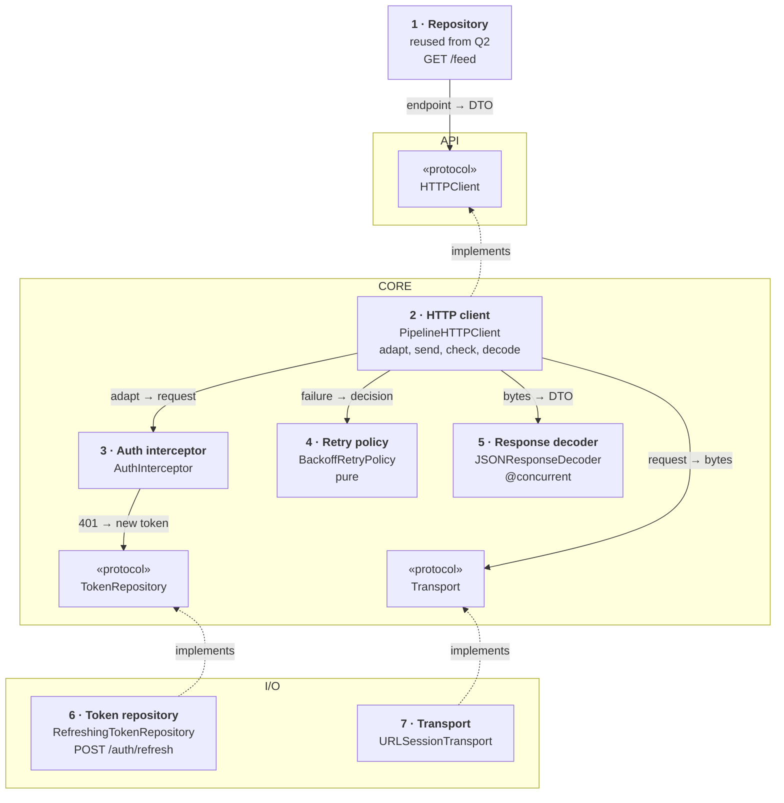
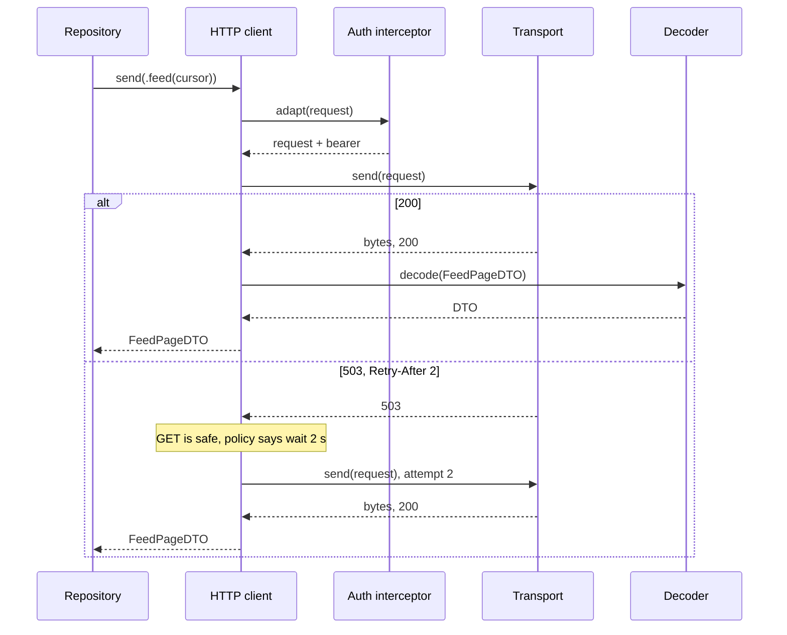
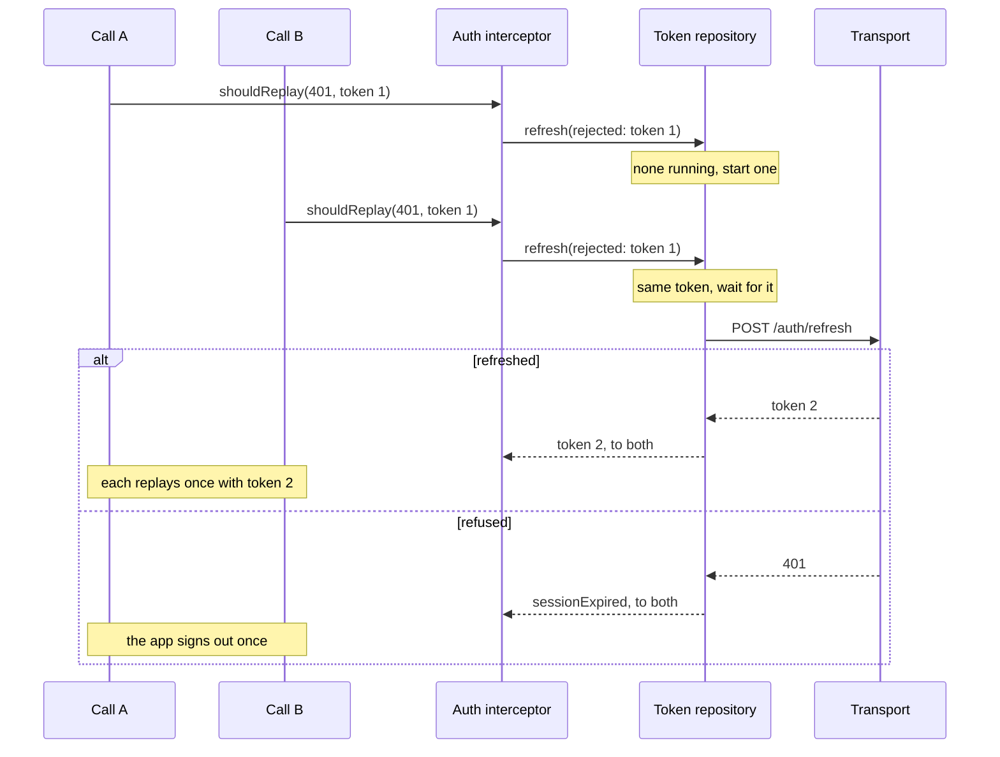

*Reported in a delivery company's architecture round as the follow-up to a screen design. The answer stays small: one value per request, one protocol, a chain of interceptors, one shared refresh, and retries only where repeating is safe.*

> **Interviewer:** "You've drawn repositories that call 'the HTTP client'. How would you structure the networking layer of this app?"

## Run it as a round, not as reading

Set a timer. Sketch. Talk the whole time. Open a section only when its slot is over.

| Clock | Phase | What you do |
|---|---|---|
| 0:00–0:02 | The prompt | Repeat it back in one sentence |
| 0:02–0:07 | Clarify | Ask yours, then read section 1 |
| 0:07–0:12 | Scope | Out of scope first, then required, then later |
| 0:12–0:24 | High level | The idea · the parts · the sketch · one line each · two flows |
| 0:24–0:40 | Deep dives | The interviewer picks one of sections 9–11 |
| 0:40–0:45 | Recap | Follow-ups, then the 60-second summary |

## What this question is really testing

- **A small public surface:** one request value and one `send` method. Features never touch `URLSession`.
- **Token refresh done once.** Ten requests that fail with 401 at once share one refresh.
- **Retries that can't do harm:** only idempotent requests, with backoff, and `Retry-After` honoured.
- **Errors a caller can act on:** no response, a bad status, a bad body, a signed-out user.
- **Testability and shipping:** one fake for features, one stub for the real transport, one SPM module.

**Traps:** a singleton `NetworkManager` with a method per endpoint; refreshing the token inside every request; retrying a `POST` that creates an order; treating cancellation as a failure; decoding on the main actor; "certificate pinning makes it secure".

::: Words used in this chapter
- **Repository** — the one owner of one kind of data. It turns the server's format into the app's model.
- **Composite** — a repository that only reads: it asks two repositories and combines their answers into one model.
- **Store** — in-memory state that several screens show at once. Not needed here.
- **Use case** — one user intent with a product rule, like "only the latest tap counts".
- **View model** — the screen's brain. It owns the screen's state and hands the screen one view state.
- **Endpoint** — one value that describes a request: method, path, query, body, and the type of the reply.
- **DTO** — the server's format, decoded as it arrives. Repositories map it to the app's model.
- **Interceptor** — a step every request passes through, like adding a header. They run as a chain.
- **Access token, refresh token** — the short-lived pass sent with each request, and the long-lived one that buys a new pass.
- **Idempotent** — sending the same request twice has the same effect as once.
- **Backoff, jitter** — wait longer after each failure, and add randomness so phones don't retry in step.
- **Certificate pinning** — the app accepts only the server keys it already knows.
:::

::: 1 · The interviewer answers your clarifying questions
**"One app, or an SDK for other apps?"** → *One app, five feature teams. It should live in its own package.*

**"REST and JSON, or GraphQL?"** → *REST and JSON, about thirty endpoints.*

**"How does auth work?"** → *An access token that lasts 15 minutes, and a refresh token that changes on every refresh.*

**"Offline writes?"** → *Not in this layer. Show an error.*

**"Uploads, downloads in the background?"** → *Out of scope. That's another question.*

**"Live data, sockets?"** → *No.*

**"How big?"** → *Ten million users a day, about 40 requests a session.*

**"Minimum OS?"** → *iOS 17, Swift 6.*

**"What hurts today?"** → *Random sign-outs when several calls fail together. And a retry once placed an order twice.*
:::

::: 2 · Requirements and scope — what you should have said
**Out of scope, said first:** the server, background transfers, sockets, GraphQL, offline queues, response caching, and image loading (question 1).

**Required for the prompt**

1. Features describe a request as a value and get back a typed reply or a typed error.
2. Every request gets the shared headers and the access token, through one chain.
3. A 401 triggers one shared refresh, then each failed request is replayed once.
4. Safe failures are retried with backoff; `Retry-After` and 429 are honoured.

**What must feel good:** no random sign-outs · no duplicate orders · decoding never blocks the main actor · a closed screen cancels its reads.

**Production considerations** (say, don't draw): metrics, logging without personal data, pinning, timeouts. See section 12.

**Optional follow-ups** (add only when asked):

```text
Writes must survive offline      → a persistent queue above this layer
Large files in the background    → a background URLSession, separate
Live updates                     → a socket client sharing the token repository
GraphQL                          → a second client behind the same interceptors
```

*"I'll start simple and add each of these when the requirement appears."*
:::

::: 3 · The idea, in 30 seconds — before you draw anything
> *"A feature describes each request as an `Endpoint` value, like `GET /feed`, that also names the reply's type. It hands it to one `HTTPClient` protocol with a single `send`. Inside, a pipeline runs the request through a chain of interceptors (shared headers, the token, logging), sends it through a transport over `URLSession`, checks the status, and decodes off the main actor. On a 401, the auth interceptor asks one token repository to refresh with `POST /auth/refresh`; every request that failed together shares that one refresh. A pure retry policy decides what's safe to repeat. It's a library, so three frames: the API features touch, the core that coordinates, and the I/O that talks to the system."*
:::

::: 4 · What we need — the components, before the sketch
| # | Part | Type | Layer | Its one job |
|---|---|---|---|---|
| 1 | **Repository** | reused from Q2 | Reused | Builds `GET /feed`, maps the DTO. |
| 2 | **HTTP client** | `PipelineHTTPClient` | Core | Runs one request through every step. |
| 3 | **Auth interceptor** | `AuthInterceptor` | Core | Adds the token; on a 401, asks for a new one. |
| 4 | **Retry policy** | `BackoffRetryPolicy` | Core | Says whether, and when, to try again. |
| 5 | **Response decoder** | `JSONResponseDecoder` | Core | Bytes → DTO, off the caller's actor. |
| 6 | **Token repository** | `RefreshingTokenRepository` | I/O | Owns the tokens; one refresh at a time. |
| 7 | **Transport** | `URLSessionTransport` | I/O | Sends one attempt through `URLSession`. |
| chip | **HTTP client** | `HTTPClient` | API | The promise features use; card 2 keeps it. |
| chip | **Token repository** | `TokenRepository` | Core | The promise card 6 keeps. |
| chip | **Transport** | `Transport` | Core | The promise card 7 keeps. |

Seven cards, three chips. `Endpoint` and `NetworkError` aren't cards; they open section 6.

**A library's roles:** the pipeline coordinates, the interceptor and policy are rules, the token repository owns one kind of data, the transport is the client. No view model, use case or store: nothing here is a screen or a product intent.

**Not drawn:** `HeadersInterceptor` (pure: app version, locale, request ID) and `LoggingInterceptor`, both under the `RequestInterceptor` protocol; `KeychainTokenDatabase` (protocol `TokenDatabase`), where card 6 keeps the tokens; `NetworkMetrics`, where card 7 reports timings. **Not on the list yet:** everything under "optional follow-ups".
:::

::: 5 · The sketch


**How to read it.** A solid arrow points from the asker to the answerer: *request → reply*. Dashed arrows mean *implements*. Card 2 asks the interceptors, then the transport, then the decoder; it asks the policy only after a failure.

**Dependency inversion, in one line.** The core writes the promises (the chips); the I/O frame keeps them, so the dashed arrows point **up** and the core never imports `URLSession` or the keychain.

**Card 6 also holds the `Transport` protocol** (that arrow isn't drawn), so the refresh skips the auth interceptor.

**No store on this sketch:** a networking layer shows nothing. The one shared state, the token, has one owner, card 6.

**On Miro:** three frames, seven cards, three chips, six solid arrows. Point at card 6: *"this is where ten 401s become one refresh."*
:::

::: 6 · Each component: its job, its interface, the choice inside it
**The values everyone passes.**

```swift
enum HTTPMethod: String, Sendable {
    case get = "GET", post = "POST", put = "PUT", delete = "DELETE"
}

/// One request, and the type of its reply. No host, no /v1:
/// the client adds both.
struct Endpoint<Response: Decodable & Sendable>: Sendable {
    let method: HTTPMethod
    let path: String
    var query: [URLQueryItem] = []
    /// Already encoded JSON
    var body: Data? = nil
    /// false only for the refresh and public calls
    var requiresAuth = true
    /// Set on a POST the app may retry; same key on every attempt
    var idempotencyKey: String? = nil
}

enum NetworkError: Error, Equatable, Sendable {
    /// No response: offline, timeout, TLS. Never CancellationError.
    case transport(URLError.Code)
    /// A response outside 200–299, with the server's error code if it sent one
    case status(Int, code: String?)
    /// 2xx, but the body didn't match the DTO. Never retried.
    case decoding(String)
    /// The refresh token was refused. The app signs out.
    case sessionExpired
}
```

Features write endpoints as pure factories beside their repository: `Endpoint<FeedPageDTO>.feed(cursor:)`. **Domain errors are the fourth tier:** the repository turns `.status(409, code: "store_closed")` into its own `BasketError.storeClosed`.

### 1 · Repository (reused from question 2)

**Job:** builds `GET /feed`, sends it, and maps `FeedPageDTO` to `FeedPage`. DTOs stop at this card.

**Interface:** `init(http: HTTPClient)`.

**Choice:** its tests fake one method and return a DTO.

### 2 · HTTP client (`PipelineHTTPClient`)

**Job:** runs one request: build the `URLRequest`, run the interceptors in order, send, check the status, replay once if an interceptor asks, retry if the policy says so, decode.

```swift
protocol HTTPClient: Sendable {
    /// Returns the decoded reply or throws NetworkError.
    /// Cancelling the caller cancels the request and any retry
    /// wait, and throws CancellationError, never wrapped.
    func send<Response>(_ endpoint: Endpoint<Response>) async throws -> Response
}

struct PipelineHTTPClient: HTTPClient {
    init(baseURL: URL, transport: Transport,
         interceptors: [RequestInterceptor],
         retry: RetryPolicy, decoder: ResponseDecoder)
}
```

**Choices:**

- **A struct with no state.** The token has its own owner (card 6), so the pipeline needs no actor.
- **One generic `send`, not a method per endpoint.** Adding an endpoint is a new value in the feature's module, never a change here.
- **A fixed order.** A replay is not a retry: at most once, after a token refresh.
- *Rejected:* a `NetworkManager` singleton. It grows a method per endpoint, every team edits it, and tests can't replace it.

### 3 · Auth interceptor (`AuthInterceptor`)

**Job:** adds `Authorization: Bearer …` to every request that needs it. After a 401, asks the token repository for a new token and asks the pipeline to replay.

```swift
protocol RequestInterceptor: Sendable {
    /// Adds what this interceptor owns. Throws to stop the request.
    func adapt(_ request: URLRequest,
               requiresAuth: Bool) async throws -> URLRequest
    /// true = replay this request once. Throws sessionExpired.
    func shouldReplay(_ request: URLRequest,
                      after response: HTTPURLResponse) async throws -> Bool
}

struct AuthInterceptor: RequestInterceptor {
    init(tokens: TokenRepository)
}
```

**Choices:**

- **A chain of small interceptors** (headers, auth, logging), ordered once at the composition root.
- **It passes the rejected token** to the repository, so a late 401 doesn't trigger a second refresh.

### 4 · Retry policy (`BackoffRetryPolicy`)

**Job:** a pure rule: given the method, the failure and the attempt number, retry after some delay, or give up.

```swift
enum RetryDecision: Equatable, Sendable {
    case retry(after: Duration)
    case giveUp
}

protocol RetryPolicy: Sendable {
    /// Pure. attempt starts at 1. retryAfter is the parsed header.
    func decision(method: HTTPMethod, hasIdempotencyKey: Bool,
                  failure: NetworkError, retryAfter: Duration?,
                  attempt: Int) -> RetryDecision
}

struct BackoffRetryPolicy: RetryPolicy {
    init(maxAttempts: Int, base: Duration, cap: Duration,
         random: RandomSource)
}
```

**Choices:**

- **Pure**, so it's tested as a table: method × failure × attempt → decision. Jitter comes from an injected random source.
- **The pipeline waits**, with `Task.sleep(for:)`, which cancellation cuts short.

### 5 · Response decoder (`JSONResponseDecoder`)

**Job:** turns the body into the endpoint's DTO, off the caller's actor.

```swift
protocol ResponseDecoder: Sendable {
    /// Throws NetworkError.decoding. Checks cancellation first.
    func decode<T: Decodable & Sendable>(_ type: T.Type,
                                         from data: Data) async throws -> T
}

struct JSONResponseDecoder: ResponseDecoder {
    /// Runs on the global pool, not the caller's actor
    @concurrent func decode<T: Decodable & Sendable>(_ type: T.Type,
                                                     from data: Data) async throws -> T
}
```

**Choices:**

- **`@concurrent`, because of Swift 6.2.** Under SE-0461 a plain `nonisolated async` function runs on its caller's actor, so a page requested from a view model would decode on the main actor.
- **One `JSONDecoder` setup** (dates, keys) for the whole app.

### 6 · Token repository (`RefreshingTokenRepository`)

**Job:** owns the access and refresh tokens. Hands out a valid token, and runs at most one refresh at a time, shared by every caller.

```swift
protocol TokenRepository: Sendable {
    /// The access token, refreshed first if it expires within a
    /// minute. Throws sessionExpired if there is none.
    func validToken() async throws -> AccessToken
    /// Refreshes unless `rejected` was already replaced. Callers
    /// share one refresh. One caller cancelling doesn't cancel it:
    /// it finishes for the others, the caller only stops waiting.
    func refresh(rejected: AccessToken) async throws -> AccessToken
}

actor RefreshingTokenRepository: TokenRepository {
    init(transport: Transport, database: TokenDatabase, baseURL: URL)
}
```

**Choices:**

- **An actor holding the refresh task**, so concurrent callers await the same one (deep dive 9).
- **The token is the stale-result guard.** If `rejected` isn't current, someone already refreshed.
- **Saves both new tokens** to the keychain before returning.

### 7 · Transport (`URLSessionTransport`)

**Job:** sends one attempt with `URLSession.data(for:delegate:)` and returns the bytes and the response. Any status is a reply; only "no response" throws.

```swift
protocol Transport: Sendable {
    /// One attempt. Throws URLError when there is no response.
    /// Cancelling the caller cancels the task.
    func send(_ request: URLRequest) async throws -> (Data, HTTPURLResponse)
}

final class URLSessionTransport: NSObject, Transport, URLSessionTaskDelegate {
    init(configuration: URLSessionConfiguration, metrics: NetworkMetrics)
}
```

**Choices:**

- **`timeoutIntervalForRequest` set, `waitsForConnectivity` off**, so an offline user sees an error now.
- **Metrics from the delegate:** `urlSession(_:task:didFinishCollecting:)` hands over `URLSessionTaskMetrics`.
- **The test seam:** a fake returns canned bytes; the real one meets a `URLProtocol` stub (deep dive 11).

**Why these parts, and no more.** Each card changes for one reason:

| Card | Changes when |
|---|---|
| 1 · Repository | an endpoint or payload (`/feed`) |
| 2 · HTTP client | a product rule (the order of the steps) |
| 3 · Auth interceptor | an endpoint or payload (how auth is carried) |
| 4 · Retry policy | a product rule (what is safe to repeat) |
| 5 · Response decoder | a platform API (JSON decoding) |
| 6 · Token repository | an endpoint or payload (`/auth/refresh`) |
| 7 · Transport | a platform API (`URLSession`) |
| not drawn · Keychain database | a storage schema (where tokens live) |
| not drawn · Headers, logging | an endpoint or payload · a platform API (logging) |

Each protocol earns a fake or a second conformance. Not added: a use case (no product intent), a generic repository, a protocol per endpoint, a DI container. Constructor injection at the composition root is enough.
:::

::: 7 · Key flows through the sketch
**Flow 1 — a GET that succeeds, or meets a busy server.**



**Flow 2 — two calls get a 401 at the same moment.**



A late 401 that carried token 1 gets token 2 at once, with no new refresh.
:::

::: 8 · The server contract
The layer's contract with the server is a set of conventions, plus the one endpoint it calls itself.

```
Every request
     Authorization: Bearer {accessToken}
     X-Request-ID: {uuid}             // one per call, same on retries
     App-Version, Accept-Language

GET  /v1/feed?cursor={opaque}         // an example feature call, card 1
     → 200 { "items": [ … ], "nextCursor": "…" }

POST /v1/auth/refresh   { "refreshToken": "…" }
     → 200 { "accessToken", "refreshToken", "expiresIn": 900 }
     → 401 { "error": { "code": "invalid_grant" } }     // sign out

Any POST the app may retry
     Idempotency-Key: {uuid}          // same key on every attempt
     → the same reply for a repeat with the same key

Errors
     → 4xx/5xx { "error": { "code": "store_closed", "message": "…" } }
     → 429 or 503 with Retry-After: 30
```

- **One error shape for every endpoint**, so `code` is parsed once.
- **The refresh token rotates**, so a second parallel refresh sends a used token.
- **`Idempotency-Key` makes a retried `POST` safe** only if the server stores the key. Agree that first.
:::

::: 9 · Deep dive — "Ten requests get a 401 at the same moment. What happens?"
**Decision:** one actor owns the tokens and at most one refresh task. Every 401 waits on that task.

1. A call gets 401. The auth interceptor calls `refresh(rejected: token it sent)`.
2. In the actor: if `rejected` is no longer the current token, return the current one. Someone already refreshed.
3. If a refresh task is running, await it. If not, start one, store it **before any `await`**, and await it.
4. When it ends, clear the task. Success: save both tokens, return the new one, each call replays once. Refused: throw `sessionExpired` to every waiter; the app signs out once.

**Why "before any `await`".** An actor lets other callers in at every suspension; store it later and two callers both refresh.

**Proactive refresh.** `validToken()` refreshes a minute before expiry through the same task. The server's 401 stays the truth: the phone's clock can be wrong.

*Rejected:* each request refreshes on its own. With a rotating refresh token, the second refresh sends a used token, the server refuses it, and the user is signed out at random. That was the bug in section 1.
:::

::: 10 · Deep dive — "When do you retry, and when must you never?"
**Decision:** a pure policy, asked after each failed attempt.

1. **Is the request safe to repeat?** `GET`, `PUT`, `DELETE` are idempotent by definition (RFC 9110). A `POST` only with an `Idempotency-Key` the server honours.
2. **Is the failure worth repeating?** A timeout, a lost connection, 502, 503, 504, and 429. Never another 4xx (the request is wrong), never a decoding error, never a cancellation.
3. **How long to wait?** `Retry-After` if the server sent it (read with `value(forHTTPHeaderField:)`). Otherwise exponential backoff with full jitter: a random delay up to `base × 2^attempt`, capped.
4. **When to stop?** Three attempts, or sooner if the caller cancels; the wait itself is cancellable.

**Why jitter.** After an outage, phones retrying at exactly 1, 2 and 4 seconds hit the server in waves.

**A timeout on a `POST` is the dangerous case:** the server may have done the work. Without a key, don't retry; report "unknown", not "failed".

*Rejected:* "retry everything three times". That placed the duplicate order.
:::

::: 11 · Deep dive — "How do you test it, and ship it to five teams?"
**Decision:** two seams for two kinds of test, and one Swift package.

1. **Features test against `HTTPClient`.** A repository's test fakes `send` and returns a DTO or an error. No JSON, no network.
2. **The pipeline tests against `Transport`.** A fake transport replays a script (401, then 200) to test replays, retries and decoding, with Swift Testing.
3. **The real transport is tested with `URLProtocol`.** A stub subclass, put in `URLSessionConfiguration.protocolClasses`, answers requests in-process, so headers, timeouts and cancellation run through real `URLSession`.
4. **Ship it as a `Networking` package.** Public: `Endpoint`, `HTTPClient`, `NetworkError`, `RequestInterceptor`, and one factory that builds the pipeline. Internal: the transport, the policy, the token actor.

**Teams own their endpoints and DTOs.** The package never imports a feature, so nobody edits it to add a call.

*Rejected:* a local stub server for unit tests: slower and flakier.
:::

::: 12 · Failure modes, production and scale
**Failures**

| Failure | Client behaviour |
|---|---|
| Offline | Fail fast with `.transport(.notConnectedToInternet)`; the screen shows retry |
| Timeout on a GET | Retry with backoff, up to three attempts |
| Timeout on a POST without a key | Don't retry; the result is unknown |
| 5xx, 429 | Retry if safe, after `Retry-After` or backoff |
| 401 | One shared refresh, then replay once |
| Refresh refused | `sessionExpired`; sign out once, keep nothing personal |
| Body doesn't decode | `.decoding`; logged with the endpoint, never retried |
| Caller cancelled | `CancellationError`; no retry, no error shown |
| Pin mismatch | The connection fails; logged, never bypassed |

**Production notes** (short, not on the board)

- **Networking:** a timeout per request; cancel reads for screens that are gone; a write that must land runs in the caller's own task.
- **Security:** HTTPS only. Pinning, if asked: `NSPinnedDomains` in the Info.plist, or a check in `urlSession(_:didReceive:completionHandler:)` with `SecTrustEvaluateWithError`. *Trade-off:* it blocks interception, but an unplanned key rotation takes old versions offline. Pin the CA's key, with a backup pin and a remote switch.
- **Logging and metrics:** path template, status, duration, request ID; latency and failures per endpoint, refreshes, retries, sign-outs. Never tokens or bodies.

**Scale, back of the envelope**, with the interviewer's numbers:

```text
users a day × requests a session × sessions = requests a day
expired tokens × parallel calls each        = refreshes, with and without sharing
```

10M × 40 × 3 is about 1.2 billion requests a day. Sharing turns a burst of ten 401s into one refresh, not nine refused rotations.

**Grow only when asked**

```text
One team                 → one module, these seven parts
Five teams               → a Networking package, features own endpoints
Offline writes           → a persistent queue above this layer
Background transfers     → a separate background session
Live data                → a socket client sharing the token repository
```
:::

::: 13 · Question bank — everything they can push on
Answer out loud first, then open.

### Shape and layers

<details>
<summary>"Walk me through the layers."</summary>

API: `Endpoint`, `HTTPClient`, `NetworkError`. Core: the pipeline, the interceptors, the retry policy, the decoder. I/O: the token repository and the transport over `URLSession`.
</details>

<details>
<summary>"Where is the use case in this design?"</summary>

There isn't one. A use case carries a product rule; a networking layer has none. Rules like "never charge twice" live in the feature's use case, which relies on the idempotency key.
</details>

<details>
<summary>"Show me dependency inversion."</summary>

The core declares `Transport` and `TokenRepository`; the I/O cards implement them. Features see only `HTTPClient`.
</details>

<details>
<summary>"Where does mapping happen?"</summary>

The decoder turns bytes into a DTO. The feature's repository turns the DTO into the app's model, and status codes into domain errors.
</details>

<details>
<summary>"Where does shared state live?"</summary>

The only shared state is the token, in one actor. There's no store or composite: this layer shows nothing and combines nothing.
</details>

<details>
<summary>"Why is `Endpoint` generic over its reply?"</summary>

So `send(.feed(cursor:))` returns `FeedPageDTO` without a cast. The compiler ties each request to its reply.
</details>

<details>
<summary>"Why not a method per endpoint on one client?"</summary>

Five teams would all edit one type. Values in each feature keep the core closed to change.
</details>

### Auth

<details>
<summary>"Why an actor for the tokens?"</summary>

The refresh task is shared state many requests reach at once. The actor runs "is one running? start one" for one caller at a time.
</details>

<details>
<summary>"Why does the refresh skip the interceptor chain?"</summary>

The auth interceptor would add an expired token and, on a 401, ask for a refresh while one is running. It goes straight to the transport.
</details>

<details>
<summary>"What if the user cancels the screen mid-refresh?"</summary>

That caller stops waiting. The refresh carries on for the others.
</details>

<details>
<summary>Follow-up chain: "The refresh itself fails."</summary>

1. *"No network during the refresh."* → Every waiter gets a transport error; tokens are kept.
2. *"The server refuses the refresh token."* → `sessionExpired` to every waiter, once.
3. *"Who signs the user out?"* → The app, listening for that error at the top, not this layer.
4. *"Five screens see the error."* → One sign-out, because the session owner ignores repeats.
</details>

### Retries and errors

<details>
<summary>"Which methods do you retry?"</summary>

`GET`, `PUT` and `DELETE`, which are idempotent. A `POST` only with an idempotency key the server honours.
</details>

<details>
<summary>"What do you do with a 429?"</summary>

Wait for `Retry-After`, then retry if the request is safe. Without the header, backoff with jitter.
</details>

<details>
<summary>"Why is a replay after 401 not counted as a retry?"</summary>

It's a different rule: once, after a new token, for any method. The request never reached the server's logic.
</details>

<details>
<summary>"What are your error types, and why those?"</summary>

No response, bad status, bad body, signed out: retry, show the message, report a bug, sign out.
</details>

<details>
<summary>"Where do domain errors come from?"</summary>

The repository maps the server's error code to its own enum, like `storeClosed`. This layer passes the code through untouched.
</details>

<details>
<summary>Follow-up chain: "A POST timed out."</summary>

1. *"Did the order go through?"* → Unknown: the server may have done it.
2. *"Retry?"* → Only with the same idempotency key, so a repeat returns the first result.
3. *"No key?"* → Don't retry. Report unknown, and look it up before trying again.
</details>

### Concurrency and cancellation

<details>
<summary>"What runs on the main actor?"</summary>

Nothing needs to. The network wait suspends, and decoding is `@concurrent`.
</details>

<details>
<summary>"How does cancellation flow?"</summary>

The caller's task cancels the `URLSession` task and any retry sleep; `send` throws `CancellationError`, never shown as an error.
</details>

<details>
<summary>"Isn't cancelling enough to drop a stale reply?"</summary>

No. Cancellation is cooperative, so a reply can still land. The caller keeps its own stale-result guard, like Q2's generation counter.
</details>

<details>
<summary>Follow-up chain: "A second screen."</summary>

1. *"Two screens load the same store at once."* → Two requests; fine for now.
2. *"Make it one."* → The repository that owns stores shares one in-flight task per ID. Not this layer: it can't know which personal replies are safe to share.
3. *"Keep both screens in sync after a write?"* → A shared store above the repository.
4. *"When wouldn't you?"* → With one screen.
</details>

### Testing, security and shipping

<details>
<summary>"How do you test a 401 then 200?"</summary>

A fake transport scripted 401 then 200, and a fake token repository: one refresh, one replay.
</details>

<details>
<summary>"`URLProtocol` stub or a fake transport?"</summary>

The fake for pipeline logic, the `URLProtocol` stub for the real transport's headers, timeouts and cancellation.
</details>

<details>
<summary>"Would you pin certificates?"</summary>

Only if the threat model needs it, and then the CA key with a backup pin and a remote switch. A rotation the app doesn't know about takes every old version offline.
</details>

<details>
<summary>"What do you measure?"</summary>

Latency and failures per endpoint, refreshes, retries and sign-outs, from `URLSessionTaskMetrics`. No tokens or bodies in logs.
</details>

<details>
<summary>"What's public in the package?"</summary>

`Endpoint`, `HTTPClient`, `NetworkError`, `RequestInterceptor` and a factory. Everything else is internal, so it can change without breaking teams.
</details>
:::

::: 14 · Scorecard — mark yourself, 0 / 1 / 2
| | Did you… | 0–2 |
|---|---|---|
| 1 | Talk the whole time, and listen when interrupted | |
| 2 | Clarify before designing (auth, teams, what hurts) | |
| 3 | Give a trade-off for each choice | |
| 4 | Say out of scope first; separate required from later | |
| 5 | Say the idea, list the parts, then sketch | |
| 6 | Keep the sketch to nine type cards, one line each | |
| 7 | Name the endpoints and the header conventions | |
| 8 | Make a request a value, and features own their endpoints | |
| 9 | Share one refresh across concurrent 401s, in an actor | |
| 10 | Retry only idempotent requests, with jitter and `Retry-After` | |
| 11 | Split errors into transport, status, decoding, domain | |
| 12 | Decode off the main actor, and never wrap cancellation | |
| 13 | Name both test seams, and the package's public surface | |
| 14 | Land the recap inside 60 seconds | |

14+ is a pass.<!--private--> Anything scored 0 goes in the progress log and comes back as a recall prompt.<!--/private--><!--public--> A zero names the thing to read about next.<!--/public-->
:::

::: 15 · The 60-second recap
A feature describes each request as a generic `Endpoint` value and sends it through one `HTTPClient` protocol, so it never sees `URLSession` and its tests fake one method. Inside, a stateless pipeline runs a chain of interceptors for headers, the token and logging, sends one attempt through a transport, checks the status and decodes off the main actor. On a 401, one token actor runs a single refresh that every failed call shares, guarded by the rejected token, and each call replays once. A pure policy retries only idempotent requests, or a `POST` with an idempotency key, with jittered backoff and `Retry-After`. Errors come in four kinds a caller can act on, and the whole thing ships as one package whose features own their endpoints.
:::
