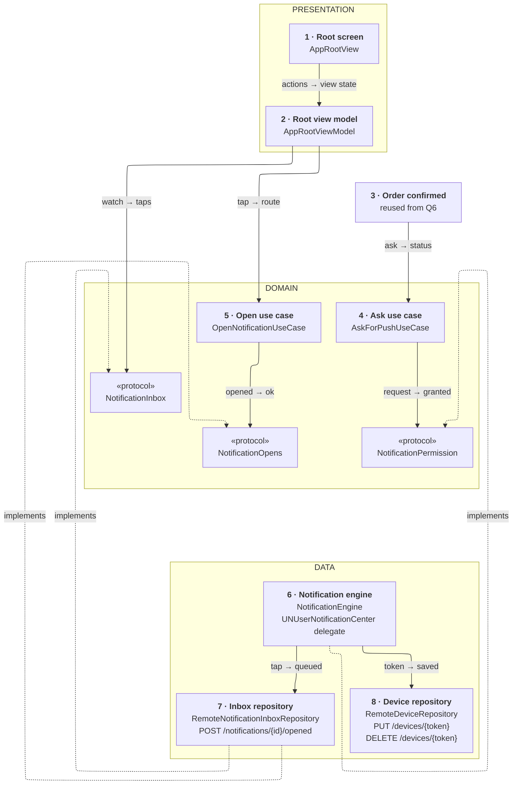
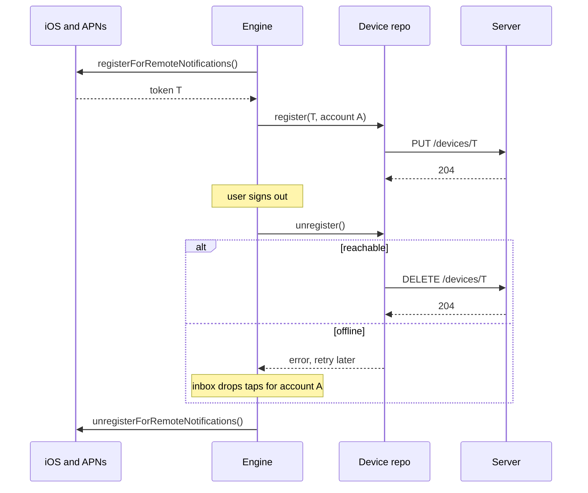
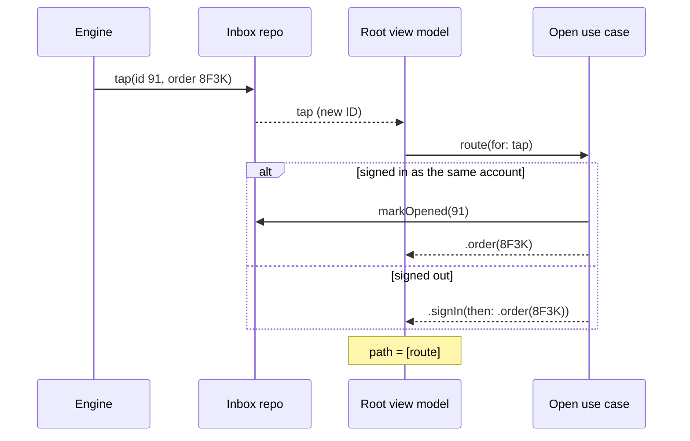
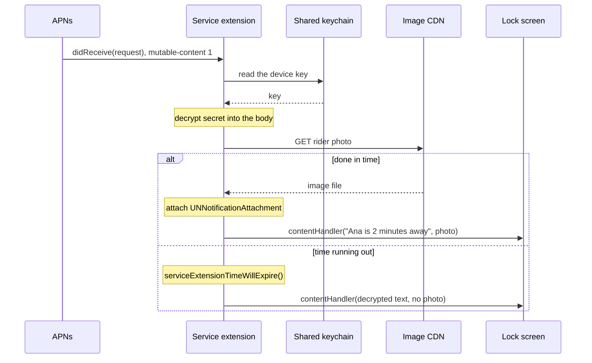

*Push looks like one API call. It is five small problems: when to ask, which account owns the phone, what the OS allows before the user sees it, where a tap lands, and what you can't promise. One engine owns the OS, two repositories own two kinds of data, two use cases hold the rules.*

> **Interviewer:** "Our grocery app delivers in ten minutes from local hubs. Design how this app handles push notifications end to end on the client."

## Run it as a round, not as reading

Set a timer. Sketch. Talk the whole time. Open a section only when its slot is over.

| Clock | Phase | What you do |
|---|---|---|
| 0:00–0:02 | The prompt | Repeat it back in one sentence |
| 0:02–0:07 | Clarify | Ask yours, then read section 1 |
| 0:07–0:12 | Scope | Out of scope first, then required, then later |
| 0:12–0:24 | High level | The idea · the parts · the sketch · one line each · two flows |
| 0:24–0:40 | Deep dives | The interviewer picks one of sections 9–11 |
| 0:40–0:45 | Recap | Follow-ups, then the 60-second summary |

## What this question is really testing

- **Asking at the right moment.** Provisional first, the real prompt when the value is obvious.
- **A token that belongs to an account.** Uploaded when it or the account changes, removed at sign-out.
- **Knowing what the OS controls.** The service extension's time limit, and silent pushes that may never come.
- **A tap that always lands somewhere sensible**: cold or warm, signed in or not.
- **Counting each notification once**, for the screen and for analytics.

**Traps:** asking for permission on first launch; uploading the token once and never again; leaving the old account's token live after sign-out; "we'll refresh the app with silent pushes"; personal data in the plain alert text; routing before the app knows who is signed in.

::: Words used in this chapter
- **Repository** — the one owner of one kind of data. It turns the server's format into the app's model.
- **Composite** — a repository that only reads: it asks two repositories and combines their answers. Not needed here.
- **Store** — in-memory state that several screens show at once. Not needed here.
- **Use case** — one user intent with a product rule, like "a tap never opens someone else's order".
- **View model** — the screen's brain. It owns the screen's state and hands the screen one view state.
- **APNs** — Apple's push service. Our server sends to it; it delivers to the phone.
- **Device token** — the address APNs gives this app on this phone. It can change.
- **Provisional authorization** — permission to deliver quietly to Notification Center, granted without a prompt.
- **Notification Service Extension** — a small separate program that may change a push before it is shown.
- **Category, action** — a push's type, and the buttons shown when the user presses on it.
- **Silent push** — a push with no alert that wakes the app in the background. Best effort only.
- **Route** — where in the app a tap should land, like "order 8F3K".
:::

::: 1 · The interviewer answers your clarifying questions
**"Which notifications do we send?"** → *Order updates (picking, on the way, arriving, delivered, a problem) and a few offers a week.*

**"Anything rich?"** → *Order pushes name the rider and show her photo. Security wants names encrypted, not readable by APNs.*

**"Buttons on the notification?"** → *"Track order" on order updates, "See offer" on offers.*

**"Signed-out users?"** → *Order pushes need an account. Families share iPads: after sign-out, the old account's pushes must stop.*

**"Do we measure opens?"** → *Yes, per campaign and per order stage.*

**"Silent pushes?"** → *Marketing wants to refresh the home screen with them every few minutes. What do you say?*

**"The lock-screen tracker?"** → *That's a Live Activity, question 11. Mention where it plugs in.*

**"Minimum OS, stack?"** → *iOS 17, SwiftUI, Swift 6.*
:::

::: 2 · Requirements and scope — what you should have said
**Out of scope, said first:** the server's sending logic and campaign tool, Live Activities (question 11), a notification preferences screen, an in-app message inbox.

**Required for the prompt**

1. Ask for permission at the right time: quietly first, properly after the first order.
2. Register, upload the token, keep it tied to the signed-in account, remove it at sign-out.
3. Show pushes well: foreground banners, categories and actions, a photo and decrypted text from the service extension.
4. A tap opens the right screen, cold or warm, after sign-in if needed, counted once.

**What must feel good:** never another account's order · a tap never lands on nothing · nothing personal readable outside the phone · works when the app was killed.

**Production considerations** (say, don't draw): token rotation, retries, metrics, App Store review of permission copy. See section 12.

**Optional follow-ups** (add only when asked):

```text
Lock-screen order tracker       → a Live Activity with its own push token (Q11)
Choose which pushes you get     → a preferences screen and endpoint
A history of past notifications → a persisted inbox
"Rider arriving" breaks Focus   → time-sensitive interruption level
```

*"I'll start simple and add each of these when the requirement appears."*
:::

::: 3 · The idea, in 30 seconds — before you draw anything
> *"We ask provisionally on first launch, so order updates land quietly, and ask properly right after the first order, when the reason is obvious. A notification engine owns everything the OS hands us: it sets the delegate before launch finishes, declares the categories, and registers at every launch. A device repository sends the token with `PUT /devices/{token}` whenever the token or the account changes, and `DELETE /devices/{token}` at sign-out. A service extension, in its own process, decrypts the rider's name and attaches her photo inside its time limit, or shows the generic text. A tap goes into an inbox repository that drops repeats by notification ID and reports `POST /notifications/{id}/opened`. An open use case turns the tap into a route, sign-in first, and the root view model navigates."*
:::

::: 4 · What we need — the components, before the sketch
| # | Part | Type | Layer | Its one job |
|---|---|---|---|---|
| 1 | **Root screen** | `AppRootView` | Presentation | Tabs and the navigation stack. |
| 2 | **Root view model** | `AppRootViewModel` | Presentation | Owns the tab and path; applies routes. |
| 3 | **Order confirmed** | reused from Q6 | Reused | Shows the "Get delivery updates" card. |
| 4 | **Ask use case** | `AskForPushUseCase` | Domain | When and how to ask for permission. |
| 5 | **Open use case** | `OpenNotificationUseCase` | Domain | A tap → a safe route, counted once. |
| 6 | **Notification engine** | `NotificationEngine` | Data | Owns the OS: delegate, categories, registration. |
| 7 | **Inbox repository** | `RemoteNotificationInboxRepository` | Data | Taps waiting to be opened; opens reported. |
| 8 | **Device repository** | `RemoteDeviceRepository` | Data | This phone's token on the server. |
| chip | **Permission** | `NotificationPermission` | Domain | The promise card 6 keeps for card 4. |
| chip | **Inbox** | `NotificationInbox` | Domain | The read promise card 7 keeps for card 2. |
| chip | **Opens** | `NotificationOpens` | Domain | The write promise card 7 keeps for card 5. |

Eight cards, three chips. `NotificationTap` and `Route` aren't cards; they're at the top of section 6.

**Not drawn:** the service extension (its own process, drawn in deep dive 10), `ForegroundPresentationPolicy` (a pure domain function the engine calls in `willPresent`), the session that says who is signed in, and the `HTTPClient` cards 7 and 8 share. **Not on the list yet:** everything under "optional follow-ups".
:::

::: 5 · The sketch


**How to read it.** Solid arrows: *request → reply*, asker to answerer. Dashed: *implements*. Grey: reused from question 6. The OS talks only to card 6, which hands taps to card 7 and tokens to card 8.

**Dependency inversion, in one line.** The domain writes the three promises (the chips); cards 6 and 7 keep them, so the dashed arrows point **up** and no use case imports UserNotifications.

**One class, two promises.** Card 7 is read by the root view model (taps) and written by the open use case (opens). Each sees only its half.

**No shared store on this sketch:** no state here is shown on several screens. The route goes into the root's own path.

**On Miro:** three frames, eight cards, three chips. Point at card 6: *"the only card that knows the OS exists."*
:::

::: 6 · Each component: its job, its interface, the choice inside it
**The models everyone shares.** Built by card 6 from the payload; the domain never sees `UNNotification`.

```swift
struct NotificationTap: Equatable, Sendable {
    /// From the payload. Drops repeats, keys analytics.
    let id: NotificationID
    /// Who the server sent it to
    let accountID: AccountID?
    /// nil when this app version can't read the route
    let route: Route?
    /// .open (the body) or .trackOrder (the button)
    let action: TapAction
}

enum Route: Hashable, Sendable {
    case home
    case order(OrderID)
    case offer(OfferID)
    case signIn(then: Route)
}
```

### 1 · Root screen (`AppRootView`)

**Job:** draws the tabs and a `NavigationStack` bound to the view state's path. It decides nothing.

**Interface:** reads `viewModel.viewState`; calls `onAppear()`, `select(_:)`, `pathChanged(_:)`.

**Choice:** `@UIApplicationDelegateAdaptor` attaches the app delegate, so card 6 starts in `application(_:didFinishLaunchingWithOptions:)`. Universal links arrive through `onOpenURL` as the same `Route`.

### 2 · Root view model (`AppRootViewModel`)

**Job:** owns the root's tab and path, and applies each route the open use case returns.

```swift
struct AppRootViewState: Equatable {
    let tab: Tab
    let path: [Route]
}

@MainActor @Observable
final class AppRootViewModel {
    init(inbox: NotificationInbox, openNotification: OpenNotificationUseCase)

    var viewState: AppRootViewState { get }

    /// Starts watching taps. Runs until the root goes away.
    func onAppear() async
    func select(_ tab: Tab)
    func pathChanged(_ path: [Route])
}
```

**Choices:**

- **It listens only once the UI exists.** A cold-launch tap waits in card 7 until then.
- **A route replaces the path.** Three order taps leave one order screen, not three.

### 3 · Order confirmed (reused from question 6)

**Job:** after the first order, shows "Get delivery updates" with a Turn on button, and calls card 4.

**Choice:** reused, plus one card. The ask lives where its reason is on screen.

### 4 · Ask use case (`AskForPushUseCase`)

**Job:** decides when to ask, and asks.

```swift
/// notAsked · quiet (provisional) · allowed · denied
enum PushPermission: Equatable, Sendable { … }

@MainActor
protocol AskForPushUseCase {
    /// At launch: provisional, never a prompt.
    func askQuietly() async
    /// After the first order: the real prompt, once. Returns the result.
    /// Denied → the caller shows a Settings link instead.
    func askAfterFirstOrder() async -> PushPermission
}
```

Built with `init(permission: NotificationPermission)`.

**Choices:**

- **The rule a product manager would state:** "never interrupt a first launch; ask once, when it's obviously useful; after a no, offer Settings."
- **Provisional first:** no prompt, quiet delivery. The full prompt upgrades it.
- **Denied is final in-app.** iOS prompts only once; after that the button opens `openNotificationSettingsURLString`.

### 5 · Open use case (`OpenNotificationUseCase`)

**Job:** turns a tap into a route that is safe to show, and counts it once.

```swift
@MainActor
protocol OpenNotificationUseCase {
    /// Never throws: the worst case is .home.
    /// The open is reported even if the caller stops waiting.
    func route(for tap: NotificationTap) async -> Route
}
```

Built with `init(opens: NotificationOpens, session: Session)`.

**Choices:**

- **The rule:** "a tap opens what it's about, after sign-in; it never opens another account's order; anything unreadable opens Home."
- **Signed out →** `.signIn(then: .order(id))`. The route survives the sign-in screen.
- **Why a use case here and not for registering:** registration is delivery mechanics (send when changed), owned by card 8. Receiving has no rule.

### 6 · Notification engine (`NotificationEngine`)

**Job:** the only card that touches UserNotifications and APNs registration. It turns OS callbacks into app models.

```swift
/// Domain: the ask use case's promise
protocol NotificationPermission: Sendable {
    /// Never throws. A failed request reads as the current status.
    func current() async -> PushPermission
    func request(provisional: Bool) async -> PushPermission
}

@MainActor
final class NotificationEngine: NSObject, NotificationPermission, UNUserNotificationCenterDelegate {
    init(center: UNUserNotificationCenter, inbox: TapSink, devices: DeviceRegistration,
         presentation: ForegroundPresentationPolicy)

    /// In didFinishLaunching: delegate, categories, register.
    func start()
    /// From the app delegate
    func didRegister(deviceToken: Data)
    /// Sign-in registers again. Sign-out removes the token first.
    func accountChanged(to account: AccountID?) async
}
```

**Choices:**

- **The delegate is set before launch finishes,** as Apple requires, or a tap that launched the app is lost.
- **Foreground presentation is a rule, not a hardcode:** `willPresent` asks the policy. A banner, unless the user is already looking at that order, where the screen refreshes instead.
- **Categories are declared once:** `ORDER_UPDATE` with "Track order", `OFFER` with "See offer". Both open the app (`.foreground`). Order pushes of one order share a `threadIdentifier`, so they group.

### 7 · Inbox repository (`RemoteNotificationInboxRepository`)

**Job:** holds taps until the UI takes them, drops repeats by ID, and reports each open with `POST /notifications/{id}/opened`.

```swift
/// Domain: the root view model's promise
protocol NotificationInbox: Sendable {
    /// Replays waiting taps on subscribe, then new ones.
    /// One stream per caller. Finishes when the caller's task is cancelled.
    func taps() -> AsyncStream<NotificationTap>
}

/// Domain: the open use case's promise
protocol NotificationOpens: Sendable {
    /// Reports once per ID. Not cancelled by the caller: it lands
    /// or is dropped after a few retries. Never throws.
    func markOpened(_ tap: NotificationTap) async
}

actor RemoteNotificationInboxRepository: NotificationInbox, NotificationOpens, TapSink {
    init(http: HTTPClient)
}
```

**Choice:** one actor, three narrow promises: the engine writes taps (`TapSink`, data-internal), the root reads, the use case reports. The seen-ID set is bookkeeping about its own data.

### 8 · Device repository (`RemoteDeviceRepository`)

**Job:** keeps the server's record of this phone's token right: `PUT /devices/{token}` on change, `DELETE /devices/{token}` at sign-out.

```swift
/// Data-internal: the engine's promise
protocol DeviceRegistration: Sendable {
    /// Sends only if token or account differ from the last success.
    /// Throws on failure; the engine retries at the next launch.
    func register(token: DeviceToken, for account: AccountID?) async throws
    /// Must finish before the session drops the credentials.
    func unregister() async throws
}

actor RemoteDeviceRepository: DeviceRegistration {
    init(http: HTTPClient)
}
```

**Choices:**

- **The account comes from the auth header,** not the body.
- **`PUT` is safe to repeat,** so sending at every launch heals a missed upload.

**Why these parts, and no more.** Each card changes for one reason:

| Card | Changes when |
|---|---|
| 1 · Root screen | the screen's design |
| 2 · Root view model | the screen's behaviour (tabs, path) |
| 4 · Ask use case | a product rule (when to ask) |
| 5 · Open use case | a product rule (where a tap may go) |
| 6 · Notification engine | a platform API (UserNotifications, APNs) |
| 7 · Inbox repository | an endpoint or payload (`/opened`) |
| 8 · Device repository | an endpoint or payload (`/devices`) |

Each protocol earns a fake or a smaller promise. Not added: a use case for registering, a store, a composite, a view-model protocol, a DI container.
:::

::: 7 · Key flows through the sketch
**Flow 1 — launch, sign-in, sign-out.** The token follows the account.



**Flow 2 — a tap on "Track order", app running.**


:::

::: 8 · The server contract
```
PUT    /v1/devices/{token}
       { "platform": "ios", "environment": "production",
         "appVersion": "4.2.0", "publicKey": "…" }       → 204
DELETE /v1/devices/{token}                                 → 204
POST   /v1/notifications/{id}/opened   { "action": "trackOrder" }  → 204

APNs payload the server sends (our contract with ourselves):
{ "aps": { "alert": { "title": "On the way", "body": "Your order is on the way" },
           "mutable-content": 1, "category": "ORDER_UPDATE",
           "thread-id": "order-8F3K" },
  "notificationId": "91", "accountId": "a1",
  "route": "orders/8F3K", "orderVersion": 7,
  "secret": "<encrypted rider name>", "imageUrl": "https://img…/rider/12.jpg" }
Header: apns-collapse-id: order-8F3K-onTheWay
```

- **The plain alert is generic,** because it shows if the extension fails. Personal text travels only encrypted.
- **Repeats are harmless:** the collapse ID merges server retries, `notificationId` dedupes taps, `orderVersion` drops stale updates.
- **The route is a string the app parses,** like a universal link's. Unknown means Home.
:::

::: 9 · Deep dive — "When do you ask for permission, and what if they say no?"
**The decision:** quiet first, then one real ask at the moment of value.

1. **First launch:** `requestAuthorization(options: [.provisional, .alert, .badge, .sound])`. No prompt. Order pushes arrive quietly in Notification Center.
2. **Order placed:** the confirmed screen shows "Get delivery updates: we'll tell you when your rider is close." Turn on → the real `requestAuthorization`, without `.provisional`.
3. **Allowed:** done. **Denied:** the card becomes "Updates are off · Open Settings", and never the system prompt again.
4. **Every launch,** read the current status, because the user can change it in Settings at any time.

**Register regardless.** `registerForRemoteNotifications()` works without permission (pushes then arrive silently), so the token upload never waits for the prompt.

**Rejected: a full prompt on first launch.** The reason is still abstract, and a "no" is permanent.
:::

::: 10 · Deep dive — "The push says 'Ana is 2 minutes away', with her photo, encrypted. Walk me through it."
**The decision:** a Notification Service Extension, in its own process, that improves the push inside its time limit and otherwise lets the safe original through.



1. **It runs only** when the payload has `mutable-content: 1` and an alert. Never for silent pushes.
2. **About 30 seconds,** then `serviceExtensionTimeWillExpire()` is the last chance. Use it: deliver what you have. If you don't, the original alert shows, which is why it must be generic.
3. **The key lives in a keychain access group** shared with the app, made at sign-in (public half sent with the device registration), deleted at sign-out.
4. **Memory is small.** Download a thumbnail to a file and attach it.

**Rejected: the rider's name in plain text.** APNs and lock screens see it. If decryption fails, "Your order is on the way" is still true.
:::

::: 11 · Deep dive — "The app was killed. The user is signed out. They tap 'Track order'."
**The decision:** queue the tap until both the UI and the session are ready, then route through sign-in.

1. iOS launches the app. In `didFinishLaunching` the engine sets itself as delegate, so `didReceive` arrives a moment later. The engine maps it to a `NotificationTap` and hands it to the inbox.
2. The inbox holds it. Nothing is listening yet.
3. The root appears and subscribes; the inbox replays the waiting tap.
4. The open use case sees no session: `.signIn(then: .order(8F3K))`. After sign-in, as the same account, the root shows the order. As a different account, Home.

**Running already?** Same path, minus the waiting.

**Why the account check:** a family iPad signed out offline may still get the old account's push; the tap must not open someone else's order.

**Rejected: route straight from the app delegate.** At cold launch the navigation stack doesn't exist yet and the session may still be loading. The tap would be lost.
:::

::: 12 · Failure modes, production and scale
**Failures**

| Failure | Client behaviour |
|---|---|
| Permission denied | Settings link on the card; register anyway |
| Registration fails | Log it; try again next launch |
| Token upload fails | Retry next launch; `PUT` is safe to repeat |
| Offline at sign-out | Retry `DELETE`; drop taps for the old account |
| Extension times out | Deliver what it has; the generic alert is the floor |
| Decryption fails | The generic alert stays |
| Unknown route | Open Home |
| Same push twice | Collapse ID merges it; the inbox drops a repeated ID |
| Older status after newer | The policy shows no banner; the screen keeps the newer |
| Silent push never arrives | Nothing breaks: the app refreshes on foreground |

**Production notes** (short, not on the board)

- **Tokens:** they change after a restore or reinstall. Send the APNs environment, or sandbox tokens pollute production.
- **Badge:** set by the server's payload; `setBadgeCount(0)` when the user opens the order.
- **Interruption:** only "rider arriving" is time-sensitive.
- **Metrics:** opt-in rate by ask moment, upload failures, opens by category and stage, extension fallbacks.

**Scale, back of the envelope**, with the interviewer's numbers:

```text
orders a day × pushes per order       = order pushes
launches a day                        = token PUTs (small, idempotent)
```

200,000 orders × 5 is a million pushes a day. The phone's cost is tiny; the fan-out is the server's question.

**Grow only when asked**

```text
Lock-screen tracker   → a Live Activity; its own push token per order (Q11)
Per-type opt-out      → a preferences screen, GET and PUT /notification-preferences
History of pushes     → persist the inbox, show it as a screen
Actions without opening → a background action that calls the API from didReceive
```
:::

::: 13 · Question bank — everything they can push on
Answer out loud first, then open.

### Scope and architecture

<details>
<summary>"Walk me through the layers."</summary>

Presentation: the root screen and its view model. Domain: the tap and route models, three protocols, the ask and open use cases. Data: the notification engine, the inbox and the device repository.
</details>

<details>
<summary>"Why does opening get a use case and registering doesn't?"</summary>

Opening has a product rule: after sign-in, never another account's order, Home when unsure. Registering is delivery mechanics, "send it when it changed", which belongs to the repository that owns the token.
</details>

<details>
<summary>"Show me dependency inversion."</summary>

The permission, inbox and opens protocols live in the domain; the engine and the inbox repository implement them. No use case imports UserNotifications, so each is tested with a fake.
</details>

<details>
<summary>"Where does mapping happen?"</summary>

In the engine: the OS response and its `userInfo` become a `NotificationTap`. Nothing past card 6 sees an OS type.
</details>

<details>
<summary>"Where does the combined state come from? Is there a store?"</summary>

There's nothing to combine and nothing several screens show. The route lands in the root's own path. If the order screen also showed "unread updates", a store would appear.
</details>

<details>
<summary>"Why is the foreground rule a separate policy?"</summary>

It changes for product reasons, the engine for Apple's API. A pure function is also trivially tested.
</details>

### Permission and tokens

<details>
<summary>"What does provisional authorization give you?"</summary>

Quiet delivery to Notification Center, no prompt. The real prompt upgrades it later.
</details>

<details>
<summary>"Do you need permission to get a device token?"</summary>

No. Registration works regardless; without permission, pushes are delivered silently. So the token upload never waits for the prompt.
</details>

<details>
<summary>"Why upload the token at every launch?"</summary>

It can change (restore, reinstall), and an upload may have failed. A repeated `PUT` heals both.
</details>

<details>
<summary>Follow-up chain: "Sign-out on a shared iPad."</summary>

1. *"Mum signs out, the son signs in."* → `DELETE /devices/{token}` before credentials go, then `PUT` again as the son.
2. *"The delete failed, offline."* → It retries; meanwhile the server may still send Mum's push.
3. *"The son taps it."* → The open use case sees a different account and opens Home.
4. *"And the lock screen text?"* → Generic by design; the name was encrypted with a key deleted at sign-out.
</details>

### Delivery and the extension

<details>
<summary>"How long does the service extension have?"</summary>

About 30 seconds. Then `serviceExtensionTimeWillExpire()` is the last chance to deliver what you have; otherwise the original alert shows.
</details>

<details>
<summary>"What if the photo download is slow?"</summary>

Deliver the decrypted text without the photo when time runs out. The photo is decoration; the text is the message.
</details>

<details>
<summary>"How does the extension get the key?"</summary>

A keychain access group shared by the app and the extension. The app creates the key at sign-in and deletes it at sign-out.
</details>

<details>
<summary>"Can we keep the home screen fresh with silent pushes?"</summary>

No. They're throttled, not guaranteed, and not delivered to a force-quit app; Apple says two or three an hour at most. Refresh on foreground.
</details>

<details>
<summary>"How do you avoid showing the same update twice?"</summary>

The server sends a collapse ID per order stage, so a retry replaces the first. The inbox drops a tap whose notification ID it already handled.
</details>

<details>
<summary>"'Picking' arrives after 'On the way'. What happens?"</summary>

In the foreground the policy compares `orderVersion` and shows no banner; the tracking screen keeps the newer status (question 11).
</details>

### Taps and deep links

<details>
<summary>"Where must the delegate be set, and why?"</summary>

In `didFinishLaunching`, before launch ends. A tap that launched the app is delivered right after; set it later and it's lost.
</details>

<details>
<summary>"How does a cold-launch tap reach the right screen?"</summary>

The engine hands it to the inbox, which holds it until the root subscribes and replays it. Routing waits for the UI and the session.
</details>

<details>
<summary>"The tap needs sign-in."</summary>

The route becomes `.signIn(then: .order(id))`. After sign-in as the same account, the order opens.
</details>

<details>
<summary>"An old app version gets a route it doesn't know."</summary>

The parser returns nil, the use case returns Home. Never a crash, never a blank screen.
</details>

<details>
<summary>"Push and universal link to the same order. One router or two?"</summary>

One. Both become a `Route`; only the source differs. `onOpenURL` feeds the same root view model.
</details>

<details>
<summary>"How do you count opens?"</summary>

The open use case reports once per notification ID with `POST /notifications/{id}/opened`. Delivery rate is the server's number; the phone can't see a push that never came.
</details>

### Production and change

<details>
<summary>"How do you test the cold-launch tap?"</summary>

Queue a tap in the inbox, subscribe later, expect it replayed once. The open use case with a fake signed-out session returns the sign-in route.
</details>

<details>
<summary>"Where do Live Activities plug in?"</summary>

They have their own push token per activity, from `pushTokenUpdates`, sent to the server per order. That's question 11; this engine doesn't touch it.
</details>

<details>
<summary>Follow-up chain: "Actions without opening the app."</summary>

1. *"Add 'Leave at door' on the arriving push."* → An action without `.foreground`; `didReceive` runs in the background.
2. *"Who sends it?"* → The engine maps it to a tap with that action; a use case with the rule calls the orders endpoint.
3. *"Locked phone?"* → Mark it `.authenticationRequired`.
4. *"Guaranteed?"* → No: it must finish in the short background time; on failure, tell the user.
</details>
:::

::: 14 · Scorecard — mark yourself, 0 / 1 / 2
| | Did you… | 0–2 |
|---|---|---|
| 1 | Talk the whole time, and listen when interrupted | |
| 2 | Clarify before designing | |
| 3 | Give a trade-off for each choice | |
| 4 | Say out of scope first; separate required from later | |
| 5 | Say the idea, list the parts, then sketch | |
| 6 | Keep the sketch to nine type cards, one line each | |
| 7 | Name the three endpoints | |
| 8 | Ask provisionally first, properly at the moment of value | |
| 9 | Tie the token to the account; delete it at sign-out | |
| 10 | Set the delegate before launch finishes | |
| 11 | Give the extension's time limit and its fallback | |
| 12 | Say silent pushes are throttled and not guaranteed | |
| 13 | Route a cold-launch tap through the session, counted once | |
| 14 | Land the recap inside 60 seconds | |

14+ is a pass.<!--private--> Anything scored 0 goes in the progress log and comes back as a recall prompt.<!--/private--><!--public--> A zero names the thing to read about next.<!--/public-->
:::

::: 15 · The 60-second recap
We ask provisionally at first launch and properly after the first order, and offer Settings after a no. One engine owns the OS: it sets the delegate before launch ends, declares the categories, and registers every launch; a device repository puts the token with `PUT /devices/{token}` when it or the account changes and deletes it at sign-out. A service extension decrypts the rider's name and attaches her photo within about 30 seconds, and the plain alert is always generic, because it's the fallback. A tap goes into an inbox that holds it until the UI exists and drops repeats; an open use case routes it through sign-in, never to another account's order, and reports the open once. Silent pushes are hints, never the plan.
:::
