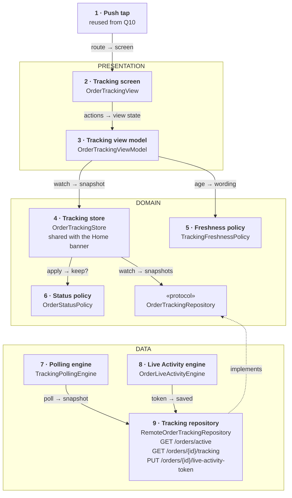
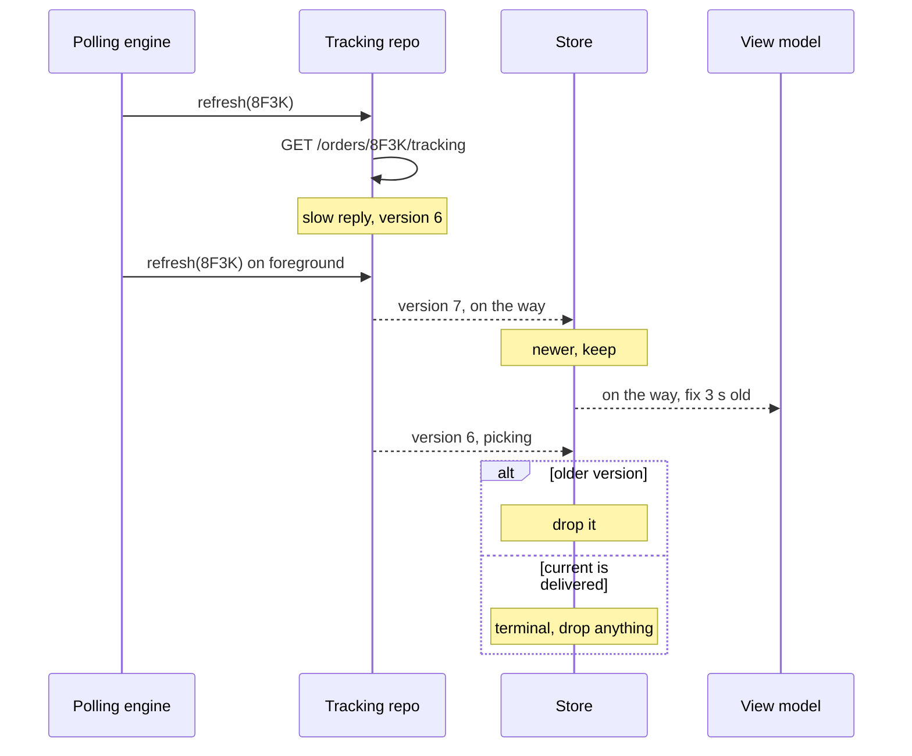
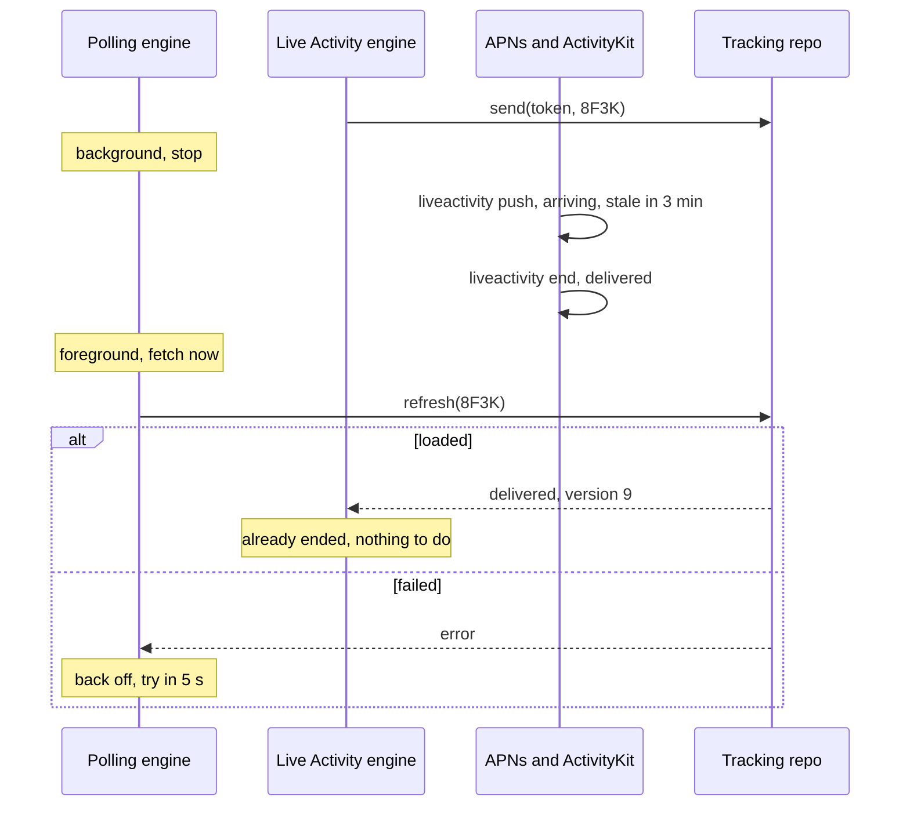

*Order tracking looks like a map question. It is really about old data: late replies, a rider in a tunnel, a killed app. The answer: one state machine, a version that only moves forward, polling while open, the server pushing when not.*

> **Interviewer:** "Design the order-tracking screen for our delivery app." The grocery order placed in question 6, delivered in about ten minutes from a local hub.

## Run it as a round, not as reading

Set a timer. Sketch. Talk the whole time. Open a section only when its slot is over.

| Clock | Phase | What you do |
|---|---|---|
| 0:00–0:02 | The prompt | Repeat it back in one sentence |
| 0:02–0:07 | Clarify | Ask yours, then read section 1 |
| 0:07–0:12 | Scope | Out of scope first, then required, then later |
| 0:12–0:24 | High level | The idea · the parts · the sketch · one line each · two flows |
| 0:24–0:40 | Deep dives | The interviewer picks one of sections 9–11 |
| 0:40–0:45 | Recap | Follow-ups, then the 60-second summary |

## What this question is really testing

- **An explicit status state machine**, with terminal states that never reopen.
- **Status that only moves forward by version**, however late a reply lands.
- **Choosing a transport and defending it**: polling, push, a stream or a socket.
- **Honest freshness**: a stale rider pin and a late ETA said out loud.
- **The lock screen and the killed app**: Live Activities, and their limits.

**Traps:** booleans like `isOnTheWay`; trusting reply order; "a WebSocket, obviously"; polling in the background; a countdown that reaches "0 min" and stays; a Live Activity that "runs until delivered".

::: Words used in this chapter
- **Repository** — the one owner of one kind of data. It turns the server's format into the app's model.
- **Composite** — a repository that only reads: it asks two repositories and combines their answers. Not needed here.
- **Store** — in-memory state that several screens show at once. Here: the tracking screen and the Home banner.
- **Use case** — one user intent with a product rule. None here: the user only watches.
- **View model** — the screen's brain. It owns the screen's state and hands the screen one view state.
- **State machine** — a fixed set of statuses and the moves allowed between them.
- **Version** — a number the server bumps on every change. Higher is newer.
- **Fix** — one reported rider position, with the time it was taken.
- **Stale** — older than we're willing to present as current.
- **Live Activity** — a small live card on the lock screen and Dynamic Island, updated by push.
- **Polling** — asking the server again on a timer.
:::

::: 1 · The interviewer answers your clarifying questions
**"What does the screen show?"** → *The steps (placed, picking, on the way, arriving, delivered), an ETA, and the rider on a map once she leaves the hub.*

**"How often does the server learn where the rider is?"** → *Her app reports every 5 seconds, when it has signal.*

**"What real-time tools do we have?"** → *REST, and APNs from question 10. Another team runs a socket service; nobody here has used it.*

**"Where else does the status show?"** → *A banner on Home while an order is active, and a Live Activity on the lock screen.*

**"How long does an order last?"** → *Ten minutes typically. A problem order can run an hour.*

**"What can go wrong?"** → *Cancelled by the hub, items missing, rider delayed. The server says which.*

**"Offline?"** → *Riders cross dead zones; customers sit in trains.*

**"Minimum OS, stack?"** → *iOS 17, SwiftUI, Swift 6.*
:::

::: 2 · Requirements and scope — what you should have said
**Out of scope, said first:** placing the order (question 6), push handling in general (question 10), chatting with or calling the rider, cancelling from the app, the rider's own app.

**Required for the prompt**

1. Show the status as steps. An old reply never moves it back.
2. Show the rider on a map, moving smoothly, honest when the fix is old.
3. Show an ETA that never lies: a range, and "running late" when late.
4. Keep the lock screen current with a Live Activity; open the screen from a push.

**What must feel good:** never an older status over a newer one · never "live" when it isn't · light on battery · right after a relaunch.

**Production considerations** (say, don't draw): timeouts, backoff, the Live Activity push budget, metrics. See section 12.

**Optional follow-ups** (add only when asked):

```text
Sub-second rider movement     → a server-sent event stream
Offline relaunch shows the last state → persist the last snapshot
Order placed on the web       → push-to-start the Live Activity
Chat with the rider           → a socket, because it's two-way
```

*"I'll start simple and add each of these when the requirement appears."*
:::

::: 3 · The idea, in 30 seconds — before you draw anything
> *"The server owns the order's state and bumps a version on every change. A tracking repository calls `GET /orders/active` at launch and on foreground, `GET /orders/{id}/tracking` when polled, and `PUT /orders/{id}/live-activity-token` for the lock screen. A polling engine asks every 5 seconds while the app is open and an order is on the way, slower while picking, never in the background, with backoff on errors. A shared store keeps the newest snapshot per order, using a state-machine policy: newer version wins, a finished order stays finished. The view model asks a freshness policy how to word an old fix and a late ETA. When the app isn't open, the server updates the Live Activity by push."*
:::

::: 4 · What we need — the components, before the sketch
| # | Part | Type | Layer | Its one job |
|---|---|---|---|---|
| 1 | **Push tap** | reused from Q10 | Reused | Routes a tapped order push here. |
| 2 | **Tracking screen** | `OrderTrackingView` | Presentation | Map, steps, ETA. |
| 3 | **Tracking view model** | `OrderTrackingViewModel` | Presentation | Snapshot + now → one view state. |
| 4 | **Tracking store** | `OrderTrackingStore` | Domain | The newest snapshot per order, for every screen. |
| 5 | **Freshness policy** | `TrackingFreshnessPolicy` | Domain | How old data and lateness are shown. |
| 6 | **Status policy** | `OrderStatusPolicy` | Domain | The state machine: is this snapshot newer and allowed? |
| 7 | **Polling engine** | `TrackingPollingEngine` | Data | Asks on a timer while the app is open. |
| 8 | **Live Activity engine** | `OrderLiveActivityEngine` | Data | Starts, feeds and ends the lock-screen card. |
| 9 | **Tracking repository** | `RemoteOrderTrackingRepository` | Data | The tracking endpoints; publishes snapshots. |
| chip | **Tracking repository** | `OrderTrackingRepository` | Domain | The promise card 9 keeps for card 4. |

Nine cards, one chip. `OrderTracking` isn't a card; it's at the top of section 6.

**Not drawn:** `AppLifecycle` over `scenePhase` and `NetworkStatus` over `NWPathMonitor` (card 7's triggers), the `HTTPClient`, and the clock the view model reads. **Not on the list yet:** everything under "optional follow-ups".
:::

::: 5 · The sketch


**How to read it.** Solid arrows: *request → reply*, asker to answerer. Dashed: *implements*. Grey: reused from question 10. The engines only make card 9 fetch or send; every snapshot reaches the screen through card 4.

**Dependency inversion, in one line.** The domain writes the one promise (the chip); card 9 keeps it, so the dashed arrow points **up** and the store never sees HTTP, timers or ActivityKit.

**A shared store is on this sketch** because the clarified prompt puts the status on two screens: this one and the Home banner. They must never disagree.

**On Miro:** three frames, nine cards, one chip. Point at card 6: *"correctness lives in this pure function."*
:::

::: 6 · Each component: its job, its interface, the choice inside it
**The model everyone shares.** Mapped by card 9; the screen never sees a DTO.

```swift
enum OrderStatus: Equatable, Sendable {
    case placed, picking, onTheWay, arriving
    /// terminal
    case delivered, cancelled(reason: String)
    /// "Rider delayed": not terminal, the server moves it on
    case problem(message: String)
}

struct OrderTracking: Equatable, Sendable {
    let orderID: OrderID
    /// bumped by the server on every change
    let version: Int
    let status: OrderStatus
    /// absolute times, so an old snapshot is still right. nil = unknown
    let eta: ClosedRange<Date>?
    /// coordinate + recordedAt. nil before she leaves the hub
    let rider: RiderFix?
    let destination: Coordinate
    /// when the server built this snapshot
    let generatedAt: Date
}
```

### 1 · Push tap (reused from question 10)

**Job:** a tapped order push becomes `.order(id)`, and the root opens this screen. Sign-in and account checks already happened there.

### 2 · Tracking screen (`OrderTrackingView`)

**Job:** draws the map, the steps and the ETA, and reports appear, disappear and map gestures.

**Interface:** reads `viewModel.viewState`; calls `onAppear()`, `onDisappear()`, `userMovedMap()`.

**Choices:**

- **MapKit for SwiftUI:** `Map(position:)` with an `Annotation` for the rider and one for home. The camera starts at `.automatic`, framing both, until the user pans.
- **Smoothing:** each fix animates the pin with `withAnimation(.linear)` over the poll interval. No guessing ahead: a pin that drives past a turn is worse than one that waits.

### 3 · Tracking view model (`OrderTrackingViewModel`)

**Job:** turns the store's snapshot and the current time into one view state.

```swift
struct OrderTrackingViewState: Equatable {
    /// placed … delivered, with the current one marked
    let steps: [StepRow]
    /// "Arriving 18:42–18:46" · "Running a little late" · "ETA updating"
    let eta: String
    /// live, stale(label: "Updated 40 s ago"), or hidden
    let riderPin: RiderPin
    /// a cancelled or problem message, if any
    let banner: String?
}

@MainActor @Observable
final class OrderTrackingViewModel {
    init(order: OrderID, store: OrderTrackingStore, freshness: TrackingFreshnessPolicy, clock: DateProvider)

    var viewState: OrderTrackingViewState { get }

    func onAppear() async
    func onDisappear()
    func userMovedMap()
}
```

**Choices:**

- **A 5-second tick** re-asks the freshness policy, so "Updated 40 s ago" grows without new data.
- **Steps, not a progress bar.** A `problem` shows a banner over its step.

### 4 · Tracking store (`OrderTrackingStore`)

**Job:** holds the newest snapshot per active order, for this screen and the Home banner.

```swift
@MainActor @Observable
final class OrderTrackingStore {
    init(tracking: OrderTrackingRepository, status: OrderStatusPolicy)

    /// loading, loaded(OrderTracking), or unavailable (never fetched)
    func state(of order: OrderID) -> TrackingState
    /// Applies card 9's stream for the app's lifetime.
    func start() async
}
```

**Choices:**

- **The stale-result guard is the version.** A poll reply and a foreground fetch can land in either order; the policy keeps the newer.
- **Rider fixes have their own guard,** `recordedAt`: position updates more often than status, and a status bump must not bring an older fix with it.
- **No protocol.** It's in-memory state; tests use it with a fake repository.

### 5 · Freshness policy (`TrackingFreshnessPolicy`)

**Job:** a pure rule for what the user may be told about old data and lateness.

```swift
struct TrackingFreshnessPolicy: Sendable {
    /// < 20 s live · < 2 min stale with its age · older hidden
    func pin(for fix: RiderFix?, now: Date) -> RiderPin
    /// a range · running late after the latest · updating when old
    func eta(_ eta: ClosedRange<Date>?, generatedAt: Date, now: Date) -> ETAWording
}
```

**Choice:** **ETA honesty is a product rule.** Never a single minute, never "0 min", never negative: past the latest time it says "running a little late", and a snapshot older than 2 minutes says "ETA updating".

### 6 · Status policy (`OrderStatusPolicy`)

**Job:** the state machine. Should this snapshot replace the one we have?

```swift
struct OrderStatusPolicy: Sendable {
    /// false if not newer by version, or if current is terminal.
    /// A newer version may move a stage back (a new rider): the server's truth.
    func shouldReplace(_ current: OrderTracking?, with incoming: OrderTracking) -> Bool
}
```

**Choices:**

- **Version decides order, the machine decides finality.** `delivered` and `cancelled` never reopen; everything else follows the server's newest version.
- **Rejected: "stage only moves forward".** A reassigned rider is a real move back to picking. Comparing stages would hide it.

### 7 · Polling engine (`TrackingPollingEngine`)

**Job:** while the app is open and an order is active, makes card 9 fetch on a timer.

```swift
@MainActor
final class TrackingPollingEngine {
    init(tracking: TrackingRefresher, lifecycle: AppLifecycle, network: NetworkStatus)
    /// At launch. Triggers: foreground, background, network back, order finished.
    func start()
    func stop()
}
```

**Choices:**

- **Cadence by stage:** 15 s while picking, 5 s on the way and arriving, none once terminal.
- **Background = stop.** iOS suspends the app anyway; the Live Activity and alert pushes cover it. Foreground or network back = fetch at once.
- **Errors back off,** 5 → 10 → 20 → 30 s, reset on success.

### 8 · Live Activity engine (`OrderLiveActivityEngine`)

**Job:** starts the lock-screen card when an order begins, sends its push token, updates it while the app is open, and ends it.

```swift
@MainActor
final class OrderLiveActivityEngine {
    init(tracking: LiveActivityTokens, snapshots: TrackingStream)
    /// At launch: re-attaches to running activities, then follows snapshots.
    func start()
}
```

**Choice:** **the server is the writer when the app is closed.** Both writers stamp `generatedAt` as the update's timestamp, so the system ignores whichever is older (section 10).

### 9 · Tracking repository (`RemoteOrderTrackingRepository`)

**Job:** calls the three endpoints, maps `TrackingDTO` to `OrderTracking`, and publishes every snapshot it gets.

```swift
/// Domain: the store's promise
protocol OrderTrackingRepository: Sendable {
    /// Every snapshot fetched, for every order, in arrival order (not version order).
    /// Replays the latest per order on subscribe. One stream per caller.
    /// Finishes when the caller's task is cancelled.
    func snapshots() -> AsyncStream<OrderTracking>
}

/// Data-internal: card 7's promise
protocol TrackingRefresher: Sendable {
    /// Throws on failure; cancelling cancels the request.
    func refreshActive() async throws
    func refresh(_ order: OrderID) async throws
}

/// Data-internal: card 8's promise
protocol LiveActivityTokens: Sendable {
    /// Retried until it lands or the order ends.
    func send(_ token: Data, for order: OrderID) async throws
}

actor RemoteOrderTrackingRepository: OrderTrackingRepository, TrackingRefresher, LiveActivityTokens, TrackingStream {
    init(http: HTTPClient)
}
```

**Choice:** **one actor, small promises per caller.** It publishes in arrival order and doesn't judge; judging is card 6's job, in the store.

**Why these parts, and no more.** Each card changes for one reason:

| Card | Changes when |
|---|---|
| 2 · Tracking screen | the screen's design |
| 3 · Tracking view model | the screen's behaviour |
| 4 · Tracking store | what several screens share |
| 5 · Freshness policy | a product rule (how old data is shown) |
| 6 · Status policy | a product rule (statuses and their moves) |
| 7 · Polling engine | a connection's lifecycle (when to ask) |
| 8 · Live Activity engine | a platform API (ActivityKit) |
| 9 · Tracking repository | an endpoint or payload |

No use case: the user only watches, and loading has no rule. Not added: a composite (one source), a socket, persistence, a DI container.
:::

::: 7 · Key flows through the sketch
**Flow 1 — opening the screen, then a late reply.**



**Flow 2 — the app goes to the background, then the order arrives.**


:::

::: 8 · The server contract
```
GET /v1/orders/active
    → { "orders": [ <tracking> ] }

GET /v1/orders/{id}/tracking
    → { "orderId": "8F3K", "version": 7, "status": "onTheWay",
        "problem": null,
        "eta": { "earliest": "2026-10-20T18:42:00Z", "latest": "2026-10-20T18:46:00Z" },
        "rider": { "firstName": "Ana", "lat": 52.52, "lng": 13.40,
                   "recordedAt": "2026-10-20T18:37:55Z" },
        "destination": { "lat": 52.53, "lng": 13.41 },
        "generatedAt": "2026-10-20T18:38:00Z" }

PUT /v1/orders/{id}/live-activity-token   { "token": "…hex…" }   → 204

ActivityKit push the server sends (apns-push-type: liveactivity):
{ "aps": { "timestamp": 1792521480, "event": "update",
           "content-state": { "status": "arriving", "etaLatest": 1792521960 },
           "stale-date": 1792521660 } }
```

- **A version on every change,** so the client can order replies it receives out of order.
- **Times, not durations.** "18:46" stays true in an old snapshot; "8 min" doesn't.
- **Personal, never cached** on a shared CDN. Map tiles are Apple's, not ours.
:::

::: 9 · Deep dive — "Push, polling, WebSocket or server-sent events? Pick one."
**The decision:** poll while the app is open; let the server push (alerts and Live Activity updates) when it isn't.

| | Freshness | Cost to us | Works when closed |
|---|---|---|---|
| Polling every 5 s | 5 s, matches the rider's reports | Nothing new | No |
| Server-sent events | Instant | One long request, reconnects | No |
| WebSocket | Instant, two-way | Reconnect, heartbeat, auth, a new service | No |
| APNs and ActivityKit | Seconds, best effort | Already there (Q10) | **Yes** |

1. **Open, order on the way:** poll every 5 s. The rider only reports every 5 s, so a stream can't be fresher than that.
2. **Backgrounded:** stop. Only push works there anyway, and polling can't run in a suspended app.
3. **Returning:** fetch at once; the version guard sorts whatever lands.
4. **Errors:** back off to 30 s, and say "Updating…" instead of pretending.

**Switch condition:** sub-second movement, or poll volume that hurts the server. Then server-sent events first, read with `URLSession.bytes(for:)`: one-way, plain HTTP, the same snapshot shape. A `URLSessionWebSocketTask` only when the client must talk back, like chatting with the rider.

**Rejected: a WebSocket now.** Two-way plumbing for a one-way feed, on a new service.
:::

::: 10 · Deep dive — "Put it on the lock screen."
**The decision:** a Live Activity started when the order is placed, updated by ActivityKit pushes, ended by whoever sees the end first.

1. **Start in the foreground.** At the order-placed moment the app is open: check `areActivitiesEnabled`, then `Activity.request(attributes:content:pushType: .token)`. Static attributes: order ID, hub. Content: status, ETA, rider's first name. Under 4 KB, so no map.
2. **Send the token, every time it changes.** Watch `pushTokenUpdates` and `PUT /orders/{id}/live-activity-token` each new one; the server addresses updates to it.
3. **Updates carry a stale date.** Each one sets `staleDate` (and `stale-date` in the push) about 3 minutes ahead. If pushes stop, the card shows it's outdated instead of lying. Stage changes go at priority 10; ETA drift at priority 5, to stay inside the push budget.
4. **End with final content.** On delivered or cancelled, `end(_:dismissalPolicy:)` with the final state; `.default` keeps it on the lock screen for up to four hours.

**The 8-hour limit.** A Live Activity can be active for up to eight hours; then the system ends it, and it stays on the lock screen up to four more. A 10-minute order never gets near it; a problem order stuck for hours does, so the app and alert pushes remain the source of truth.

**Two writers, one rule.** In the foreground the app can update the card too, via `update(_:alertConfiguration:timestamp:)` (iOS 17.2+). Both pass `generatedAt`; the system ignores anything older than what it already shows. That's the version guard again, enforced by the OS.

**Order placed on the web?** The app normally starts one only in the foreground. From iOS 17.2, `pushToStartTokenUpdates` gives a token the server can use to start one. A later rung.
:::

::: 11 · Deep dive — "The app is killed mid-delivery, then the phone goes into a tunnel."
**The decision:** nothing on the phone runs while killed, so the server keeps the lock screen current; on return, show nothing old as if it were new.

1. **Killed:** no polling, no store. The Live Activity and alert pushes keep arriving, server-driven. If they stop, the stale date greys the card.
2. **Relaunched from a push:** the tap routes to `.order(8F3K)` (question 10). The store is empty, so the screen says "Getting your order…" while `GET /orders/active` runs. No guessed status.
3. **Offline in a tunnel:** keep the last snapshot. The freshness policy does the talking: the pin dims with "Updated 50 s ago", then hides; the ETA reads "ETA updating". A small "Offline" line, never an error screen.
4. **Back online:** the network trigger fetches at once. Whatever arrives passes the version guard, so a delayed old reply can't move the steps back.

**Delivered meanwhile?** The first fetch says so; the Live Activity engine ends anything still running.

**Rejected: a saved snapshot shown as current at relaunch.** It could say "picking" for an order that arrived. If persisted, show it dimmed with its time.
:::

::: 12 · Failure modes, production and scale
**Failures**

| Failure | Client behaviour |
|---|---|
| First fetch fails | "Getting your order…", retry with backoff |
| Poll fails | Keep the snapshot; age shows on pin and ETA |
| Reply arrives late | Dropped by version |
| Rider fix older than 2 min | Pin hidden, steps stay |
| Past the latest ETA | "Running a little late" |
| Problem status | Banner with the server's message |
| Cancelled | Terminal: final screen, Live Activity ended |
| Live Activities turned off | Alert pushes only |
| Activity push token rotates | Send the new one |
| 8-hour limit hit | System ends it; app and pushes carry on |

**Production notes** (short, not on the board)

- **Networking:** a 5 s timeout per poll; one poll in flight per order; honour `Retry-After` on 429.
- **Battery:** no customer location, no background work, the map only while visible.
- **Metrics:** snapshot age when shown, out-of-order drops, ETA error, Live Activity stale rate.

**Scale, back of the envelope**, with the interviewer's numbers:

```text
orders a day × minutes watched × polls a minute = tracking GETs
orders a day × updates per order                = Live Activity pushes
```

200,000 × 3 × 12 is about 7 million small `GET`s a day, around 80 a second. Ten updates per order is 2 million pushes. Neither changes the client.

**Grow only when asked**

```text
Smoother rider        → server-sent events, same snapshot shape
Relaunch offline      → persist the last snapshot, shown dimmed
Order from the web    → push-to-start token (iOS 17.2+)
Two orders at once    → the store already keys by order; relevance score on each Live Activity
Chat with the rider   → a socket, two-way at last
```
:::

::: 13 · Question bank — everything they can push on
Answer out loud first, then open.

### Scope and architecture

<details>
<summary>"Walk me through the layers."</summary>

Presentation: the tracking screen and its view model. Domain: the snapshot model, the shared store, two pure policies, one protocol. Data: the tracking repository and two engines.
</details>

<details>
<summary>"Why no use case?"</summary>

The user only watches. Loading has no rule, and the rules that exist (version order, finality, freshness) are pure functions, so they're policies.
</details>

<details>
<summary>"Show me dependency inversion."</summary>

The store depends on the `OrderTrackingRepository` protocol in the domain; card 9 implements it. Tests feed the store snapshots in any order from a fake.
</details>

<details>
<summary>"Where does mapping happen?"</summary>

In the repository: `TrackingDTO` to `OrderTracking`, status strings to the enum, ISO times to `Date`. Unknown status strings map to `problem` with a generic message.
</details>

<details>
<summary>"Where does the combined state come from?"</summary>

The store. It's on the sketch because the Home banner and this screen show the same status. One source, so no composite.
</details>

<details>
<summary>Follow-up chain: "A second screen."</summary>

1. *"The orders tab shows the status too."* → It reads the same store.
2. *"It shows a different status than the banner."* → Impossible: one snapshot per order, one guard.
3. *"Who starts polling for it?"* → Nobody new; the engine polls while the app is open and an order is active.
</details>

### The state machine

<details>
<summary>"Why an enum and not booleans?"</summary>

Booleans allow delivered and on the way at once. An enum has exactly the real states; the policy names the moves.
</details>

<details>
<summary>"A reply with version 6 lands after version 7."</summary>

The policy says no and the store keeps 7. Arrival order means nothing; the version is the stale-result guard.
</details>

<details>
<summary>"Can the stage ever go back?"</summary>

Yes, with a newer version, like a new rider sent back to the hub. Only delivered and cancelled never reopen.
</details>

<details>
<summary>"The server sends a status this app version doesn't know."</summary>

The repository maps it to `problem` with a generic line. The screen never crashes or goes blank.
</details>

### Map and ETA

<details>
<summary>"How do you make the rider move smoothly?"</summary>

Animate the annotation linearly between fixes over the poll interval. No prediction past the last fix.
</details>

<details>
<summary>"The rider's fix is two minutes old."</summary>

The freshness policy hides the pin and keeps the steps. Between 20 seconds and 2 minutes it's dimmed with its age.
</details>

<details>
<summary>"Should the map follow the rider?"</summary>

It frames rider and home with `.automatic` until the user pans; then it leaves the camera alone.
</details>

<details>
<summary>"How do you show the ETA honestly?"</summary>

A range from the server's earliest and latest times. Past the latest, "running a little late". With old data, "updating". Never "0 min".
</details>

<details>
<summary>"Why absolute times?"</summary>

"Arrives by 18:46" is still true in a snapshot from a minute ago. "8 minutes" isn't.
</details>

### Transport and background

<details>
<summary>"Why not a WebSocket?"</summary>

The rider reports every 5 seconds, so a socket isn't fresher than a 5-second poll. It adds reconnects and a new service, and still dies in the background.
</details>

<details>
<summary>"When would you switch?"</summary>

Sub-second movement, or poll load the server feels. Server-sent events first; a socket only for two-way features.
</details>

<details>
<summary>"What happens when the app goes to the background?"</summary>

Polling stops. The Live Activity and alert pushes take over. On return, fetch at once.
</details>

<details>
<summary>"Can a silent push keep the screen fresh?"</summary>

No: throttled and not guaranteed (question 10). The Live Activity has its own pushes, with their own budget.
</details>

<details>
<summary>"Two polls in flight for one order?"</summary>

The engine never starts one while one is out. If a foreground fetch overlaps anyway, the version guard sorts it.
</details>

### Live Activities

<details>
<summary>"How long can a Live Activity run?"</summary>

Up to eight hours active; then the system ends it, and it may stay on the lock screen up to four more.
</details>

<details>
<summary>"What if the server stops sending updates?"</summary>

Each update sets a stale date a few minutes ahead, so the card shows it's outdated rather than wrong.
</details>

<details>
<summary>"Its push token changes."</summary>

`pushTokenUpdates` emits the new one; we send it again. The server always uses the latest.
</details>

<details>
<summary>"App and server both update it. Who wins?"</summary>

The newest timestamp. Both stamp the server's `generatedAt`, and the system ignores older updates.
</details>

<details>
<summary>Follow-up chain: "The user disabled Live Activities."</summary>

1. *"What changes?"* → `areActivitiesEnabled` is false, so we don't start one.
2. *"How do they stay informed?"* → Alert pushes at each stage (question 10).
3. *"Do you nag?"* → No. One line on the tracking screen at most.
</details>

### Production and change

<details>
<summary>"How do you test the state machine?"</summary>

The policy directly: state pairs, older and newer versions, terminal states. The store with a fake repository emitting snapshots out of order.
</details>

<details>
<summary>Follow-up chain: "Two weeks instead of six."</summary>

1. *"What do you cut?"* → The Live Activity and the smooth pin.
2. *"What can't you cut?"* → The version guard, terminal states, honest ETA wording.
3. *"Risk?"* → A quieter lock screen; alert pushes cover it.
</details>
:::

::: 14 · Scorecard — mark yourself, 0 / 1 / 2
| | Did you… | 0–2 |
|---|---|---|
| 1 | Talk the whole time, and listen when interrupted | |
| 2 | Clarify before designing | |
| 3 | Give a trade-off for each choice | |
| 4 | Say out of scope first; separate required from later | |
| 5 | Say the idea, list the parts, then sketch | |
| 6 | Keep the sketch to nine type cards, one line each | |
| 7 | Name the three endpoints | |
| 8 | Draw the status as a state machine with terminal states | |
| 9 | Order snapshots by version, not arrival | |
| 10 | Choose a transport, with a switch condition | |
| 11 | Stop polling in the background and say what covers it | |
| 12 | Show stale fixes and late ETAs honestly | |
| 13 | Give the Live Activity's token, stale date, end and 8-hour limit | |
| 14 | Land the recap inside 60 seconds | |

14+ is a pass.<!--private--> Anything scored 0 goes in the progress log and comes back as a recall prompt.<!--/private--><!--public--> A zero names the thing to read about next.<!--/public-->
:::

::: 15 · The 60-second recap
The server owns the order and bumps a version on every change. A tracking repository fetches active orders and one order's tracking, and publishes snapshots in whatever order they land; a shared store keeps the newest per order through a pure state-machine policy, so an old reply never moves the steps back and delivered never reopens. A polling engine asks every 5 seconds while the app is open, stops in the background and backs off on errors; I'd move to server-sent events only for sub-second movement. A freshness policy dims an old rider pin, hides a very old one, and words a late ETA honestly. The lock screen is a Live Activity fed by ActivityKit pushes, with a stale date, a final end, and an eight-hour limit.
:::
