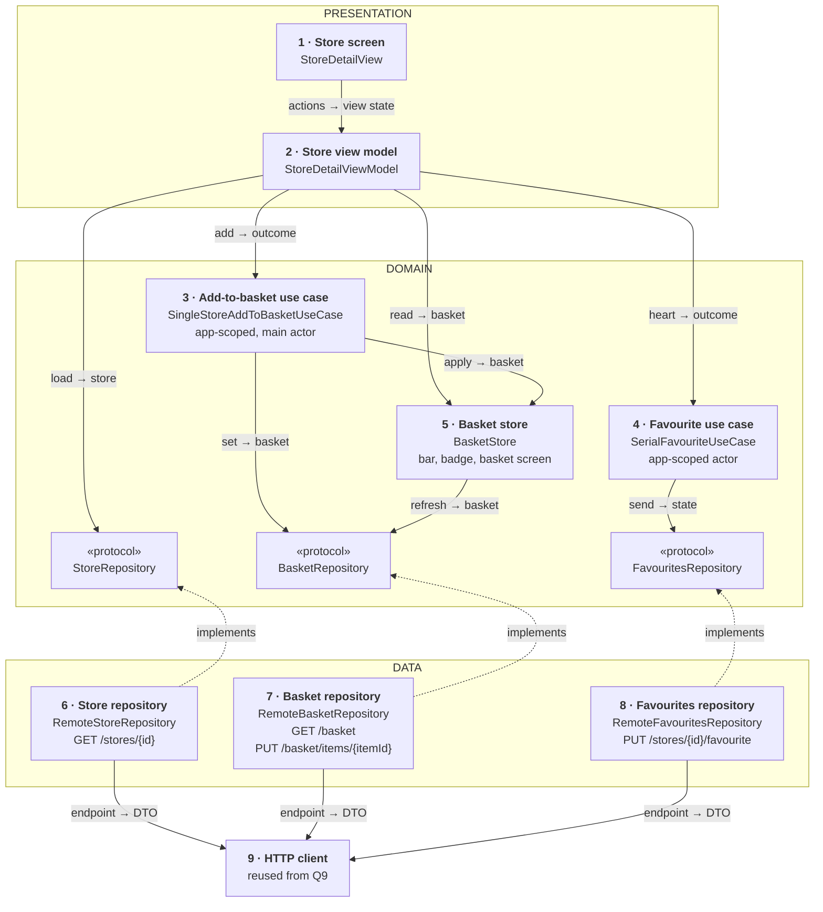
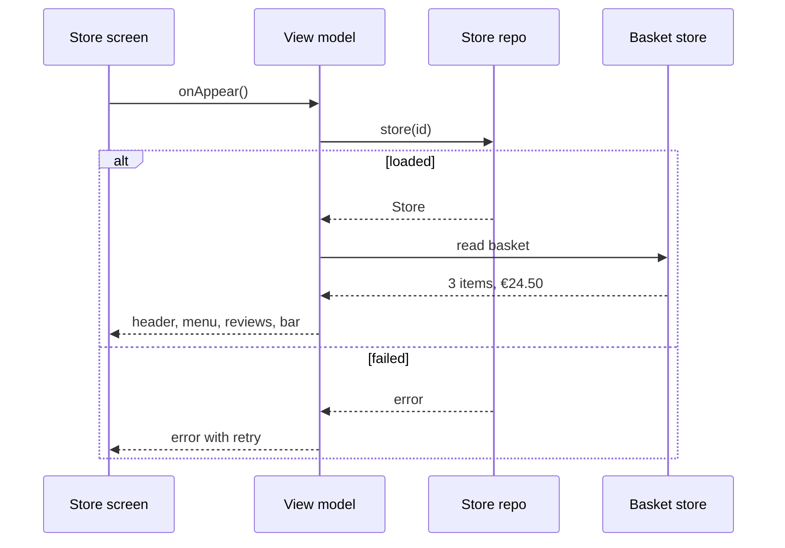
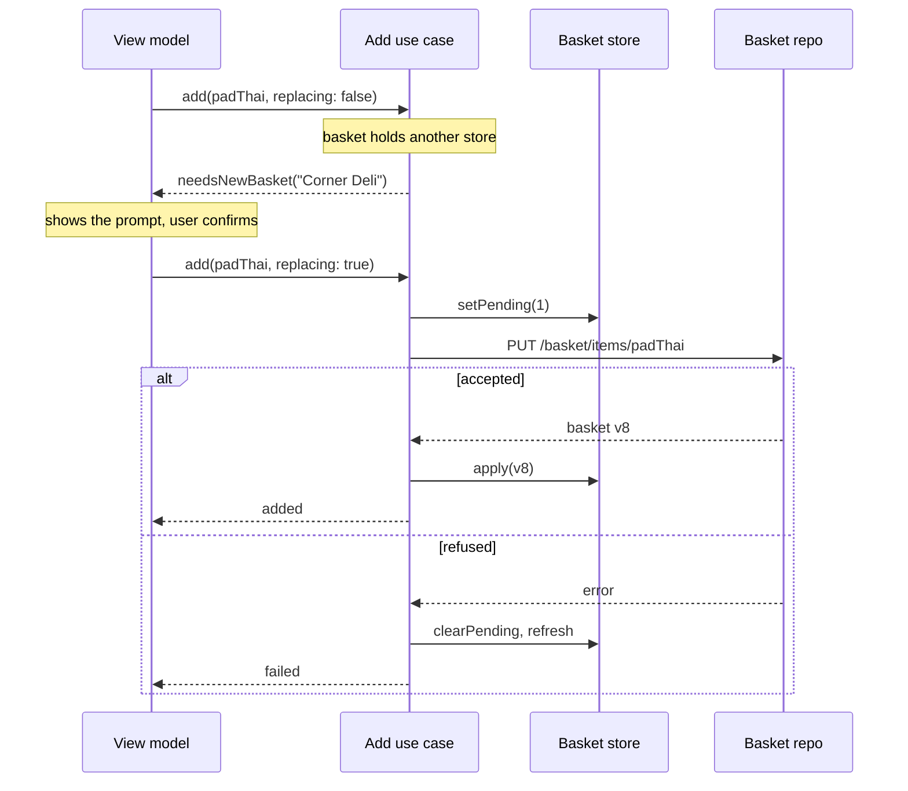

*Reported in a delivery company's architecture round: a mini app from a spec and a wireframe, then "Why MVVM?", the networking layer, scale and tests. The answer stays small: one view model, one shared basket, two rules, and a reason for every boundary.*

> **Interviewer:** "Here's a spec and a wireframe for a store's page in our delivery app. Architect this screen, and tell me why."

## Run it as a round, not as reading

Set a timer. Sketch. Talk the whole time. Open a section only when its slot is over.

| Clock | Phase | What you do |
|---|---|---|
| 0:00–0:02 | The prompt | Repeat it back in one sentence |
| 0:02–0:07 | Clarify | Read the wireframe aloud, ask yours, then read section 1 |
| 0:07–0:12 | Scope | Out of scope first, then required, then later |
| 0:12–0:24 | High level | The idea · the parts · the sketch · one line each · two flows |
| 0:24–0:40 | Deep dives | "Why MVVM?" · "What if it scales?" · "What would you test?" |
| 0:40–0:45 | Recap | Follow-ups, then the 60-second summary |

## What this question is really testing

- **Reading a spec into state:** what is one screen's, and what is shared.
- **Defending a pattern honestly:** MVVM against MV, TCA and VIPER, with when you'd switch.
- **Boundaries with reasons:** a use case only where there's a rule, a shared store only where state is shared.
- **Dependency injection and navigation** that keep the view model testable and the screen previewable.
- **A test plan** that names what's worth testing, and what isn't.

**Traps:** "MVVM because it's best"; a view model that pushes other screens; the basket copied into each screen; prices as `Double`; a use case per button; "we'd unit-test the views".

::: Words used in this chapter
- **Repository** — the one owner of one kind of data. It turns the server's format into the app's model.
- **Composite** — a repository that only reads: it asks two repositories and combines their answers into one model.
- **Store** — in-memory state that several screens show at once. Here, the basket.
- **Use case** — one user intent with a product rule, like "only the latest tap counts".
- **View model** — the screen's brain. It owns the screen's state and hands the screen one view state.
- **View state** — one value that describes everything the screen shows. The view only draws it.
- **MVVM, MV, TCA, VIPER** — four ways to split a screen: view + view model · view on observable models · one reducer over state · five roles per screen.
- **Composition root** — the one place at launch that builds every part and hands each its collaborators.
- **Router** — the object that owns the navigation stack; screens ask it to go somewhere.
- **Optimistic update** — show the result of a tap at once, and correct it if the server refuses.
- **Minor units** — money as a whole number of the smallest coin, like 1999 cents.
:::

::: 1 · The interviewer answers your clarifying questions
**"Walk me through the wireframe."** → *A hero photo, the name, rating ("4.6 · 1,200 reviews"), delivery time and fee. A heart in the top bar. Menu sections, each item with a photo, name, price and a ＋. A reviews summary: the average and the three latest. A pinned basket bar: "3 items · €24.50 · View basket".*

**"Where else does the basket show?"** → *On every store page, on the basket screen, and as a badge on the tab bar.*

**"Can a basket hold items from two stores?"** → *No. Adding from another store asks "Start a new basket?" first.*

**"Items with options?"** → *Tapping one opens an options sheet. That sheet is another screen; just navigate to it.*

**"Where do reviews come from?"** → *The store call returns the summary. The full list is another screen.*

**"Is the favourite shown anywhere else?"** → *A favourites list, which reloads when it opens.*

**"Offline, live updates?"** → *No. An error with retry is fine.*

**"Team and timeline?"** → *One team now, six feature teams within a year.*

**"Minimum OS?"** → *iOS 17, SwiftUI, Swift 6.*
:::

::: 2 · Requirements and scope — what you should have said
**Out of scope, said first:** the options sheet, the basket screen, checkout, search, the full reviews list, and the server. Photos come from question 1's image loader; requests go through question 9's HTTP client.

**Required for the prompt**

1. Show the store: header, menu sections, reviews summary.
2. Add an item to the basket, with the one-store rule, and keep the basket bar right.
3. Favourite and unfavourite the store, instantly, correctly under fast taps.

**What must feel good:** the ＋ answers at once · the bar, the badge and the basket screen always agree · prices are exact · the screen previews and tests without a network.

**Production considerations** (say, don't draw): accessibility, Dynamic Type, metrics, feature flags. See section 12.

**Optional follow-ups** (add only when asked):

```text
More screens like this one      → the same template, a factory per screen
Six teams                       → a module per feature, routes not imports
Offline menus                   → a saved copy of the last store
Live stock or store closing     → push or polling, only if required
```

*"I'll start simple and add each of these when the requirement appears."*
:::

::: 3 · The idea, in 30 seconds — before you draw anything
> *"The screen is a dumb SwiftUI view over one main-actor view model that turns domain models into one view state. The store comes from a store repository, `GET /stores/{id}`, with the reviews summary and the favourite flag inside. The basket is shown on several screens, so it lives in one shared basket store, refreshed with `GET /basket`. Adding an item is a use case because it has a rule, one store per basket, and sends `PUT /basket/items/{itemId}`. Favouriting is a use case with Q2's like rule, latest tap wins, over `PUT /stores/{id}/favourite`. Everything is built once at a composition root and injected by constructor; a router owns navigation."*
:::

::: 4 · What we need — the components, before the sketch
| # | Part | Type | Layer | Its one job |
|---|---|---|---|---|
| 1 | **Store screen** | `StoreDetailView` | Presentation | Draws the view state, forwards actions. |
| 2 | **Store view model** | `StoreDetailViewModel` | Presentation | Store + basket + heart → one view state. |
| 3 | **Add-to-basket use case** | `SingleStoreAddToBasketUseCase` | Domain | One store per basket, latest quantity wins. |
| 4 | **Favourite use case** | `SerialFavouriteUseCase` | Domain | One request per store, latest tap wins. |
| 5 | **Basket store** | `BasketStore` | Domain | The one basket every screen shows. |
| 6 | **Store repository** | `RemoteStoreRepository` | Data | `GET /stores/{id}` → `Store`. |
| 7 | **Basket repository** | `RemoteBasketRepository` | Data | `GET /basket`, `PUT /basket/items/{itemId}`. |
| 8 | **Favourites repository** | `RemoteFavouritesRepository` | Data | `PUT /stores/{id}/favourite`. |
| 9 | **HTTP client** | reused from Q9 | Reused | Sends every request. |
| chip | **Store repository** | `StoreRepository` | Domain | The promise card 6 keeps. |
| chip | **Basket repository** | `BasketRepository` | Domain | The write promise card 7 keeps. |
| chip | **Favourites repository** | `FavouritesRepository` | Domain | The promise card 8 keeps. |

Nine cards, three chips. `Store` and `Basket` aren't cards; they open section 6.

**Not drawn:** `AppRouter` (protocol `StoreNavigator`), which owns the navigation stack, and Q1's image loader. **Not on the list yet:** a composite (the store call carries reviews and the heart), everything under "optional follow-ups".
:::

::: 5 · The sketch


**How to read it.** A solid arrow points from the asker to the answerer: *request → reply*. Dashed arrows mean *implements*; the grey card is question 9's networking layer.

**Dependency inversion, in one line.** The domain writes the three promises (the chips); the data layer keeps them, so every dashed arrow points **up** and nothing above the data frame knows HTTP exists.

**A shared store belongs on this sketch:** the basket is on three screens. The heart is on one at a time, so it stays in the view model.

**One class, two promises.** Both arrows meet the basket chip; each caller holds only its half: card 5 the read promise `BasketReader`, the use case the write promise `BasketRepository`. Card 7 keeps both.

**On Miro:** three frames, nine cards, three chips, twelve solid arrows. Point at card 5: *"three screens, one basket. That's why it's a store and not view-model state."*
:::

::: 6 · Each component: its job, its interface, the choice inside it
**The models everyone shares.** Money is minor units plus a currency, never a `Double`.

```swift
struct Money: Hashable, Sendable {
    let minorUnits: Int
    /// ISO 4217, e.g. "EUR"
    let currency: String
}

struct Store: Identifiable, Sendable {
    let id: StoreID
    let name: String
    let hero: ImageRef
    let deliveryMinutes: ClosedRange<Int>
    let deliveryFee: Money
    let isOpen: Bool
    let isFavourite: Bool
    let menu: [MenuSection]
    /// average, count, the three latest
    let reviews: ReviewsSummary
}

struct Basket: Equatable, Sendable {
    /// nil = empty
    let storeID: StoreID?
    let lines: [BasketLine]
    /// Computed by the server: fees, promotions
    let total: Money
    /// Rises with every change on the server
    let version: Int
}
```

### 1 · Store screen (`StoreDetailView`)

**Job:** draws the view state and reports taps, appear and pull-to-refresh. It decides nothing.

**Interface:** reads `viewModel.viewState`; calls `onAppear()` from `.task`, `refresh()` from `.refreshable`, and the action methods.

**Choice:** a `List` with sections, so long menus reuse their rows.

### 2 · Store view model (`StoreDetailViewModel`)

**Job:** keeps this screen's state (load, pending heart, prompt) and turns the store and the basket into one view state.

```swift
struct StoreDetailViewState: Equatable {
    /// loading, loaded, failed(message)
    let load: LoadState
    /// name, "4.6 · 1,200 reviews", "25–35 min", "€1.99 delivery"
    let header: HeaderRow?
    /// filled, empty, or pending
    let heart: HeartState
    /// prices already formatted, "+" disabled while the store is closed
    let sections: [MenuSectionRow]
    let reviews: ReviewsRow?
    /// nil when the basket is empty
    let basketBar: BasketBar?
    /// "Start a new basket? Your items from {store} will be removed."
    let newBasketPrompt: Prompt?
}

@MainActor @Observable
final class StoreDetailViewModel {
    init(storeID: StoreID, stores: StoreRepository, basket: BasketStore,
         addToBasket: AddToBasketUseCase, favourite: SetFavouriteUseCase,
         navigator: StoreNavigator)

    var viewState: StoreDetailViewState { get }

    func onAppear() async
    func refresh() async
    /// Opens the options sheet instead, if the item has required options
    func add(_ item: MenuItemID) async
    func confirmNewBasket() async
    func toggleFavourite() async
    func openBasket()
}
```

**Choices:**

- **`viewState` is computed** from stored state and the basket store, so it never goes stale.
- **Formatting happens here:** minor units converted with the currency's exponent, then `Decimal.FormatStyle.Currency`.
- **Navigation is asked, not done:** `navigator.showOptions(item)`, `showBasket()`.

### 3 · Add-to-basket use case (`SingleStoreAddToBasketUseCase`)

**Job:** adds an item to the one shared basket, keeping the rule that a basket holds one store's items.

```swift
enum AddOutcome: Equatable, Sendable {
    case added
    /// The basket holds another store's items. Nothing changed.
    case needsNewBasket(currentStore: String)
    /// Refused or unreachable; the basket shows the server's state
    case failed(message: String)
}

protocol AddToBasketUseCase: Sendable {
    /// Never throws. Not cancelled by the caller's task: the write
    /// still lands, the caller only stops waiting.
    func add(_ item: MenuItemID, from store: StoreID,
             replacing: Bool) async -> AddOutcome
}

@MainActor
final class SingleStoreAddToBasketUseCase: AddToBasketUseCase {
    init(basket: BasketStore, repository: BasketRepository)
}
```

**Choices:**

- **The rule a product manager would state:** "one store per basket; ask before replacing". That's why adding is a use case and loading isn't.
- **App-scoped and `@MainActor`**, because it writes the main-actor store; one instance, so two screens can't send in parallel.
- **Final quantities, one request per item** ("quantity 3", never "+1"), Q2's rule. The server checks the one-store rule too: 409 `other_store`.

### 4 · Favourite use case (`SerialFavouriteUseCase`)

**Job:** sends the latest heart the user wants, one request per store at a time.

```swift
protocol SetFavouriteUseCase: Sendable {
    /// Never throws. Not cancelled by the caller's task.
    /// Returns saved, superseded or failed(serverState:), as Q2's like.
    func setFavourite(_ on: Bool, store: StoreID) async -> FavouriteOutcome
}

actor SerialFavouriteUseCase: SetFavouriteUseCase {
    init(favourites: FavouritesRepository)
}
```

**Choice:** question 2's like, reused. The pending heart lives in the view model, because only this screen shows it.

### 5 · Basket store (`BasketStore`)

**Job:** holds the one basket the bar, the badge and the basket screen all read, with pending quantities laid over it.

```swift
@MainActor @Observable
final class BasketStore {
    init(reader: BasketReader)

    /// The server's basket with pending quantities applied
    private(set) var basket: Basket
    var itemCount: Int { get }

    func refresh() async
    /// Ignored if its version is older than the one held
    func apply(_ basket: Basket)
    func setPending(_ quantity: Int, for item: MenuItemID)
    func clearPending(for item: MenuItemID)
}
```

**Choices:**

- **The version is the stale-result guard:** a reply older than what's held is dropped.
- **No rules inside;** the store only holds and applies.
- **The total is the server's.** While a change is pending, the bar dims it.

### 6 · Store repository (`RemoteStoreRepository`)

**Job:** fetches `GET /stores/{id}` and maps `StoreDTO` to `Store`, menu and reviews included.

```swift
protocol StoreRepository: Sendable {
    /// Throws on failure. Cancelling the caller cancels the request.
    func store(_ id: StoreID) async throws -> Store
}
```

**Choice:** reviews and the heart come inside the store call. *Trade-off:* separate endpoints would let two teams own them, at the cost of a second request and a composite, which nothing above would notice.

### 7 · Basket repository (`RemoteBasketRepository`)

**Job:** reads the basket with `GET /basket` and sets a quantity with `PUT /basket/items/{itemId}`. Two callers, two small promises.

```swift
/// Domain: the use case's promise
protocol BasketRepository: Sendable {
    /// Final quantity, 0 removes. replacing clears another store's
    /// basket first. Returns the server's basket. Throws
    /// BasketError.otherStore on 409. Cancelling the caller cancels
    /// the request; the use case runs it in its own task.
    func setQuantity(_ quantity: Int, of item: MenuItemID,
                     store: StoreID, replacing: Bool) async throws -> Basket
}

/// The store's promise
protocol BasketReader: Sendable {
    /// Throws on failure; the store keeps what it holds.
    func basket() async throws -> Basket
}
```

**Choice:** mapping and error codes stop here: the DTO's cents become `Money`, `other_store` becomes `BasketError.otherStore`.

### 8 · Favourites repository (`RemoteFavouritesRepository`)

**Job:** saves a heart with `PUT /stores/{id}/favourite` and returns what the server holds.

```swift
protocol FavouritesRepository: Sendable {
    /// Throws if refused or unreachable. Cancelling the caller
    /// cancels the request; the use case runs it in its own task.
    func setFavourite(_ on: Bool, store: StoreID) async throws -> Bool
}
```

**Choice:** a thin adapter; the heart is read with the store.

### 9 · HTTP client (reused from question 9)

**Job:** sends each endpoint and returns its DTO. Cards 6–8 see only its `HTTPClient` protocol.

**Why these parts, and no more.** Each card changes for one reason:

| Card | Changes when |
|---|---|
| 1 · Store screen | the screen's design |
| 2 · Store view model | the screen's behaviour |
| 3 · Add-to-basket use case | a product rule (what a basket may hold) |
| 4 · Favourite use case | a product rule (latest tap wins) |
| 5 · Basket store | what several screens share (the basket) |
| 6 · Store repository | an endpoint or payload (`/stores/{id}`) |
| 7 · Basket repository | an endpoint or payload (`/basket`) |
| 8 · Favourites repository | an endpoint or payload (`/favourite`) |
| not drawn · Router | the screen's behaviour (where taps lead) |

Each protocol earns a fake or a smaller promise. Not added: a use case for loading (a pass-through), a protocol for the view model, a composite, a DI container. Constructor injection is enough.
:::

::: 7 · Key flows through the sketch
**Flow 1 — opening the store page.** The basket is already in the store, refreshed at launch.



**Flow 2 — adding from another store.**



The bar, the badge and the basket screen change together: they read one store.
:::

::: 8 · The server contract
```
GET  /v1/stores/{id}
     → { "id", "name", "hero": { "url", "width", "height" },
         "deliveryMinutes": { "min": 25, "max": 35 },
         "deliveryFee": { "minorUnits": 199, "currency": "EUR" },
         "isOpen", "isFavourite",
         "menu": [ { "id", "title", "items": [ { "id", "name", "price",
                     "image", "hasRequiredOptions" } ] } ],
         "reviews": { "average": 4.6, "count": 1200, "latest": [ … ] } }

GET  /v1/basket
     → { "storeId", "version": 7, "lines": [ … ],
         "total": { "minorUnits": 2450, "currency": "EUR" } }

PUT  /v1/basket/items/{itemId}   { "storeId", "quantity": 1, "replacing": true }
     → 200 { …the basket, "version": 8 }
     → 409 { "error": { "code": "other_store" } }

PUT  /v1/stores/{id}/favourite   { "favourite": true }
     → 200 { "favourite": true }
```

- **Money in minor units**, the total computed by the server.
- **Final quantities with `PUT`**, idempotent, so the HTTP client may retry it.
- **The store call is personal** (`isFavourite`), never on a shared CDN; photos are.

**"How would you structure the networking layer?"** Point at card 9 and give question 9 in two lines: features describe requests as `Endpoint` values; one `HTTPClient` runs them through interceptors, one shared token refresh and retries for idempotent calls, and repositories map its errors to domain errors.
:::

::: 9 · Deep dive — "Why MVVM?"
**Decision:** MVVM with `@Observable`: a dumb view, a main-actor view model, domain types below it. Then say what each alternative is good at.

1. **Against MV** (views read `@Observable` models and call repositories): less code, fine for a settings screen. But the prompt, the pending heart and the formatting land in the view, which can't be unit-tested. *Switch* for screens with no rules.
2. **Against TCA** (one reducer over state, effects as values): excellent for testing every state change. But it's a third-party dependency every team must learn, and it shapes the whole app. *Switch* if the team already uses it.
3. **Against VIPER** (five roles per screen): clear, but heavy and UIKit-era. Our use cases already play the interactor, only where there's a rule.
4. **What MVVM buys here:** the view state is a plain `Equatable` value, so tests assert on it and previews draw it.

**The honest line:** *"The boundaries matter more than the pattern: rules out of views, I/O out of view models, shared state in one place. MVVM is the smallest pattern that does that here."*

*Rejected:* a view model per row. Rows have no logic of their own.
:::

::: 10 · Deep dive — "What if this needed to scale?"
**More screens.** Each is the same template: view, view model, view state, factory. The composition root builds shared parts once; a factory per screen builds its view model.

**More teams.** Six teams can't share one target.

1. **A module per feature** (Store, Basket, Checkout), each with its views, view models and repositories.
2. **Shared domain in its own small module**: `Money`, `Basket`, the repository protocols. Features depend on it, never on each other.
3. **Navigation by route, not by import.** Store calls `navigator.showBasket()`; the app module maps routes to screens with `NavigationStack` and `navigationDestination(for:destination:)`. The Store module never imports Basket.
4. **The app module is the composition root:** the only place that knows every concrete type.

**More state.** A second screen showing the heart moves it into a favourites store, like the basket. The rule stays in the use case.

*Rejected:* a global `@Environment` bag of services. A missing value fails only at runtime, and dependencies vanish from the `init`. Environment is fine for values the view itself reads.
:::

::: 11 · Deep dive — "What would you write tests for?"
**Decision:** test the rules and the mapping, where bugs cost money; skip what the compiler or a preview already shows.

1. **The use cases**, with fake repositories: another store's basket returns `needsNewBasket` and sends nothing; three fast ＋ taps send one request, then the final quantity.
2. **The view model**, asserting on `viewState` with fakes and the real basket store: loaded, failed, closed (＋ disabled), €1.99 from 199 minor units, the prompt.
3. **The basket store:** a reply with an older version is ignored; pending quantities lay over the server's basket.
4. **The repositories' mapping**, with a fake `HTTPClient` returning a DTO: cents become `Money`, `other_store` becomes `BasketError.otherStore`.

All in Swift Testing, no network. **Not unit-tested:** the views; previews cover them.

**Previews from the same fakes.** `#Preview` builds the screen through a preview composition root with canned repositories: loaded, loading, failed, closed, a long name, the largest text, dark mode.

*Rejected:* UI tests for every state: slow and flaky. Two or three for the main path.
:::

::: 12 · Failure modes, production and scale
**Failures**

| Failure | Client behaviour |
|---|---|
| Store fails to load | Full-screen error with retry |
| Store closed | Menu visible, ＋ disabled, "Closed" |
| Add refused | Basket store drops the pending count; short message |
| 409 another store | The prompt, as if the client had caught it |
| Basket refresh fails | Keep what's held; retry on next appear |
| Favourite refused | Heart goes to the server's state, short message |
| Price changed since load | The basket's server total wins; the menu refreshes on appear |
| Session expired | The HTTP client signs out once (Q9) |

**Production notes** (short, not on the board)

- **Networking:** reads cancelled with the screen (`.task` does it); writes run in the use case's own task.
- **Accessibility:** the ＋ reads "Add Pad Thai, €9.50"; layouts survive the largest text size.
- **Metrics and flags:** time to first content, add failures, new-basket prompts shown versus confirmed; reviews behind a remote flag.

**Scale, back of the envelope**, with the interviewer's numbers:

```text
store page views a day × size of one store payload   = bandwidth for this screen
adds a day × average taps per add                    = basket writes
```

A 150-item menu is about 60 KB of JSON; photos dominate, so they come from the image loader at the row's size. The architecture changes with teams, not traffic.

**Grow only when asked**

```text
One screen shows the heart   → the pending heart in the view model
A second screen shows it     → a favourites store, like the basket
Reviews get their own team   → a second endpoint and a composite
Offline menus                → save the last store, show it first
Six teams                    → a module per feature, routes not imports
```
:::

::: 13 · Question bank — everything they can push on
Answer out loud first, then open.

### Architecture and the pattern

<details>
<summary>"Walk me through the layers."</summary>

Presentation: screen and view model. Domain: models, three protocols, two use cases, the basket store. Data: three repositories over Q9's client.
</details>

<details>
<summary>"Why MVVM and not MV?"</summary>

This screen has rules and formatting. In a view they can't be unit-tested; in a view model they're asserted on a plain value.
</details>

<details>
<summary>"Why not TCA?"</summary>

Strong for state testing, but a dependency that shapes the whole app. I'd use it if the team already does.
</details>

<details>
<summary>"Why not VIPER?"</summary>

Five types per screen for roles we already have: use cases are the interactors, only where there's a rule.
</details>

<details>
<summary>"Show me dependency inversion."</summary>

The domain writes the three repository protocols; the data repositories implement them. The view model and use cases never import networking.
</details>

<details>
<summary>"Is the view really dumb?"</summary>

It draws one `Equatable` view state and calls methods. Strings and disabled states are decided upstream.
</details>

### State and data

<details>
<summary>"Why does adding get a use case and loading doesn't?"</summary>

Adding has a rule a product manager states: one store per basket, ask before replacing. Loading is one call; a use case would only pass it through.
</details>

<details>
<summary>"Why is the basket a store and the heart isn't?"</summary>

The basket shows on three screens at once. The heart shows on one at a time, and the list reloads when it opens.
</details>

<details>
<summary>"Where does the combined state come from?"</summary>

The store call already carries reviews and the heart, so no composite. The view model joins the store with the basket store's basket.
</details>

<details>
<summary>"Where does mapping happen?"</summary>

In each repository: DTO to `Store`, cents to `Money`, error codes to `BasketError`. Formatting for display happens in the view model.
</details>

<details>
<summary>"Why not `Double` for prices?"</summary>

Binary fractions can't hold 0.10 exactly, so sums drift. Minor units are exact; the server computes the total.
</details>

### Basket and favourite

<details>
<summary>"The user taps ＋ three times fast."</summary>

The bar shows 3 at once. One request at a time for that item, then the latest quantity, sent as a final value.
</details>

<details>
<summary>"Two replies arrive out of order."</summary>

Each basket carries a version; the store drops one older than it holds.
</details>

<details>
<summary>"The client thinks the basket is empty, the server says another store."</summary>

The server's 409 wins: the repository maps it, and the view model shows the same prompt.
</details>

<details>
<summary>"The user leaves the page mid-add."</summary>

The add still lands; the use case runs it in its own task, and the badge updates through the store.
</details>

<details>
<summary>Follow-up chain: "A second screen."</summary>

1. *"A favourites tab shows hearts live."* → Two copies of the heart could disagree.
2. *"Fix it."* → A favourites store both screens read; the pending heart moves there.
3. *"Where does the rule go?"* → It stays in the use case, which writes outcomes to the store.
4. *"When wouldn't you?"* → While the list simply reloads on open.
</details>

### Navigation, DI and previews

<details>
<summary>"Who owns navigation?"</summary>

An app router holding the `NavigationPath`. The view model calls `showBasket()` on a `StoreNavigator` protocol; it never builds another screen.
</details>

<details>
<summary>"How do dependencies get in?"</summary>

By constructor. A composition root builds shared parts once, and a factory per screen builds the view model with them.
</details>

<details>
<summary>"Why not a DI container or the environment?"</summary>

A missing registration fails at runtime; a missing init argument fails to compile.
</details>

<details>
<summary>"How do you preview it?"</summary>

`#Preview` builds it through a preview composition root with canned repositories: the same fakes as the tests.
</details>

<details>
<summary>"Where is the use case instance created?"</summary>

Once, at the composition root: a second instance would send in parallel.
</details>

### Testing and scale

<details>
<summary>"What would you write tests for?"</summary>

Use case rules, view states, the version guard, mapping. Not the views.
</details>

<details>
<summary>"How do you test the new-basket prompt?"</summary>

Another store's basket and a fake repository: `add` returns `needsNewBasket`, the fake records no call.
</details>

<details>
<summary>"How would you structure the networking layer?"</summary>

Q9: endpoint values, one `HTTPClient`, interceptors, one shared refresh, safe retries.
</details>

<details>
<summary>Follow-up chain: "What if this needed to scale?"</summary>

1. *"Forty more screens."* → The same template and a factory each; shared parts built once.
2. *"Six teams."* → A module per feature, a small shared domain module.
3. *"Store needs to open Basket."* → By route through the router, never by import.
4. *"What doesn't change?"* → The boundaries: rules in use cases, shared state in stores, I/O in repositories.
</details>
:::

::: 14 · Scorecard — mark yourself, 0 / 1 / 2
| | Did you… | 0–2 |
|---|---|---|
| 1 | Talk the whole time, and listen when interrupted | |
| 2 | Read the wireframe aloud and clarify before designing | |
| 3 | Give a trade-off for each choice | |
| 4 | Say out of scope first; separate required from later | |
| 5 | Say the idea, list the parts, then sketch | |
| 6 | Keep the sketch to nine type cards, one line each | |
| 7 | Name the four endpoints | |
| 8 | Put the basket in a shared store, and say why the heart isn't | |
| 9 | Give use cases only to the rules, and say why not loading | |
| 10 | Use `Money` in minor units; format in the view model | |
| 11 | Defend MVVM against MV, TCA and VIPER, with switch conditions | |
| 12 | Keep navigation in a router, dependencies in constructors | |
| 13 | Name what you'd test, and what you wouldn't | |
| 14 | Land the recap inside 60 seconds | |

14+ is a pass.<!--private--> Anything scored 0 goes in the progress log and comes back as a recall prompt.<!--/private--><!--public--> A zero names the thing to read about next.<!--/public-->
:::

::: 15 · The 60-second recap
The store page is a dumb SwiftUI view over one main-actor view model that turns domain models into one `Equatable` view state, so it tests and previews easily. The store, its reviews and the heart come from one repository; the basket shows on three screens, so it lives in one shared store with a version guard. Adding is a use case because a basket holds one store's items, and favouriting reuses question 2's latest-tap rule; both send final values, one request at a time. Money is minor units, formatted in the view model. Everything is built once at a composition root and injected by constructor, and a router owns navigation, so features can become modules that link by route. I chose MVVM as the smallest pattern that keeps rules out of views and I/O out of view models; I'd use MV for a screen with no rules, and TCA if the team already does.
:::
