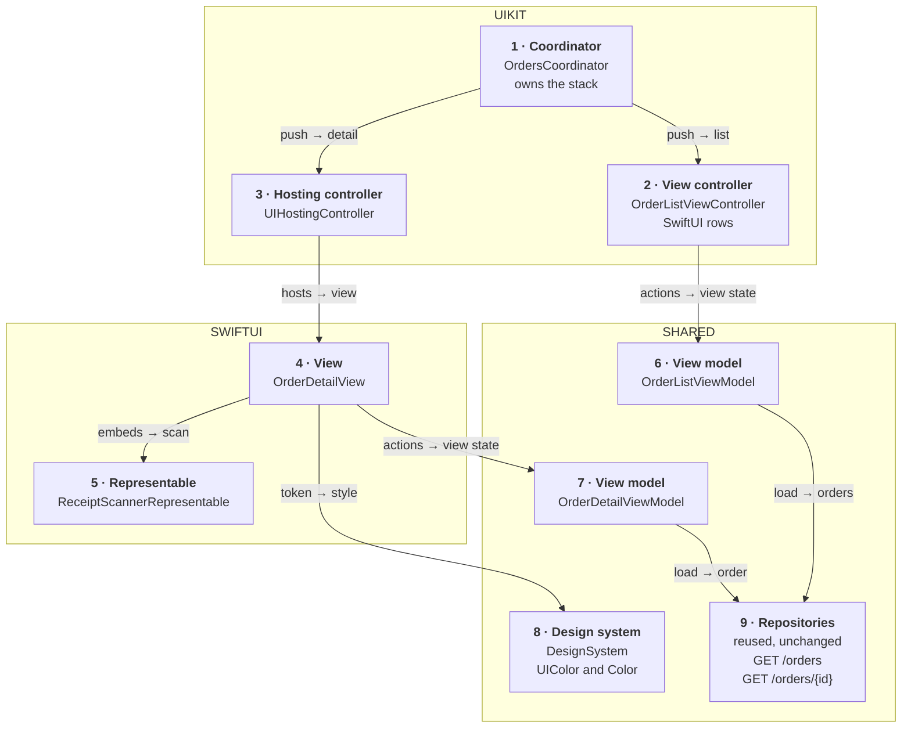
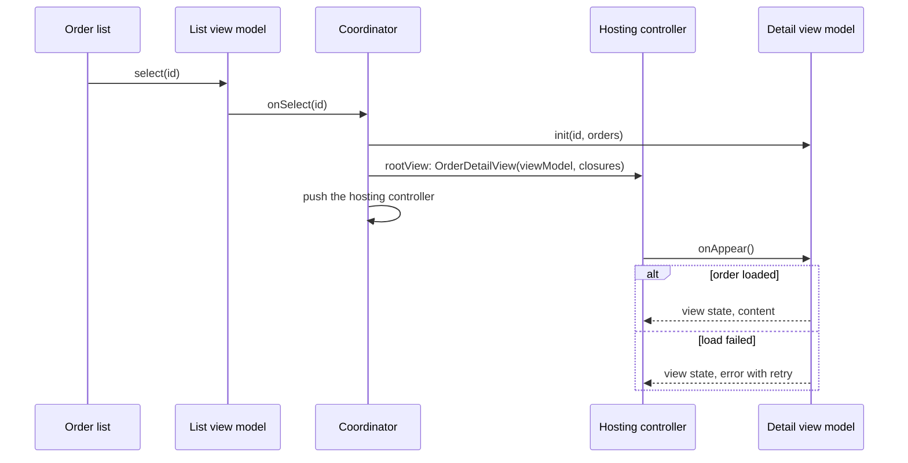
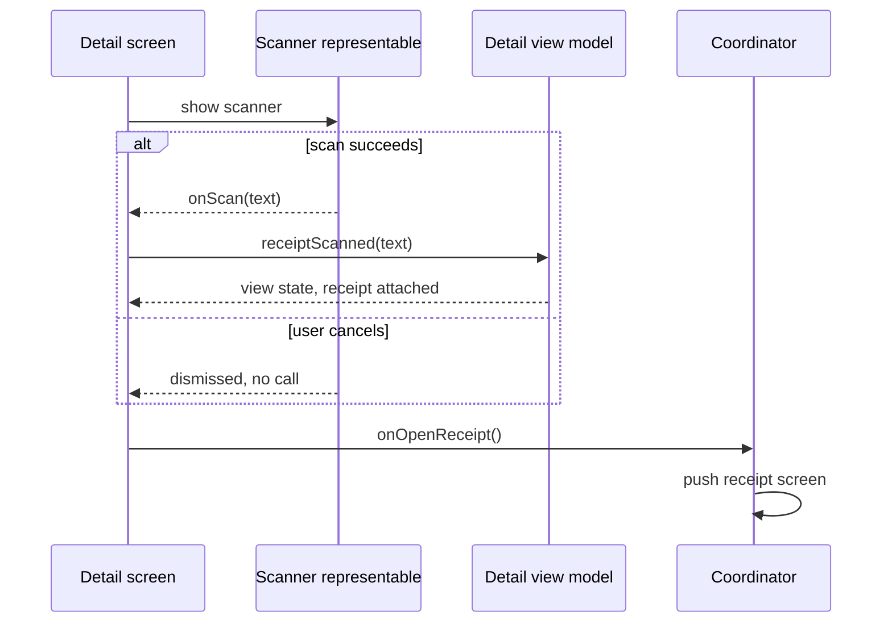

*A recurring senior prompt in first-hand reports. The answer is a boundary, not a rewrite: UIKit keeps navigation, SwiftUI screens arrive as leaves inside hosting controllers, and view models don't care which framework draws them.*

> **Interviewer:** "We have a large UIKit app, a few hundred screens, and we're starting to write SwiftUI. How do you structure that?"

## Run it as a round, not as reading

Set a timer. Sketch. Talk the whole time. Open a section only when its slot is over.

| Clock | Phase | What you do |
|---|---|---|
| 0:00–0:02 | The prompt | Repeat it back in one sentence |
| 0:02–0:07 | Clarify | Ask yours, then read section 1 |
| 0:07–0:12 | Scope | Out of scope first, then required, then later |
| 0:12–0:24 | High level | The idea · the parts · the sketch · one line each · two flows |
| 0:24–0:40 | Deep dives | The interviewer picks one of sections 9–11 |
| 0:40–0:45 | Recap | Follow-ups, then the 60-second summary |

## What this question is really testing

- **The three bridges**: a hosting controller for a screen, a hosting configuration for a cell, a representable for UIKit inside SwiftUI.
- **One owner of navigation.** During migration that's UIKit; SwiftUI screens report intents through closures.
- **View models that work from both frameworks**, and how UIKit observes them on each OS version.
- **One design system with two faces**, so a migrated screen looks the same.
- **A migration order and a moment to flip the root**, without a freeze.

**Traps:** a `NavigationStack` inside a pushed hosting controller; SwiftUI screens reaching for the navigation controller; a hosting controller per cell; a second copy of the colours; "rewrite it in SwiftUI"; claiming UIKit observes `@Observable` automatically on iOS 17.

::: Words used in this chapter
- **Repository** — the one owner of one kind of data. It turns the server's format into the app's model.
- **Composite** — a repository that only reads: it asks two repositories and combines their answers into one model.
- **Store** — in-memory state that several screens show at once. Not needed here yet.
- **Use case** — one user intent with a product rule, like "never charge twice".
- **View model** — the screen's brain. It owns the screen's state and hands the screen one view state.
- **Coordinator** — a UIKit object that owns a navigation controller and decides which screen comes next.
- **Hosting controller** — a UIKit view controller whose content is a SwiftUI view.
- **Hosting configuration** — the same idea for one table or collection cell.
- **Representable** — a SwiftUI view that wraps a UIKit view or view controller.
- **Observation tracking** — recording which properties a piece of code read, and running it again when one changes.
- **Leaf screen** — a screen that opens nothing else, like a detail or a settings page.
:::

::: 1 · The interviewer answers your clarifying questions
**"How is navigation done today?"** → *Coordinators, each owning a `UINavigationController`. Tabs are a `UITabBarController`.*

**"What architecture inside screens?"** → *View controllers with view models. Some use delegates, some closures.*

**"Minimum OS?"** → *iOS 17. Swift 6. We'd like to use the newest APIs where they exist.*

**"What will be SwiftUI first?"** → *New screens. The first is a new order detail, opened from the existing UIKit order list.*

**"Is there a design system?"** → *A UIKit one: colours in an asset catalog, a type ramp, buttons.*

**"Rewrite allowed?"** → *No. We ship every two weeks.*

**"Anything already painful?"** → *The order list scrolls badly on old phones. Don't make it worse.*

**"Tests?"** → *Unit tests for view models, UI tests on the main flows.*
:::

::: 2 · Requirements and scope — what you should have said
**Out of scope, said first:** rewriting existing screens, changing the data layer, a new architecture pattern, the server. The repositories are reused as they are.

**Required for the prompt**

1. Show a SwiftUI screen from UIKit navigation, and back again.
2. Use SwiftUI rows inside existing UIKit lists.
3. Use a UIKit-only component (the receipt scanner) inside a SwiftUI screen.
4. One design system and one kind of view model for both frameworks.

**What must feel good:** a migrated screen looks identical · navigation feels native (back swipe, large titles) · no scroll regressions · every screen testable without UI.

**Production considerations** (say, don't draw): sizing, safe areas, list performance, metrics. See section 12.

**Optional follow-ups** (add only when asked):

```text
A whole flow in SwiftUI     → a SwiftUI NavigationStack inside one hosting controller
State on two screens        → a shared @MainActor @Observable store
Most tabs are SwiftUI       → flip the root to a SwiftUI TabView
Deep links into SwiftUI     → the coordinator still routes them
```

*"I'll start with a leaf screen and grow the boundary one step at a time."*
:::

::: 3 · The idea, in 30 seconds — before you draw anything
> *"UIKit keeps the app shell and navigation for now. A coordinator pushes a `UIHostingController` whose root is a SwiftUI view, and hands that view closures like `onOpenReceipt`, so SwiftUI reports intents and never navigates. Existing lists get SwiftUI rows through `UIHostingConfiguration`, and the one UIKit-only component goes into SwiftUI through a representable. View models are `@MainActor @Observable` classes that import no UI framework, so SwiftUI observes them for free and UIKit observes them with `updateProperties()` on iOS 26, an Info.plist key on iOS 18, and `withObservationTracking` on iOS 17. The data layer and its endpoints, `GET /orders` and `GET /orders/{id}`, don't change."*
:::

::: 4 · What we need — the components, before the sketch
**Adapted for an architecture prompt:** the cards are boundaries (who hosts whom, who owns what), the one-blank test applies to each, and section 8 holds the module contracts across the UIKit–SwiftUI line instead of a server contract. The server is unchanged.

| # | Part | Type | Side | Its one job |
|---|---|---|---|---|
| 1 | **Orders coordinator** | `OrdersCoordinator` | UIKit | Owns the stack; decides what's next. |
| 2 | **Order list** | `OrderListViewController` | UIKit | The existing list, with SwiftUI rows. |
| 3 | **Hosting controller** | `UIHostingController` | Bridge | Puts the SwiftUI detail on the UIKit stack. |
| 4 | **Order detail screen** | `OrderDetailView` | SwiftUI | Draws the view state, forwards actions. |
| 5 | **Scanner representable** | `ReceiptScannerRepresentable` | Bridge | The UIKit scanner, inside SwiftUI. |
| 6 | **List view model** | `OrderListViewModel` | Shared | The list's state → one view state. |
| 7 | **Detail view model** | `OrderDetailViewModel` | Shared | The detail's state → one view state. |
| 8 | **Design system** | `DesignSystem` | Shared | One set of tokens, two faces. |
| 9 | **Repositories** | reused, unchanged | Reused | The existing data layer. |

Nine cards, no chips. The view models depend on the existing `OrderRepository` protocol; its implementation is reused.

**Not drawn:** the tab bar controller, the other coordinators, the row view (a plain SwiftUI view inside card 2). **Not on the list yet:** everything under "optional follow-ups".
:::

::: 5 · The sketch


**How to read it.** A solid arrow points from the asker or owner to the part it uses. The two bold cards are the bridges between frameworks. Navigation only ever starts in the UIKIT frame.

**Dependency inversion, in one line.** Both view models depend on the `OrderRepository` protocol, not on UIKit or SwiftUI, so either framework can draw them and the reused data layer is untouched.

**No shared store on this sketch:** the list and the detail each own their screen's state. If both had to show a live status, it would move into one store (section 13).

**On Miro:** three frames, nine cards, nine solid arrows. Point at card 3: *"this is the whole boundary for a screen. SwiftUI lives inside it, UIKit owns everything around it."*
:::

::: 6 · Each component: its job, its interface, the choice inside it
**The model everyone shares** is the existing `Order` from the domain. The views never see a DTO.

### 1 · Orders coordinator (`OrdersCoordinator`)

**Job:** owns the orders tab's `UINavigationController`. It builds each screen with its view model and closures, and decides what comes next.

**Interface:**

```swift
@MainActor
final class OrdersCoordinator {
    init(navigation: UINavigationController, orders: OrderRepository)
    func start()
    func showDetail(_ id: OrderID)
    func showReceipt(for id: OrderID)
}
```

**Choices:**

- **It keeps navigation during the migration.** One owner per stack. A pushed hosting controller gets back swipe and the large title for free.
- **It never imports a SwiftUI view's insides.** It creates the view with a view model and closures, and wraps it.

### 2 · Order list (`OrderListViewController`)

**Job:** the existing UIKit list. Its rows are now SwiftUI views, set through `UIHostingConfiguration` on each cell.

**Interface:** reads `viewModel.viewState` in `updateProperties()`; forwards `didSelect` as `viewModel.select(_:)`.

**Choices:**

- **A hosting configuration per cell, never a hosting controller per cell.** The configuration is built for cell reuse; a controller per cell adds child view controllers to every scroll.
- **The diffable data source stays.** Only the cell's content changes.

### 3 · Hosting controller (`UIHostingController`)

**Job:** Apple's bridge: a view controller whose view is a SwiftUI hierarchy. The coordinator pushes it like any other.

**Interface:**

```swift
let detail = OrderDetailView(
    viewModel: viewModel,
    onOpenReceipt: { [weak self] in self?.showReceipt(for: id) }
)
navigation.pushViewController(UIHostingController(rootView: detail), animated: true)
```

**Choices:**

- **No `NavigationStack` inside it.** The UIKit stack already owns the bar; a second stack fights it. `.navigationTitle` and toolbar items on the root view are forwarded to the hosting controller's navigation item, so set them in SwiftUI and check on the oldest OS.
- **Size it explicitly when embedded.** As a child inside a UIKit layout, set `sizingOptions` to `.intrinsicContentSize` (or `.preferredContentSize` for popovers and sheets).

### 4 · Order detail screen (`OrderDetailView`)

**Job:** draws the detail's view state, and reports taps as closures. It decides nothing, and navigates nowhere.

**Interface:** in section 8.

**Choice:** **closures, not a router object, at first.** One closure per exit is the smallest contract. When a screen has many exits, pass one `(OrderDetailRoute) -> Void` instead.

### 5 · Scanner representable (`ReceiptScannerRepresentable`)

**Job:** wraps the existing UIKit receipt scanner so the SwiftUI detail can show it.

**Interface:**

```swift
struct ReceiptScannerRepresentable: UIViewControllerRepresentable {
    /// Called on the main actor with the scanned text, once.
    let onScan: (String) -> Void
}
```

**Choice:** **its coordinator is the scanner's delegate**, and turns delegate calls into the closure. The representable keeps no state of its own; SwiftUI may recreate it at any time.

### 6 · List view model (`OrderListViewModel`)

**Job:** keeps the list's rows and loading state, as one view state.

**Interface:**

```swift
@MainActor @Observable
final class OrderListViewModel {
    init(orders: OrderRepository, onSelect: @escaping (OrderID) -> Void)
    var viewState: OrderListViewState { get }
    func onAppear() async
    func select(_ id: OrderID)
}
```

**Choice:** **`@Observable`, and no UIKit or SwiftUI import.** That is what lets a UIKit screen use it today and a SwiftUI screen tomorrow, unchanged.

### 7 · Detail view model (`OrderDetailViewModel`)

**Job:** keeps the detail's order, its load state and the scan result, as one view state.

**Interface:**

```swift
@MainActor @Observable
final class OrderDetailViewModel {
    init(id: OrderID, orders: OrderRepository)
    var viewState: OrderDetailViewState { get }
    func onAppear() async
    func receiptScanned(_ text: String)
}
```

**Choices:**

- **Exits are not its job.** The view's closures go straight to the coordinator. The view model owns the screen's state, not the stack.
- **Main actor**, so UIKit and SwiftUI both read it without hopping.

### 8 · Design system (`DesignSystem`)

**Job:** one set of colours, type and components, exposed to both frameworks.

**Interface:**

```swift
enum DSColor {
    /// From the shared asset catalog.
    static var accent: UIColor { get }
}
extension Color {
    /// The same token, for SwiftUI.
    static var dsAccent: Color { get }
}
```

**Choices:**

- **One source, two faces.** Each colour set lives once in the asset catalog. SwiftUI uses `Color(uiColor:)` or the same named colour, so dark mode and contrast match by construction.
- **A UIKit theme reaches SwiftUI through traits.** A custom trait conforming to `UITraitBridgedEnvironmentKey` (iOS 17) shows up in the hosted view's environment.

### 9 · Repositories (reused)

**Job:** the existing data layer, behind the existing `OrderRepository` protocol. Nothing about it changes.

**Choice:** **the migration stops at the view model.** That is why it is safe to do screen by screen.

**Why these parts, and no more.** Each card changes for one reason:

| Card | Changes when |
|---|---|
| 1 · Coordinator | the flow's navigation |
| 2 · Order list | the list's design |
| 3 · Hosting controller | a platform API (hosting) |
| 4 · Order detail screen | the detail's design |
| 5 · Scanner representable | a platform API (the UIKit scanner's interface) |
| 6 · List view model | the list's behaviour |
| 7 · Detail view model | the detail's behaviour |
| 8 · Design system | the brand's look |
| 9 · Repositories | an endpoint or payload (unchanged here) |

Not added: a SwiftUI router, a shared store, a protocol per view model, a wrapper type around `UIHostingController`. Each waits for a requirement that needs it.
:::

::: 7 · Key flows through the sketch
**Flow 1 — tap an order in the UIKit list, see the SwiftUI detail.**



**Flow 2 — the user scans a receipt, then opens it.**



SwiftUI reports intents; only the coordinator moves the stack.
:::

::: 8 · The module contracts
The interfaces across the UIKit–SwiftUI line. These are what reviews guard.

```swift
// A SwiftUI screen's contract: a view model and its exits
struct OrderDetailView: View {
    init(
        viewModel: OrderDetailViewModel,
        /// Called on the main actor. The coordinator decides what happens.
        onOpenReceipt: @escaping () -> Void
    )
}

// The view state both frameworks render
struct OrderDetailViewState: Equatable {
    let title: String
    let status: String
    let total: String
    /// loading, loaded, failed(message)
    let load: LoadState
    let receipt: ReceiptState
}

// A screen with many exits gets one route callback instead
enum OrderDetailRoute: Hashable, Sendable {
    case receipt(OrderID)
    case support(OrderID)
}

// The data contract, unchanged
protocol OrderRepository: Sendable {
    /// Throws on failure. Cancelling the caller cancels the request.
    func order(_ id: OrderID) async throws -> Order
    func recentOrders() async throws -> [Order]
}
```

- **The view state is plain values**, formatted already, so either framework can draw it and a test can compare it.
- **Exits are closures or one route enum**, never a navigation controller passed into SwiftUI.
- **The endpoints don't change.** The repositories keep calling the same `GET /v1/orders` and `GET /v1/orders/{id}`.
:::

::: 9 · Deep dive — "Who owns navigation, and when does that change?"
**Decision:** UIKit coordinators own every stack until a whole tab is SwiftUI. SwiftUI screens report intents.

1. The coordinator creates the SwiftUI view with closures for each exit.
2. A tap calls the closure on the main actor. The coordinator pushes, presents or dismisses.
3. Back swipe, large titles and the tab bar keep working, because the stack is a real `UINavigationController`.
4. Deep links still go to coordinators, which already know how to build each screen.

**A whole SwiftUI flow** (a three-step return wizard) can own its own `NavigationStack`, inside **one** hosting controller that the coordinator presents modally. Never inside a pushed one: two stacks would each draw a bar.

**Rejected: passing the navigation controller into SwiftUI**, or reading it from the environment. The screen then knows UIKit, can't be previewed alone, and two owners move one stack.
:::

::: 10 · Deep dive — "The same view model drives a UIKit screen. How does UIKit see changes?"
**Decision:** one `@MainActor @Observable` view model, observed the way each OS allows.

1. **SwiftUI:** reading `viewState` in `body` registers the dependency. Nothing to do.
2. **iOS 26:** UIKit tracks `@Observable` reads in `updateProperties()`, `layoutSubviews()` and cell configuration handlers, and calls them again on change. Read `viewState` in `updateProperties()`; it runs before layout and doesn't force one.
3. **iOS 18:** the same tracking in layout methods, switched on with the `UIObservationTrackingEnabled` Info.plist key. `updateProperties()` doesn't exist yet, so read in `viewWillLayoutSubviews()`.
4. **iOS 17:** wrap the read in `withObservationTracking(_:onChange:)`. Its `onChange` fires once, before the value changes, and may run off the main actor, so hop to the main actor, re-read, and register again.

**Hide the version split in one place**: a small helper on the view controller that the list calls once. Delete the iOS 17 branch the day the minimum moves.

**Rejected: a second, Combine-based view model for UIKit.** Two copies of the logic drift, and the migrated screen behaves differently from the old one.
:::

::: 11 · Deep dive — "Which screens first, and when do you flip the root?"
**Decision:** leaves first, then cells, then whole flows, then the root, one tab at a time.

1. **Leaf screens:** details, settings, empty states. They open nothing, so navigation is untouched.
2. **Cells:** SwiftUI rows in existing lists, through hosting configurations. High reuse, small risk.
3. **Flows:** a self-contained flow in one hosting controller with its own `NavigationStack`.
4. **Flip a tab's root** when most of its screens are SwiftUI: the tab becomes a SwiftUI `NavigationStack`, and the remaining UIKit screens enter through `UIViewControllerRepresentable`. Navigation ownership moves to SwiftUI at the same moment, never half.

**Ship behind a flag.** The coordinator builds either the old view controller or the hosting controller, with the same view model. Compare metrics, then delete the old one.

**Rejected: flipping the app root first.** Every UIKit screen then sits inside a representable, and navigation ownership splits on day one.
:::

::: 12 · Failure modes, production and scale
**Failures**

| Failure | Client behaviour or fix |
|---|---|
| Two navigation bars | A `NavigationStack` inside a pushed hosting controller; remove it |
| Hosted view has zero or wrong size | Set `sizingOptions`; give the child view constraints |
| Content inset twice under the keyboard | Adjust `safeAreaRegions` on the hosting controller |
| UIKit screen doesn't update | Read the state inside a tracked method, or re-register on iOS 17 |
| Scroll hitches in the list | Lighter rows; stable item IDs; no hosting controller per cell |
| Colours differ after migration | Both faces read the same colour set; never copy hex values |

**Production notes** (short, not on the board)

- **Performance:** a hosting configuration's row should be a small view over plain values. Measure with the Animation Hitches instrument on the oldest phone, before and after.
- **Sizing:** `UIHostingConfiguration` self-sizes cells; set its `margins` instead of padding inside the row.
- **Testing:** view models are tested without any UI. Coordinators are tested by asserting which screen and which closures they built. UI tests keep working if migrated screens keep their accessibility identifiers.
- **Metrics:** screen load time, scroll hitches, crash rate per screen, the share of screens migrated.

**Scale, back of the envelope**, with the interviewer's numbers:

```text
screens × share touched per release ≈ screens migrated per release
300 × 5% ≈ 15
```

About 15 screens a release, so a few years to finish, which is why the boundary has to be comfortable to live with.

**Grow only when asked**

```text
New leaf screens          → hosting controllers pushed by coordinators
New list rows             → hosting configurations
A whole flow              → one hosting controller with its own NavigationStack
Live state on two screens → one shared @MainActor @Observable store
Most of a tab is SwiftUI  → flip that tab's root, UIKit screens via representables
```
:::

::: 13 · Question bank — everything they can push on
Answer out loud first, then open.

### Bridges

<details>
<summary>"Walk me through the layers."</summary>

UIKit shell and coordinators on top. SwiftUI screens inside hosting controllers. Shared view models and the design system below, over the unchanged data layer.
</details>

<details>
<summary>"Hosting controller, hosting configuration, representable: when each?"</summary>

A whole SwiftUI screen in UIKit: the controller. A SwiftUI cell in a UIKit list: the configuration. A UIKit view inside SwiftUI: the representable.
</details>

<details>
<summary>"Why not a hosting controller per cell?"</summary>

It adds a child view controller per row and fights reuse. `UIHostingConfiguration` is designed for cells.
</details>

<details>
<summary>"How does the representable talk back?"</summary>

Its coordinator is the UIKit delegate and turns delegate calls into closures. The representable itself keeps no state.
</details>

<details>
<summary>"Why does my hosted view have the wrong size?"</summary>

By default it doesn't report size changes to UIKit. Set `sizingOptions`, and add constraints when it's a child.
</details>

### Navigation

<details>
<summary>"Who owns navigation?"</summary>

The coordinators, until a tab is mostly SwiftUI. SwiftUI screens get closures for their exits.
</details>

<details>
<summary>"Why not `NavigationStack` inside the hosted screen?"</summary>

The UIKit stack already owns the bar; two stacks give two bars and broken back behaviour.
</details>

<details>
<summary>"Closures or a router?"</summary>

Closures for a few exits: smallest contract. One route enum callback when there are many.
</details>

<details>
<summary>"How do deep links reach a SwiftUI screen?"</summary>

Through the coordinators, as before. They build the hosting controller like any other screen.
</details>

<details>
<summary>Follow-up chain: "A SwiftUI flow."</summary>

1. *"The return wizard has three steps."* → One hosting controller, presented modally, with its own `NavigationStack`.
2. *"Who decides when it's done?"* → The wizard calls `onFinish`; the coordinator dismisses it.
3. *"Can it push onto the UIKit stack?"* → No. One stack, one owner.
</details>

### State and observation

<details>
<summary>"How does a UIKit screen observe an `@Observable` view model?"</summary>

On iOS 26, by reading it in `updateProperties()`. On iOS 18, in layout methods with the Info.plist key. On iOS 17, with `withObservationTracking`, re-registered each time.
</details>

<details>
<summary>"What's the catch with `withObservationTracking`?"</summary>

`onChange` fires once, before the change, possibly off the main actor. Hop to the main actor, re-read, register again.
</details>

<details>
<summary>"Why can one view model serve both frameworks?"</summary>

It imports neither. It exposes one `Equatable` view state and action methods.
</details>

<details>
<summary>"Why no use case on this sketch?"</summary>

Showing an order has no product rule. A screen with one, like "never charge twice", keeps its use case below the view model, unchanged.
</details>

<details>
<summary>"Where does mapping happen?"</summary>

In the existing repositories. The view model maps the domain `Order` into a formatted view state.
</details>

<details>
<summary>Follow-up chain: "A second screen."</summary>

1. *"The UIKit list and the SwiftUI detail both show a live status."* → Two view models would disagree.
2. *"Fix it."* → One shared `@MainActor @Observable` order store; both view models read it.
3. *"Does UIKit see store changes?"* → Yes, the same tracking: it reads through its view model in a tracked method.
4. *"When wouldn't you?"* → If only one screen shows the status.
</details>

### Design system

<details>
<summary>"How do you keep colours identical?"</summary>

Each colour lives once in the asset catalog; UIKit and SwiftUI read the same set. Never copy hex values.
</details>

<details>
<summary>"How does a UIKit theme reach SwiftUI?"</summary>

A custom UIKit trait conforming to `UITraitBridgedEnvironmentKey` appears in the hosted view's environment.
</details>

<details>
<summary>"Do you rewrite the UIKit components in SwiftUI?"</summary>

Only when a SwiftUI screen needs one. Until then, wrap it in a representable.
</details>

### Migration, testing and performance

<details>
<summary>"Which screens first?"</summary>

Leaves: they open nothing, so navigation doesn't change. Then cells, then whole flows.
</details>

<details>
<summary>"When do you flip the root?"</summary>

Per tab, once most of its screens are SwiftUI. Navigation ownership moves at the same moment.
</details>

<details>
<summary>"How do you roll out a migrated screen safely?"</summary>

A flag in the coordinator picks the old controller or the hosting controller, with the same view model. Compare, then delete the old one.
</details>

<details>
<summary>"How do you test it?"</summary>

View models without UI. Coordinators by what they built. UI tests keep their accessibility identifiers.
</details>

<details>
<summary>"The list hitches after adding SwiftUI rows. Why?"</summary>

Heavy row views, unstable IDs, or a controller per cell. Measure on the oldest phone, keep rows to plain values.
</details>

<details>
<summary>Follow-up chain: "Two releases instead of a year."</summary>

1. *"What do you do?"* → The bridges, the design system's two faces, one leaf screen behind a flag.
2. *"What do you leave?"* → Every existing screen, and navigation in UIKit.
3. *"Risk?"* → Little: one screen, a flag, and the old path still there.
</details>
:::

::: 14 · Scorecard — mark yourself, 0 / 1 / 2
| | Did you… | 0–2 |
|---|---|---|
| 1 | Talk the whole time, and listen when interrupted | |
| 2 | Clarify navigation, OS floor and the design system first | |
| 3 | Give a trade-off for each choice | |
| 4 | Say out of scope first; separate required from later | |
| 5 | Say the idea, list the parts, then sketch | |
| 6 | Keep the sketch to nine type cards, one line each | |
| 7 | Name the three bridges and when each applies | |
| 8 | Keep navigation in one owner, with closures from SwiftUI | |
| 9 | Make view models framework-free and `@Observable` | |
| 10 | Say how UIKit observes on iOS 26, 18 and 17 | |
| 11 | Bridge the design system from one source | |
| 12 | Migrate leaves first, flip the root per tab | |
| 13 | Name the sizing and list-performance pitfalls | |
| 14 | Land the recap inside 60 seconds | |

14+ is a pass.<!--private--> Anything scored 0 goes in the progress log and comes back as a recall prompt.<!--/private--><!--public--> A zero names the thing to read about next.<!--/public-->
:::

::: 15 · The 60-second recap
UIKit keeps the shell and navigation for now. A coordinator pushes a `UIHostingController` whose SwiftUI view gets a view model and closures for its exits, so SwiftUI never touches the stack. Existing lists get SwiftUI rows through `UIHostingConfiguration`, and UIKit-only components go into SwiftUI through representables. View models are `@MainActor @Observable` and import no UI framework; UIKit observes them in `updateProperties()` on iOS 26, with an Info.plist key on iOS 18, and with `withObservationTracking` on iOS 17. One asset catalog feeds both design-system faces. I'd migrate leaf screens first, behind a flag, then cells, then flows, and flip each tab's root only when most of it is SwiftUI.
:::
