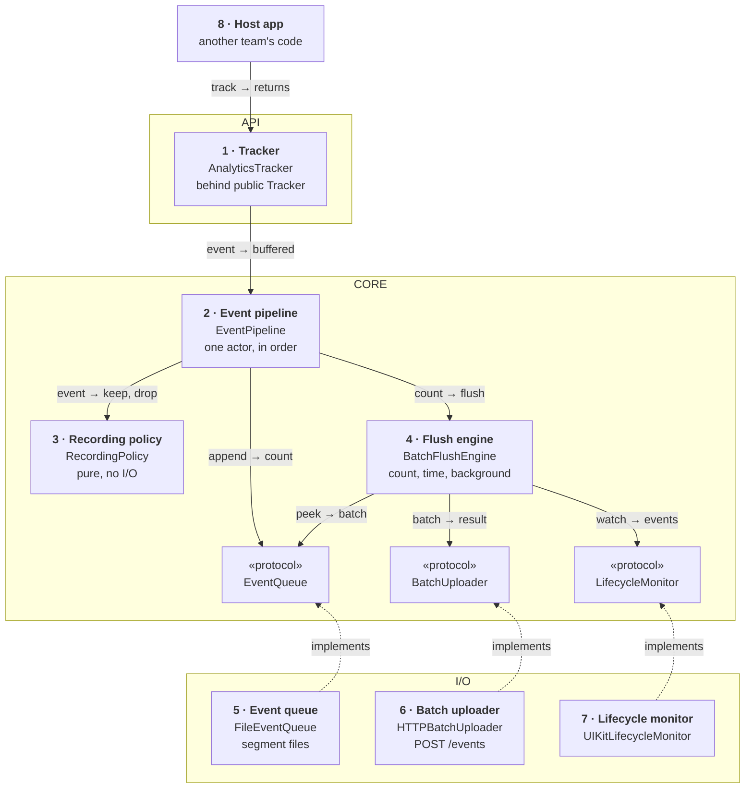
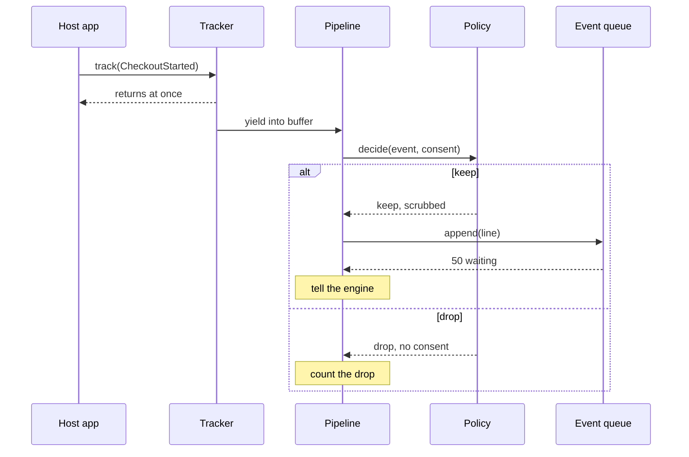
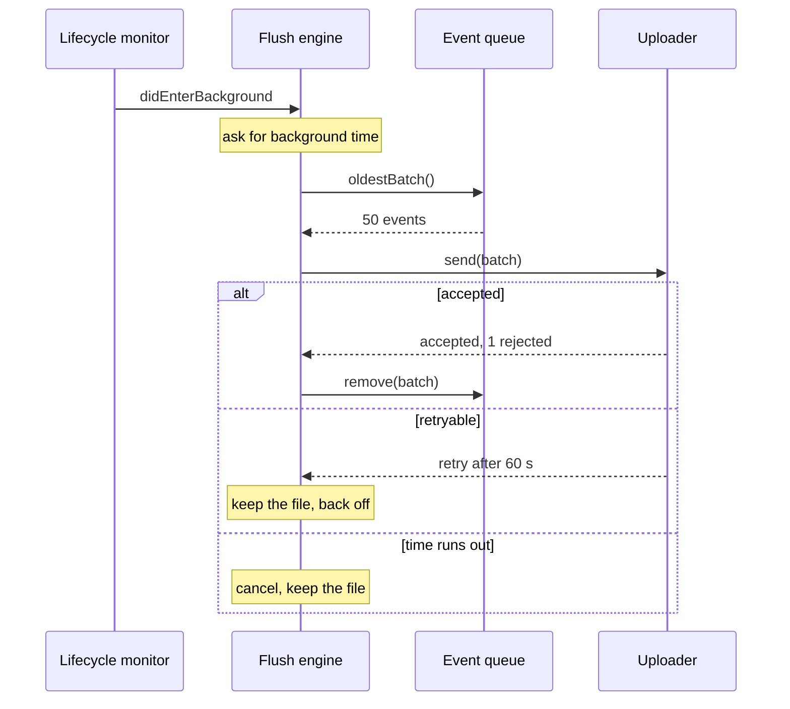

*A general library prompt. The answer stays small: a `track()` that returns at once, events on disk within a moment, batches sent at the right times, and personal data kept out by the API's shape and by consent.*

> **Interviewer:** "Several teams want product analytics in their apps. Design the analytics SDK we'd ship to them."

## Run it as a round, not as reading

Set a timer. Sketch. Talk the whole time. Open a section only when its slot is over.

| Clock | Phase | What you do |
|---|---|---|
| 0:00–0:02 | The prompt | Repeat it back in one sentence |
| 0:02–0:07 | Clarify | Ask yours, then read section 1 |
| 0:07–0:12 | Scope | Out of scope first, then required, then later |
| 0:12–0:24 | High level | The idea · the parts · the sketch · one line each · two flows |
| 0:24–0:40 | Deep dives | The interviewer picks one of sections 9–11 |
| 0:40–0:45 | Recap | Follow-ups, then the 60-second summary |

## What this question is really testing

- **A tiny public API**, and a `track()` that never blocks the caller.
- **Events on disk across launches**, sent in batches, deleted only once the server has them.
- **A flush policy** (count, time, background) that's kind to the battery, with backoff.
- **Caps and a dropping rule**, so a broken network never fills the disk.
- **Privacy:** consent, no personal data, a privacy manifest, and knowing ATT is a different question.

**Traps:** a singleton with no seam for tests; disk writes inside `track()`; a request per event; "ATT is our consent"; deleting before the server confirms; an unbounded queue.

::: Words used in this chapter
- **Repository** — the one owner of one kind of data. It turns the server's format into the app's model. A library has none.
- **Composite** — a repository that only reads: it asks two repositories and combines their answers into one model. None here.
- **Store** — in-memory state that several screens show at once. None here: the SDK has no screens.
- **Use case** — one user intent with a product rule, like "only the latest tap counts". None here: the host's users never talk to the SDK.
- **View model** — the screen's brain. It owns the screen's state and hands the screen one view state. The host's, not ours.
- **Event** — one thing that happened, with a name, a time and a few properties.
- **Batch, segment** — a batch is the events sent in one request; a segment is the file on disk that holds one batch.
- **Flush** — sending what's waiting.
- **Consent** — the user's yes or no to analytics, asked by the host app.
- **Sampling** — keeping only a share of an event, to save cost.
- **PII** — personally identifiable information: names, emails, phone numbers, anything that points at one person.
:::

::: 1 · The interviewer answers your clarifying questions
**"Who adopts it?"** → *Four product teams, in three apps and a widget extension.*

**"What do they send?"** → *Screen views, taps, funnel steps. No crashes, no performance traces.*

**"How many?"** → *Two million daily users, about 200 events each a day.*

**"How fresh?"** → *Within minutes. No real-time dashboards.*

**"Consent?"** → *Each app already has a consent screen. Legal says nothing without a yes.*

**"Backend?"** → *Ours: one ingest endpoint that takes batches.*

**"Can we lose events?"** → *A few, yes. Counting one twice is worse; the server can dedupe if we give it an ID.*

**"How do teams get it?"** → *Swift Package Manager, source, internal repo. iOS 17, Swift 6.*

**"What hurts today?"** → *Every team built its own. One added 300 ms to launch. One sent emails in event properties.*
:::

::: 2 · Requirements and scope — what you should have said
**Out of scope, said first:** dashboards and the ingest backend, crash reporting, A/B testing, remote config, and the consent screen itself (the host's).

**Required for the prompt**

1. A small API: track an event, set consent, flush.
2. Events survive relaunches and go in batches.
3. Consent is enforced and personal data kept out.
4. The host barely notices it: launch, main thread, battery, data.

**What must feel good:** `track()` returns at once · bounded memory and disk · no PII · a fake for tests.

**Production considerations** (say, don't draw): event schema versions, SPM packaging, SDK versions, health metrics. See section 12.

**Optional follow-ups** (add only when asked):

```text
Change sampling without a release → remote config, a kill switch
App and widget share one queue    → an App Group container
Send to two destinations          → a second uploader
Signed-in user across devices     → an opaque user ID, only with consent
```

*"I'll start simple and add each of these when the requirement appears."*
:::

::: 3 · The idea, in 30 seconds — before you draw anything
> *"Host code calls `track(event)`, which copies the event into a bounded buffer and returns. One pipeline actor takes events in order, asks a pure policy whether consent, sampling and size limits allow each one, stamps it with an ID, time, session and schema version, and appends it as a line to a segment file. A flush engine sends the oldest segment as one batch with `POST /events` when 50 wait, every minute in the foreground, and when the app goes to the background. It deletes the file only after the server accepts, and backs off on failure. It's a library, so three frames: the API teams touch, the core that decides, the I/O that does the work."*
:::

::: 4 · What we need — the components, before the sketch
| # | Part | Type | Layer | Its one job |
|---|---|---|---|---|
| 1 | **Tracker** | `AnalyticsTracker` | API | `track`, `setConsent`, `flush`. Never blocks. |
| 2 | **Event pipeline** | `EventPipeline` | Core | Takes events in order, stamps and queues them. |
| 3 | **Recording policy** | `RecordingPolicy` | Core | Keep or drop: consent, sampling, PII, size. |
| 4 | **Flush engine** | `BatchFlushEngine` | Core | When to send, one batch at a time, backoff. |
| 5 | **Event queue** | `FileEventQueue` | I/O | Segment files on disk, with caps. |
| 6 | **Batch uploader** | `HTTPBatchUploader` | I/O | `POST /events` → accepted, retry or discard. |
| 7 | **Lifecycle monitor** | `UIKitLifecycleMonitor` | I/O | Background and foreground, plus background time. |
| 8 | **Host app** | another team's code | Reused | Calls the tracker. |
| chip | **Event queue** | `EventQueue` | Core | The promise card 5 keeps. |
| chip | **Batch uploader** | `BatchUploader` | Core | The promise card 6 keeps. |
| chip | **Lifecycle monitor** | `LifecycleMonitor` | Core | The promise card 7 keeps. |

Eight cards, three chips.

**A library's roles.** Each card ends with a library role that has an app twin: the **tracker** is what callers touch (the view's place), the **pipeline** coordinates, the **queue** is a database of events, the **uploader** is a client, the **monitor** wraps a platform API. Policy and engine keep their app names.

**Not drawn:** the public `Tracker` protocol (written on card 1), and `EventContext`, a value of app version, OS and SDK version read once at startup. **Not on the list yet:** remote config, App Group sharing, a second destination.
:::

::: 5 · The sketch


**How to read it.** A solid arrow points from the asker to the answerer: *request → reply*. Dashed arrows mean *implements*. The grey card is the host's code, not ours.

**Dependency inversion, in one line.** The core writes the three promises (the chips); I/O keeps them, so every dashed arrow points **up** and the core never imports UIKit, the file system or networking.

**Two users, one queue.** The pipeline only appends; the engine reads and removes. The queue is an actor, so they never collide.

**No store on this sketch:** the SDK has no screens.

**On Miro:** three frames, eight cards, three chips, eight solid arrows. Point at card 1: *"this is all the host ever sees."*
:::

::: 6 · Each component: its job, its interface, the choice inside it
**The values everyone passes.**

```swift
public protocol AnalyticsEvent: Sendable {
    /// "checkout_started". A rename is a new event.
    static var name: String { get }
    /// Bumped when a property's meaning or type changes
    static var schemaVersion: Int { get }
    var properties: [String: PropertyValue] { get }
}

/// No Any, no nested dictionaries
public enum PropertyValue: Sendable, Equatable {
    case string(String), int(Int), double(Double), bool(Bool)
}

public enum Consent: Sendable { case unknown, granted, denied }
```

Teams declare events as small structs, so a reviewer sees every property.

### 1 · Tracker (`AnalyticsTracker`)

**Job:** the whole public surface. `track` copies the event into a buffer and returns.

```swift
public protocol Tracker: Sendable {
    /// Never blocks, never throws. Safe from any thread or actor.
    func track(_ event: some AnalyticsEvent)
    /// The host's answer from its consent screen. Applies at once.
    func setConsent(_ consent: Consent)
    /// Sends what's waiting. Returns when this attempt ends.
    /// Cancelling the caller stops waiting, not the send.
    func flush() async
}

public final class AnalyticsTracker: Tracker {
    /// No I/O, no network: makes a buffer and starts the pipeline
    public init(configuration: AnalyticsConfiguration)
}
```

**Choices:**

- **No global singleton.** The host makes one at launch and injects `Tracker`, so its tests pass a fake. A second package product, `AnalyticsTesting`, ships a `RecordingTracker` that keeps events for assertions.
- **The buffer is an `AsyncStream` with `.bufferingNewest(1_000)`.** Yielding is thread-safe and instant; if the pipeline falls 1,000 behind, the oldest go, counted.
- **Launch cost is a budget:** `init` touches no file or socket. Measure with `OSSignposter`, and keep an `XCTApplicationLaunchMetric` test.

### 2 · Event pipeline (`EventPipeline`)

**Job:** takes events from the buffer one at a time, asks the policy, stamps the ones it keeps and appends them to the queue.

```swift
actor EventPipeline {
    init(queue: EventQueue, policy: RecordingPolicy,
         engine: FlushEngine, context: EventContext,
         installID: InstallID, clock: any Clock<Duration>)

    /// Runs until the buffer finishes
    func consume(_ events: AsyncStream<PendingEvent>) async
    /// denied also empties the queue and resets the install ID
    func setConsent(_ consent: Consent) async
}
```

**Choices:**

- **One actor, one order.** Each kept event gets an ID (for server dedupe), a time, a sequence number, the session and its schema version.
- **The session rule:** a new session after 30 minutes with no events.
- **Encoding happens here**, never on the caller's thread.

### 3 · Recording policy (`RecordingPolicy`)

**Job:** decides whether an event may be recorded, and in what form. A pure function.

```swift
enum Decision: Equatable, Sendable {
    case keep(PendingEvent)
    /// noConsent, sampledOut, tooLarge, invalid
    case drop(DropReason)
}

struct RecordingPolicy: Sendable {
    init(sampling: [String: Double], limits: Limits)
    /// Pure: same inputs, same answer
    func decide(_ event: PendingEvent, consent: Consent,
                installID: InstallID) -> Decision
}
```

**Choices:**

- **Sampling per install, not per event:** a hash of install ID and event name against the rate, so one user's funnel stays whole. The rate travels with the event.
- **Scrubbing:** drop keys on a blocklist (`email`, `phone`, `name`), drop string values that look like an email or phone number, cut strings at 256 characters.
- **Pure, so it's tested as a table.**

### 4 · Flush engine (`BatchFlushEngine`)

**Job:** decides when to send, sends one batch at a time, deletes on success, backs off on failure.

```swift
protocol FlushEngine: Sendable {
    /// Starts the triggers. Idempotent. Waits before its first send.
    func start() async
    /// From the pipeline after each append
    func eventsWaiting(_ count: Int) async
    /// Returns when the attempt ends. The caller's cancel stops
    /// waiting, not the send.
    func flushNow() async
}

actor BatchFlushEngine: FlushEngine {
    init(queue: EventQueue, uploader: BatchUploader,
         lifecycle: LifecycleMonitor, clock: any Clock<Duration>,
         policy: FlushConfiguration)
}
```

**Choices:**

- **Triggers:** 50 waiting, every 60 s in the foreground if anything waits, entering the background, and leftovers 10 s after launch (section 10).
- **One send in flight.** A trigger during a send asks for one more round.
- **Delete only after the server accepts.** At least once; event IDs let the server drop repeats.

### 5 · Event queue (`FileEventQueue`)

**Job:** keeps events on disk as segment files, oldest first, within a size cap.

```swift
protocol EventQueue: Sendable {
    /// Appends one encoded event; returns how many wait.
    /// Never throws: over the cap, the oldest segment goes.
    func append(_ line: Data) async -> Int
    /// The oldest closed segment, or nil. Doesn't remove it.
    func oldestBatch() async -> Batch?
    func remove(_ batch: BatchID) async
    func removeAll() async
}

actor FileEventQueue: EventQueue {
    init(directory: URL, files: FileManager, limits: QueueLimits)
}
```

**Choices:**

- **One JSON line per event, written with `FileHandle.write(contentsOf:)`.** A segment closes at 50 events or 256 KB and never changes again; deleting the file *is* removing the batch.
- **Caps, oldest out:** 5 MB and 7 days. Drops are counted.
- **Application Support with `isExcludedFromBackup`**, and file protection that lets a background send read it after first unlock.

### 6 · Batch uploader (`HTTPBatchUploader`)

**Job:** sends one batch with `POST /events` and says what to do next.

```swift
enum UploadResult: Equatable, Sendable {
    /// Indexes the server refused for good
    case accepted(rejected: [Int])
    case retry(after: Duration?)
    /// 400 or 413: the batch can never succeed
    case discard
}

protocol BatchUploader: Sendable {
    /// Never throws: transport errors become .retry.
    /// Cancelling the caller cancels the request.
    func send(_ batch: Batch) async -> UploadResult
}

final class HTTPBatchUploader: BatchUploader {
    init(session: URLSession, endpoint: URL)
}
```

**Choices:**

- **Its own ephemeral session:** no cookies, a 30 s timeout, compressed bodies, never the host's headers.
- **`allowsConstrainedNetworkAccess = false`:** in Low Data Mode, analytics waits.

### 7 · Lifecycle monitor (`UIKitLifecycleMonitor`)

**Job:** tells the engine when the app goes to the background or comes back, and gets it a little time to finish a send.

```swift
protocol LifecycleMonitor: Sendable {
    /// One stream per caller. No replay. Finishes when the
    /// caller's task is cancelled.
    func events() -> AsyncStream<LifecycleEvent>
    /// Runs work with extra background time. Cancels it when
    /// the time runs out.
    func withBackgroundTime(_ work: @Sendable () async -> Void) async
}

struct UIKitLifecycleMonitor: LifecycleMonitor {
    init(center: NotificationCenter)
}
```

**Choices:**

- **`didEnterBackgroundNotification` and `beginBackgroundTask(withName:expirationHandler:)`** in apps. In the widget extension there's no `UIApplication`, so it uses `ProcessInfo.performExpiringActivity(withReason:using:)`.
- **A protocol, so a test can send "background" by hand.**

### 8 · Host app (another team's code)

**Job:** makes one tracker at launch, passes consent, calls `track`. Drawn to answer "who calls this?".

**Why these parts, and no more.** Each card changes for one reason:

| Card | Changes when |
|---|---|
| 1 · Tracker | a platform API (our public API, which teams build on) |
| 2 · Event pipeline | a product rule (sessions, stamping, order) |
| 3 · Recording policy | a product rule (what may be recorded) |
| 4 · Flush engine | a connection's lifecycle (when and how often we send) |
| 5 · Event queue | a storage schema (segments, caps) |
| 6 · Batch uploader | an endpoint or payload |
| 7 · Lifecycle monitor | a platform API (UIKit lifecycle) |
| 8 · Host app | not ours: the host team's code |

Each protocol earns a fake. Not added: a use case or repository (no app rules, no app model), a database library (append-only files are enough), a DI container, a plugin system for destinations.
:::

::: 7 · Key flows through the sketch
**Flow 1 — a tap tracked on the main thread.**



**Flow 2 — the user leaves the app.**



Nothing is ever deleted on a failure. The worst case is a resend, which the server dedupes.
:::

::: 8 · The server contract
```
POST /v1/events
     Content-Encoding: gzip
     { "batchId": "b_19", "sentAt": "2026-10-20T09:14:03Z",
       "context": { "app": "3.2.0", "os": "17.6", "sdk": "1.4.0" },
       "events": [ { "id": "e_8f2", "name": "checkout_started",
                     "schema": 2, "time": "…", "seq": 1042,
                     "session": "s_77", "sampleRate": 1.0,
                     "props": { "items": 3 } } ] }
     → 200 { "rejected": [ { "index": 4, "reason": "unknownSchema" } ] }
     → 429 or 503, Retry-After: 120
     → 400 or 413          // never retried
```

- **Event IDs make retries safe.** The server drops an ID it has seen, so "at least once" from the phone becomes "once" in the data.
- **Partial acceptance.** One bad event doesn't fail fifty good ones; the rejected ones are dropped and counted.
- **The schema version travels with each event**, so the server can read old app versions' events for as long as they're in the wild.
:::

::: 9 · Deep dive — "The app crashes with events in flight. What's lost?"
**Decision:** append each kept event to the open segment as soon as the pipeline has it. The buffer holds milliseconds of events, not minutes.

1. `track()` puts the event in the buffer. Microseconds.
2. The pipeline appends one line with `FileHandle.write(contentsOf:)`. Once the write returns, the bytes belong to the system, so a crash of our process doesn't lose them. Only a power loss right then could.
3. A segment closes at 50 events or 256 KB. Closed segments never change, so a batch is always exactly one file.
4. On the next launch, a half-written last line (a crash mid-write) is skipped, and leftover segments are sent.

**What's lost:** only events still in the buffer, a handful.

*Rejected:* writing inside `track()`. That's file I/O on the caller's thread, usually the main thread.

*Rejected:* keeping events in memory and saving on background. A crash sends no background notification, so minutes of events would vanish.

**Why at least once, not exactly once.** A request can time out after the server stored it. The phone can't tell, so it resends, and the event ID lets the server drop the copy.
:::

::: 10 · Deep dive — "When do you send, and how do you not drain the battery?"
**Decision:** four triggers, one send at a time, and backoff that every trigger respects.

1. **50 waiting:** send now.
2. **Every 60 s in the foreground**, if anything waits.
3. **Entering the background:** close the segment and send, inside the background time the monitor asks for. If time runs out, cancel and keep the file.
4. **After launch:** send leftovers after 10 s, so the SDK doesn't compete with the host's own launch requests.

**Battery is the radio.** It stays up for seconds after each wake, so a few big batches cost far less than many small ones. No timers in the background.

**Backoff:** start at 5 s, double each failure, cap at 30 minutes, add random jitter, and honour `Retry-After`. Reset on success. Jitter matters: after a backend outage, a million phones must not retry in step.

**Data:** batches are compressed, and Low Data Mode waits.

*Rejected:* a request per event (the radio never sleeps) and a scheduled background refresh task (not guaranteed, and the background trigger already covers the gap).
:::

::: 11 · Deep dive — "Legal says nothing personal without consent. Isn't that what ATT is for?"
**Decision:** the host passes consent, the SDK enforces it, and the API's shape keeps personal data out.

1. **Consent states.** `unknown` and `denied` record nothing. Turning to `denied` also deletes the queue and resets the install ID. `granted` records from then on.
2. **ATT is a different question.** `ATTrackingManager` asks permission to *track*: link our data with other companies' data for ads, or share it with data brokers. First-party analytics that stays with us isn't tracking, so the SDK never shows that prompt and never reads the advertising ID. Privacy law still needs the user's yes, and that comes from the host's consent screen.
3. **No personal data by design.** Typed events with plain values, no free-form "user" dictionary, a random install ID instead of a device ID, nothing collected automatically. The policy's scrubbing is the safety net, not the plan.
4. **A privacy manifest in the package.** `PrivacyInfo.xcprivacy` lists the data collected (product interaction), sets `NSPrivacyTracking` to false, and gives a reason for each required-reason API the SDK uses (for example `UserDefaults` or file timestamps). Xcode folds it into the host app's privacy report. If we ever ship a binary, it's signed too.

*Rejected:* buffering events before consent and sending them if the user says yes later. That's collecting before consent.
:::

::: 12 · Failure modes, production and scale
**Failures**

| Failure | SDK behaviour |
|---|---|
| Offline for days | Keep queueing up to 5 MB and 7 days; oldest out, counted |
| 5xx or 429 | Keep the batch; back off; honour `Retry-After` |
| 400 or 413 | Drop that batch, count it; never retry |
| Some events rejected | Drop those, keep the rest |
| Crash mid-write | Skip the torn line next launch |
| Disk full | Appends fail quietly; count the drop |
| Consent revoked | Delete the queue, stop recording |
| Pipeline falls behind | The buffer drops the oldest, counted |

**Production notes** (short, not on the board)

- **Packaging:** one Swift package, products `Analytics` and `AnalyticsTesting`, no third-party dependencies (nothing to conflict with a host's), Swift 6 language mode, and the privacy manifest as a package resource.
- **Versioning:** semantic versions for the SDK; a breaking API change is a major version. The event schema is versioned separately, per event; segments carry a format version so an app update reads old files.
- **Health metrics:** drops by reason, queue depth and send failures, as a sampled event of its own.
- **Threading:** only the `yield` runs on the caller's thread.

**Scale, back of the envelope**, with the interviewer's numbers:

```text
daily users × events each × bytes an event = ingest a day
events a day ÷ batch size                  = requests per phone
```

2M × 200 × 300 bytes is 120 GB a day before compression. One phone sends about four batches, 60 KB. Sampling moves the cost, not the design.

**Grow only when asked**

```text
Sampling changes without a release → remote config, with a kill switch
App and widget share a queue       → segments in an App Group container
A second destination               → a second uploader behind the same protocol
Debug view for teams               → a log the testing product can read
```
:::

::: 13 · Question bank — everything they can push on
Answer out loud first, then open.

### Scope and architecture

<details>
<summary>"Walk me through the layers."</summary>

API: the tracker. Core: the pipeline, the policy, the flush engine and three protocols. I/O: the queue files, the uploader, the lifecycle monitor.
</details>

<details>
<summary>"Why no use case or repository?"</summary>

A use case carries a user's intent; a repository maps a server's format into an app model. The SDK has neither; its rules live in the pipeline and policy.
</details>

<details>
<summary>"Show me dependency inversion."</summary>

The core writes the queue, uploader and lifecycle protocols; I/O implements them. The arrows point up, so the core never imports UIKit or the file system.
</details>

<details>
<summary>"Where does mapping happen?"</summary>

The pipeline turns a typed event into the wire format, with its stamps. The uploader wraps lines into a batch. The host never sees JSON.
</details>

<details>
<summary>"Where does the combined state come from?"</summary>

Nowhere: there are no screens. The disk queue is the only state that matters, and the pipeline and engine reach it through one actor.
</details>

<details>
<summary>"Why not a singleton like most SDKs?"</summary>

A singleton gives the host's tests nothing to swap. An injected `Tracker` can be a fake.
</details>

### The API and threads

<details>
<summary>"Why can't `track()` be async?"</summary>

Every call site would need `await` or a `Task`. Synchronous and instant, with the buffer moving the work off.
</details>

<details>
<summary>"What if a team calls `track()` 10,000 times in a loop?"</summary>

The buffer keeps the newest 1,000 and counts what it drops. The caller never blocks.
</details>

<details>
<summary>"Why typed events and not a dictionary of Any?"</summary>

`Any` isn't `Sendable` and can't be checked. Typed events are reviewable, versioned, and keep accidental personal data out.
</details>

<details>
<summary>"What does the SDK cost at launch?"</summary>

A buffer and a task. No file or network until the first event or 10 s later.
</details>

<details>
<summary>Follow-up chain: "A second instance."</summary>

1. *"A team creates a second tracker."* → Two pipelines would write one folder.
2. *"Fix it."* → One per storage folder: the second `init` with the same folder is a programmer error, caught in debug.
3. *"The widget?"* → Its own folder, unless they share an App Group queue later.
</details>

### Durability and sending

<details>
<summary>"What's lost if the app crashes?"</summary>

Only events still in the buffer. Appended lines survive a crash.
</details>

<details>
<summary>"When do you delete events?"</summary>

After the server accepts the batch. Never on a failure, and only the rejected ones on partial acceptance.
</details>

<details>
<summary>"How do you avoid counting an event twice?"</summary>

Each event has an ID; the server drops repeats. The phone sends at least once.
</details>

<details>
<summary>"Why batch by count and time, not only count?"</summary>

A quiet user might never reach 50. The timer and background trigger still send within minutes.
</details>

<details>
<summary>"How do you back off?"</summary>

Double from 5 s to 30 minutes, with jitter and `Retry-After`. Success resets it.
</details>

<details>
<summary>"The user is offline for a week."</summary>

The queue grows to its 5 MB cap and drops the oldest segments, counted. Events older than 7 days are dropped too.
</details>

<details>
<summary>Follow-up chain: "Backgrounding."</summary>

1. *"The user leaves the app with 30 events waiting."* → Close the segment, send it inside background time.
2. *"Time runs out mid-send."* → Cancel and keep the file.
3. *"It arrived anyway?"* → The resend next launch carries the same IDs; the server drops them.
</details>

### Privacy

<details>
<summary>"Do we need the ATT prompt?"</summary>

No, unless we link data with other companies' for ads or share it with brokers. ATT is about tracking, not about consent to analytics.
</details>

<details>
<summary>"What happens before the user answers?"</summary>

Nothing is recorded. Buffering and sending later would be collecting before consent.
</details>

<details>
<summary>"How do you stop a team sending emails?"</summary>

Typed events with reviewed properties first, then the policy drops blocklisted keys and email-shaped values.
</details>

<details>
<summary>"What goes in the privacy manifest?"</summary>

The data types collected, tracking set to false, and a reason for each required-reason API the SDK uses. It ships inside the package.
</details>

### Change and testing

<details>
<summary>"A team renames a property."</summary>

Bump that event's schema version. Old app versions keep sending the old one, and the server reads both.
</details>

<details>
<summary>"How do host teams test their analytics?"</summary>

Inject `RecordingTracker` from `AnalyticsTesting` and assert on the events it kept. No network, no files.
</details>

<details>
<summary>"How do you test the SDK?"</summary>

The policy as a table. The engine with fakes and a test clock: 50 events → one send, a 503 → backoff. The queue in a temp folder, torn line included.
</details>

<details>
<summary>Follow-up chain: "Two weeks instead of six."</summary>

1. *"What do you cut?"* → Sampling and the health events.
2. *"What can't you cut?"* → The non-blocking `track`, the disk queue, delete-after-accept, consent.
3. *"Risk?"* → Higher ingest cost until sampling ships.
</details>
:::

::: 14 · Scorecard — mark yourself, 0 / 1 / 2
| | Did you… | 0–2 |
|---|---|---|
| 1 | Talk the whole time, and listen when interrupted | |
| 2 | Clarify before designing | |
| 3 | Give a trade-off for each choice | |
| 4 | Say out of scope first; separate required from later | |
| 5 | Say the idea, list the parts, then sketch | |
| 6 | Keep the sketch to nine type cards, one line each | |
| 7 | Name the endpoint and its partial-acceptance reply | |
| 8 | Keep the public API to track, consent and flush, with no singleton | |
| 9 | Make `track()` non-blocking with a bounded buffer | |
| 10 | Persist events in segments; delete only after the server accepts | |
| 11 | Flush on count, time and background, with jittered backoff | |
| 12 | Cap disk and memory, and count every drop | |
| 13 | Separate consent from ATT; mention the privacy manifest | |
| 14 | Land the recap inside 60 seconds | |

14+ is a pass.<!--private--> Anything scored 0 goes in the progress log and comes back as a recall prompt.<!--/private--><!--public--> A zero names the thing to read about next.<!--/public-->
:::

::: 15 · The 60-second recap
Host teams get one injected `Tracker` with three calls: track, set consent, flush. `track()` copies a typed event into a bounded buffer and returns, so the main thread never waits. One pipeline actor asks a pure policy about consent, sampling, size and personal data, stamps each kept event with an ID, time, session and schema version, and appends it as a line to a segment file, so a crash loses almost nothing. A flush engine sends the oldest segment with `POST /events` when 50 wait, every minute in the foreground, on backgrounding and after launch, deletes it only once the server accepts, and backs off with jitter. The queue is capped by size and age. Consent comes from the host; ATT is a separate question, and the package ships its own privacy manifest.
:::
