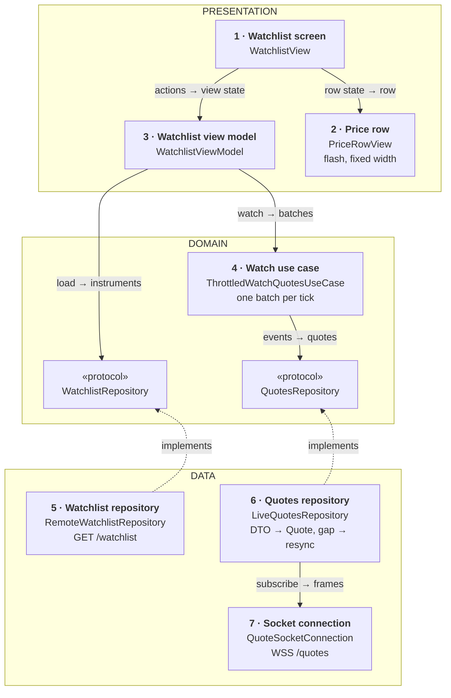
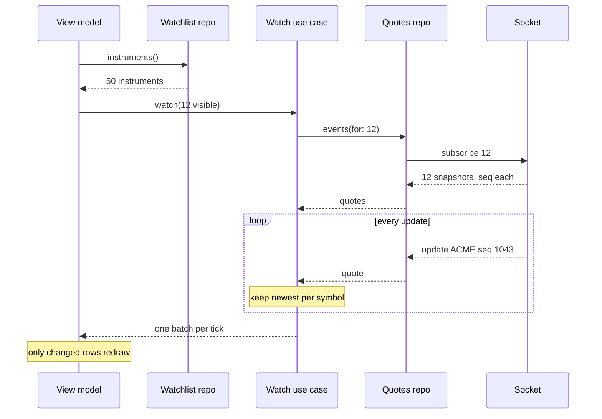
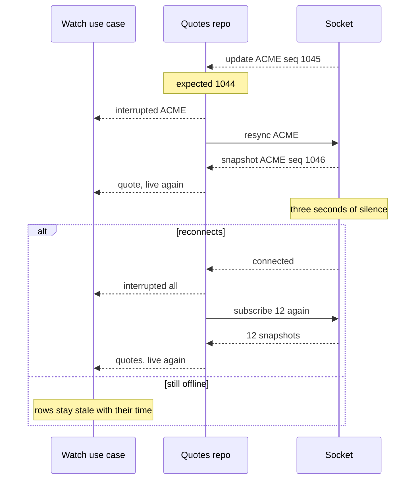

*A common prompt at trading and fintech apps. The answer stays small: one socket, a snapshot then numbered updates, and a rule that the screen redraws a few times a second however fast the prices arrive.*

> **Interviewer:** "Design a screen showing live prices that update several times a second. Think of a watchlist of about fifty instruments in a trading app."

**Cold run: don't read about this topic beforehand. Run it, then open the answer.**

## Run it as a round, not as reading

Set a timer. Sketch. Talk the whole time. Open a section only when its slot is over.

| Clock | Phase | What you do |
|---|---|---|
| 0:00–0:02 | The prompt | Repeat it back in one sentence |
| 0:02–0:07 | Clarify | Ask yours, then read section 1 |
| 0:07–0:12 | Scope | Out of scope first, then required, then later |
| 0:12–0:24 | High level | The idea · the parts · the sketch · one line each · two flows |
| 0:24–0:40 | Deep dives | The interviewer picks one of sections 9–11 |
| 0:40–0:45 | Recap | Follow-ups, then the 60-second summary |

## What this question is really testing

- **Coalescing:** the network rate is not the screen rate. Keep the latest price per instrument and redraw on a fixed tick.
- **Snapshot, then numbered updates**, and what you do when a number is missing.
- **A socket that dies quietly**, and comes back with the same subscriptions.
- **Honesty about age.** A price you can't vouch for is never shown as live.
- **The main actor's budget**, and which rows SwiftUI actually redraws.

**Traps:** one main-actor update per message; `Double` for prices; trusting an open socket; showing the last price as live after a disconnect; VoiceOver announcing every tick.

::: Words used in this chapter
- **Repository** — the one owner of one kind of data. It turns the server's format into the app's model.
- **Composite** — a repository that only reads: it asks two repositories and combines their answers into one model.
- **Store** — in-memory state that several screens show at once. Not needed here yet.
- **Use case** — one user intent with a product rule, like "only the latest tap counts".
- **View model** — the screen's brain. It owns the screen's state and hands the screen one view state.
- **WebSocket** — one connection that stays open, so the server can push messages.
- **Snapshot, update** — a snapshot is the full current price; an update says only what changed.
- **Sequence number** — a counter on every update, so a missing one is noticed.
- **Coalescing** — keeping only the newest price per instrument between redraws.
- **Tick** — the fixed moment, four times a second, when the screen redraws.
- **Stale** — a price that may be out of date, shown with its time.
- **Backoff with jitter** — waiting longer after each failed reconnect, with a random spread.
:::

::: 1 · The interviewer answers your clarifying questions
**"What instruments, and what precision?"** → *Stocks and ETFs, quoted in euros or dollars to the cent. FX and crypto later.*

**"How fast do prices move?"** → *A busy stock updates up to ten times a second. Fifty instruments, so a few hundred messages a second at peak.*

**"What does a row show?"** → *Name, last price, change since yesterday's close, and a short flash when the price moves.*

**"Is there a socket already?"** → *Yes, a WebSocket that pushes prices. Tell me what you need from it.*

**"Other screens with live prices?"** → *An instrument detail screen later. Just the watchlist now.*

**"Editing the watchlist? Trading?"** → *Both out of scope.*

**"What if prices can't be live?"** → *Regulators care that we never show an old price as current.*

**"Minimum OS?"** → *iOS 17, SwiftUI, Swift 6.*

**"What hurts today?"** → *The app gets hot, the list stutters, and after a tunnel the prices sometimes freeze without saying so.*
:::

::: 2 · Requirements and scope — what you should have said
**Out of scope, said first:** trading, editing the watchlist, charts, alerts, order books, the detail screen.

**Required for the prompt**

1. Show the watchlist with live prices and change since close.
2. A brief flash when a price moves, up or down.
3. Mark any price that may be out of date, with its time, and recover by itself.

**What must feel good:** smooth while prices stream · never a wrong or old price shown as live · cool phone, modest data · calm for VoiceOver.

**Production considerations** (say, don't draw): auth on the socket, server-side conflation, metrics. See section 12.

**Optional follow-ups** (add only when asked):

```text
An instrument detail screen  → the same use case, a second caller
A portfolio total in the tab → a shared quote store
Charts per instrument        → history endpoint, a frame-rate tick
FX and crypto                → a price scale per instrument
```

*"I'll add each of these when the requirement appears."*
:::

::: 3 · The idea, in 30 seconds — before you draw anything
> *"A watchlist repository calls `GET /watchlist` for the instruments in order. One socket connection holds `WSS /quotes` while the app is in the foreground. A quotes repository subscribes only to the rows on screen, takes a snapshot then numbered updates, and resyncs any instrument whose numbers jump. A watch use case keeps the newest price per instrument and hands the view model one batch per tick, four times a second, with any price we can't vouch for marked stale. The view model turns batches into rows, and each row redraws only when its own values change."*
:::

::: 4 · What we need — the components, before the sketch
| # | Part | Type | Layer | Its one job |
|---|---|---|---|---|
| 1 | **Watchlist screen** | `WatchlistView` | Presentation | Draws the list, reports visible rows. |
| 2 | **Price row** | `PriceRowView` | Presentation | One row, the flash, the accessibility label. |
| 3 | **Watchlist view model** | `WatchlistViewModel` | Presentation | Instruments + batches → one view state. |
| 4 | **Watch use case** | `ThrottledWatchQuotesUseCase` | Domain | Newest price per tick, stale marked. |
| 5 | **Watchlist repository** | `RemoteWatchlistRepository` | Data | `GET /watchlist` → instruments. |
| 6 | **Quotes repository** | `LiveQuotesRepository` | Data | Subscriptions, snapshots, sequence checks. |
| 7 | **Socket connection** | `QuoteSocketConnection` | Data | One `WSS /quotes` socket, reconnects. |
| chip | **Watchlist repository** | `WatchlistRepository` | Domain | The promise card 5 keeps. |
| chip | **Quotes repository** | `QuotesRepository` | Domain | The promise card 6 keeps. |

Seven cards, two chips. `Quote` isn't a card; it's written on card 6.

**No use case for loading the list:** it's one call with no rule. Watching prices has one a product manager would say: "at most four refreshes a second, always the newest, and never an old price shown as live".

**Not drawn:** the `HTTPClient` card 5 uses, and a `NetworkMonitor` (protocol `NetworkStatus`) over `NWPathMonitor` that tells card 7 to retry at once when the network comes back. **Not on the list yet:** everything under "optional follow-ups".
:::

::: 5 · The sketch


**How to read it.** A solid arrow points from the asker to the answerer: *request → reply*. Dashed arrows mean *implements*; orange is the one network connection.

**Dependency inversion, in one line.** The domain writes the two promises (the chips); cards 5 and 6 keep them, so both dashed arrows point **up** and the view model and use case never see a socket.

**Where the rates change.** Cards 7, 6 and 4 run off the main actor at the network's rate; only card 4's tick reaches card 3.

**No shared store on this sketch:** one screen shows the prices. A portfolio total in the tab bar would add one.

**On Miro:** three frames (blue, purple, green), seven cards, two chips, six solid arrows. Point at card 4: *"hundreds of messages in, four batches a second out."*
:::

::: 6 · Each component: its job, its interface, the choice inside it
**The models everyone shares.** The screen never sees a DTO.

```swift
struct Money: Equatable, Sendable {
    /// Cents for EUR and USD
    let minorUnits: Int
    /// ISO code, which gives the exponent
    let currency: String
}

struct Quote: Equatable, Sendable {
    let symbol: Symbol
    let last: Money
    let previousClose: Money
    /// Server time of this price
    let time: Date
}

struct Instrument: Identifiable, Hashable, Sendable {
    let id: Symbol
    let name: String
}
```

Never `Double`: 0.1 + 0.2 isn't 0.3 in binary, and a price must add up to the cent. The view model formats `Decimal(minorUnits)` scaled by the currency's exponent with `Decimal.FormatStyle.Currency`.

### 1 · Watchlist screen (`WatchlistView`)

**Job:** draws the list and the banner, and reports which rows are on screen. It decides nothing.

**Interface:** reads `viewModel.viewState`; calls `onAppear()`, `visibleRowsChanged(_:)`, `retry()`.

**Choice:** a SwiftUI `List` with one `PriceRowView` per row, identified by symbol. On iOS 17 rows report visibility from `.onAppear` and `.onDisappear`; on iOS 18 `onScrollTargetVisibilityChange` reports the visible set directly.

### 2 · Price row (`PriceRowView`)

**Job:** draws one row from its row state: name, price, change, the flash and the stale time.

**Interface:** `PriceRowView(state: PriceRowState)`, an `Equatable` view (or wrapped in `.equatable()`), so SwiftUI skips it when its state hasn't changed.

**Choices:**

- **No layout change on a tick.** Digits use `monospacedDigit()` and the price column has a fixed width, so a new price never moves its neighbours.
- **The flash is a background tint that fades**, drawn behind the text, never a size change. With Reduce Motion on (`accessibilityReduceMotion`), only the arrow and colour change.
- **Stale time with `Text(date, style: .relative)`.** The system updates "12 sec ago" itself, so the age costs the view model nothing.

### 3 · Watchlist view model (`WatchlistViewModel`)

**Job:** loads the instruments, watches the visible ones, and turns each batch into rows.

```swift
struct WatchlistViewState: Equatable {
    let rows: [PriceRowState]
    /// loading, loaded, failed(message): the instrument list
    let list: LoadState
    /// nil, or "Reconnecting. Prices may be out of date."
    let banner: String?
}

struct PriceRowState: Equatable, Identifiable {
    let id: Symbol
    let name: String
    /// "€182.40", nil until the first quote
    let price: String?
    /// "+1.24 %"
    let change: String?
    /// up or down, plus a counter so the same direction flashes again
    let flash: Flash?
    /// nil while live, else the time of the last price
    let staleSince: Date?
    /// "Acme, 182 euros 40, up 1.2 percent"
    let accessibilityLabel: String
}

@MainActor @Observable
final class WatchlistViewModel {
    init(watchlist: WatchlistRepository, quotes: WatchQuotesUseCase)

    var viewState: WatchlistViewState { get }

    func onAppear() async
    /// The rows on screen, once scrolling settles
    func visibleRowsChanged(_ ids: Set<Symbol>)
    func retry() async
}
```

**Choices:**

- **One watch at a time.** A new visible set starts a new `watch` and cancels the old task; the repository keeps overlapping subscriptions open (section 11).
- **The stale-result guard is a watch generation.** A batch from a cancelled watch carries the old generation and is dropped.
- **Formatting happens here**, once per changed row per tick.
- **It joins two sources by symbol**, not a composite: the list loads once and the prices tick, so a composite would only turn a list into a stream.

### 4 · Watch use case (`ThrottledWatchQuotesUseCase`)

**Job:** keeps the newest quote per symbol and emits at most one batch per tick, with untrusted prices marked stale.

```swift
enum Freshness: Equatable, Sendable {
    case live
    case stale(since: Date)
}

struct LiveQuote: Equatable, Sendable {
    /// nil until the first snapshot
    let quote: Quote?
    let freshness: Freshness
}

struct QuoteBatch: Equatable, Sendable {
    /// Only the symbols whose quote or freshness changed
    let changes: [Symbol: LiveQuote]
}

protocol WatchQuotesUseCase: Sendable {
    /// Replays the latest known quotes first, then one batch per tick.
    /// Never throws: a dead feed shows as stale, not as an error.
    /// One stream per caller, off the main actor. Finishes when the
    /// caller's task is cancelled, which releases the symbols.
    func watch(_ symbols: Set<Symbol>) -> AsyncStream<QuoteBatch>
}

struct ThrottledWatchQuotesUseCase: WatchQuotesUseCase {
    init(quotes: QuotesRepository, clock: any Clock<Duration>, tick: Duration)
}
```

**Choices:**

- **The rule a product manager would state:** at most four refreshes a second, always the newest, and never an old price shown as live. That's why it's a use case.
- **No per-item state of its own.** Each `watch` call gets its own buffer inside its stream, so the type is a plain struct and needs no app-wide instance.
- **The tick is injected** with the clock: 250 ms, or 1 s in Low Power Mode (`isLowPowerModeEnabled`). Tests drive a fake clock.

### 5 · Watchlist repository (`RemoteWatchlistRepository`)

**Job:** fetches `GET /watchlist` and maps each DTO to an `Instrument`.

```swift
protocol WatchlistRepository: Sendable {
    /// In display order. Throws on failure.
    /// Cancelling the caller cancels the request.
    func instruments() async throws -> [Instrument]
}
```

**Choice:** a thin adapter; the server owns the order.

### 6 · Quotes repository (`LiveQuotesRepository`)

**Job:** owns live quotes: which symbols are subscribed, the last sequence number of each, and the latest quote. It maps frames to `Quote`s and resyncs any symbol with a gap.

```swift
enum QuoteEvent: Sendable {
    case quote(Quote)
    /// May be out of date (gap or disconnect) until the next snapshot
    case interrupted(Set<Symbol>)
}

protocol QuotesRepository: Sendable {
    /// Replays the cached quote of each symbol, then events in order.
    /// Never throws. One stream per caller. Cancelling releases the
    /// symbols, unsubscribed after a short grace if nobody else wants them.
    func events(for symbols: Set<Symbol>) -> AsyncStream<QuoteEvent>
}

actor LiveQuotesRepository: QuotesRepository {
    init(socket: QuoteSocket)
}
```

**Choices:**

- **A count per symbol, a diff on the wire.** Two callers watching the same symbol mean one subscription, and only additions and removals are sent.
- **Sequence numbers per symbol** (section 10). The check is a pure helper inside this card, because it changes with the payload.
- **The snapshot comes over the same socket**, so it's ordered with the updates. An HTTP snapshot would race the stream.

### 7 · Socket connection (`QuoteSocketConnection`)

**Job:** holds one WebSocket while the app is in the foreground, reconnects when it drops, and hands frames to card 6.

```swift
/// Data-internal: what card 6 needs
protocol QuoteSocket: Sendable {
    /// Frames as DTOs, plus .connected after every (re)connect.
    /// One subscriber, the quotes repository.
    func frames() -> AsyncStream<SocketEvent>
    /// Throws if not connected; card 6 resends after .connected
    func send(_ command: QuoteCommandDTO) async throws
}

actor QuoteSocketConnection: QuoteSocket {
    init(session: URLSession, url: URL, tokens: TokenProvider)
    /// Driven by scenePhase: active → start, background → stop
    func start()
    func stop()
}
```

**Choices:**

- **`URLSessionWebSocketTask`**, read with `receive()` in a loop. No third-party library.
- **A quiet socket can look open.** The server sends a heartbeat every second; three seconds of silence, or a missed `sendPing` reply, means dead: close and reconnect.
- **Backoff with jitter:** 0.5 s, 1, 2, 4, capped at 30 s, each with a random spread so a crowd doesn't reconnect at once. A network-back signal retries at once.

**Why these parts, and no more.** Each card changes for one reason:

| Card | Changes when |
|---|---|
| 1 · Watchlist screen | the screen's design |
| 2 · Price row | the screen's design (the row, the flash) |
| 3 · View model | the screen's behaviour |
| 4 · Watch use case | a product rule (rate, staleness) |
| 5 · Watchlist repository | an endpoint or payload (`/watchlist`) |
| 6 · Quotes repository | an endpoint or payload (the quote frames) |
| 7 · Socket connection | a connection's lifecycle |

Each protocol earns a fake. Not added: a composite, a store, a use case for loading, a protocol for the view model.
:::

::: 7 · Key flows through the sketch
**Flow 1 — opening the watchlist.**



**Flow 2 — a gap, then a tunnel.**


:::

::: 8 · The server contract
```
GET  /v1/watchlist
     → { "instruments": [ { "symbol": "ACME", "name": "Acme" } ] }

WSS  /v1/quotes                         // token in the first frame
  →  { "type": "subscribe",   "symbols": ["ACME"], "maxRate": 4 }
  →  { "type": "unsubscribe", "symbols": ["ACME"] }
  →  { "type": "resync",      "symbols": ["ACME"] }
  ←  { "type": "snapshot", "symbol": "ACME", "seq": 1042,
       "last": 18240, "previousClose": 18010,
       "currency": "EUR", "time": "…" }
  ←  { "type": "update", "symbol": "ACME", "seq": 1043,
       "last": 18245, "time": "…" }
  ←  { "type": "heartbeat", "time": "…" }
```

- **Prices in minor units with a currency**, so the client never parses a decimal string or a float.
- **A sequence number per symbol, and the snapshot on the same socket**, so ordering is the server's promise and a gap is detectable.
- **A heartbeat and `maxRate`.** Silence means dead, not quiet. The server conflates to four a second, and the client still coalesces, because the network bunches frames.
:::

::: 9 · Deep dive — "Three hundred messages a second. What touches the main actor?"
**Decision:** the network rate never reaches the main actor. Card 4 coalesces; the view model sees four batches a second.

1. Card 7 receives frames on its actor. Card 6 decodes and checks sequence numbers on its own actor.
2. Card 4 writes each quote into its buffer: newest per symbol wins. An older one is overwritten.
3. On each tick, if anything changed, it emits one batch with only those symbols.
4. The view model, on the main actor, rebuilds only those rows. A tick with no changes emits nothing.

**Rejected: one main-actor hop per message.** Three hundred re-renders a second nobody can read. That's the hot phone.

**Rejected: once per frame.** Sixty or 120 updates a second is right for a chart, wrong for digits. People read a price, not an animation.

**What SwiftUI redraws.** `@Observable` tracks properties, not array elements: the list re-reads `rows` on each batch. Each `PriceRowView` is `Equatable`, so only changed rows run their body; fifty comparisons four times a second is nothing. If Instruments shows the list itself as hot, give each row its own small observable cell. Measure first.

**Flash without layout churn.** The row state carries `Flash(direction, counter)`. A new counter starts a short tint animation behind the text. Monospaced digits and a fixed-width column mean nothing moves.
:::

::: 10 · Deep dive — "The train goes into a tunnel. What does the user see?"
**Decision:** freshness is the server's sequence and heartbeat, never "the last value I have".

**A gap in the numbers:**

1. Card 6 expects `last + 1`. A smaller number is a duplicate, dropped.
2. A bigger number means updates were lost. Mark the symbol interrupted and send `resync`.
3. Until the new snapshot, the row shows its last price dimmed, with "12 sec ago".
4. The snapshot carries a sequence number; updates after it apply as usual.

**A dead socket:**

1. No frame for three seconds → dead. Close it and mark every symbol interrupted.
2. Reconnect with backoff and jitter. A token refresh first if the close said "expired".
3. On `.connected`, resubscribe the current set. Each symbol gets a fresh snapshot.
4. The banner says "Reconnecting" after two seconds, so a blip doesn't flicker it.

**Background:** on `scenePhase == .background`, card 7 closes the socket. iOS would suspend it anyway, and old prices are worthless. On return, steps 2–4 again; rows show stale until their snapshot lands, usually in under a second.

*Rejected:* an HTTP snapshot on reconnect. It arrives on another channel, so an update can land before or after it, and the client can't order them.
:::

::: 11 · Deep dive — "Why only the visible rows? And what does VoiceOver hear?"
**Decision:** subscribe to what's on screen plus a few rows of margin, and let VoiceOver read on focus, not on change.

**Visible-only subscriptions:**

1. Rows report appearing and disappearing. The view model waits until scrolling settles (about 300 ms).
2. It starts a new `watch` with the visible set; the old one is cancelled.
3. Card 6 counts per symbol. A released symbol is unsubscribed only after two seconds, so a fling back doesn't unsubscribe and resubscribe.
4. A row that scrolls back in shows its cached price at once, marked stale until an update arrives.

Twelve symbols instead of fifty cuts traffic by three quarters.

**VoiceOver:**

- **One element per row**, with a label like "Acme, 182 euros 40, up 1.2 percent". The view model builds it from the same values.
- **The `updatesFrequently` trait**, so VoiceOver reads the new value when the user lingers, not on every tick.
- **No announcements per price.** Posting one per change would talk over everything. Announce only "Prices may be out of date" when the banner appears.
- **Colour is never the only signal:** an arrow and a sign go with red and green.
:::

::: 12 · Failure modes, production and scale
**Failures**

| Failure | Client behaviour |
|---|---|
| Watchlist fails | Full-screen error with retry |
| Socket drops | Rows stale with their age; reconnect with backoff |
| Gap in sequence | That symbol stale, resync, live again |
| Duplicate or old update | Dropped by sequence |
| Token expired on the socket | Refresh, reconnect, resubscribe |
| Offline for long | Banner, stale rows, retry when the network returns |
| App backgrounded | Socket closed; reconnect and snapshots on return |

**Production notes** (short, not on the board)

- **Networking:** a short-lived socket token in the first frame; HTTP timeouts and safe retries.
- **Battery and data:** visible-only subscriptions, server-side `maxRate`, a slower tick in Low Power Mode, no socket in the background.
- **Metrics:** time to first price, reconnects per hour, gaps per hour, share of rows shown stale, main-thread hitches.

**Scale, back of the envelope**

```text
symbols subscribed × updates a second × bytes a frame = bandwidth
12 × 5 × 100 B ≈ 6 KB/s ≈ 22 MB an hour on cellular
50 × 5 × 100 B ≈ 25 KB/s ≈ 90 MB an hour
```

Subscriptions and server conflation move the cost; the tick keeps the main actor at about 50 row updates a second, worst case.

**Grow only when asked**

```text
One screen                → the view model joins list and prices
A detail screen           → a second caller of the same use case
A total in the tab bar    → a shared quote store both read
Charts                    → a frame-rate tick for that view only
FX and crypto             → a price scale per instrument, Decimal
```
:::

::: 13 · Question bank — everything they can push on
Answer out loud first, then open.

### Scope and architecture

<details>
<summary>"Walk me through the layers."</summary>

Presentation: the screen, the row and the view model. Domain: `Quote`, the two protocols, the watch use case. Data: the watchlist repository, the quotes repository and the socket connection.
</details>

<details>
<summary>"Why does watching get a use case and loading doesn't?"</summary>

Watching has a product rule: four refreshes a second at most, newest wins, and old prices are marked. Loading the list is one call with no rule.
</details>

<details>
<summary>"Show me dependency inversion."</summary>

The two repository protocols live in the domain; cards 5 and 6 implement them. The view model and use case never import the socket, so a test feeds them fake events.
</details>

<details>
<summary>"Where does mapping happen?"</summary>

In each repository: card 5 maps the watchlist DTO, card 6 maps frames to `Quote`. Card 7 only returns frames.
</details>

<details>
<summary>"Where does the combined row come from?"</summary>

The view model joins instruments and quotes by symbol. No composite: one source loads once, the other ticks. No store: one screen.
</details>

<details>
<summary>"Why is the socket its own card?"</summary>

It has a lifecycle: start, stop, heartbeat, reconnect. A repository doesn't run loops, so the connection does.
</details>

### Coalescing and the main actor

<details>
<summary>"Why not update the UI on every message?"</summary>

Hundreds of main-actor hops a second, for digits nobody can read that fast. Coalescing keeps the newest per symbol and redraws four times a second.
</details>

<details>
<summary>"Why a fixed tick and not per frame?"</summary>

Per frame suits a chart. A price is read, so four a second is plenty.
</details>

<details>
<summary>"Which rows redraw on a tick?"</summary>

The list re-reads its rows, but each row is `Equatable`, so only changed rows run their body. Per-row observable cells only if measured hot.
</details>

<details>
<summary>"Why not `Double`?"</summary>

Binary floats can't hold most cents exactly. Minor units as integers, formatted through `Decimal` with the currency's exponent.
</details>

<details>
<summary>Follow-up chain: "The phone gets hot."</summary>

1. *"Where do you look?"* → Instruments: main-thread time and hitches during streaming.
2. *"The view model updates 300 times a second."* → Something bypasses the tick. Every quote must go through card 4.
3. *"Still warm."* → Fewer subscriptions, server `maxRate`, a slower tick in Low Power Mode.
4. *"What do you lose?"* → Nothing the eye sees.
</details>

### Ordering and freshness

<details>
<summary>"What's the sequence number for?"</summary>

Updates only carry what changed, so a missing one leaves a wrong price. The number shows the gap, and a resync fixes it.
</details>

<details>
<summary>"An update arrives with an older number."</summary>

A duplicate or late; drop it.
</details>

<details>
<summary>"Why the snapshot on the socket and not over HTTP?"</summary>

Same channel, same order. Over HTTP, an update could land before or after the snapshot and the client couldn't tell.
</details>

<details>
<summary>"How do you know the socket is dead?"</summary>

Heartbeats every second; three seconds of silence, or no pong, means dead. An open socket proves nothing.
</details>

<details>
<summary>"What does a stale row look like?"</summary>

The last price dimmed, with "12 sec ago" that the system ticks. Never shown as live.
</details>

<details>
<summary>Follow-up chain: "Reconnect."</summary>

1. *"The socket drops."* → Every symbol interrupted, rows stale.
2. *"How fast do you retry?"* → Backoff with jitter, capped at 30 s; at once when the network returns.
3. *"Connected again."* → Resubscribe the current set; fresh snapshots.
4. *"Ten thousand phones reconnect after an outage."* → The jitter spreads them.
</details>

### Lifecycle, subscriptions and accessibility

<details>
<summary>"What happens in the background?"</summary>

The socket closes. On return it reconnects and resubscribes, and rows show stale until snapshots land.
</details>

<details>
<summary>"Why subscribe only to visible rows?"</summary>

A quarter of the traffic and decoding. The cached price shows at once when a row comes back.
</details>

<details>
<summary>"The user flings up and down."</summary>

The view model waits for scrolling to settle, and card 6 waits two seconds before unsubscribing, so nothing churns.
</details>

<details>
<summary>"What does VoiceOver say?"</summary>

The row's combined label when focused, refreshed thanks to `updatesFrequently`. No announcement per tick.
</details>

### Production and change

<details>
<summary>Follow-up chain: "A second screen."</summary>

1. *"The detail screen shows Acme live."* → It calls the same use case.
2. *"Two subscriptions?"* → No, card 6 counts per symbol.
3. *"A total in the tab bar."* → Now several screens show the same values: a shared quote store fed by one watch.
4. *"When wouldn't you?"* → With one screen.
</details>

<details>
<summary>"How do you test the throttle?"</summary>

The use case with a fake repository and a fake clock: push ten quotes, advance 250 ms, expect one batch with the newest.
</details>

<details>
<summary>"FX arrives with five decimals."</summary>

The server sends a price scale per instrument; the price becomes an integer and that scale, formatted through `Decimal`. Still no `Double`.
</details>

<details>
<summary>Follow-up chain: "Two weeks instead of six."</summary>

1. *"What do you cut?"* → Visible-only subscriptions and Low Power tuning.
2. *"What can't you cut?"* → Sequence checks, staleness, coalescing, reconnect.
3. *"Risk?"* → More data on cellular. Fixable next release.
</details>
:::

::: 14 · Scorecard — mark yourself, 0 / 1 / 2
| | Did you… | 0–2 |
|---|---|---|
| 1 | Talk the whole time, and listen when interrupted | |
| 2 | Clarify before designing | |
| 3 | Give a trade-off for each choice | |
| 4 | Say out of scope first; separate required from later | |
| 5 | Say the idea, list the parts, then sketch | |
| 6 | Keep the sketch to nine type cards, one line each | |
| 7 | Name the endpoints: `GET /watchlist`, `WSS /quotes` and its frames | |
| 8 | Coalesce to a fixed tick, off the main actor | |
| 9 | Use snapshot plus numbered updates, and resync on a gap | |
| 10 | Detect a dead socket with heartbeats; backoff with jitter | |
| 11 | Mark stale prices with their age, never as live | |
| 12 | Use minor units, never `Double` | |
| 13 | Say which rows redraw, and keep the flash from moving layout | |
| 14 | Land the recap inside 60 seconds | |

14+ is a pass.<!--private--> Anything scored 0 goes in the progress log and comes back as a recall prompt.<!--/private--><!--public--> A zero names the thing to read about next.<!--/public-->
:::

::: 15 · The 60-second recap
The watchlist comes from `GET /watchlist`, and prices from one `WSS /quotes` socket that lives only in the foreground, with heartbeats to spot a dead one and backoff with jitter to come back. A quotes repository subscribes only to the visible rows, takes a snapshot then numbered updates, and resyncs a symbol when a number is missing. A watch use case keeps the newest price per symbol and hands the main-actor view model one batch per tick, four times a second, marking any price it can't vouch for as stale with its age. Prices are integers in minor units, rows are `Equatable` so only changed ones redraw, the flash never moves the layout, and VoiceOver hears a price when it asks, not on every tick.
:::
