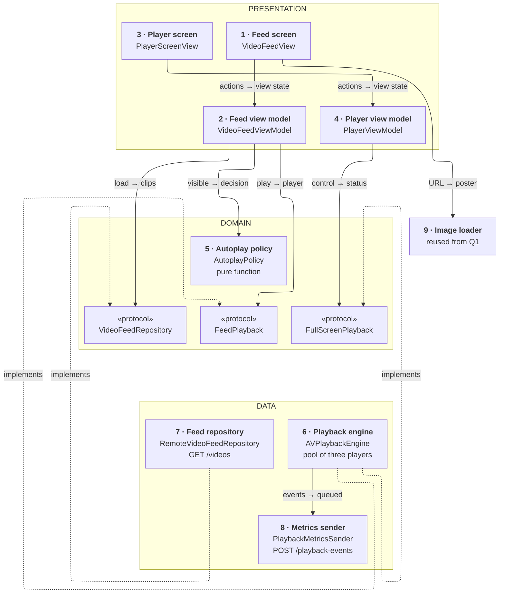
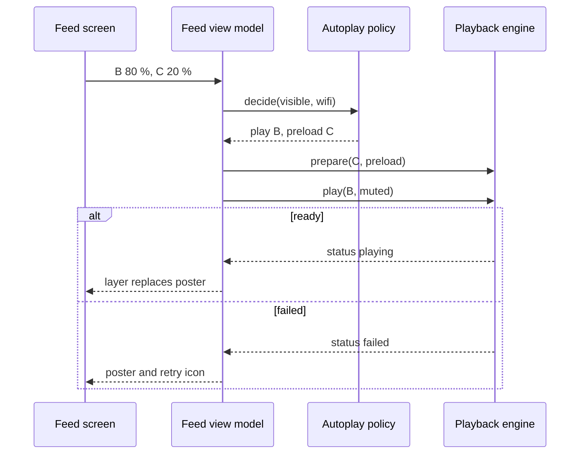
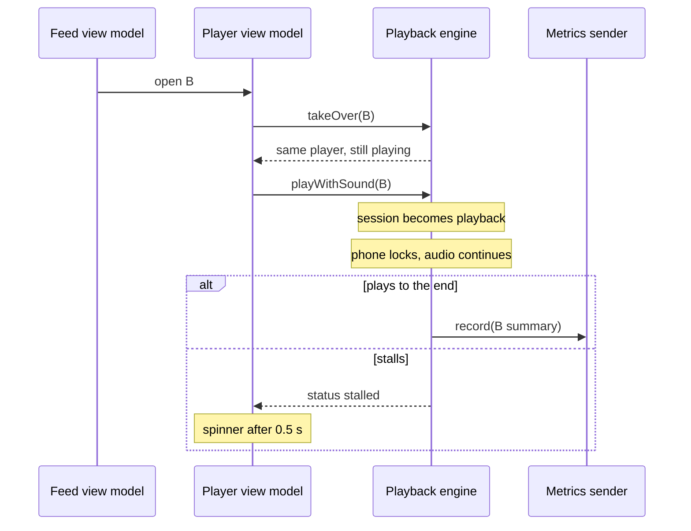

*A common prompt at any app with video. The answer stays small: the system already streams and adapts; you decide how many players exist, which one plays, how it sounds, and what you measure.*

> **Interviewer:** "Design a video player screen for our app. We have a feed of short videos, and tapping one opens a full-screen player."

**Cold run: don't read about this topic beforehand. Run it, then open the answer.**

## Run it as a round, not as reading

Set a timer. Sketch. Talk the whole time. Open a section only when its slot is over.

| Clock | Phase | What you do |
|---|---|---|
| 0:00–0:02 | The prompt | Repeat it back in one sentence |
| 0:02–0:07 | Clarify | Ask yours, then read section 1 |
| 0:07–0:12 | Scope | Out of scope first, then required, then later |
| 0:12–0:24 | High level | The idea · the parts · the sketch · one line each · two flows |
| 0:24–0:40 | Deep dives | The interviewer picks one of sections 9–11 |
| 0:40–0:45 | Recap | Follow-ups, then the 60-second summary |

## What this question is really testing

- **A small pool of players**, not one per row. Memory and decoders are the limit.
- **Knowing what the system does for you:** HLS adapts the bitrate; you only cap it.
- **Autoplay and sound rules**, and the audio session that makes them polite.
- **One player that moves** from the feed to full screen, Picture in Picture and the lock screen.
- **Measuring playback:** startup time and rebuffering.

**Traps:** an `AVPlayer` per cell; downloading MP4s yourself; `.playback` audio for muted autoplay, which stops the user's music; reusing a failed `AVPlayerItem`; a black frame before the first frame.

::: Words used in this chapter
- **Repository** — the one owner of one kind of data. It turns the server's format into the app's model.
- **Composite** — a repository that only reads: it asks two repositories and combines their answers into one model.
- **Store** — in-memory state that several screens show at once. Not needed here yet.
- **Use case** — one user intent with a product rule, like "only the latest tap counts".
- **View model** — the screen's brain. It owns the screen's state and hands the screen one view state.
- **HLS** — video cut into short segments at several qualities, listed in a playlist.
- **Adaptive bitrate** — the player switches quality as the network changes.
- **Player, item** — `AVPlayer` plays; `AVPlayerItem` is one video's state inside it.
- **Pool** — a few players that rows borrow and give back.
- **Audio session** — how the app's sound mixes with other apps and the silent switch.
- **Stall, rebuffer ratio** — playback waiting for data; the share of watch time spent waiting.
- **Picture in Picture (PiP)** — the video keeps playing in a small window over other apps.
:::

::: 1 · The interviewer answers your clarifying questions
**"What are the videos?"** → *Short clips, 15 to 60 seconds, vertical or square. Each has a caption and a poster image.*

**"How are they served?"** → *HLS from our CDN, with several qualities.*

**"Autoplay?"** → *In the feed, the clip you're looking at plays muted. Sound only when the user taps unmute or opens full screen.*

**"Full screen?"** → *Sound, controls, scrubbing, Picture in Picture. Audio keeps going when the phone locks.*

**"Data and cellular?"** → *A setting: autoplay always, on Wi-Fi only, or never. Respect Low Data Mode.*

**"Live streams? DRM? Offline?"** → *No live, no DRM. Downloads maybe later.*

**"What do we measure?"** → *We want startup time and rebuffering, to judge the CDN.*

**"Minimum OS?"** → *iOS 17, SwiftUI, Swift 6.*

**"What hurts today?"** → *Crashes after long scrolling, a black flash before playback, and the app stopping people's music.*
:::

::: 2 · Requirements and scope — what you should have said
**Out of scope, said first:** recording and upload, likes and comments (question 2), live, DRM, ads, ranking. Posters come from question 1's image loader; feed paging works as in question 2.

**Required for the prompt**

1. The feed autoplays the most visible clip, muted, and pauses the rest.
2. Tapping opens full screen: the same clip continues with sound, controls, PiP and background audio.
3. Stalls and errors are shown and recovered; startup time and rebuffering are measured.

**What must feel good:** first frame in under a second on Wi-Fi · no black flash · smooth scroll with bounded memory · never interrupts music uninvited.

**Production considerations** (say, don't draw): CDN cache headers, captions from the HLS playlist, metrics. See section 12.

**Optional follow-ups** (add only when asked):

```text
Offline viewing          → AVAssetDownloadURLSession, a downloads repository
Watch position resumes   → a position repository
Live streams             → low-latency HLS, a different buffer
Many screens play video  → the same engine, more callers
```

*"I'll add each of these when the requirement appears."*
:::

::: 3 · The idea, in 30 seconds — before you draw anything
> *"A feed repository calls `GET /videos` for pages of clips, each with an HLS URL, a poster and its size. A playback engine owns a pool of three players: the one playing, the next one buffering, and a spare. Rows borrow a player and give it back. An autoplay policy decides, from what's on screen, the network and the user's setting, which clip plays and which preloads. Tapping hands the same player to the full-screen screen, so playback continues without a black frame. The engine measures startup and stalls, and a metrics sender batches them to `POST /playback-events`."*
:::

::: 4 · What we need — the components, before the sketch
| # | Part | Type | Layer | Its one job |
|---|---|---|---|---|
| 1 | **Feed screen** | `VideoFeedView` | Presentation | Rows with poster and video layer. |
| 2 | **Feed view model** | `VideoFeedViewModel` | Presentation | Clips, visibility, which row plays. |
| 3 | **Player screen** | `PlayerScreenView` | Presentation | Full screen, system controls, PiP. |
| 4 | **Player view model** | `PlayerViewModel` | Presentation | Status, errors, retry, mute. |
| 5 | **Autoplay policy** | `AutoplayPolicy` | Domain | Which clip plays, which preloads. |
| 6 | **Playback engine** | `AVPlaybackEngine` | Data | The player pool, audio, metrics. |
| 7 | **Feed repository** | `RemoteVideoFeedRepository` | Data | `GET /videos` → clips. |
| 8 | **Metrics sender** | `PlaybackMetricsSender` | Data | `POST /playback-events`, batched. |
| 9 | **Image loader** | reused from Q1 | Reused | Poster images. |
| chip | **Feed playback** | `FeedPlayback` | Domain | What card 2 needs from card 6. |
| chip | **Full-screen playback** | `FullScreenPlayback` | Domain | What card 4 needs from card 6. |
| chip | **Video feed repository** | `VideoFeedRepository` | Domain | The promise card 7 keeps. |

Nine cards, three chips. `Video` isn't a card; it's written on card 7.

**No use case:** loading has no rule, the autoplay rule is pure so it's a policy, and play and pause go straight to the engine.

**Not drawn:** the `HTTPClient` cards 7 and 8 share, and a `NetworkMonitor` (protocol `NetworkStatus`) over `NWPathMonitor` that gives card 2 Wi-Fi, cellular or Low Data Mode. **Not on the list yet:** everything under "optional follow-ups".
:::

::: 5 · The sketch


**How to read it.** A solid arrow points from the asker to the answerer: *request → reply*. Dashed arrows mean *implements*; the grey card is reused from question 1.

**Dependency inversion, in one line.** The domain writes the three promises (the chips); cards 6 and 7 keep them, so the dashed arrows point **up**. The one AVFoundation type that crosses is `AVPlayer` itself, because a layer must draw it; the view models only pass it to the view.

**One class, two promises.** The feed and the full-screen player need different halves of the engine, so it keeps two narrow protocols.

**Shared state, but no store:** both screens show the same playback, and the engine owns it, because that state *is* the `AVPlayer`. A store that copied position and status would drift from it.

**On Miro:** three frames, nine cards, three chips, nine solid arrows. Point at card 6: *"three players, however far you scroll."*
:::

::: 6 · Each component: its job, its interface, the choice inside it
**The model everyone shares.** The screen never sees a DTO.

```swift
struct Video: Identifiable, Hashable, Sendable {
    let id: VideoID
    let caption: String
    /// The HLS playlist on the CDN
    let stream: URL
    let poster: URL
    /// So the row has its size before anything loads
    let width: Int
    let height: Int
    let duration: Duration
}

enum PlaybackStatus: Equatable, Sendable {
    case loading
    case playing
    /// Waiting for data after it started
    case stalled
    case paused
    case ended
    case failed(PlaybackError)
}
```

### 1 · Feed screen (`VideoFeedView`)

**Job:** draws each row as a poster with a video layer over it, and reports how much of each row is on screen. It decides nothing.

**Interface:** reads `viewModel.viewState`; calls `onAppear()`, `visibilityChanged(_:)`, `rowTapped(_:)`, `toggleMute()`.

**Choices:**

- **The poster stays until the first frame.** The layer shows only when `AVPlayerLayer.isReadyForDisplay` is true. That's the black-flash fix.
- **A tiny `UIViewRepresentable`** hosts the `AVPlayerLayer`. A layer per row is cheap; a player per row is not.

### 2 · Feed view model (`VideoFeedViewModel`)

**Job:** loads pages of clips, feeds visibility to the policy, and tells the engine which clip plays and which preloads.

```swift
struct VideoFeedViewState: Equatable {
    let rows: [VideoRow]
    let initialLoad: LoadState
    let pagination: PaginationState
    let isMuted: Bool
}

struct VideoRow: Equatable, Identifiable {
    let id: VideoID
    let caption: String
    let posterURL: URL
    let aspectRatio: Double
    /// Set only on rows that hold a player right now
    let player: AVPlayer?
    /// loading, playing, stalled, failed: the overlay
    let status: PlaybackStatus?
}

@MainActor @Observable
final class VideoFeedViewModel {
    init(feed: VideoFeedRepository, playback: FeedPlayback,
         network: NetworkStatus, settings: AutoplaySettings)

    var viewState: VideoFeedViewState { get }

    func onAppear() async
    /// Fraction of each row on screen, after scrolling settles
    func visibilityChanged(_ fractions: [VideoID: Double])
    func rowTapped(_ id: VideoID)
    func toggleMute()
}
```

**Choices:**

- **Paging as in question 2:** cursor, load once, a stale-result guard by generation.
- **It asks the policy, then the engine.** It holds no AVFoundation logic; `player` is only passed through to the row.
- **Mute is a screen choice:** muted by default; unmute holds for this session.

### 3 · Player screen (`PlayerScreenView`)

**Job:** shows the clip full screen with the system controls, and hosts PiP.

**Interface:** reads `viewModel.viewState`; calls `onAppear()`, `onDisappear()`, `retry()`.

**Choice:** wrap `AVPlayerViewController`. It brings controls, scrubbing, captions, AirPlay, PiP and the lock-screen controls. SwiftUI's `VideoPlayer` is simpler but gives less PiP control; custom controls cost months and accessibility work. *Switch* only if the design truly needs bespoke controls, then use `AVPictureInPictureController`.

### 4 · Player view model (`PlayerViewModel`)

**Job:** takes the clip's player from the engine, plays it with sound, and turns status into overlays and messages.

```swift
struct PlayerViewState: Equatable {
    let player: AVPlayer?
    /// nil, "Loading", or "Can't play this video" with retry
    let overlay: PlayerOverlay?
}

@MainActor @Observable
final class PlayerViewModel {
    init(video: Video, playback: FullScreenPlayback)

    var viewState: PlayerViewState { get }

    func onAppear() async
    func onDisappear()
    func retry()
}
```

**Choice:** a stall shows a spinner only after half a second, so a short wait doesn't flicker.

### 5 · Autoplay policy (`AutoplayPolicy`)

**Job:** decides, as a pure function, which clip plays and which ones preload.

```swift
struct AutoplayInput: Equatable, Sendable {
    /// Each row's share on screen, in feed order
    let visible: [RowVisibility]
    /// wifi, cellular, or constrained (Low Data Mode)
    let network: NetworkKind
    /// always, wifiOnly, never
    let setting: AutoplaySetting
    /// UIAccessibility.isVideoAutoplayEnabled
    let systemAllowsAutoplay: Bool
}

struct AutoplayDecision: Equatable, Sendable {
    let play: VideoID?
    let preload: [VideoID]
}

enum AutoplayPolicy {
    static func decide(_ input: AutoplayInput) -> AutoplayDecision
}
```

**Choices:**

- **The rule:** the most visible clip above 60 % plays, muted. None plays in Low Data Mode, on cellular with "Wi-Fi only", with "never", or when the system's Auto-Play Video Previews is off. The next clip below preloads unless the network is constrained.
- **Pure, so no protocol and no fake:** tests call it with inputs.

### 6 · Playback engine (`AVPlaybackEngine`)

**Job:** owns three players, lends them to clips, configures each item for the network, runs the audio session, and measures each play.

```swift
/// Domain: what the feed needs
@MainActor
protocol FeedPlayback: AnyObject {
    /// Lends a pooled player and starts buffering this clip.
    /// role: .playing, or .preload with a short buffer.
    /// Takes back the least useful player if all three are lent.
    func prepare(_ video: Video, as role: PlaybackRole) -> AVPlayer
    func play(_ id: VideoID, muted: Bool)
    func pause(_ id: VideoID)
    /// Returns the player to the pool
    func release(_ id: VideoID)
    /// Replays the current status on subscribe. One stream per caller,
    /// finishes when the caller's task is cancelled. Never throws:
    /// failure is a status.
    func status(of id: VideoID) -> AsyncStream<PlaybackStatus>
}

/// Domain: what the full-screen player needs
@MainActor
protocol FullScreenPlayback: AnyObject {
    /// The clip's current player if lent, so playback continues
    func takeOver(_ video: Video) -> AVPlayer
    /// Sound on: switches the audio session to playback
    func playWithSound(_ id: VideoID)
    /// A new item; a failed one can't be reused
    func retry(_ id: VideoID)
    func status(of id: VideoID) -> AsyncStream<PlaybackStatus>
}

@MainActor
final class AVPlaybackEngine: FeedPlayback, FullScreenPlayback {
    init(audio: AudioSession, metrics: PlaybackMetrics, poolSize: Int)
}
```

**Choices:**

- **`@MainActor`**, because players and their layers are driven from the main thread. Cheap calls only; AVFoundation does the heavy work on its own threads.
- **Each pooled player is an `AVQueuePlayer`,** so `AVPlayerLooper` can loop a short clip without a gap. Lending swaps the item with `replaceCurrentItem(with:)`.
- **Status via async APIs:** `load(.isPlayable, .duration)` on the asset, `timeControlStatus` and the item's `status` observed into the stream, `playbackStalledNotification` read with `notifications(named:)`. Time comes from `addPeriodicTimeObserver`, only while full screen shows it.
- **It owns `AVAudioSession`** through a thin `AudioSession` wrapper (section 11).

### 7 · Feed repository (`RemoteVideoFeedRepository`)

**Job:** fetches `GET /videos` and maps each DTO to a `Video`.

```swift
protocol VideoFeedRepository: Sendable {
    /// Clips in display order, and the next cursor (nil at the end).
    /// Throws on failure. Cancelling the caller cancels the request.
    func videos(after cursor: Cursor?) async throws -> VideoPage
}
```

**Choice:** a thin adapter, as in question 2. The stream URL passes through untouched; AVFoundation fetches it.

### 8 · Metrics sender (`PlaybackMetricsSender`)

**Job:** queues one summary per play and sends them in batches.

```swift
/// Data-internal: what the engine needs
protocol PlaybackMetrics: Sendable {
    /// Never throws, never blocks: queued in memory
    func record(_ summary: PlaybackSummary)
}

actor PlaybackMetricsSender: PlaybackMetrics {
    init(http: HTTPClient)
    /// Flushes every 30 s and when the app goes to the background
    func start()
    func stop()
}
```

**Choice:** best effort. At most 500 summaries in memory, oldest dropped first; no clip titles, only IDs.

### 9 · Image loader (reused from question 1)

**Job:** gives each row its poster at the row's size. **Choice:** reused, not redesigned.

**Why these parts, and no more.** Each card changes for one reason:

| Card | Changes when |
|---|---|
| 1 · Feed screen | the screen's design |
| 2 · Feed view model | the screen's behaviour |
| 3 · Player screen | the screen's design |
| 4 · Player view model | the screen's behaviour |
| 5 · Autoplay policy | a product rule (when clips play) |
| 6 · Playback engine | a platform API (AVFoundation) |
| 7 · Feed repository | an endpoint or payload (`/videos`) |
| 8 · Metrics sender | an endpoint or payload (`/playback-events`) |

Not added: a use case (no rule with a write), a store (the engine owns the shared state), our own downloader (HLS is the system's job), a protocol for the view models.
:::

::: 7 · Key flows through the sketch
**Flow 1 — scrolling stops on a clip.**



**Flow 2 — tap, full screen, then lock the phone.**


:::

::: 8 · The server contract
```
GET  /v1/videos?cursor={opaque}&limit=10
     → { "items": [ { "id", "caption", "durationMs",
                      "width", "height",
                      "stream": "https://cdn…/v1/master.m3u8",
                      "poster": "https://cdn…/v1.jpg" } ],
         "nextCursor": "…" }            // null at the end

POST /v1/playback-events
     { "events": [ { "videoId", "startupMs", "stalls",
                     "stalledMs", "watchedMs", "avgBitrate",
                     "error": null } ] }
     → 202
```

- **Width, height and a poster in each clip**, so rows are sized and drawn before any video loads.
- **The stream is an HLS master playlist** with a low variant (about 400 kbps) and an I-frame playlist for scrubbing. The CDN serves it; it's shared, so it caches hard. The feed is personal and doesn't.
- **Metrics in batches, accepted with 202.** Losing a few is fine; they never block playback.
:::

::: 9 · Deep dive — "Users scroll for ten minutes and the app gets killed."
**Decision:** a fixed pool of three players, whatever the scroll depth. Each player with a loaded item holds buffered segments and decoded frames, and the hardware decoder has a limited number of sessions.

1. **Lend on decision, not on appear.** Only the playing clip and the next one hold a player. Every other row is a poster.
2. **Take back the least useful.** When a fourth clip needs one, the engine reclaims the player furthest from the playing row, removes its item and detaches its layer.
3. **Preload small.** The next clip's item gets `preferredForwardBufferDuration` of a few seconds, enough for an instant start, not a full download.
4. **Shrink on pressure.** A memory warning keeps only the playing player; background pauses all and drops the preload.

**Reusing rows.** A recycled row's layer gets `player = nil` and shows its poster until its own player is ready, so a row never shows another clip's frame.

**Rejected: a player per cell.** Memory grows with scroll depth, decoders run out, and creating players during a fling causes hitches.

**Rejected: one player for everything.** The next clip can't buffer while the current one plays, so every swipe waits.
:::

::: 10 · Deep dive — "It starts slowly and stalls on the train."
**Decision:** let HLS adapt; cap it to what the screen needs, and measure.

1. **The system picks the variant** as the bandwidth changes. We set limits: in the feed, `preferredMaximumResolution` at the row's pixel size and a `preferredPeakBitRate` around 2 Mbps; full screen lifts both.
2. **Cellular** (`NWPath.isExpensive`): `preferredPeakBitRateForExpensiveNetworks` caps it lower. **Low Data Mode** (`NWPath.isConstrained`): no autoplay, no preload, play on tap at the lowest cap.
3. **Stalls:** `automaticallyWaitsToMinimizeStalling` stays on. `timeControlStatus` goes to waiting with reason `toMinimizeStalls`; the view shows a spinner after 0.5 s.
4. **Errors:** a failed item can't be reused. Retry makes a new `AVPlayerItem` from the same asset URL. After two failures, "Can't play this video".

**Measuring, per play:**

- **Startup time:** from `play()` to the first `.playing` status. The access log's `startupTime` cross-checks it.
- **Rebuffer ratio:** time in the waiting state after the first frame, divided by time watched.
- **Also:** stall count, average indicated bitrate (`AVPlayerItemAccessLogEvent`), error domain and code.

The engine builds one `PlaybackSummary` when a clip is released, and card 8 sends it later.

*Rejected:* our own segment downloader and bitrate logic. AVFoundation already adapts, buffers and caches; rewriting it is a team-year.
:::

::: 11 · Deep dive — "They tap a clip, unmute, then lock the phone."
**Decision:** one player moves between screens, and the audio session follows the user's intent.

**The handoff:**

1. The feed view model opens the player screen with the clip.
2. `takeOver` returns the **same** player, so there's no reload and no black frame.
3. The engine pins it: the pool can't reclaim a player that full screen or PiP holds.
4. Closing the screen returns it to the feed, still playing, muted again.

**Audio session:**

- **Muted autoplay → `.ambient`.** It mixes with the user's music and respects the silent switch.
- **Sound on → `.playback`** with mode `.moviePlayback`, activated only at that moment. That's what stops their music, and only when they asked for sound.
- **Background audio and PiP** need `.playback` and the background mode for audio, AirPlay and PiP. `AVPlayerViewController` keeps audio going when the phone locks; with a bare layer, detach the player from it in the background.
- **Interruptions** (a call): pause on `interruptionNotification`, resume only if the system says it should.

**Picture in Picture:** `AVPlayerViewController` with `canStartPictureInPictureAutomaticallyFromInline` starts PiP when the user leaves the app. Its delegate restores the screen when they tap back in.
:::

::: 12 · Failure modes, production and scale
**Failures**

| Failure | Client behaviour |
|---|---|
| Feed page fails | As in question 2: error or retry row |
| Clip fails to load | Poster with a retry icon; a new item on retry |
| Stall | Spinner after 0.5 s; the system picks a lower variant |
| Low Data Mode | Posters only; play on tap, lowest quality |
| Memory warning | Keep only the playing player |
| Call comes in | Pause; resume if the system allows |
| Headphones unplugged | Pause (route change) |
| Metrics can't send | Keep up to 500, drop the oldest |

**Production notes** (short, not on the board)

- **Networking:** the CDN's cache headers decide segment freshness; feed calls with timeouts and safe retries.
- **Accessibility:** captions come from the HLS playlist and show in the system player; respect Auto-Play Video Previews.
- **Metrics:** startup time p50 and p95, rebuffer ratio, failure rate by error code, memory at the end of a session, all by CDN region.

**Scale, back of the envelope**

```text
clips watched a session × seconds watched × bitrate = data a session
40 clips × 20 s × 2 Mbps ≈ 200 MB on Wi-Fi
40 clips × 20 s × 0.8 Mbps ≈ 80 MB on capped cellular
```

The bitrate cap moves the cost; the client architecture doesn't change.

**Grow only when asked**

```text
One feed and one player   → the engine owns the shared playback
Offline viewing           → AVAssetDownloadURLSession, a downloads repository
Resume where you left     → a position repository, saved on release
Live streams              → low-latency HLS, a different buffer setting
```
:::

::: 13 · Question bank — everything they can push on
Answer out loud first, then open.

### Scope and architecture

<details>
<summary>"Walk me through the layers."</summary>

Presentation: two screens and their view models. Domain: `Video`, three protocols and the autoplay policy. Data: the playback engine, the feed repository, the metrics sender.
</details>

<details>
<summary>"Why no use case?"</summary>

Loading has no rule, and the autoplay rule is a pure function, so it's a policy. Play and pause are commands with nothing to decide.
</details>

<details>
<summary>"Show me dependency inversion."</summary>

The feed, feed-playback and full-screen protocols live in the domain; the repository and the engine keep them. A fake engine makes the view models testable without video.
</details>

<details>
<summary>"Where does mapping happen?"</summary>

In the feed repository, DTO to `Video`. The engine maps AVFoundation states to `PlaybackStatus`.
</details>

<details>
<summary>"Where does shared state come from?"</summary>

The engine: both screens show the same player. A store would copy what the player already holds, and drift.
</details>

<details>
<summary>"Why does the engine have two protocols?"</summary>

The feed lends and releases; full screen takes over and adds sound. Each fake needs only its half.
</details>

### Players, pool and memory

<details>
<summary>"Why not one AVPlayer per cell?"</summary>

Memory and decoder sessions grow with scroll depth, and creating players mid-fling hitches. Three pooled players cover playing, next and spare.
</details>

<details>
<summary>"How do you avoid the black flash?"</summary>

The poster stays until `isReadyForDisplay` is true, then the layer shows.
</details>

<details>
<summary>"Why AVQueuePlayer?"</summary>

`AVPlayerLooper` needs it to loop a short clip without a gap. It also lets full screen queue the next clip.
</details>

<details>
<summary>"How does preloading work?"</summary>

The next clip gets a pooled player and an item with a short forward buffer. It's an optimization; a clip without one still starts, just slower.
</details>

<details>
<summary>Follow-up chain: "Memory."</summary>

1. *"Memory grows while scrolling."* → Check that released players lose their items and layers.
2. *"A memory warning arrives."* → Keep only the playing player.
3. *"Still killed."* → Instruments' Allocations and the memory graph; look for leaked observers holding items.
4. *"What's bounded?"* → Players and buffers. Total app memory isn't, so measure it.
</details>

### Streaming and errors

<details>
<summary>"Who decides the quality?"</summary>

The system's adaptive bitrate. We cap peak bitrate and resolution to the row, and lower on cellular.
</details>

<details>
<summary>"What does preferredForwardBufferDuration do?"</summary>

It asks how many seconds ahead to buffer. Short for preloads to save data; the system's default while playing.
</details>

<details>
<summary>"A clip fails. Retry?"</summary>

With a new `AVPlayerItem`, since a failed one can't recover. Twice, then a message.
</details>

<details>
<summary>"How do you detect a stall?"</summary>

`timeControlStatus` waiting with reason `toMinimizeStalls`, plus the stalled notification. A spinner after half a second.
</details>

<details>
<summary>"Low Data Mode is on."</summary>

`NWPath.isConstrained`: no autoplay or preload; tap plays at the lowest cap.
</details>

### Audio, background and PiP

<details>
<summary>"Muted autoplay stops my music. Why?"</summary>

The session was `.playback`. Muted autoplay uses `.ambient`, which mixes; `.playback` only when the user asks for sound.
</details>

<details>
<summary>"How does audio continue when the phone locks?"</summary>

`.playback` plus the audio background mode. The system player keeps it going; a bare layer must be detached from the player.
</details>

<details>
<summary>"How does PiP work here?"</summary>

`AVPlayerViewController` starts it automatically when the user leaves. The engine pins that player so the pool can't take it.
</details>

<details>
<summary>"A phone call arrives."</summary>

Pause on the interruption; resume only if the system says so.
</details>

<details>
<summary>Follow-up chain: "Full screen and back."</summary>

1. *"User taps a clip."* → Full screen takes over the same player.
2. *"Why not a new player?"* → Reload, black frame, lost position.
3. *"User closes full screen."* → The player returns to the feed, muted.
4. *"PiP is still open."* → The player stays pinned until PiP closes.
</details>

### Production and change

<details>
<summary>"What do you measure?"</summary>

Startup time, rebuffer ratio, stall count, bitrate and errors per play, sent in batches.
</details>

<details>
<summary>"How do you test autoplay?"</summary>

The policy directly with inputs. The feed view model with a fake `FeedPlayback`: scroll to B, expect `play(B, muted)` and `prepare(C)`.
</details>

<details>
<summary>"Add offline downloads."</summary>

`AVAssetDownloadURLSession` with a background session, a downloads repository that owns the files, and the engine plays the local asset when there is one.
</details>

<details>
<summary>Follow-up chain: "Two weeks instead of six."</summary>

1. *"What do you cut?"* → Preloading, PiP, Low Data tuning.
2. *"What can't you cut?"* → The pool, the poster-until-ready, the audio session rules.
3. *"Risk?"* → Slower starts. Fixable next release.
</details>
:::

::: 14 · Scorecard — mark yourself, 0 / 1 / 2
| | Did you… | 0–2 |
|---|---|---|
| 1 | Talk the whole time, and listen when interrupted | |
| 2 | Clarify before designing | |
| 3 | Give a trade-off for each choice | |
| 4 | Say out of scope first; separate required from later | |
| 5 | Say the idea, list the parts, then sketch | |
| 6 | Keep the sketch to nine type cards, one line each | |
| 7 | Name the endpoints: `GET /videos`, `POST /playback-events` | |
| 8 | Pool a few players instead of one per cell | |
| 9 | Let HLS adapt, and cap bitrate and resolution | |
| 10 | Keep the poster until the first frame | |
| 11 | Use `.ambient` for muted autoplay, `.playback` for sound | |
| 12 | Hand the same player to full screen and PiP | |
| 13 | Measure startup time and rebuffer ratio | |
| 14 | Land the recap inside 60 seconds | |

14+ is a pass.<!--private--> Anything scored 0 goes in the progress log and comes back as a recall prompt.<!--/private--><!--public--> A zero names the thing to read about next.<!--/public-->
:::

::: 15 · The 60-second recap
The feed comes from `GET /videos` with an HLS URL, a poster and a size per clip, so rows are drawn before any video loads. A playback engine owns three pooled players: the clip playing, the next one buffering a few seconds, and a spare, so memory doesn't grow with scrolling. A pure autoplay policy picks the most visible clip, respecting the network, Low Data Mode and the user's setting; it plays muted under the `.ambient` session, so music keeps going. Tapping hands the same player to full screen, which switches to `.playback`, and gets controls, PiP and background audio from `AVPlayerViewController`. HLS adapts the quality and we only cap it; stalls show after half a second, failed items are replaced, and startup time and rebuffer ratio go in batches to `POST /playback-events`.
:::
